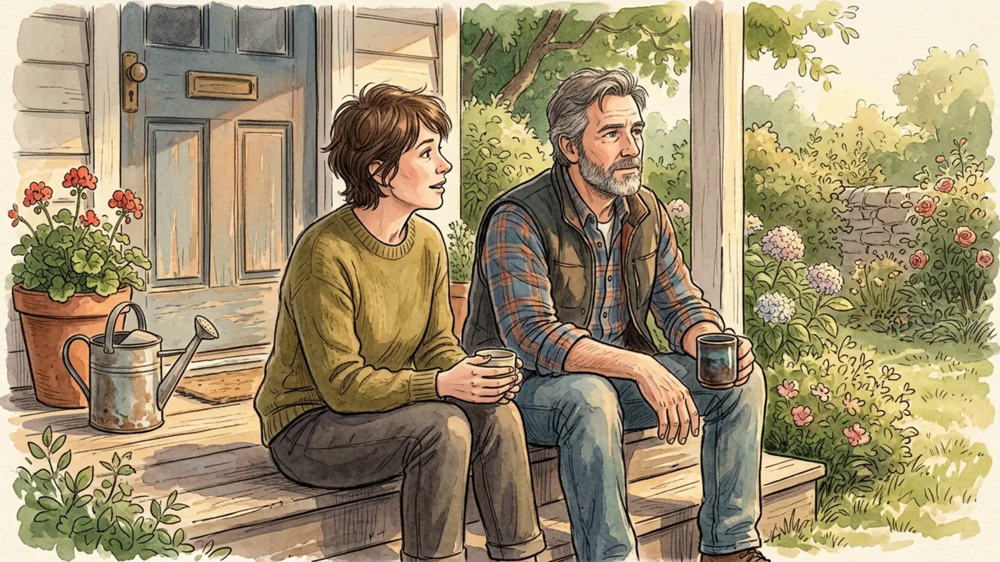
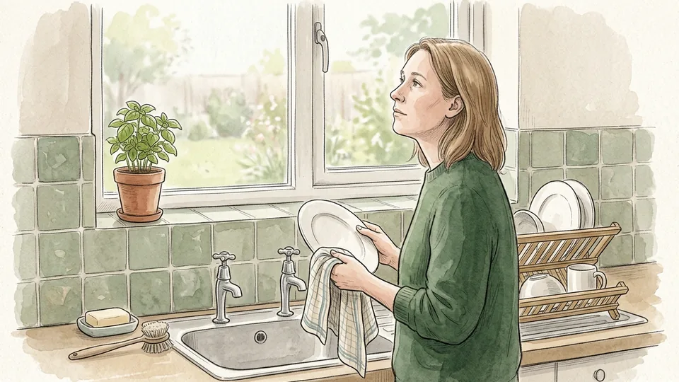
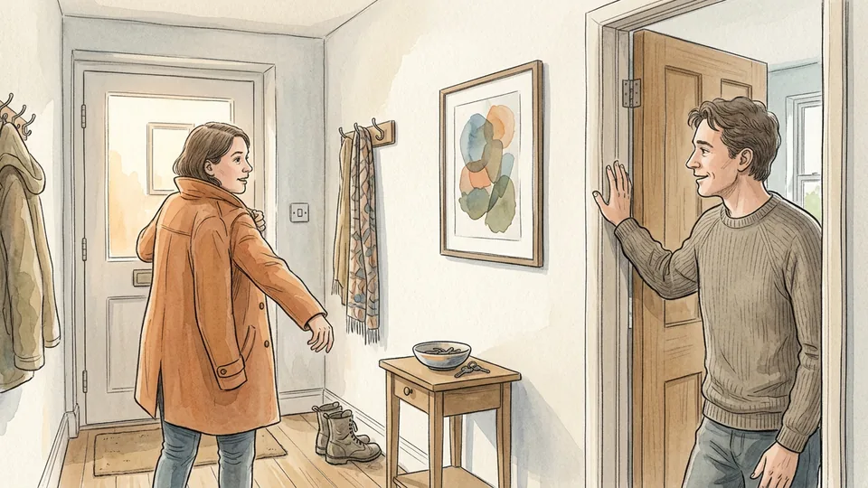
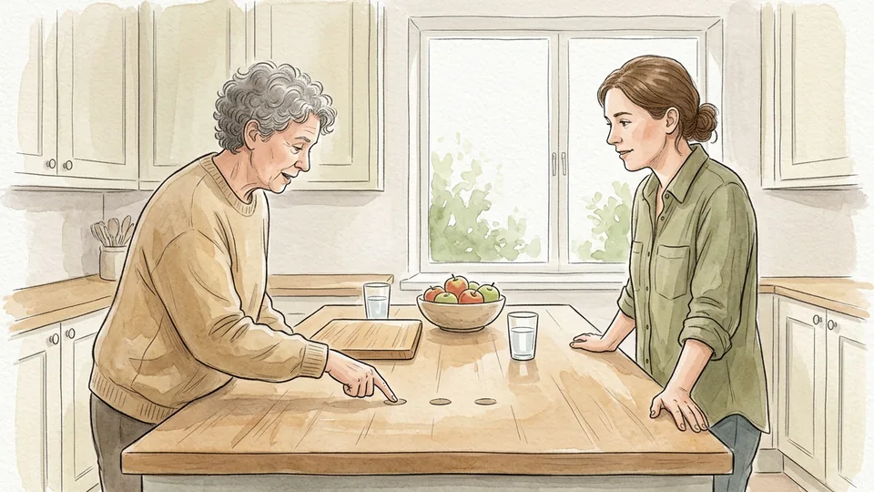
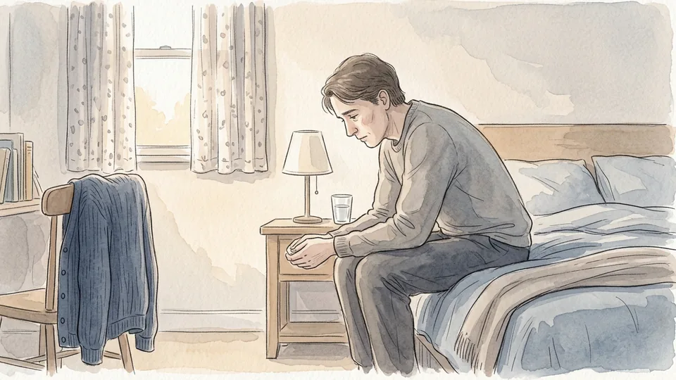
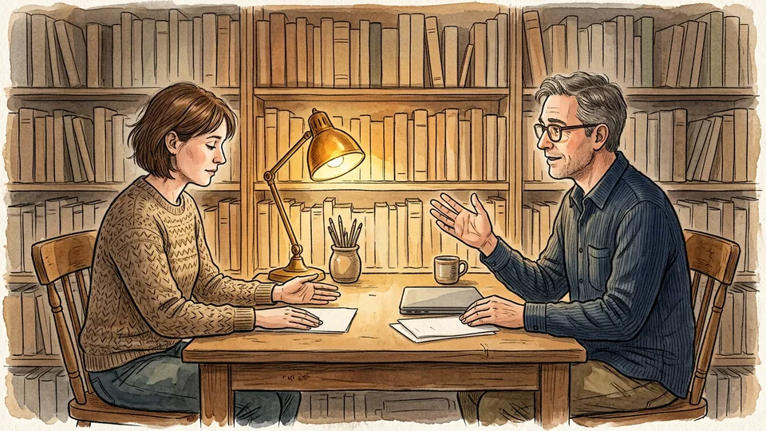
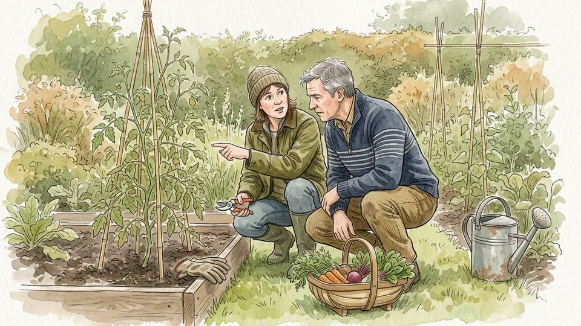
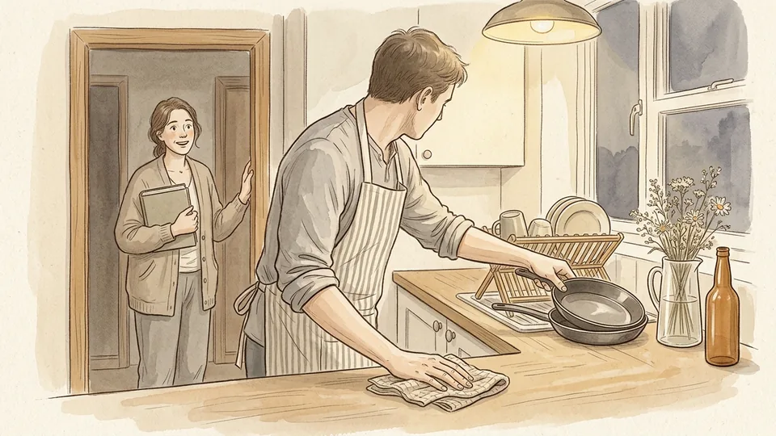

# How to Ask for Feedback in a Relationship

*Ask a question small enough to answer honestly, make it safe to say the true thing, and take the answer without making the other person regret giving it.*

**Category:** Relationships

**Slug:** `/Ask-for-Feedback-in-a-Relationship`

**Primary keyword:** ask for feedback in a relationship

**Meta description:** Ask for feedback in a relationship: a small answerable question, the right moment, situation-behaviour-impact, and how to take the answer without defensiveness.

---

## Intro

Asking the people closest to you how you are doing is harder than it sounds, mostly because of how we ask. Relationship researcher Harry Reis points out that the obvious opener — I don't think you love me enough — is almost guaranteed to produce a backlash, because it asks for a verdict rather than information. The alternative is a smaller, more answerable question, delivered at a moment that is not already tense, and received in a way that does not punish honesty. This guide takes one request for feedback from partner, friend, relative or colleague through fifteen steps: deciding what you actually want to know, asking for situation, behaviour and impact rather than a character rating, listening in a way that lowers defensiveness, and turning what you hear into one small experiment instead of a vague promise to do better.

## Part 1 of 3 — Ask a Question That Can Be Answered

### Step 1 — Decide what you actually want to know

There is a difference between wanting reassurance, wanting advice and wanting a verdict. All three are legitimate, but they need different questions, and mixing them is why so many of these conversations go sideways. Be honest with yourself first: if what you want tonight is comfort, ask for comfort. If you want to get better at something, ask for coaching and be ready to hear it.

**Tip:** Write the question down before you say it. If you cannot finish the sentence on paper, it is not ready to be asked out loud.

### Step 2 — Make the question small

How am I doing as a partner is too large to answer, so most people answer it with fine. Shrink it until it fits one situation: how was I to live with during the move, or did I talk over you at dinner on Friday. A narrow question gives the other person something specific to describe, and specific answers are the only ones you can act on.

**Tip:** One question, one timeframe, one setting. If your question needs the word generally, it is still too big.

### Step 3 — Avoid the question that cannot be answered

Do you even care about me puts the other person on trial, and the predictable response is defence rather than information. Replace the accusation with an observation and a request: when I got back from the hospital appointment you carried on with the washing up, and I would like to know how that looked from your side.

**Tip:** If the only honest answers to your question are yes, no or how dare you, rewrite it before you use it.

### Step 4 — Pick a moment that is not already tense

Do not ask in the twenty minutes after an argument, at midnight, or while one of you is halfway out of the door. Side by side beats face to face for most people: walking, driving, washing up and gardening all make honesty easier, because nobody has to hold eye contact while they say a difficult thing.

**Tip:** Hungry, tired, late or drunk are four reasons to postpone. None of them improves anybody's phrasing.

### Step 5 — Tell them it is coming

Springing a serious question on someone forces them to improvise, and improvised answers are either softened or sharper than the truth. Give notice: I want to ask you something about how I have been lately, nothing dramatic, can we talk after supper. Then say the part that matters most — that you want the real answer, not the kind one.

**Tip:** Say what you will not do with the answer: I am not going to argue with it, I just want to hear it.

## Part 2 of 3 — Make Honesty Easy

### Step 6 — Ask for situation, behaviour and impact

The Center for Creative Leadership teaches feedback in three parts: the situation, the observable behaviour, and the impact it had. Ask for all three. Rather than was I difficult last week, try: think of one moment last week, tell me what I did, and tell me what it was like for you. You are asking for a description, not a diagnosis.

**Tip:** Character words — selfish, lazy, cold — are a sign the description has been skipped. Ask gently: what did I actually do?

### Step 7 — Ask for one thing, not a list

A general invitation to criticise produces either nothing or everything, and both are hard to use. Ask for a single item: what is one thing I do, or fail to do, that makes your week harder. One item is small enough that the other person does not feel cruel saying it, and small enough that you can actually change it.

**Tip:** If they offer several, pick the one that recurs and park the rest. You can always ask again next month.

### Step 8 — Listen to learn, not to reply

Reis describes a listen to learn mindset: attend to the other person as though there were a quiz tomorrow, rather than assembling your reply while they speak. It is harder than it sounds. Most of us rate ourselves as good listeners, and the people talking to us rate us considerably lower.

**Tip:** The silence after their sentence is the useful part. Count two seconds before you speak and you will interrupt far less.

### Step 9 — Keep judgement off your face

High-quality listening, in Guy Itzchakov's research, means attention, empathy and the absence of judgement — and people can tell within seconds which one they are getting. Sighing, correcting a detail or looking away teaches the other person to give you the safe answer next time. Keep your hands still, your eyes available and your corrections for later.

**Tip:** Correcting a small factual error mid-flow costs you the rest of the answer. Let the date or the day of the week be wrong.

### Step 10 — Say it back in its strongest version

Before you respond, repeat what you heard in a form the other person would sign off on — not the weakened version that is easier to live with. So when I take calls at dinner you end up managing bedtime alone, and it feels like the family is my second shift. Then ask whether you have got it right, and fix it until they say yes.

**Tip:** Summarise the impact, not just the facts. People want to hear that the effect landed, not that the timeline was noted.

## Part 3 of 3 — Take the Answer Well

### Step 11 — Expect the flinch

A jolt of defensiveness when you hear something true is normal and physical; it does not mean the feedback is wrong or that you are fragile. Name it to yourself, let it pass, and keep your mouth shut while it does. Ten seconds of silence costs you nothing and saves the conversation more often than any clever phrase.

**Tip:** If the flinch wins and you snap, say so straight away: that came out defensively, let me try again.

### Step 12 — Take the impact before you explain the intent

Your intentions are usually good; the impact is what the other person actually experienced, and only they can report it. Acknowledge that first. Once it has landed, intent is still worth exploring — the Center for Creative Leadership suggests the question what were you hoping for, which works just as well in reverse when you explain where you were coming from.

**Tip:** I didn't mean it like that is true and useless on its own. Pair it with: I can see how it landed that way.

### Step 13 — Ask what would have worked better

Criticism becomes usable the moment it turns into a request. What would you have wanted me to do instead is a question most people can answer precisely, and their answer is often much smaller than the apology you were preparing. Write it down if it is practical, because the specific version fades within a day and the vague guilty feeling does not.

**Tip:** If their suggestion is impossible, say so and offer the nearest thing you can manage rather than agreeing and failing.

### Step 14 — Change one behaviour as an experiment

Reis makes a useful distinction: you are not being asked to change who you are, only how you act — and a behaviour can be trialled. Pick the single change their answer points to, run it for a fortnight, and treat it as a test rather than a vow. Experiments are easier to start, and easier to adjust when the first version does not fit.

**Tip:** Attach the new behaviour to something that already happens — after the news, before you sit down — so you do not rely on remembering.

### Step 15 — Close the loop and return the favour

Two weeks later, tell them what you changed and ask whether it made any difference. That single follow-up is what proves the first conversation was safe, and it makes the next honest answer far more likely. Then offer the same thing back: ask what they would like you to notice about them, and listen to that with the same care.

**Tip:** Thank them for the answer, not for being nice about it. Honesty is the thing you want more of.

## Tips

- Asking the same small question every few months tells you more than one big annual audit of the relationship.
- Do not ask for feedback as a trap. If you only want them to say the thing you plan to disagree with, you are starting an argument with extra steps.
- Feedback from one person is one perspective, not a verdict. Ask two or three people who see different sides of you before concluding anything.
- If someone gives you a hard answer and you handle it badly, go back within a day and repair it. The repair matters more than the original reaction.

## Warnings

- Constant criticism, name-calling, monitoring or being told that everything wrong in the relationship is your fault is not feedback. If that is the pattern, speak to a domestic abuse service or your doctor rather than trying harder to ask the right question.
- At work, keep development conversations separate from formal processes. Anything involving discrimination, harassment, safety or pay belongs with HR, a union representative or an employee assistance programme, with a written record.
- If asking how you are doing reliably ends in a crisis, or if the answers leave you feeling worthless for days, that is worth raising with a general practitioner or a counsellor rather than managing alone.

## Community Q&A

**Why does asking my partner for feedback always turn into an argument?**

Usually because the question asks for a verdict rather than information, and arrives at a bad moment. Questions like do you even care put the other person on trial, and defence is the natural reply. Try a narrow, factual version instead — one situation, one behaviour, one effect — given with notice and at a time when neither of you is tired, hungry or already annoyed. Then let the first answer stand without rebutting it.

**What if the feedback I get feels unfair?**

Separate the report from the judgement. The other person is the authority on how your behaviour landed for them, even if their explanation of why you did it is wrong. Take the impact seriously, ask for the specific moment they have in mind, and then say where your experience differs without arguing them out of theirs. If you still disagree after that, you are allowed to: you can hear feedback accurately and decide not to act on it.

**How often should couples do a check-in like this?**

Little and often beats rare and heavy. A short question every few weeks keeps the stakes low, while an annual state-of-the-relationship summit tends to arrive loaded with months of unsaid material. Pick a regular slot you both accept — a walk on Sunday, the drive back from the shops — and keep each one to a single topic. The point is to make honesty ordinary rather than ceremonial.

**How do I ask for feedback from a friend or colleague without making it awkward?**

Keep it concrete and bounded. Ask about one event and one behaviour: when I presented on Tuesday, did I leave enough room for questions? Say why you are asking and what you will do with the answer. Among friends, the same rule applies — one thing, recent, and clearly invited. Thank them plainly, act on something small, and tell them later what you changed; that is what makes the next request easy.

## Useful external resources

- [APA Speaking of Psychology, episode 381: How to feel more loved, with Harry Reis, PhD](https://www.apa.org/news/podcasts/speaking-of-psychology/feel-more-loved) — Why I don't feel loved enough backfires, and the listen-to-learn, curiosity, open-heart and self-disclosure mindsets that work better.
- [Center for Creative Leadership: Use Situation-Behavior-Impact (SBI) to understand intent](https://www.ccl.org/articles/leading-effectively-articles/closing-the-gap-between-intent-vs-impact-sbii/) — The three-part feedback description, plus the fourth step of asking about intent instead of assuming it.
- [APA Speaking of Psychology, episode 386: Why listening well is harder than you think, with Guy Itzchakov, PhD](https://www.apa.org/news/podcasts/speaking-of-psychology/deep-listening) — What separates high-quality listening from silence, and how being listened to lowers defensiveness and anxiety.

## References

1. American Psychological Association. Speaking of Psychology, episode 381: How to feel more loved, with Harry Reis, PhD, May 2026. https://www.apa.org/news/podcasts/speaking-of-psychology/feel-more-loved
2. Center for Creative Leadership. Use Situation-Behavior-Impact (SBI) to Understand Intent, published 19 August 2025. https://www.ccl.org/articles/leading-effectively-articles/closing-the-gap-between-intent-vs-impact-sbii/
3. American Psychological Association. Speaking of Psychology, episode 386: Why listening well is harder—and more powerful—than you think, with Guy Itzchakov, PhD. https://www.apa.org/news/podcasts/speaking-of-psychology/deep-listening
4. Reis, H. T., & Lyubomirsky, S. How to Feel Loved: The Five Mindsets That Get You More of What Matters Most. https://howtofeelloved.com/

## Internal links

- [How to Have a Difficult Conversation](https://www.56juqingba.com/Have-a-Difficult-Conversation)
- [How to Prepare for a Performance Review](https://www.56juqingba.com/Prepare-for-a-Performance-Review)
- [How to Split Household Chores Fairly](https://www.56juqingba.com/Split-Household-Chores-Fairly)
- [How to Build a Monthly Budget](https://www.56juqingba.com/Build-a-Monthly-Budget)
