# How to Build a Dog Walking Routine

*Turn ad-hoc dog walks into a routine that fits your week, builds your dog's fitness gradually and stays safe in heat, ice and traffic.*

**Category:** Pets and Animals

**Slug:** `/Build-a-Dog-Walking-Routine`

**Primary keyword:** how to build a dog walking routine

**Meta description:** Build a dog walking routine that lasts: vet check, harness fit, gradual fifteen-minute blocks, sniff breaks, and safe walking in heat and ice.

---

## Intro

A dog walk is rarely just exercise. It is the part of the day when your dog gets to smell, see and hear everything beyond the garden fence, and it is often the only reliable walk the human gets too. The difference between walks that happen and walks that keep getting postponed is almost never willpower; it is whether the walk has a fixed slot, a kit that is already by the door, and a length the dog can actually manage. Veterinary guidance is unusually consistent here: start with a health check, build up gradually to brisk fifteen-minute blocks, and adjust for weather rather than pushing through it. This guide turns that into a routine you can keep.

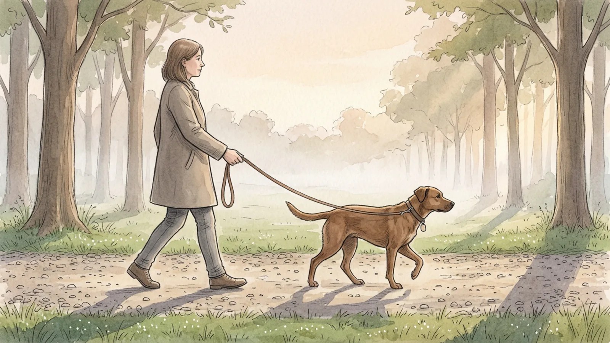

## Part 1 of 3 — Get the Dog, the Kit and the Rules Right

### Step 1 — Start with a vet check, not a schedule

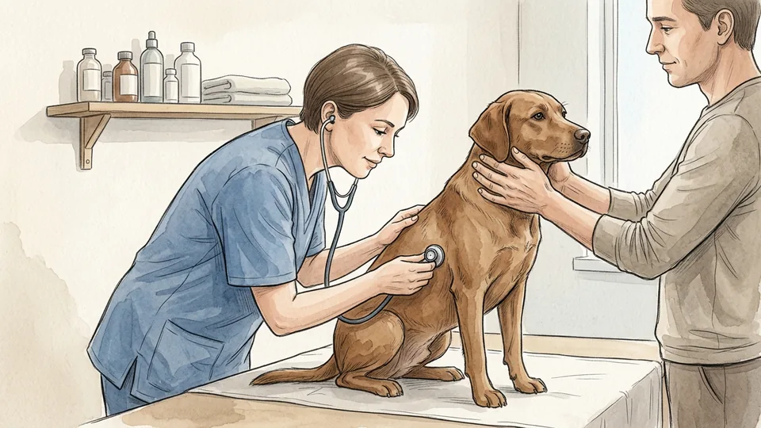

Before you plan anything, have the dog looked over. Veterinary advice is to confirm your dog is healthy enough for an exercise programme and to tailor the programme to their needs. Age, weight, joints, heart and breathing all change what a sensible walk looks like. Overweight dogs and short-nosed breeds need particular care, and a dog who tires quickly or limps needs examining rather than encouraging. Ask what distance to aim for and what to watch out for.

**Tip:** Mention the routine you have in mind by name: how many walks, how long, what surface. Specific plans get specific advice.

### Step 2 — Fit the collar or harness properly

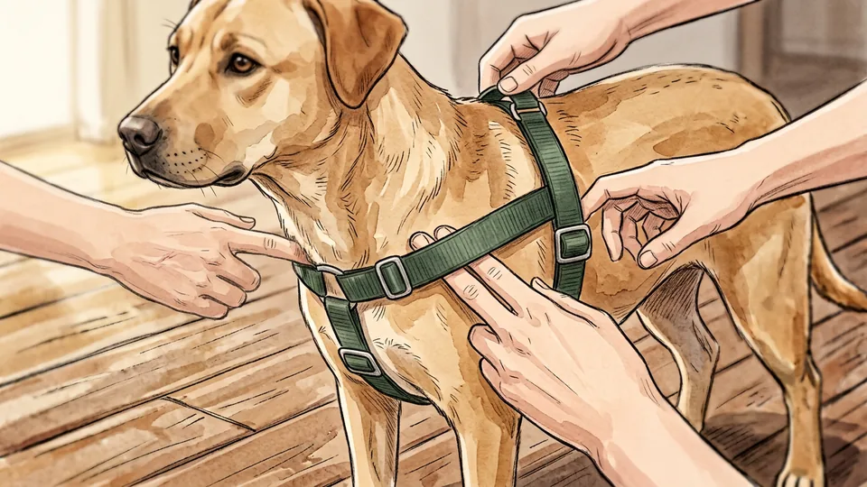

A badly fitted collar either chokes or slips off, and both end walks early. You should be able to slide two fingers flat under the strap, no more. Many dogs do better in a harness, and some must use one: dogs with airway, neck or tracheal problems should not have pressure on the throat. Check the fit again every few weeks on a growing dog, and after any coat clip, because a trimmed dog is a smaller dog.

**Tip:** Fit the harness indoors first and feed a few treats while it goes on, so the gear itself is not the thing the dog resists.

### Step 3 — Put identification on before the first walk

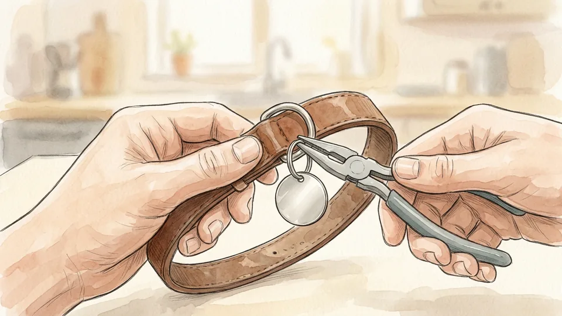

Accidents happen on ordinary walks, so make sure the dog can be returned. Fit a well-fitting collar with a tag carrying current contact details, and have the dog microchipped. A chip only works if the registry entry is current, so update it whenever you move or change your phone number. In winter, snow and ice hide the scent trails a lost dog would normally follow home, which makes identification more important rather than less.

**Tip:** Check the registry details once a year, on a date you already remember, such as the dog's vaccination month.

### Step 4 — Build one kit and keep it by the door

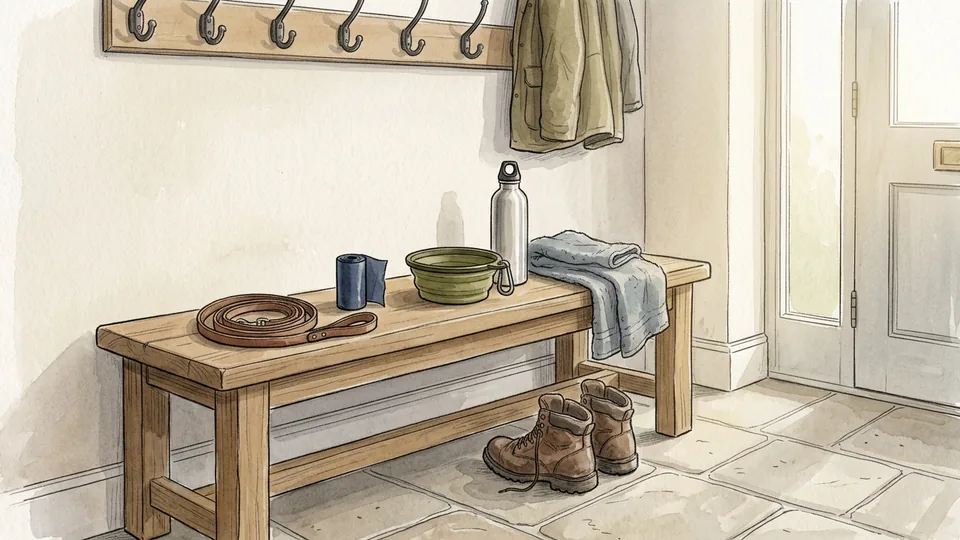

Assemble everything the walk needs in one place: lead, waste bags, a water bottle and a collapsible bowl, a few treats and an old towel. A routine fails on friction, and hunting for bags in three rooms is friction. Keep the kit on a hook or shelf by the door you actually leave from, restock the bags the moment the roll looks thin, and keep the towel with it so muddy paws have an answer waiting.

**Tip:** Keep a spare lead in the car. The day you forget the main one is the day the routine breaks.

### Step 5 — Teach loose-lead walking before you add distance

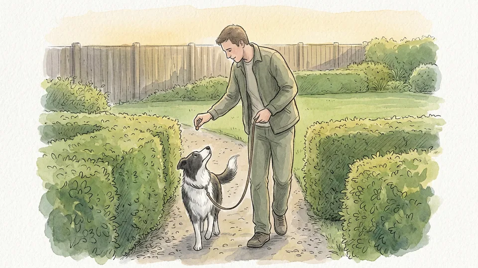

A dog who pulls makes every walk shorter than planned, because the human stops enjoying it. Teach the dog to walk on a lead that hangs in a loose curve, rewarding the position beside your leg rather than correcting the pulling. Short practice sessions in a quiet place work better than long ones on a busy pavement. If your dog has behavioural problems on the lead, get help from a qualified trainer early.

**Tip:** Stop walking the instant the lead goes tight and start again when it slackens. The walk itself becomes the reward.

## Part 2 of 3 — Build the Routine Week by Week

### Step 6 — Begin with short, frequent walks

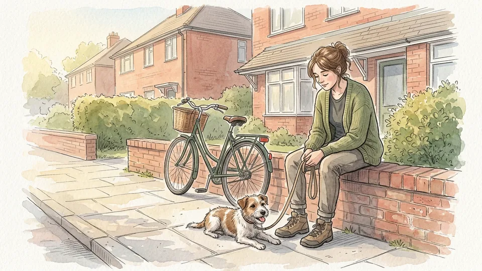

Start shorter than you think you need to. Veterinary guidance is to begin with short, frequent walks and to rest as often as the dog needs, which matters most for puppies, older dogs and any dog who has been inactive. Two ten-minute outings often beat one long march, because they build the habit twice a day. Watch how the dog moves afterwards: stiffness that evening means the last walk was too much.

**Tip:** Judge the walk by the hour after it, not the minute you get home. Most dogs look fine at the front door.

### Step 7 — Build up to brisk fifteen-minute blocks

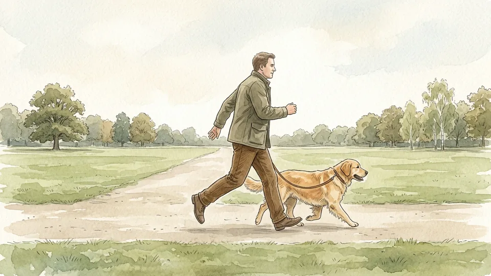

Once the dog is comfortable, build gradually towards one or more fifteen-minute periods of brisk walking, then allow time to cool down and recover. Brisk means a pace that makes conversation slightly harder for you, not a jog. Add length or pace, never both in the same week. If the dog is overweight, this steady build is exactly what helps, and it is far safer than sudden long hikes at the weekend.

**Tip:** Add about ten percent to the total week, then hold it for a week before adding more.

### Step 8 — Leave room for sniffing

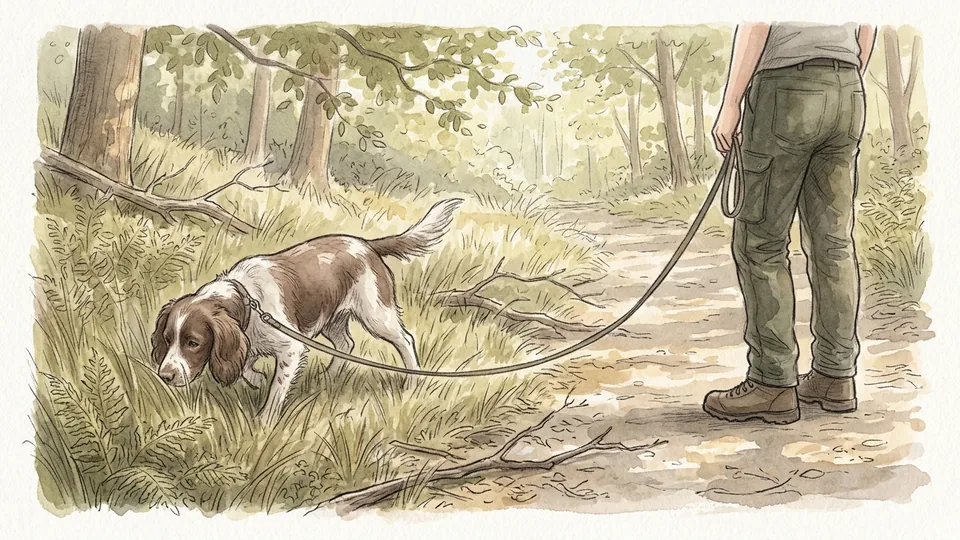

Walks are mental exercise as much as physical, and the smelling is most of it. Allow sniff breaks within reason, rather than towing the dog past everything interesting. A useful shape is brisk walking for the fitness part, then a slower stretch where the dog chooses the pace and the lamp posts. Dogs who are allowed to sniff tend to come home settled instead of wired, which is usually the point of the walk.

**Tip:** Give the sniffing a cue, such as a released lead and a word, so the dog learns the difference between working and browsing.

### Step 9 — Anchor the walks to fixed times

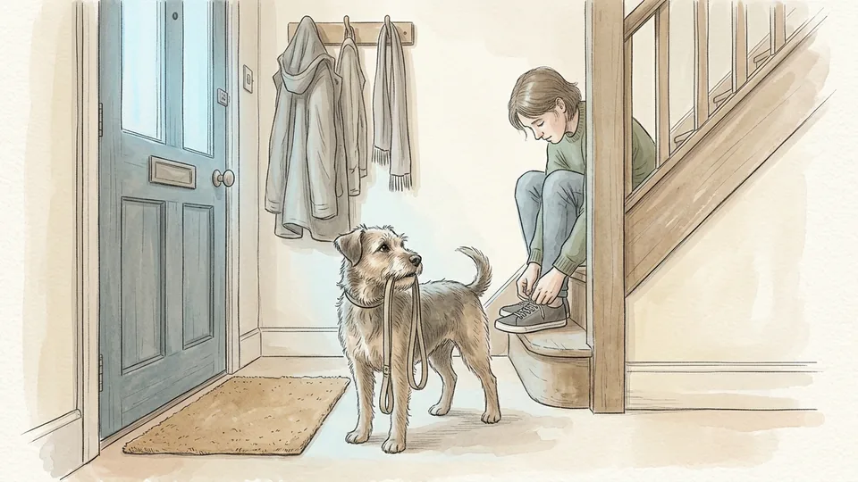

Put the walks where they will survive a bad day: after the alarm, before dinner, at the end of the working day. Dogs learn clock patterns quickly and will start asking, which is a useful form of enforcement. Two anchored slots beat four hopeful ones. If the week has a day that always collapses, plan a shorter walk for that day rather than pretending it will be normal.

**Tip:** Lay the lead and your shoes out the night before the early slot. The routine should not depend on a decision made half-asleep.

### Step 10 — Change the route when enthusiasm drops

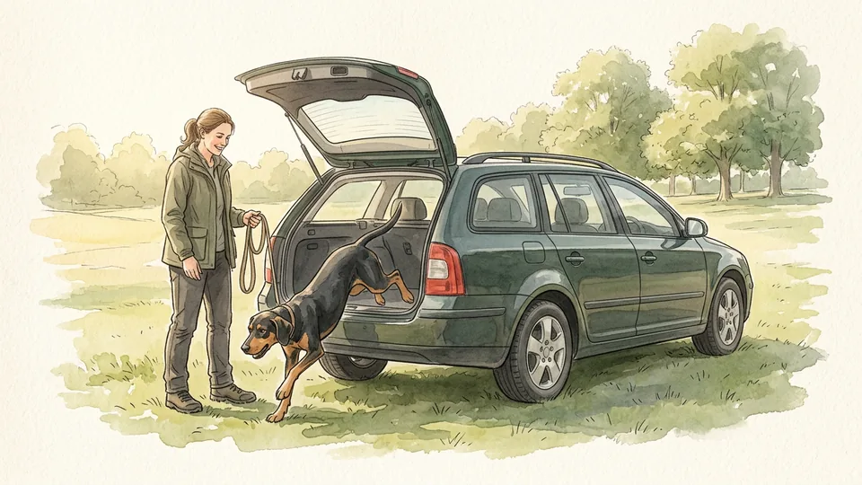

If your dog keeps steering for home, the route has gone stale. Drive to a nearby park or a less familiar area and walk there instead, or simply run the usual loop in reverse. Choose safe footing: avoid very uneven ground, sand, holes, broken glass and places where loose dogs or wildlife are common. A new smell map restores interest faster than any amount of encouragement on the old one.

**Tip:** Keep two or three known-good routes rather than one. Variety also spreads the wear on paws and joints.

## Part 3 of 3 — Keep It Safe in Any Weather

### Step 11 — Test the ground before summer walks

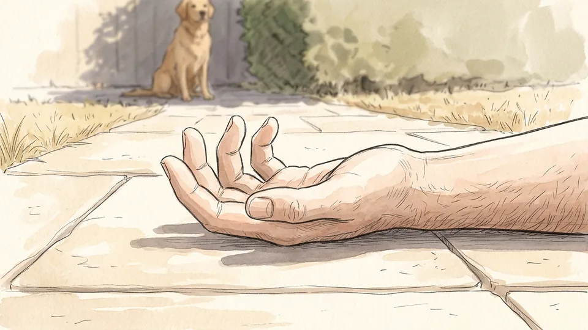

Hot pavements, roads and other surfaces burn paw pads. Press the back of your hand flat on the surface before you set off; if you cannot hold it there comfortably, the dog should not be standing on it. Walk on grass or shaded paths instead, and move the whole routine to the cooler hours of the day in warm weather. If it feels hot to you, it is considerably hotter down at the dog's level.

**Tip:** Asphalt stays hot long after sunset. Late evening is not automatically safe after a very hot day.

### Step 12 — Carry water and take breaks in the heat

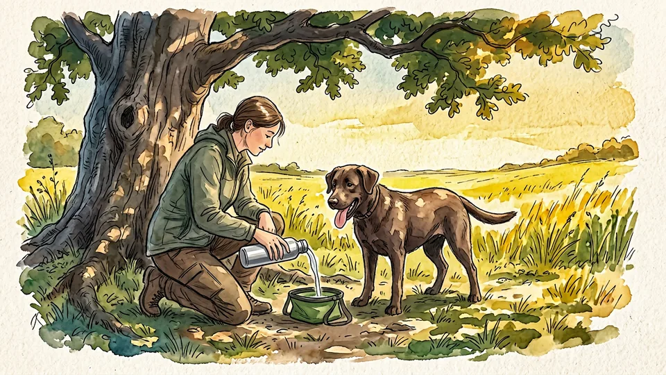

Bring enough water for both of you and stop often. Short-nosed and overweight dogs struggle most in warm weather and need shorter walks and more rests. Learn the signs of heat stress: unusual anxiety or weakness, heavy panting, excessive drooling, discoloured or sticky gums, unsteadiness. Heat stress can progress to heat stroke and death without immediate veterinary care, so stop, cool the dog and call the vet rather than finishing the loop.

**Tip:** Offer water at every break, even when the dog refuses. Dogs often drink only once they have stopped moving.

### Step 13 — Shorten and kit up in cold weather

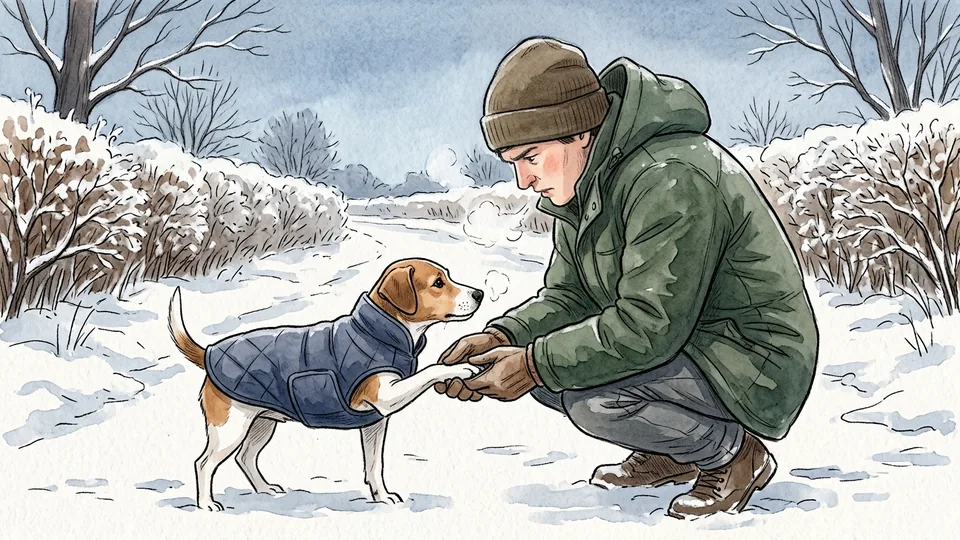

Cold tolerance varies with coat, size, body condition, age and health, and very cold days usually mean shorter walks for both of you. Small, thin-coated, very young and very old dogs feel it first. A coat helps a short-haired dog, and a dry one should go on each time, because a damp coat makes the dog colder. Boots protect against sharp ice and frozen ground. Stay well away from frozen ponds and lakes.

**Tip:** Ice balls form between the toes of hairy feet. Clipping the hair between the pads reduces them.

### Step 14 — Wipe the dog down when you get home

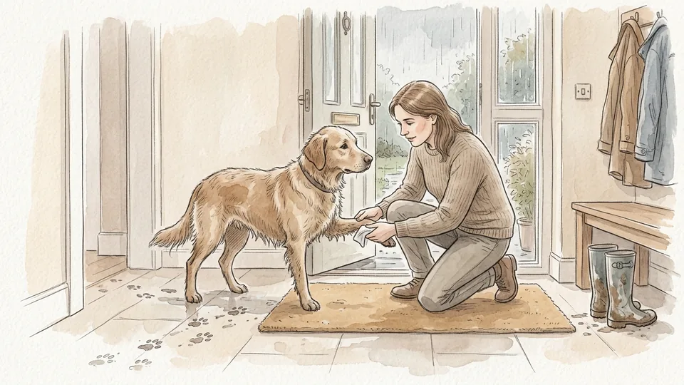

Feet, legs and bellies pick things up: grit, de-icing salt, antifreeze and lawn chemicals. Dogs then lick it off, which is how a walk becomes a poisoning. Wipe or wash the paws, legs and underside at the door, and keep the towel with the walking kit so it is always there. Check the pads at the same time for cracks, cuts, bleeding or anything wedged between the toes.

**Tip:** A sudden limp during a walk is often ice or a stone between the toes rather than an injury. Look before you worry.

### Step 15 — Pick up, bin it, and wash your hands

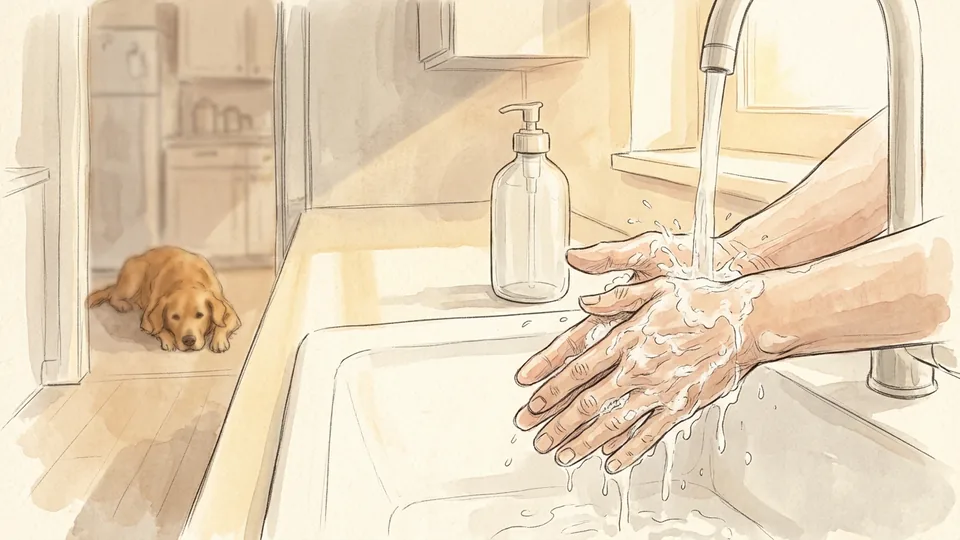

Clean up every time, with a bag or scooper, and put it in a bin rather than a hedge. Dog waste can carry parasites and germs, including roundworms and hookworms, which is also why children should be kept away from ground that may be contaminated. Wash your hands with soap and running water after handling waste, the dog, bowls or toys, and use sanitiser when a tap is not available.

**Tip:** Keep a small bottle of hand sanitiser clipped to the lead. The bin is rarely next to a sink.

## Tips

- Two anchored walks a day beat four that depend on how the day goes.
- Keep the lead, bags, bowl and towel together by the door you actually use.
- Add distance or pace in one week, never both.
- Let the dog set the pace for part of every walk.
- Obey local leash laws, and keep the dog close where livestock or wildlife may be about.

## Warnings

- Staggering, struggling to breathe, reluctance to walk, a wide-based stance, abnormally coloured gums or disorientation mean stop the walk and contact a vet immediately.
- Never leave a dog in a parked car in warm weather. Cars overheat to deadly temperatures even in the shade with the windows cracked.
- If your dog has a history of aggression towards people or other dogs, walk them separately and avoid situations that could provoke a bite; get help from a qualified behaviourist.
- This guide is general information and not veterinary advice. Any change in exercise for a dog with a health condition should be agreed with your vet.

## Community Q&A

**How long should a daily dog walk be?**

There is no single number, because breed, age, weight and health all change the answer. A common veterinary target for a healthy adult dog is to build gradually to one or more fifteen-minute periods of brisk walking, with cool-down time afterwards, and many dogs do well with two such outings a day. Start shorter than the target, add slowly, and let your vet set the ceiling for puppies, seniors and dogs with existing conditions.

**When is it too hot to walk the dog?**

Judge the surface, not only the air. Press the back of your hand against the pavement: if you cannot hold it there comfortably, it is too hot for paws. Move walks to the cooler hours, keep to grass and shade, carry water and take frequent breaks. Short-nosed and overweight dogs tolerate heat particularly badly and may need the walk shortened or skipped on hot days.

**Should my dog wear a collar or a harness?**

Either can work if it fits, with two fingers of room under the strap. A harness is preferable for dogs that pull hard and necessary for dogs with airway, neck or tracheal conditions, since it keeps pressure off the throat. Whichever you use, a tag with current contact details should be on the dog, and a microchip registration should be kept up to date as a backup.

**My dog pulls the whole way. What should I change first?**

Change the practice, not the walk length. Work in a quiet place for a few minutes at a time, reward the dog for being beside your leg, and stop moving whenever the lead tightens so that pulling never earns progress. Adding distance before the lead manners exist usually makes both worse. Persistent pulling, lunging or reactivity is worth a session with a qualified trainer.

## Useful external resources

- [AVMA: Walking or Running With Your Dog](https://www.avma.org/resources-tools/pet-owners/petcare/walking-your-pet) — Designing a safe walking programme, fifteen-minute brisk blocks, injury and disease precautions.
- [AVMA: Warm Weather Pet Safety](https://www.avma.org/resources-tools/pet-owners/petcare/warm-weather-pet-safety) — Hot surfaces, cooler walking hours and the signs of heat stress.
- [AVMA: Cold Weather Animal Safety](https://www.avma.org/resources-tools/pet-owners/petcare/cold-weather-animal-safety) — Shorter winter walks, paw checks, coats and wiping off de-icing chemicals.
- [CDC: Ways to Stay Healthy Around Animals](https://www.cdc.gov/healthy-pets/about/index.html) — Handwashing, picking up waste and the parasites dog faeces can carry.

## References

1. American Veterinary Medical Association. Walking or Running With Your Dog. https://www.avma.org/resources-tools/pet-owners/petcare/walking-your-pet
2. American Veterinary Medical Association. Warm Weather Pet Safety. https://www.avma.org/resources-tools/pet-owners/petcare/warm-weather-pet-safety
3. American Veterinary Medical Association. Cold Weather Animal Safety. https://www.avma.org/resources-tools/pet-owners/petcare/cold-weather-animal-safety
4. Centers for Disease Control and Prevention. Ways to Stay Healthy Around Animals, Healthy Pets Healthy People. Reviewed May 4, 2026. https://www.cdc.gov/healthy-pets/about/index.html

## Internal links

- [How to Brush a Dog's Teeth](https://www.56juqingba.com/Brush-a-Dogs-Teeth)
- [More Pets and Animals guides](https://www.56juqingba.com/Category/Pets-and-Animals)
- [How to Run Your First 5K](https://www.56juqingba.com/Run-Your-First-5K)
