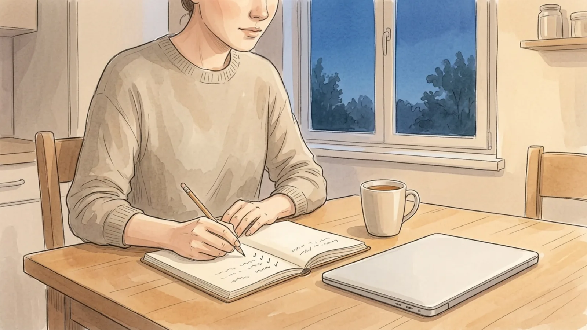
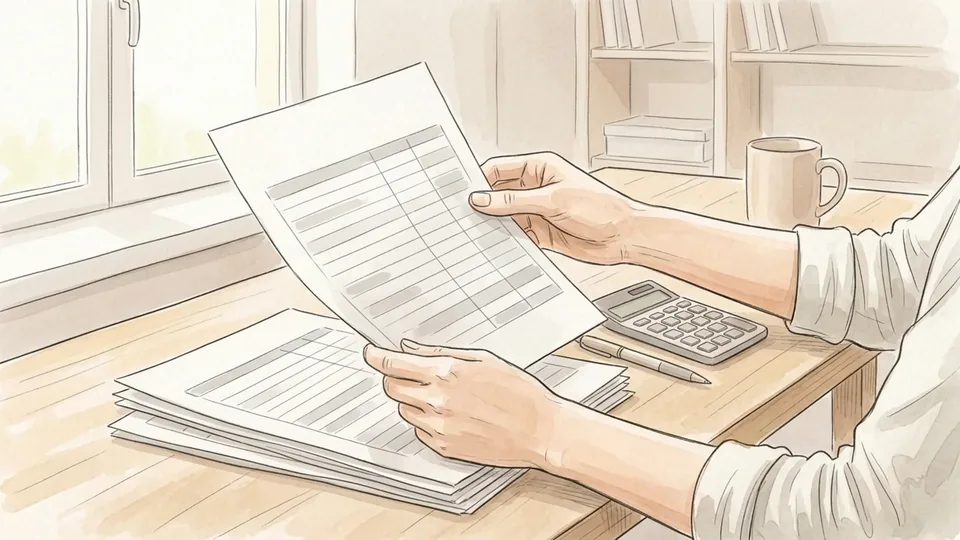
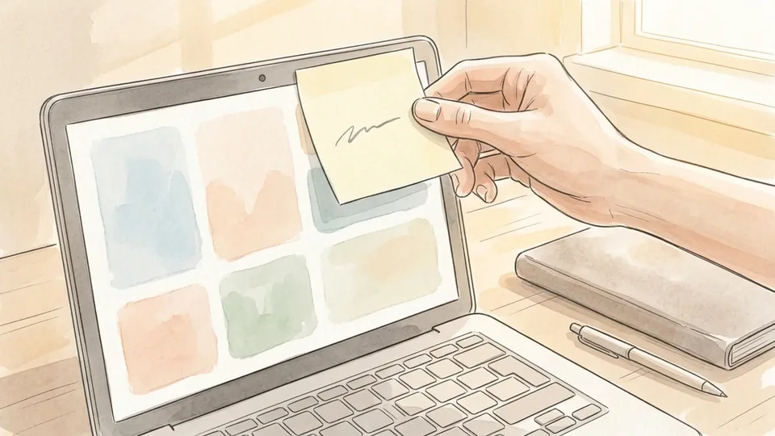
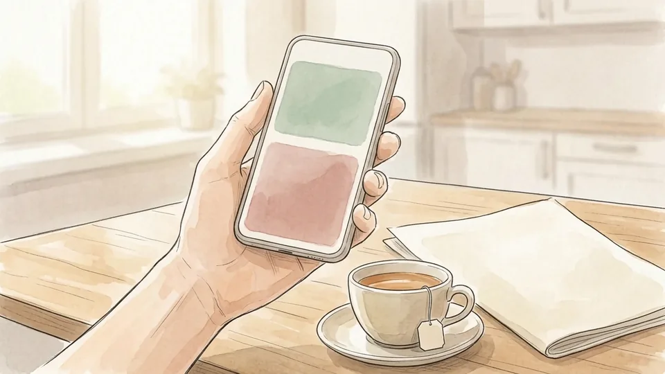
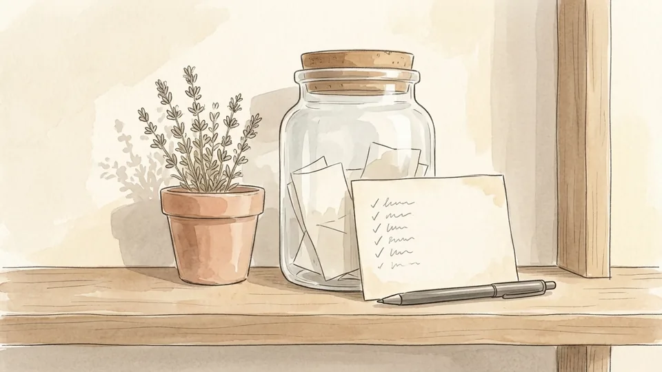
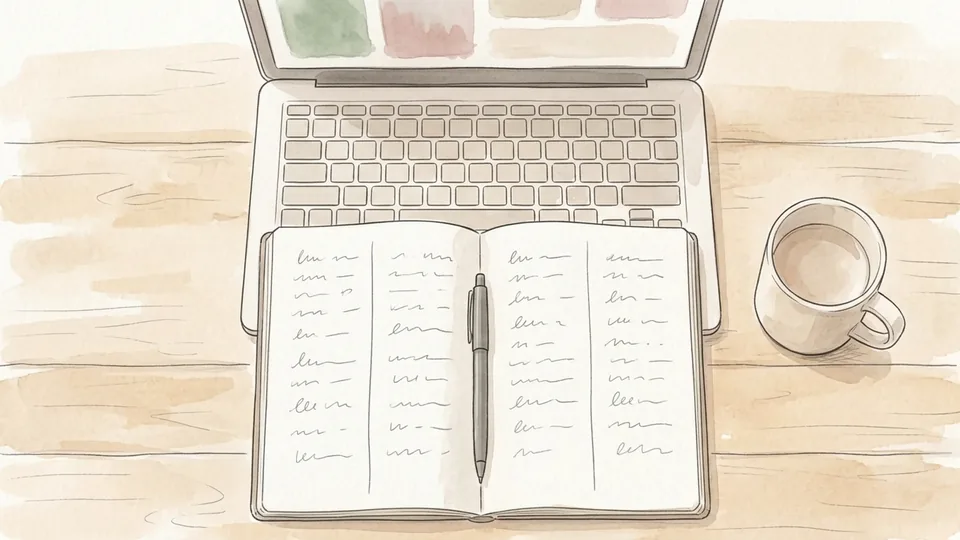
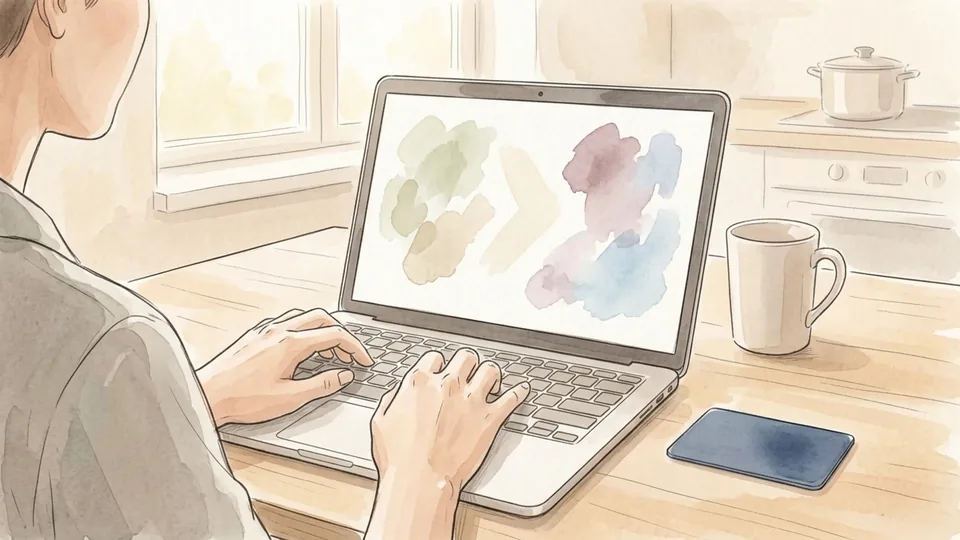
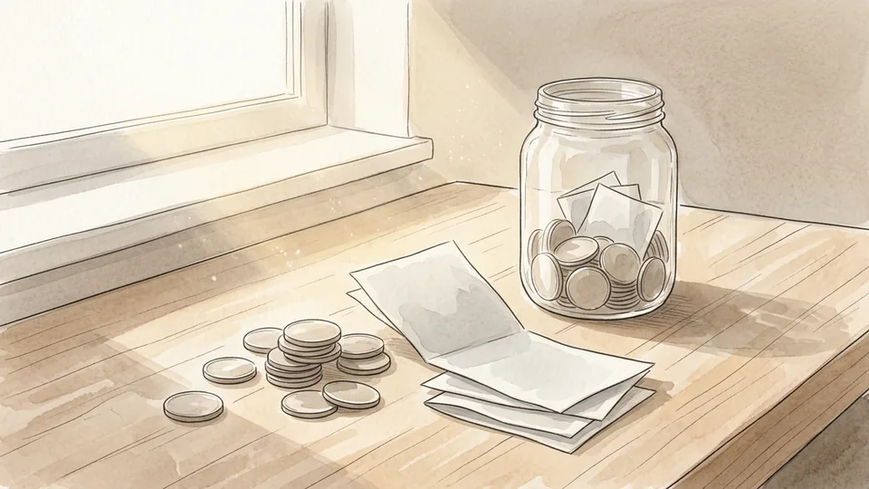

> DRAFT — do not publish or package: 8 of 16 illustrations are still missing, and the article has not been reviewed by a person.

# How to Build an Emergency Fund

*Not the version that assumes you have spare money. The version that starts from a target small enough to reach and a transfer small enough to survive a bad month.*

**Category:** Finance and Business

**Slug:** `/Build-an-Emergency-Fund`

**Primary keyword:** build an emergency fund

**Meta description:** Build an emergency fund that survives real life: set a reachable first target, automate the transfer, and decide in advance when to spend it.

---

## Intro

An emergency fund is a cash reserve set aside for the unplanned: a car repair, a boiler, a medical bill, a month without work. The Consumer Financial Protection Bureau makes a point of not prescribing a single figure, because the right size depends entirely on how exposed you are. What it does say is that the people who struggle most after a financial shock are the ones with nothing set aside, who end up on credit cards or pulling from retirement savings to cover a cost that was never really a surprise. This guide builds the fund from the other end: a target you can see from where you are standing, an automatic transfer you will not cancel, and a written rule about what the money is for.

## Part 1 of 3 — Set a Target You Will Actually Hit

### Step 1 — Write down the last three unplanned expenses you had

Before choosing a target, look backwards. Go through a year of statements and pull out the costs you did not plan for: the car repair, the boiler, the dental bill, the last-minute flight. The CFPB suggests exactly this, on the grounds that the emergencies most likely to hit you are the kind that already have. Three real numbers from your own life beat any general rule about months of expenses.

**Tip:** Include the ones you put on a credit card. Those are precisely the emergencies the fund exists to replace.

### Step 2 — Set a first milestone you can reach

A target of six months of expenses is paralysing when you are starting from nothing. Pick a first milestone that is visible from where you stand: enough to cover the typical surprise you found in step one, or a round number you could reach in three or four months. Hitting a small target changes behaviour far more reliably than admiring a large one for a year.

**Tip:** Write the milestone somewhere you will see it. A goal that lives only in your head quietly moves.

### Step 3 — Keep it separate from everything else

Put the fund in its own account, at a different institution from your current account if that helps. Money sitting next to your everyday balance gets spent without a decision ever being made, because it never looks like a separate thing. A named account with its own balance makes every withdrawal deliberate, and that friction is the entire mechanism.

**Tip:** Name the account for what it is. 'Emergency fund' is harder to raid than 'Savings 2'.

### Step 4 — Decide in advance what counts as an emergency

Write a short list and keep it with the account: loss of income, medical costs, urgent home or vehicle repairs, travel for a family crisis. Then write what does not count, which is usually the harder list. Deciding this in the calm beforehand is far more reliable than deciding in the moment, when every expense feels urgent and the money is sitting right there.

**Tip:** A holiday deposit is not an emergency. Save for that separately so the two never compete for the same balance.

### Step 5 — Work out what you can move each payday

Look at the gap between what comes in and what has to go out, then commit a fixed amount from that gap. If your income varies, set the figure against your worst recent month rather than your best. The size matters less than whether it survives a bad month untouched, because a contribution you cancel twice becomes a contribution you stop making altogether.

**Tip:** If the honest answer is a very small amount, start there anyway. The habit is the asset; the balance follows it.

## Part 2 of 3 — Build the Habit

### Step 6 — Automate the transfer for payday

Set up a recurring transfer that leaves your current account the day after you are paid, not at the end of the month. The CFPB puts automatic transfers near the top of its list of saving strategies for a reason: money moved before you see it is not an argument you have to win every month. Month-end transfers compete with whatever is left, which is frequently nothing.

**Tip:** If your pay date shifts, set the transfer a day later rather than earlier. A failed transfer can trigger a fee.

### Step 7 — Start small enough that you never cancel it

The most common failure is setting an ambitious figure, feeling the squeeze for two months, then switching the whole thing off. Pick an amount you would barely notice leaving, run it for three months, then raise it. An automatic transfer that has run uninterrupted for a year is worth more than one twice the size that keeps getting paused and restarted.

**Tip:** Raise the amount on the day a pay rise lands, before the new figure turns into normal spending.

### Step 8 — Use one-off money to jump ahead

> IMAGE PENDING for step 8: An opened envelope and a folded slip of paper on a kitchen worktop next to a phone and a set of keys.

Tax refunds, bonuses, rebates, the proceeds of selling something: these move a fund from embarrassing to useful fastest, because the money was never part of your monthly rhythm. Decide the split before it arrives. Half into the fund and half into whatever you like is a rule most people manage to keep; all of it into the fund is a rule most people break.

**Tip:** Move windfall money within a day of it landing. Anything that sits in a current account for a week gets absorbed.

### Step 9 — Fix the timing of your bills, not your income

> IMAGE PENDING for step 9: A hand marking one square of a blank wall calendar grid with a pencil, a telephone on the shelf below.

If you run short at the same point every month, the problem is often sequencing rather than totals. Utilities, lenders and landlords will frequently move a due date on request. Shifting two bills a week later can open a stretch of days in which a transfer actually clears. The CFPB lists this as a cash-flow strategy in its own right, and it costs nothing beyond a phone call.

**Tip:** Ask for the change in writing or by email. A verbal agreement with a call centre is hard to point at later.

### Step 10 — Put the balance where you will see it

> IMAGE PENDING for step 10: A hand-drawn progress chart pinned to a kitchen noticeboard, partly filled in with pencil shading.

Turn on a monthly balance notification, or write the running total on the same sheet of paper each payday. Watching the number climb is what keeps the habit alive once the novelty wears off, and it is the single point nearly every savings guide agrees on. Checking daily achieves the opposite, because the balance moves far too slowly to reward that much attention.

**Tip:** Mark the milestone when you reach it. A small, cheap celebration is a legitimate part of the system, not a leak in it.

## Part 3 of 3 — Protect It and Use It Properly

### Step 11 — Keep it reachable within a day or two

> IMAGE PENDING for step 11: A person at a bank counter speaking with a teller, a card and a phone resting on the counter in front of them.

An emergency fund has one job: to be available on the day something breaks. A savings account you can transfer out of the same day is right for it. A fixed-term deposit with an exit penalty, or anything whose value moves with a market, is not, however attractive the return looks. The cost of locking the money away appears at exactly the moment you can least absorb it.

**Tip:** Test the route once. Move a small amount out and see how long it genuinely takes to arrive.

### Step 12 — Check what the account costs and earns

> IMAGE PENDING for step 12: A folded printed statement on a desk with a highlighter resting across it and a laptop open behind.

Compare the interest rate against accounts you could switch to, and read the conditions attached: minimum balances, caps on withdrawals per month, fees that appear when the balance dips. An account that penalises you for taking money out is working directly against the purpose of the fund. Of the three, the rate matters least and the access conditions matter most.

**Tip:** Re-check the rate once a year. Introductory rates on savings accounts have a habit of quietly expiring.

### Step 13 — Raise the target once the first one lands

> IMAGE PENDING for step 13: A person at a kitchen table adding a new line to a notebook list, a calculator and a mug beside them.

When you hit the first milestone, set the next one instead of stopping. A common progression is one month of essential costs, then three, then whatever your circumstances call for. Households with variable income, a single earner or dependants usually need more. The CFPB declines to name one figure on purpose, because the right size depends on how exposed you actually are.

**Tip:** Recalculate after any large change: a new job, a move, a child, a car. The old target was built for an old life.

### Step 14 — Spend it when the emergency actually happens

> IMAGE PENDING for step 14: A person handing a card across a workshop counter while a mechanic writes on a pad, a car visible through the open doorway.

A fund you refuse to touch is not a safety net; it is an uncomfortable savings account. When something on your written list occurs, use the money and feel fine about it. The alternative is usually a credit card balance at a rate that outlives the emergency by years, which is precisely the outcome the fund was built to prevent.

**Tip:** Pay from the fund directly rather than putting it on a card and intending to clear it later. Intentions have a poor record.

### Step 15 — Refill it on a schedule, not on a feeling

> IMAGE PENDING for step 15: A hand dropping folded notes into a glass jar on a shelf that already holds a small amount, soft daylight behind.

After a withdrawal, set a date by which the fund will be whole again and raise the automatic transfer until it is. Treat the repayment the way you would a loan instalment, because that is effectively what it is: you borrowed from yourself. Funds that are never rebuilt quietly become funds that are not there the second time something goes wrong.

**Tip:** Rebuild before you restart any other savings goal. The emergency fund is the thing that protects all of them.

## Tips

- If you are carrying debt at a high interest rate, a small starter fund still comes first. Without one, the next surprise goes straight back onto the card and the balance never falls.
- Two accounts beat one. Keep the emergency fund separate from a 'things I know are coming' pot for car tax, insurance renewals and birthdays, or the predictable costs will eat the unpredictable ones.
- Review the whole arrangement once a year on a fixed date. Rates change, bills change, and the target you set two jobs ago is almost certainly wrong now.

## Warnings

- This guide is general information, not financial advice. It does not take account of your circumstances, and nothing in it should be treated as a recommendation about a specific product, account or provider.
- Do not keep an emergency fund in anything whose value can fall or that charges a penalty for early access. The point of the money is certainty on a bad day, not return.
- Check how your deposits are protected by the relevant scheme in your country, and what the limit is per institution. Rules and limits differ substantially between jurisdictions.

## Community Q&A

**How much should an emergency fund hold?**

There is no single right number, which is why the CFPB does not give one. Base it on the unplanned expenses you have actually had and on how stable your income is. A frequently used progression is one month of essential costs first, then three, then more if you have variable income, dependants or a single earner in the household.

**Should I build an emergency fund or pay off debt first?**

In most approaches a small starter fund comes first, then aggressive debt repayment, then the full fund. Without any buffer, the next unexpected cost goes straight back onto credit and the debt never actually falls. If your situation is complicated, this is the point at which free non-profit debt advice is worth seeking.

**Where should I keep the money?**

Somewhere you can reach within a day or two and whose value cannot fall: a plain savings account at a deposit-taking institution, separate from your current account. Avoid fixed terms with exit penalties, and avoid investments. Returns matter far less here than being able to get at the money on the morning something breaks.

**What if I can only save a very small amount?**

Start with it. The CFPB's position is that even a small reserve provides some protection against a financial shock, and the habit of transferring on a fixed day is the part that compounds. A small automatic transfer that never stops will out-save a large one that gets cancelled in month three.

**I used the fund. Did I do it wrong?**

No, that is the fund working. An emergency fund that never gets spent has not protected you from anything. What matters is what follows: set a date to restore it, raise the automatic transfer until it is whole again, and treat that repayment with the same priority as any other monthly commitment.

## Useful external resources

- [CFPB: An Essential Guide to Building an Emergency Fund](https://www.consumerfinance.gov/an-essential-guide-to-building-an-emergency-fund/) — The source for the strategies in this guide: savings habit, cash flow, one-off opportunities and automatic transfers.
- [CFPB: Savings Plan Tool (PDF)](https://files.consumerfinance.gov/f/documents/cfpb_your-money-your-goals_savings_plan_tool_2018-11_ADA.pdf) — Worksheet for calculating how long a target will take at a given contribution.
- [CFPB: Financial Well-Being Questionnaire](https://www.consumerfinance.gov/consumer-tools/financial-well-being/) — A short self-assessment to establish a baseline before you start.

## References

1. Consumer Financial Protection Bureau. An Essential Guide to Building an Emergency Fund. Accessed October 30, 2026. https://www.consumerfinance.gov/an-essential-guide-to-building-an-emergency-fund/
2. Consumer Financial Protection Bureau. Your Money, Your Goals: Savings Plan Tool. November 2018. https://files.consumerfinance.gov/f/documents/cfpb_your-money-your-goals_savings_plan_tool_2018-11_ADA.pdf
3. Consumer Financial Protection Bureau. Your Money, Your Goals: Cash Flow Budget Tool. November 2018. https://files.consumerfinance.gov/f/documents/cfpb_your-money-your-goals_cash_flow_budget_tool_2018-11_ADA.pdf
4. Consumer Financial Protection Bureau. Financial Well-Being Questionnaire. Accessed October 30, 2026. https://www.consumerfinance.gov/consumer-tools/financial-well-being/

## Internal links

- [How to Build a Monthly Budget](https://www.56juqingba.com/Build-a-Monthly-Budget)
- [How to Prepare for a Performance Review](https://www.56juqingba.com/Prepare-for-a-Performance-Review)
- [Finance and Business](https://www.56juqingba.com/Category/Finance-and-Business)
