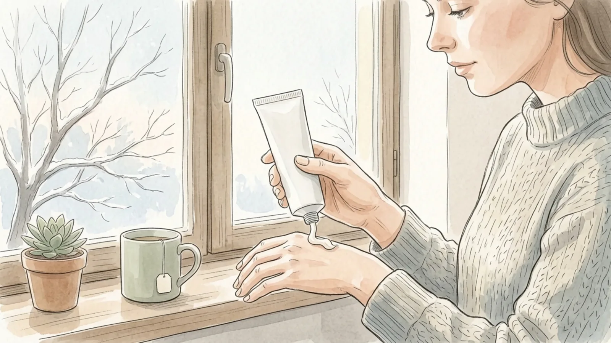
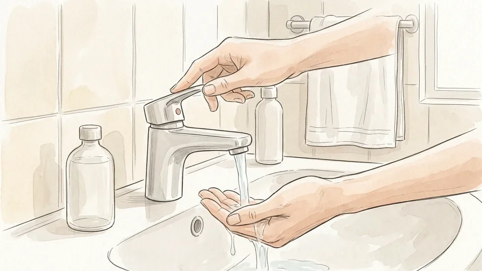
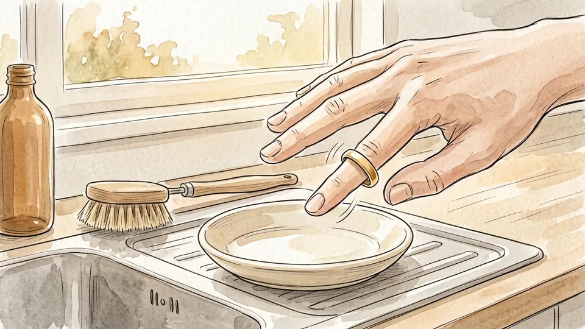
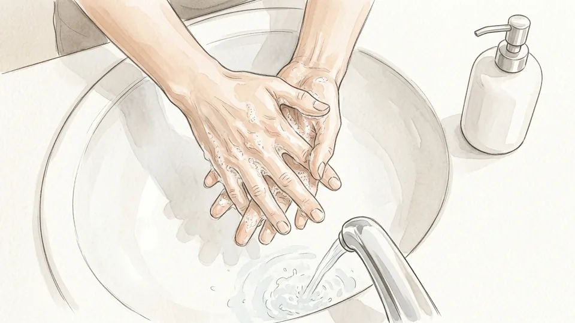
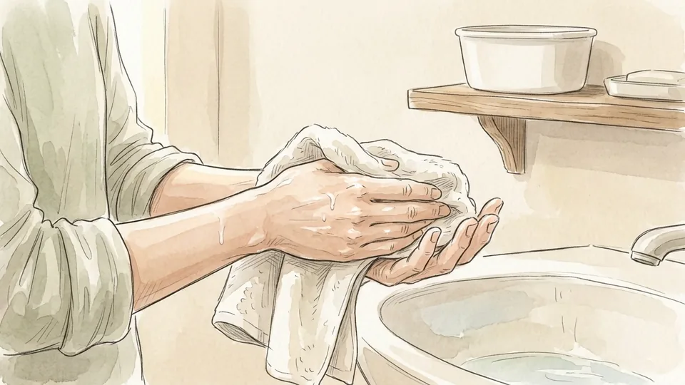
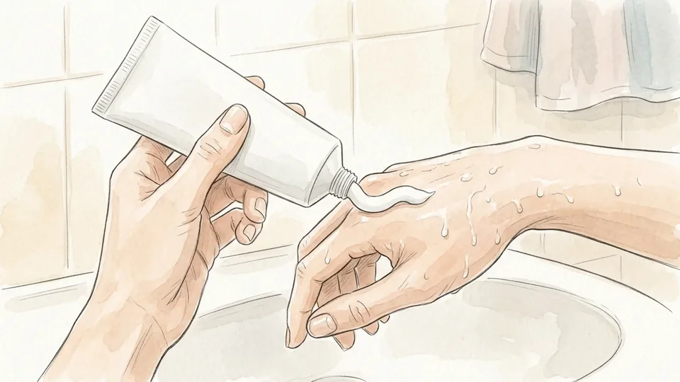
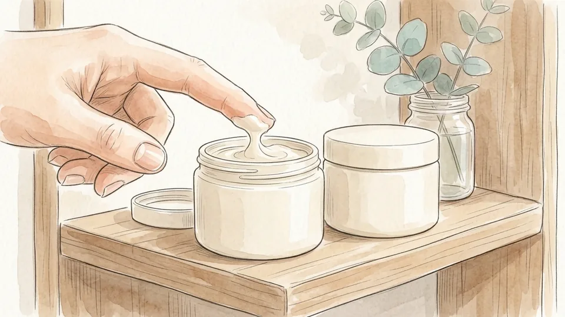
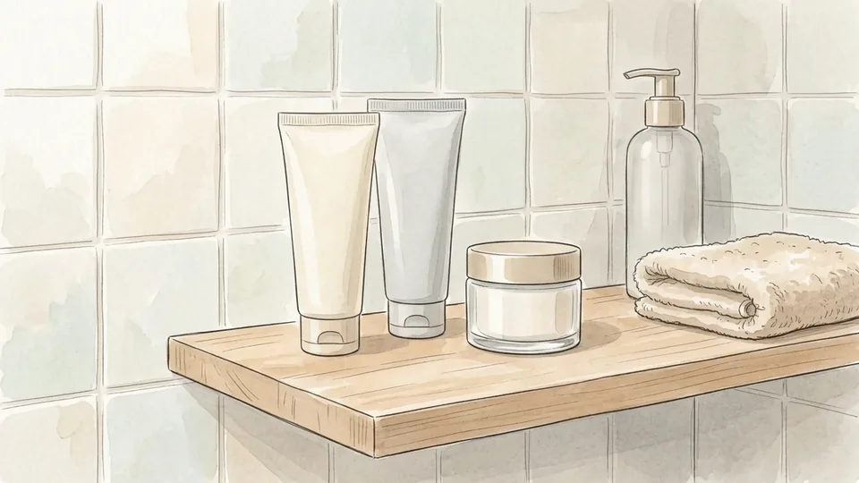
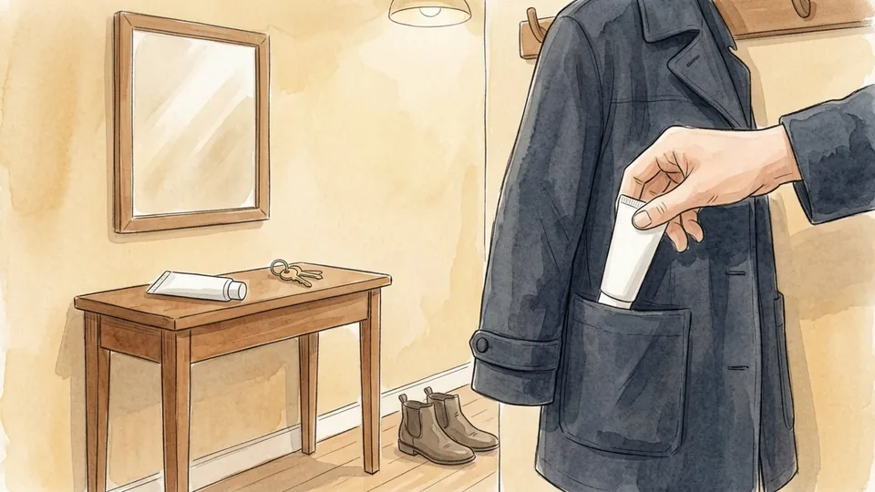
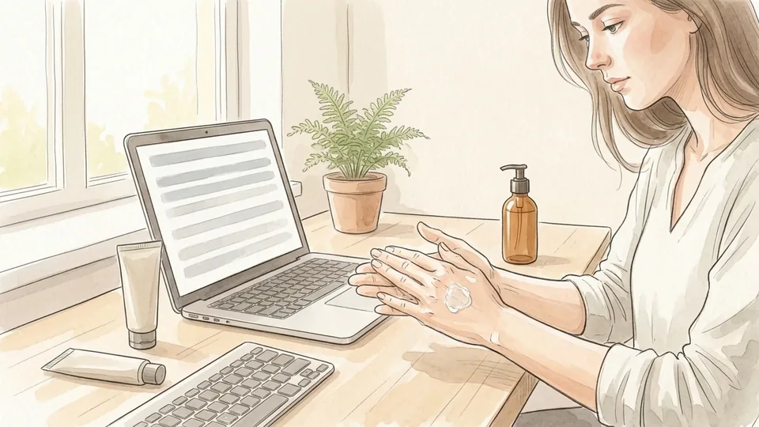

> DRAFT — do not publish or package: 6 of 16 illustrations are still missing, and the article has not been reviewed by a person.

# How to Care for Dry Hands

*Cooler water, damp skin and a tube within reach: fifteen small changes that let you keep washing your hands without the cracking.*

**Category:** Personal Care and Style

**Slug:** `/Care-for-Dry-Hands`

**Primary keyword:** care for dry hands

**Meta description:** Care for dry hands with dermatologist-backed steps: cooler water, gentle cleanser, cream on damp skin, gloves for wet work, and when to see a doctor.

---

## Intro

Dry hands are rarely caused by one dramatic mistake. They are caused by ordinary things repeated all day: hot taps, foaming soap, paper towels, cold air, washing up without gloves. Dermatologists call the pattern wet work, and the US Centers for Disease Control and Prevention defines it as hands wet for more than two hours a day, more than twenty washes a day, or gloves worn for more than two hours. The answer is not to wash less. Clean hands prevent illness, and cracked skin actually makes it easier for germs to get in. The answer is to change the small details around each wash, protect your hands between washes, and recognise the point where home care stops being enough. These fifteen steps follow guidance from the American Academy of Dermatology and from contact-dermatitis specialists writing for the CDC.

## Part 1 of 3 — Change What Happens at the Tap

### Step 1 — Turn the water temperature down

Hot water strips the oils that hold the skin barrier together, and it does it every single wash. The American Academy of Dermatology tells people with dry skin to use lukewarm water, and the contact-dermatitis specialists writing for the CDC go further: warm or cold, never hot. Nudge the mixer towards the middle and leave it there. The change costs nothing and removes one of the most frequent causes of damage you have.

**Tip:** Hot water does not make handwashing more hygienic. Time, soap and friction do the work, so temperature is yours to choose.

### Step 2 — Take your rings off first

A ring holds a film of soap and water against the skin long after you have finished washing, which is a slow, daily irritation that people rarely connect with the rash underneath. The CDC's dermatologist authors list removing rings alongside glove-wearing as a basic preventive measure. Keep a small dish by the sink you use most, so the ring has a home and does not end up down the drain.

**Tip:** If a ring cannot come off easily, dry carefully underneath it by sliding it back and forth under the towel.

### Step 3 — Wash gently and completely

Use a gentle, fragrance-free cleanser, and only enough to clean rather than enough to produce a thick lather. Wash for about twenty seconds, covering the backs of the hands, between the fingers and around the nails, which are the places people skip and then wonder why the skin there is rough. Avoid scrubbing, washcloths and nail brushes on skin that is already sore.

**Tip:** Some soaps are much more drying than others. If your hands feel tight within a minute of washing, try a different one before you blame the weather.

### Step 4 — Pat dry and stop while hands are still damp

Rubbing hands dry with a rough towel irritates skin that is already damaged. Pat instead, and leave a trace of moisture on the surface rather than drying until the skin squeaks. The AAD's advice is explicit: dry with a clean towel but leave some water on your hands, or let them air dry until they are only slightly damp. That remaining moisture is what the next step seals in.

**Tip:** Do leave the webs between your fingers properly dry. Trapped water there softens skin and invites splitting.

### Step 5 — Moisturise within seconds, not minutes

Applying cream to damp skin traps the water that is already there, which is why dermatologists treat the moisturiser as part of the wash rather than as something separate. Work it into the fingertips, the nail folds and the knuckles, the places that crack first. Moist skin is also better at keeping germs out than dry, cracked skin, so this step protects you twice over.

**Tip:** Keep the tube beside the soap, not in a drawer. The step you have to walk for is the step you skip.

## Part 2 of 3 — Pick Products That Actually Repair

### Step 6 — Choose an ointment or thick cream, not a lotion

Lotions are mostly water and evaporate quickly. The AAD recommends ointments and creams instead, and lists the ingredients worth looking for: petrolatum, mineral oil, dimethicone, glycerin, hyaluronic acid, lactic acid, lanolin, jojoba oil and shea butter. Plain petroleum jelly, one of the cheapest products in any pharmacy, is also one of the most effective things you can put on cracked hands.

**Tip:** Thick products feel greasy for about two minutes. Judge them the next morning, not on the way out of the bathroom.

### Step 7 — Read the label for fragrance, not for promises

Fragrance is a common irritant on damaged skin, and the word "unscented" is not a synonym for fragrance-free: unscented products may contain chemicals that mask other smells. Look for products labelled fragrance-free and dye-free. The AAD also points out that tubes and tubs usually hold thicker, more protective formulas than pump bottles, which have to stay thin enough to pump.

**Tip:** People with very dry skin should also avoid products containing alcohol or retinoids, apart from alcohol-based hand sanitiser.

### Step 8 — Put a tube everywhere you wash

Dry hands are a maths problem: a dozen washes a day against one application of cream at bedtime will always lose. Keep a tube at the kitchen sink, one in the bathroom, one in your bag, one at your desk and one in the car. The AAD suggests carrying a non-greasy cream and applying it after every single wash, which only happens if the tube is already there.

**Tip:** Buy the same product five times rather than five different products. You will learn quickly whether it works.

### Step 9 — Reach for sanitiser when hands are not visibly dirty

This surprises people. According to the dermatologists writing for the CDC, alcohol-based sanitiser removes fewer of the skin's protective oils than soap and water, so it is often the gentler option when hands are not soiled. Choose one with few ingredients, fragrance-free, ideally containing dimethicone or glycerin, and at least sixty per cent alcohol. Apply your cream as soon as it has dried.

**Tip:** Stinging when sanitiser lands means the skin is already cracked. It is a sign of existing damage, not of new damage being done.

### Step 10 — Treat your hands overnight

> IMAGE PENDING for step 10: A person sitting on the edge of a bed in lamplight, pulling a white cotton glove onto a freshly creamed hand, a jar standing on the bedside table.

Sleep is eight uninterrupted hours with no washing, no keyboard and no housework, which makes it the best repair window you have. Spread a thick layer of plain petrolatum over clean hands, paying attention to cracks and nail folds, then pull on clean cotton gloves. The CDC page recommends exactly this combination of a thick moisturiser under cotton gloves for people whose hands are suffering.

**Tip:** A pair of thin cotton gloves costs very little and can be washed. Old socks work for one night but trap heat.

## Part 3 of 3 — Protect Your Hands Between Washes

### Step 11 — Wear gloves for the washing-up

> IMAGE PENDING for step 11: Yellow rubber gloves being worn to wash a pan in a kitchen sink full of suds, with a drying rack of clean dishes alongside.

Water itself is an irritant when the exposure is long enough, and detergents strip oils faster than hand soap does. Both the AAD and the CDC name dishwashing as the household task most worth gloving for. Buy a pair a size larger than you think you need so your hands slide in and out easily, and dry the insides between uses so they do not become damp all over again.

**Tip:** If gloves make your hands sweat, wear a thin cotton liner inside them and swap the liner when it feels wet.

### Step 12 — Glove up for cleaning products and the garden

> IMAGE PENDING for step 12: A pair of hands pulling on sturdy canvas gardening gloves beside a tray of seedlings and a small trowel on a potting bench.

Cleaning agents, solvents and soil all belong on the irritant list, and NIOSH notes that contact dermatitis accounts for an estimated ninety to ninety-five per cent of occupational skin disease in the United States. Keep a separate sturdy pair for the garden and for anything dusty or abrasive. Wash your hands after you take the gloves off, then moisturise, because the inside of a glove is a warm, damp place.

**Tip:** If you react to rubber gloves themselves, that may be an allergy to glove materials rather than to the task. Ask a dermatologist about patch testing.

### Step 13 — Cover your hands in cold, dry air

> IMAGE PENDING for step 13: A person on a cold street in a scarf and coat pulling on a woollen glove, breath visible in the air and bare trees behind.

Winter air holds little moisture, and the heating indoors holds even less, which is why hands that cope all summer split in January. Treat gloves as outdoor clothing rather than as an accessory for very cold days only. Put cream on before you go out and let it absorb for a minute, then wear gloves that cover the wrists as well, because the skin there chaps quietly.

**Tip:** Keep a spare pair in your coat pocket from autumn onwards. Hands get cold on the days you did not plan for.

### Step 14 — Add moisture to the air you sleep in

> IMAGE PENDING for step 14: A small humidifier releasing a soft plume of mist on a bedside table beside a lamp and a folded blanket in a quiet bedroom.

A humidifier in the bedroom raises the humidity of the air against your skin for a third of the day, and the AAD lists it among its standard recommendations for dry skin. A small portable unit beside the bed is enough. Clean it on the schedule in its manual, every few days for most models, because a neglected humidifier grows mould and blows it around the room.

**Tip:** If the windows stream with condensation in the morning, the room is too humid. Turn the unit down a setting.

### Step 15 — Know when this stops being dry skin

> IMAGE PENDING for step 15: A clinician in a bright consulting room examining a patient's open palms under a small examination lamp, both seated at a table.

Cracks that bleed, itching, burning, blisters, crusting or a rash that keeps returning point to hand dermatitis rather than ordinary dryness, and the symptoms often need prescription treatment. Patch testing is how a specialist separates an irritant reaction from a true allergy. See a board-certified dermatologist if home care has not helped after a few weeks, or sooner if your hands hurt enough to interfere with work or sleep.

**Tip:** Take photographs of your hands at their worst. Skin often looks calmer in a waiting room than it did at six in the morning.

## Tips

- Moisturise after every wash for two weeks before you decide whether a product works. One application a day will not show you anything.
- Keep nails short while your hands are sore. Long nails catch, and the skin around them is usually the first to split.
- Paper towels in public washrooms are rough. Pat rather than scrub, and carry a small tube for afterwards.
- If one hand is far worse than the other, look at what that hand does: the mouse, the kettle, the pram handle, the dog lead.
- Petroleum jelly on the hands before gardening or dusty work gives the soap less to remove later.

## Warnings

- Do not respond to dry hands by washing less. Handwashing prevents illness, and cracked skin makes it easier for germs to enter, so change the details of the wash instead.
- Signs of infection need medical attention rather than more hand cream: spreading redness, warmth, swelling, pus, a red streak running up the arm, or fever.
- Hand eczema, psoriasis and some medical conditions look like simple dryness at first. Persistent cracking, itching or blistering should be assessed by a clinician, not managed indefinitely at home.
- If you develop a rash under rubber gloves, stop using them and ask about patch testing. Some people become allergic to glove materials themselves.
- This guide is general information about skin care and is not a diagnosis or a treatment plan for anyone's hands.

## Community Q&A

**Why do my hands get worse in winter even though I wash them the same amount?**

Cold outdoor air holds very little moisture and indoor heating removes more, so the same washing routine now sits on top of a drier baseline. Cover your hands outdoors, run a humidifier in the bedroom, and move from a lotion to a thicker cream or ointment for the season.

**Is hand sanitiser worse for my skin than soap and water?**

Usually not. Contact-dermatitis specialists writing for the CDC describe alcohol-based sanitiser as removing fewer of the skin's protective oils than soap and water, which makes it a reasonable choice whenever hands are not visibly dirty. Pick a fragrance-free product with few ingredients and apply cream once it has dried.

**How long should it take for dry hands to improve?**

Most people notice a difference within one to two weeks of moisturising after every wash and gloving for wet work. If nothing has changed after a few weeks, or if the skin is cracking and bleeding, that is the point to see a board-certified dermatologist rather than buying another product.

**Does drinking more water help dry hands?**

Staying hydrated is sensible, but dry hands are a barrier problem rather than a hydration problem. Water you drink does not replace the oils that hot water and detergent have removed. Reducing the exposure and sealing the skin afterwards does far more than an extra glass of water.

## Useful external resources

- [American Academy of Dermatology: Dry skin relief from handwashing](https://www.aad.org/public/everyday-care/skin-care-basics/dry/coronavirus-handwashing) — The three-step wash routine, why cream goes on damp skin, and which moisturiser formats dermatologists suggest for chapped hands.
- [American Academy of Dermatology: Dermatologists' top tips for relieving dry skin](https://www.aad.org/public/everyday-care/skin-care-basics/dry/dermatologists-tips-relieve-dry-skin) — Ointments over lotions, the ingredient list worth looking for, gloves, humidifiers and what to avoid on very dry skin.
- [CDC: Keeping Your Hands Clean and Healthy](https://www.cdc.gov/patient-safety/stories/keeping-hands-clean-and-healthy.html) — Contact-dermatitis specialists on wet work thresholds, removing rings, water temperature, sanitiser versus soap, and overnight cotton gloves.
- [CDC NIOSH: Skin Exposures and Effects](https://www.cdc.gov/niosh/skin-exposure/about/index.html) — Background on irritant and allergic contact dermatitis, the symptoms to watch for, and why patch testing is used to tell them apart.

## References

1. American Academy of Dermatology Association. Dry skin relief from handwashing, last updated 18 December 2024. https://www.aad.org/public/everyday-care/skin-care-basics/dry/coronavirus-handwashing
2. American Academy of Dermatology Association. Dermatologists' top tips for relieving dry skin. https://www.aad.org/public/everyday-care/skin-care-basics/dry/dermatologists-tips-relieve-dry-skin
3. Lugo-Somolinos A, Adler BL, Chen JK, for the American Contact Dermatitis Society. Keeping Your Hands Clean and Healthy. US Centers for Disease Control and Prevention, 13 July 2026. https://www.cdc.gov/patient-safety/stories/keeping-hands-clean-and-healthy.html
4. US Centers for Disease Control and Prevention, National Institute for Occupational Safety and Health. Skin Exposures and Effects, updated 4 March 2026. https://www.cdc.gov/niosh/skin-exposure/about/index.html

## Internal links

- [How to Build a Simple Skincare Routine](https://www.56juqingba.com/Build-a-Simple-Skincare-Routine)
- [How to Build a Home First Aid Kit](https://www.56juqingba.com/Build-a-Home-First-Aid-Kit)
- [How to Keep Running Through Winter](https://www.56juqingba.com/Keep-Running-Through-Winter)
- [How to Split Household Chores Fairly](https://www.56juqingba.com/Split-Household-Chores-Fairly)
