# How to Check Your Tire Pressure

*A five-minute job that most drivers get wrong in the same two ways: reading the number off the tire instead of the car, and measuring after a drive.*

**Category:** Cars and Other Vehicles

**Slug:** `/Check-Your-Tire-Pressure`

**Primary keyword:** check your tire pressure

**Meta description:** Check tire pressure properly: find the door-jamb figure, take a cold reading, and correct it. Fifteen illustrated steps based on NHTSA guidance.

---

## Intro

Tire pressure is the cheapest safety equipment on your car and the easiest to neglect. NHTSA puts it first in its list of tire maintenance tasks, and its own figures suggest only about one driver in five keeps their tires properly inflated. The method below takes five minutes with a gauge that costs less than a tank of fuel. It covers where the correct figure actually lives, why the number moulded into the tire is the wrong one, how to take a reading that is not distorted by heat, and what to do when a tire keeps going soft.

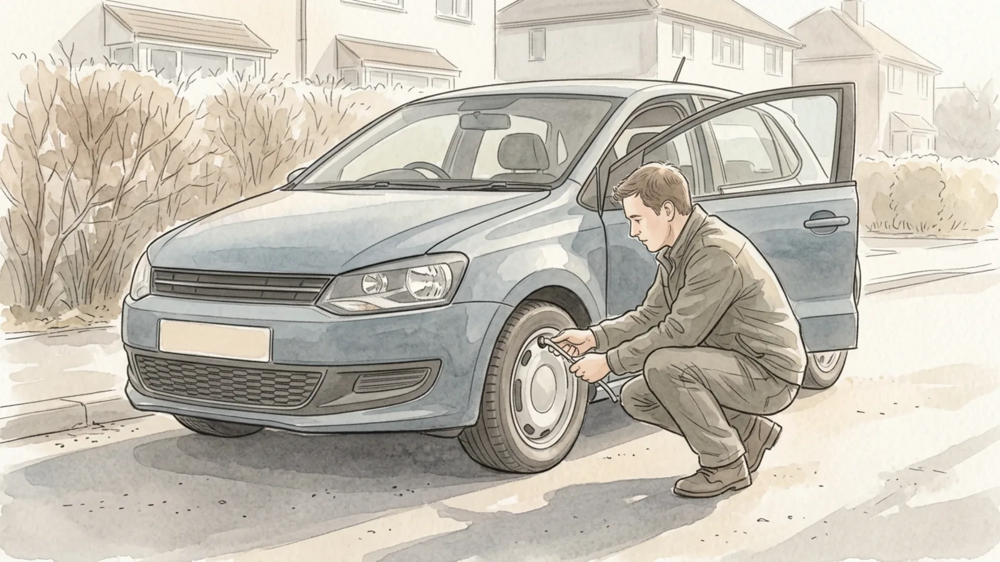

## Part 1 of 3 — Find the Right Number

### Step 1 — Open the driver's door and find the information label

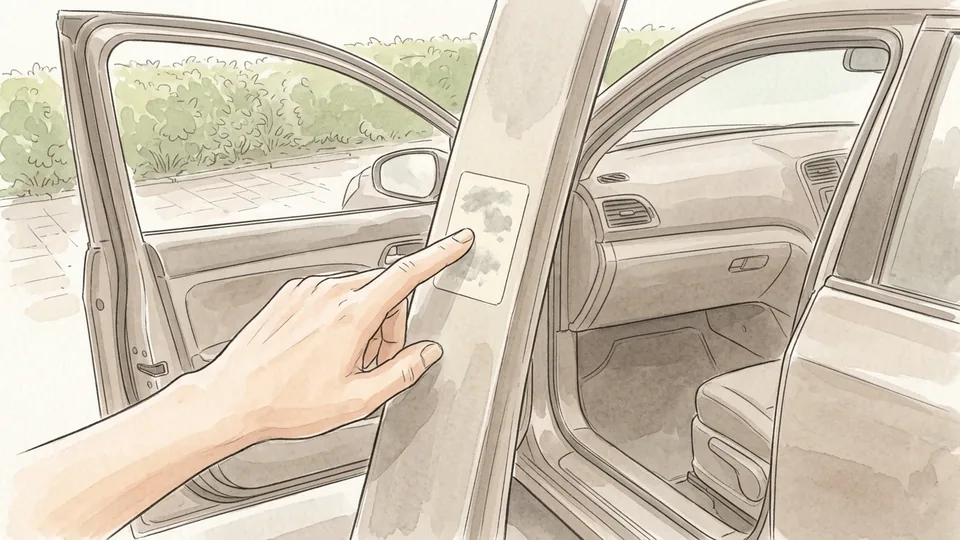

Open the driver's door and look along the edge of the door or the pillar behind it. The Tire and Loading Information label lists your tire size and the cold inflation pressure the vehicle was designed for, given in both psi and kilopascals. On vehicles without that pillar the label may sit on the rear edge of the door, or on a surface beside the driver's seat. If you cannot find it anywhere, the same figures appear in the owner's manual.

**Tip:** Photograph the label with your phone. The numbers are then in your pocket at every service station.

### Step 2 — Ignore the figure moulded into the sidewall

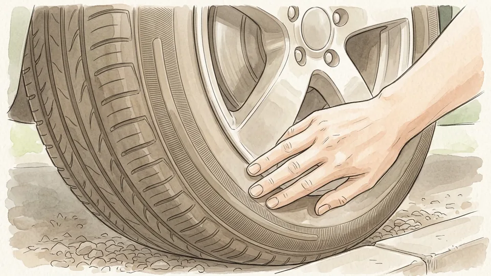

The large pressure figure pressed into the tire itself is the maximum that tire can safely hold. It is not the pressure your car should run. NHTSA states the point plainly: use the vehicle manufacturer's number, not the one on the tire. Inflating to the sidewall maximum gives a harsh ride, shrinks the patch of rubber touching the road, and wears out the centre of the tread long before the shoulders.

**Tip:** If the two numbers differ by fifteen psi or more, nothing is wrong. The door label still wins.

### Step 3 — Note whether the front and rear differ

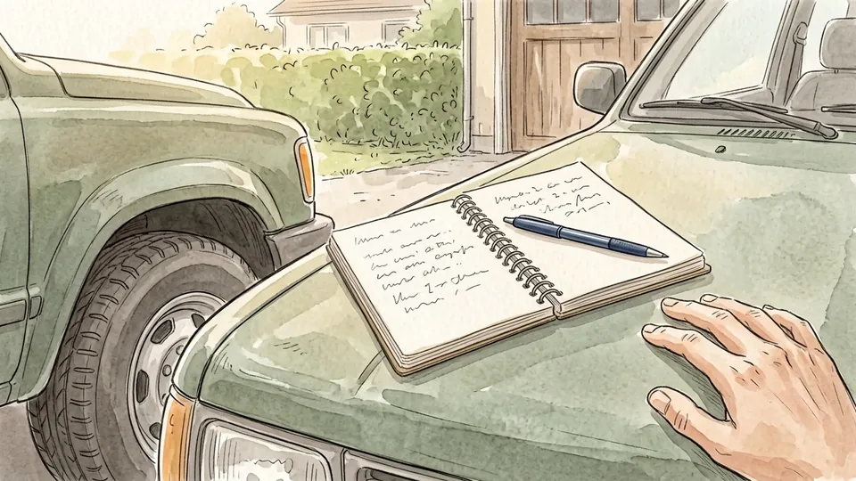

Plenty of vehicles specify one pressure for the front axle and another for the rear, and the spare often needs considerably more than either. Read every figure on the label before you start rather than assuming a single number covers the whole car. Write them down in the order you intend to work around the vehicle, so you are not crouching by a wheel trying to remember which axle takes which.

**Tip:** Loading up for a long trip with passengers and luggage? Check whether the label gives a separate full-load figure.

### Step 4 — Get a gauge you can actually read

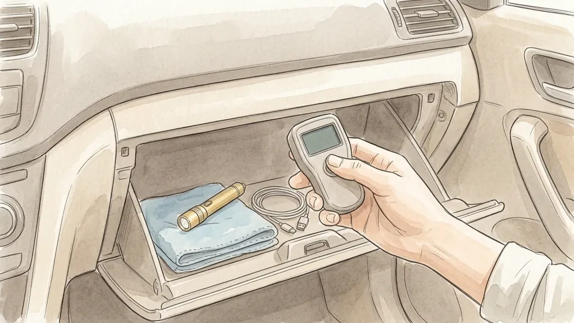

A pencil gauge, a dial gauge or a small digital one all work. The gauges bolted to garage air hoses are the least reliable of the lot, because they live outdoors and get dropped daily. Keep your own in the glovebox so a reading is never more than a minute away. Compare it against a second gauge once in a while; if two disagree by more than a couple of psi, retire the older one.

**Tip:** Digital gauges run on batteries. Test yours before a long trip, not on a dark forecourt at night.

### Step 5 — Plan a cold reading

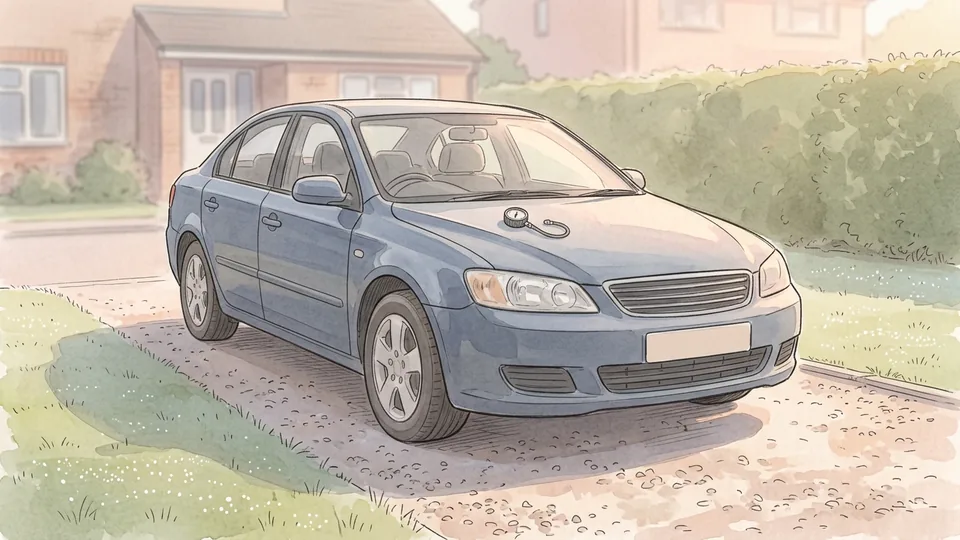

Air expands as it warms, so pressure climbs once the tires have been working. The figure on the door label applies only to a cold tire, meaning the car has stood for at least three hours or has been driven less than a mile. The simplest routine is to check in the morning before the first trip of the day. A reading taken after a motorway run can be several psi high and will tempt you to let out air you need.

**Tip:** Sun falling on one side of the car warms those two tires as well. Park in shade when you can.

## Part 2 of 3 — Take the Reading and Correct It

### Step 6 — Unscrew the valve cap and keep it safe

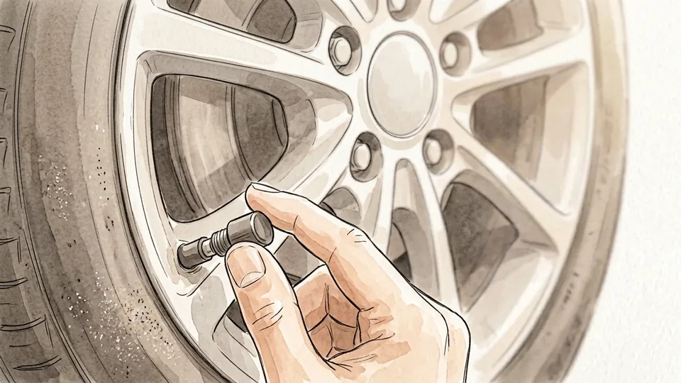

Turn the small cap anticlockwise and put it somewhere it cannot roll under the car: a pocket, or balanced on the fuel filler cap. That little cap keeps grit and rainwater out of the valve, and a missing one lets dirt settle into the seal where it slowly turns into a leak. Replace any cap that is cracked, or that you have to force to get moving.

**Tip:** Caps cost almost nothing at a parts counter. Buy a set of four rather than hunting for a single replacement.

### Step 7 — Press the gauge on squarely

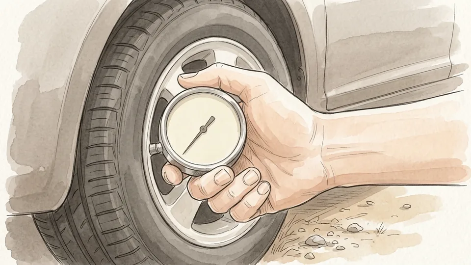

Push the gauge straight onto the valve stem in one firm movement and hold it still. A short hiss as you make contact is normal. A continuous hiss means the gauge is sitting crooked and air is escaping past it, so lift off and try again rather than pressing harder. Keep the gauge aligned with the valve instead of levering it sideways, which is what bends valve stems.

**Tip:** If the reading jumps about, you are rocking the gauge. Brace your wrist against the wheel to steady it.

### Step 8 — Read the figure and write it down

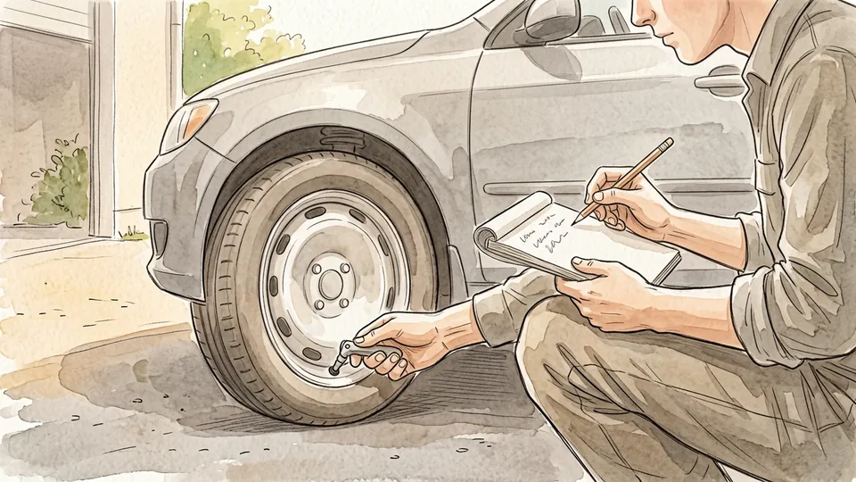

Take the reading straight away and note it beside that wheel on your list. Work around the car in a fixed order, front left to front right to rear right to rear left, so you cannot lose your place halfway. Then do the spare. It is the one tire most people discover is flat on the single day of the decade they actually need it.

**Tip:** Check the spare at least twice a year, even if you check the other four every month.

### Step 9 — Add air to anything reading low

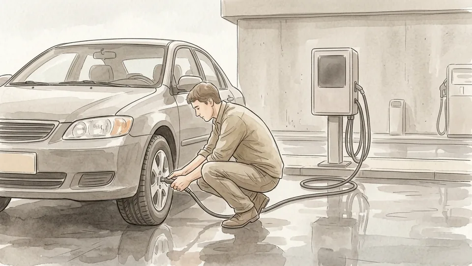

Work out the gap between your reading and the target, then add that much at the air line. Fill in short bursts and re-measure with your own gauge between each one, rather than trusting the display on the machine. Most forecourt inflators let you dial in a target and stop on their own, but they are frequently a psi or two out, so always confirm with the gauge you know.

**Tip:** Carry coins or a card. Plenty of air machines still charge, and very few of them take notes.

### Step 10 — Let air out of anything reading high

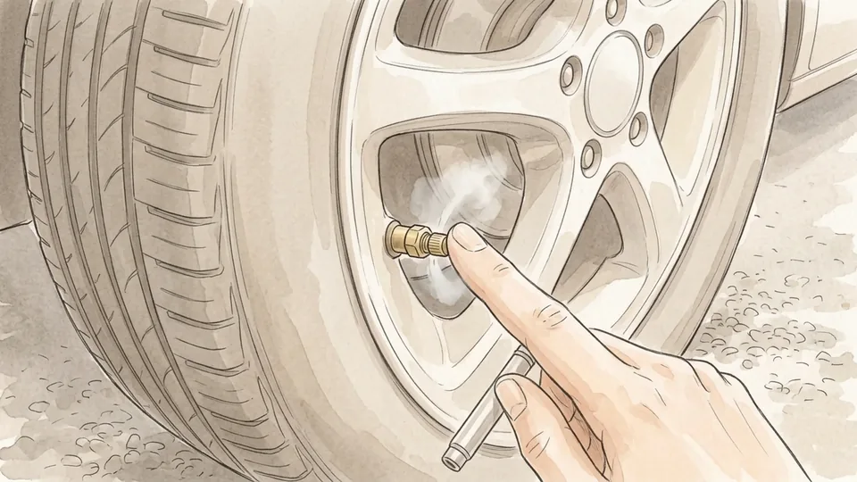

If a tire is over its target, press the small pin in the centre of the valve using the nub on the back of your gauge. Release in bursts of a second or two and re-measure between each one. Air leaves far faster than it goes in, and overshooting means queueing at the pump again. Only do this on a cold tire; a warm one will read high regardless.

**Tip:** Never use a screwdriver, a key or a nail on the valve pin. You will damage the seal and create a slow leak.

### Step 11 — Even up each axle and refit the caps

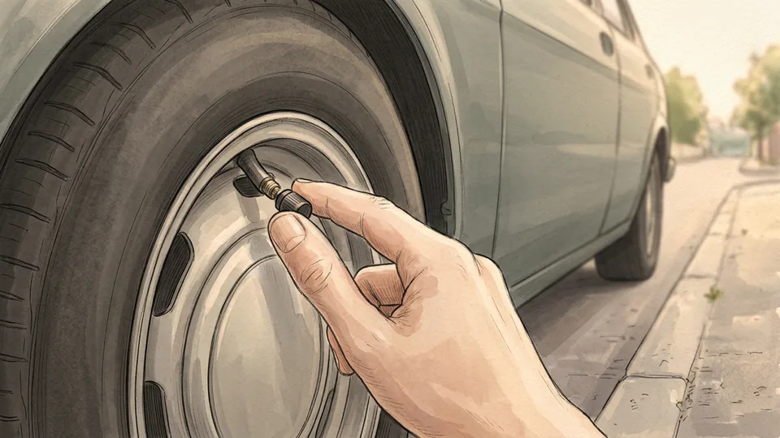

Compare the two tires on each axle and bring them to the same figure, unless the label specifies different pressures front and rear. A mismatched pair pulls the steering to one side and wears unevenly. Once every tire matches its target, screw the caps back on finger-tight: firm enough to stay put, loose enough that the next person does not need pliers.

**Tip:** Walk round the car and count four caps before you leave. It is the step everyone skips when it starts raining.

## Part 3 of 3 — Keep It Right Between Checks

### Step 12 — Look at the tread while you are down there

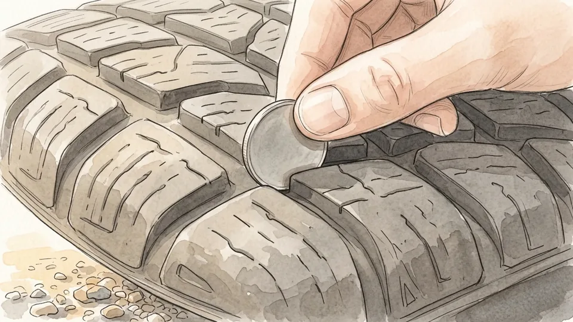

You are already crouched by the wheel, so run a hand across the tread and find the wear bars, the raised strips set across the bottom of the grooves. When the tread wears level with them it has reached two thirty-seconds of an inch and the tire needs replacing. The coin test works too: stand a penny in a groove with Lincoln upside down, and if the top of his head is visible, the tread is finished.

**Tip:** Wear concentrated on one edge of a single tire usually points to alignment or pressure, not to a faulty tire.

### Step 13 — Treat the dashboard warning as a last resort

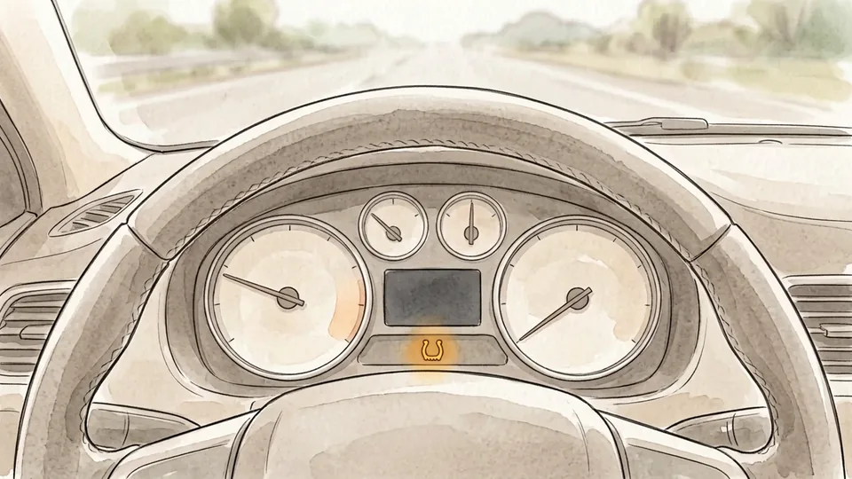

A tire pressure monitoring system only lights up once a tire is significantly underinflated, well past the point where handling, braking and fuel economy have already suffered. It is a warning that something has gone wrong, not a substitute for a monthly check. When the light does appear, put a gauge on all four tires rather than guessing which one set it off.

**Tip:** A light that flashes for a minute at startup and then stays on usually means a sensor fault rather than low pressure.

### Step 14 — Put the check on a monthly cycle

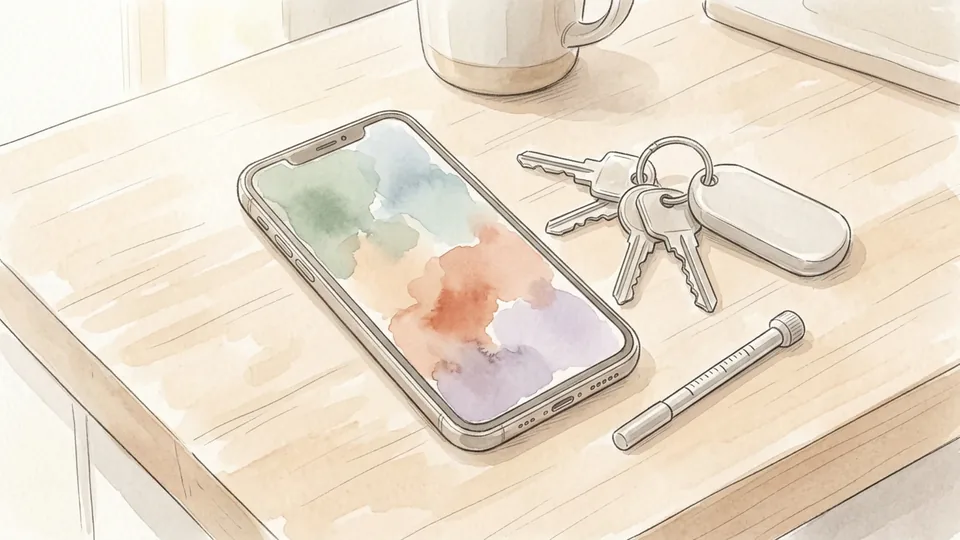

Set a recurring reminder for the same date each month and attach it to something you already do, such as the first fill-up after payday. Tires lose pressure slowly all by themselves, and roughly a further psi for every ten degrees Fahrenheit the temperature falls. That is why the first genuinely cold week of autumn takes every tire on the street below target at once.

**Tip:** Re-check a week after any tire work. Fitters set pressures from a generic chart, not from the label on your door.

### Step 15 — Know when to stop and have it inspected

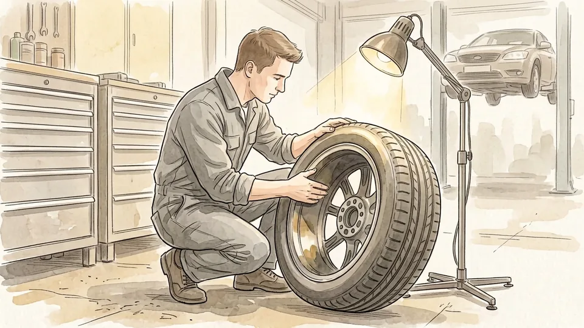

A tire that needs air every week has a leak, and slow leaks have a habit of becoming sudden ones. Stop driving on it and get it looked at. The same goes for a bulge in the sidewall, a cut deep enough to show the cords, or any tire you have driven on while flat, even for a short distance. That damage happens inside the casing and will not be visible from the outside.

**Tip:** Note the date and the reading each time you top up. A written pattern is far easier to show a fitter than a vague feeling.

## Tips

- Do the whole car, including the spare, in one go. Checking a single tire because it looks low tells you nothing about the other three.
- Keep the gauge, a pen and a scrap of card in the glovebox together, so the job never depends on finding something first.
- If you top up at a station, drive there gently and accept that the reading will be a little warm. A slightly imperfect correction beats leaving a tire soft.

## Warnings

- Never inflate a tire to the maximum pressure moulded into the sidewall unless the vehicle manufacturer specifies that figure. It is a limit, not a target.
- Do not drive on a tire that has been run flat, even briefly, without having it inspected. Internal damage to the casing is invisible from outside and can cause a blowout later.
- Stand to the side, not in front of a tire, when inflating a tire that was very low or that you suspect is damaged.

## Community Q&A

**How often should I check my tire pressure?**

At least once a month, and before any long trip. NHTSA recommends monthly checks on all tires including the spare, taken when the tires are cold. Pressure also drops as the weather turns colder, so expect to top up in autumn even if nothing is leaking.

**What does 'cold' actually mean?**

The car has been parked for at least three hours, or driven less than about a mile at low speed. That is the condition the figure on your door label assumes. Checking after a long drive will give a higher reading, because the air inside has warmed and expanded.

**Should I use the number on the tire or the number on the door?**

The door. The figure on the sidewall is the maximum pressure the tire is built to contain, while the label on the driver's door edge gives the pressure the vehicle was engineered around. Using the sidewall figure overinflates most cars considerably.

**My TPMS light is off, so are my tires fine?**

Not necessarily. The system is designed to warn you when a tire is significantly underinflated, not when it is mildly low. A tire several psi below target affects grip, braking distance and fuel use long before it trips the warning, which is why a monthly gauge check still matters.

**What if one tire keeps losing air?**

Treat it as a fault, not a chore. A tire needing air every week or two has a puncture, a corroded rim, or a failing valve. Have it inspected rather than topping it up indefinitely, because the underlying leak tends to get worse rather than better.

## Useful external resources

- [NHTSA: Tires (TireWise)](https://www.nhtsa.gov/vehicle-safety/tires) — Official guidance on cold readings, the door-jamb label, tread depth and TPMS.
- [NHTSA: Tire Recalls](https://www.nhtsa.gov/recalls#tires) — Check whether your tires are subject to a safety recall.
- [NHTSA Ratings: Uniform Tire Quality Grading](https://www.nhtsa.gov/ratings#tires) — Treadwear, traction and temperature grades when you come to replace a tire.

## References

1. National Highway Traffic Safety Administration. Tires: Maintenance and Maintaining Proper Tire Pressure (TireWise). Accessed October 30, 2026. https://www.nhtsa.gov/vehicle-safety/tires
2. National Highway Traffic Safety Administration. Tire Safety Ratings and Recalls. Accessed October 30, 2026. https://www.nhtsa.gov/recalls#tires
3. National Highway Traffic Safety Administration. Uniform Tire Quality Grading System. Accessed October 30, 2026. https://www.nhtsa.gov/ratings#tires

## Internal links

- [How to Change a Flat Tire](https://www.56juqingba.com/Change-a-Flat-Tire)
- [How to Jump-Start a Car](https://www.56juqingba.com/Jump-Start-a-Car)
- [Cars and Other Vehicles](https://www.56juqingba.com/Category/Cars-and-Other-Vehicles)
