# How to Compare Two Philosophical Viewpoints

*Get both views under one question, state each one as its defender would, test them on the same case, and finish with a judgement instead of a shrug.*

**Category:** Philosophy and Religion

**Slug:** `/Compare-Two-Philosophical-Viewpoints`

**Primary keyword:** compare two philosophical viewpoints

**Meta description:** Compare two philosophical viewpoints fairly: find the shared question, state each view as its defender would, test both on one case, then write a verdict.

---

## Intro

Most comparisons of two philosophical positions go wrong in the first ten minutes. Either the two views turn out to be answering different questions, or one of them is quietly rewritten into something nobody has ever held. A good comparison is slower and far more useful: it names the single question at stake, states each view in words its defender would accept, and then looks for the one place where the two really come apart. Writing centres teach the mechanics of comparison, and philosophers have their own tools for it, from the mutual adjustment of principles and cases known as reflective equilibrium to a whole literature on what to do when a sensible person disagrees with you. These fifteen steps put those tools in order, from setting up the comparison to writing the verdict down.

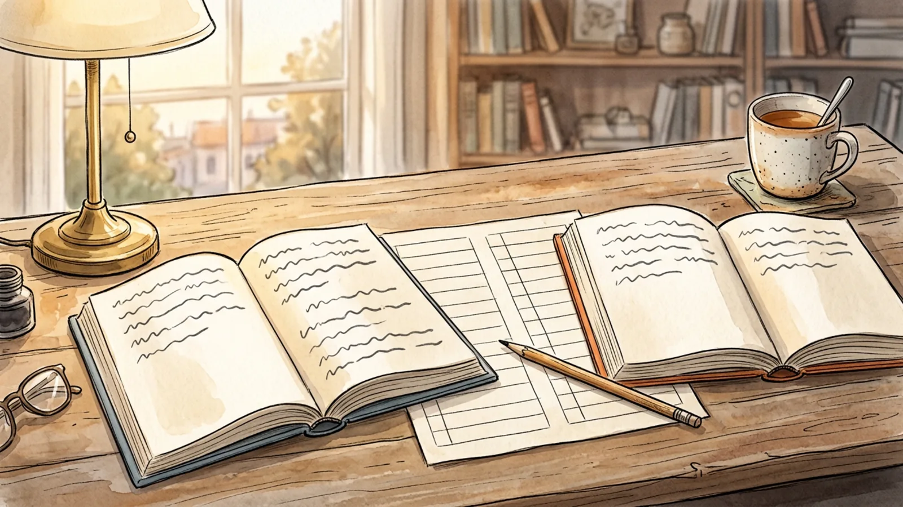

## Part 1 of 3 — Set Up a Fair Comparison

### Step 1 — Write the one question both views answer

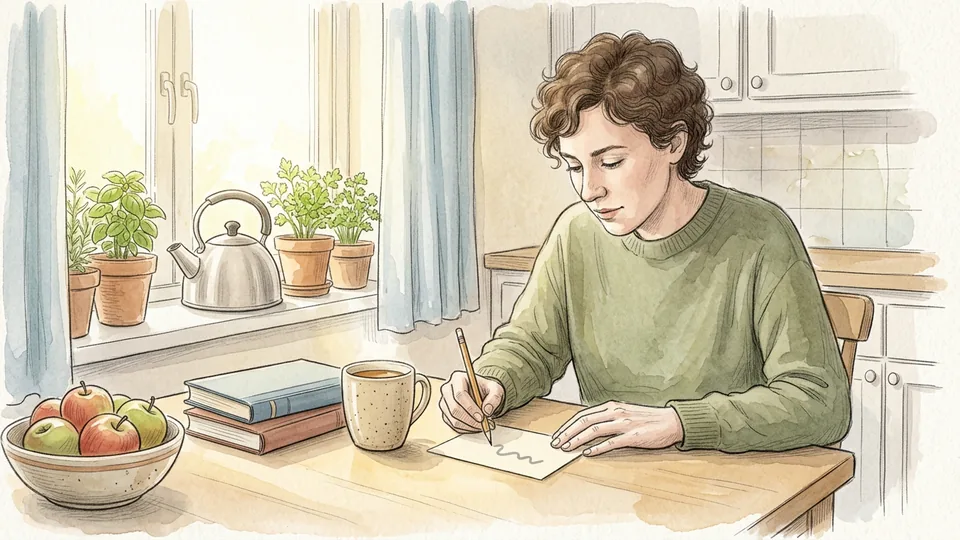

A comparison only works if both positions are answers to the same question. Write that question in a single sentence before anything else, and make it a question rather than a pairing of names. Not Kant against Mill, but: what makes an action the right one to do? If you cannot fit both views under one question, you are holding two separate debates and should split them. Keep the sentence at the top of the page, because it is what stops the comparison wandering.

**Tip:** If one view answers what is true and the other answers what we should do, write two questions and treat them as two comparisons.

### Step 2 — Take each view from its own source

Read at least one passage per side written or endorsed by somebody who holds the view. Critics compress their opponents, textbooks compress everyone, and a summary of a summary drifts a long way from the original in three steps. You do not need the complete works; a chapter, an article or a well-chosen extract is enough to hear the position in its own voice. Note where each text was published and when, because a view often changes across an author's career.

**Tip:** Our guide to reading a philosophical text covers how to get through a dense passage without rereading it six times.

### Step 3 — State each view in one sentence its defender would accept

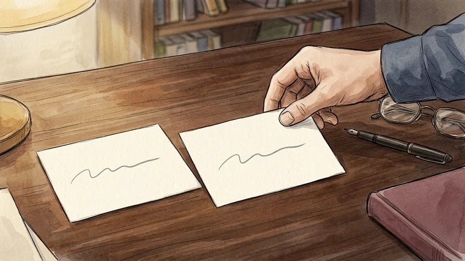

Now compress each position into a single sentence, and apply the test that matters: would somebody who actually holds this view nod at your sentence? If they would object, you have built the comparison on a caricature, and it will collapse the moment a defender reads it. Rewrite until both sentences pass. This is harder than it sounds, because the charitable version of a view is usually more careful and more qualified than the slogan version.

**Tip:** Write both sentences on separate cards. If one is twice the length of the other, you have understood one view better than the other.

### Step 4 — Build a grid before you build an argument

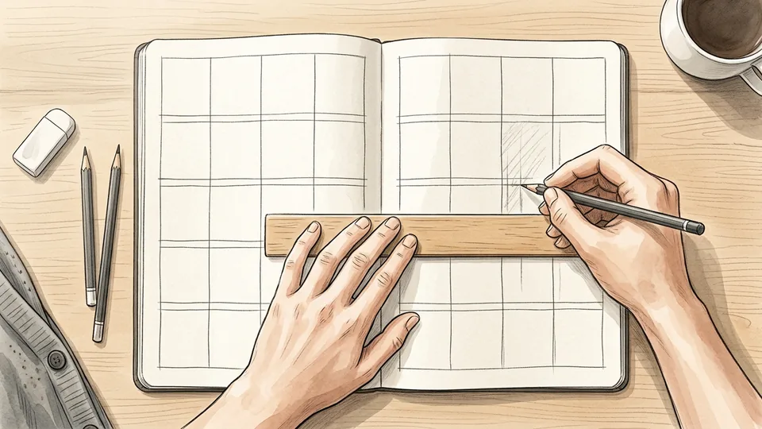

Writing centres recommend a simple chart for exactly this job: criteria down the left-hand side, the two views across the top, one box for each pair. Useful criteria include the central claim, the main argument, what counts as evidence, the hard cases, and the practical upshot. Fill the boxes from your reading rather than from memory. The empty boxes are the most informative part of the grid, because each one marks something you have not actually looked up yet.

**Tip:** Keep the grid to one page. If it needs two, you are comparing three things, not two.

### Step 5 — Find the real point of disagreement

Scan the grid for the row where the two views genuinely collide, and check first that the collision is real. Sometimes both sides use one word in two senses, and the dispute dissolves once you say which sense you mean. Philosophers also separate disagreement about what is true from disagreement about what to do, and the difference is practical: you can suspend judgement about a claim, but somebody who must act still has to act or not act.

**Tip:** Underline the disputed words in both one-sentence summaries. Freedom, cause, good and natural are the usual suspects.

## Part 2 of 3 — Work Through the Substance

### Step 6 — Compare what each view takes for granted

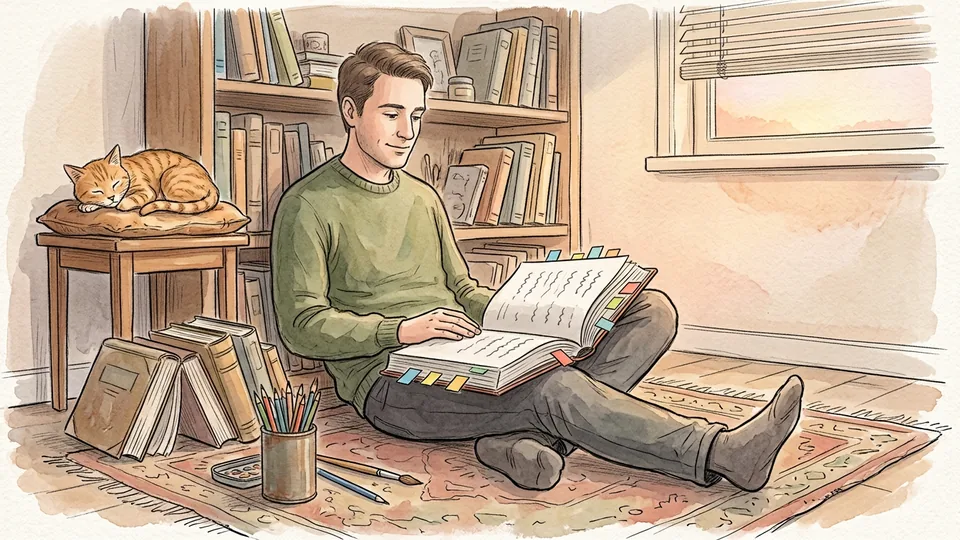

Behind every position sits a set of things it never argues for: a picture of what people are like, of what counts as knowing something, of what a good explanation has to do. Write two or three of these background assumptions for each side. Very often the real split is upstream of the arguments, in what each author thought was too obvious to defend, and a comparison that stays at the level of conclusions will never find it.

**Tip:** Ask of each view: what would have to be false about the world for this position to be a non-starter?

### Step 7 — Reconstruct the argument on each side

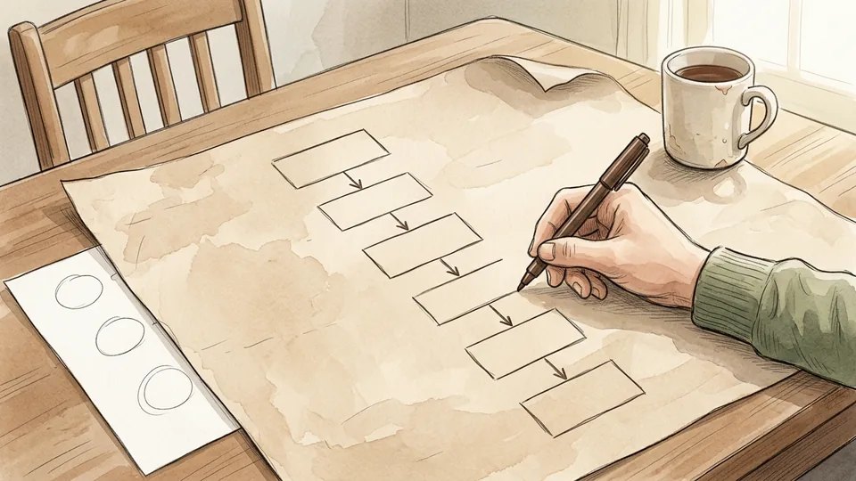

Set out each position as premises followed by a conclusion, one short line per premise. Then ask where your two reconstructions diverge. Sometimes the two sides share every premise but one, which makes the comparison narrow and tractable. Sometimes they share all the premises and differ about whether the conclusion follows, which is a very different problem. Naming which kind of disagreement you have saves you from arguing past the actual fault line.

**Tip:** Number the premises on both sides. Then you can write a sentence as precise as: the two agree except at premise three.

### Step 8 — Run both views on the same case

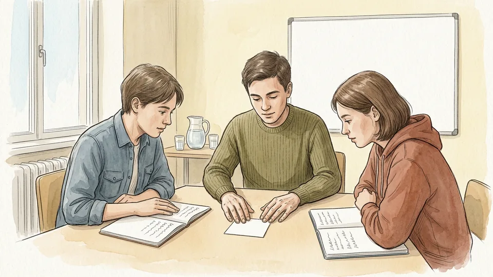

Pick one concrete case that both views have to handle, and write down the verdict each gives. This is the oldest engine in moral and political philosophy: principles and judgements about cases get adjusted against each other until they agree, a method Rawls called reflective equilibrium. When a principle delivers a verdict you cannot accept, you have two honest options. Revise the principle, or accept the verdict and say plainly why the discomfort is survivable.

**Tip:** Choose a case neither author discusses. Worked examples are chosen by authors because their own theory handles them well.

### Step 9 — Write the strongest objection to each view

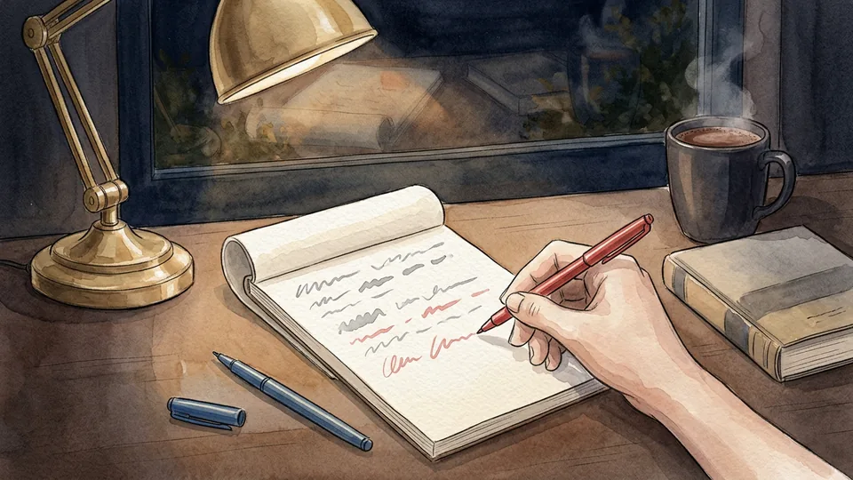

Spend ten minutes as the prosecution for each side in turn, and write the sharpest objection you can find, not the easiest. Then switch back and write the reply the defender would actually give, using the resources their own position provides. If you cannot construct a reply for one side, that is a real finding and belongs in your conclusion. If you can, you now know which objections a thoughtful supporter has already absorbed.

**Tip:** Use a different coloured pen for the objection and the reply. It stops the two voices blurring into your own.

### Step 10 — Mark where the two views agree

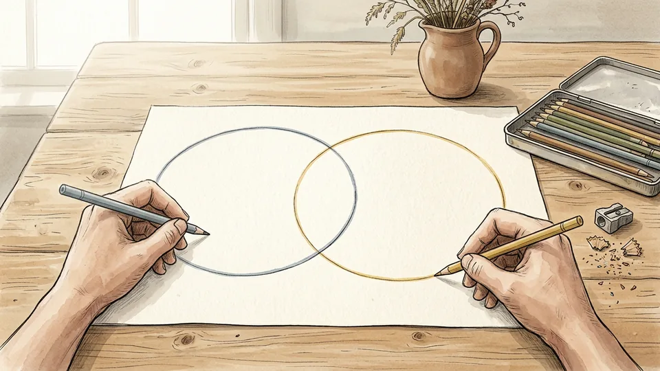

Draw two overlapping circles and fill the middle with everything both sides accept. The overlap is usually larger than the labels suggest, and it does real work. It sets the stakes, because it shows how much turns on the remaining difference, and it keeps the comparison honest, because a view you are about to criticise probably gets most of the ordinary cases right for the same reasons your preferred view does.

**Tip:** If the overlap fills the page and the disputed area is a sliver, say so. That is a result, not a failure.

## Part 3 of 3 — Reach a Judgement You Can Defend

### Step 11 — Decide in advance what would move you

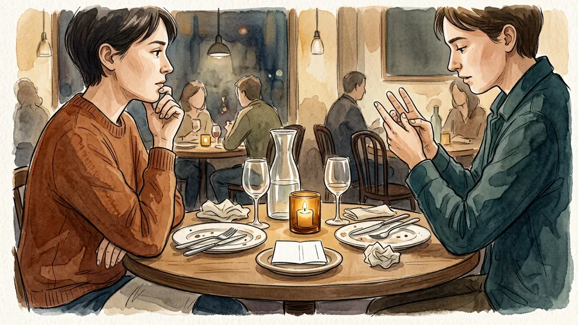

Before you weigh the two views, write down what would change your mind: a case you could not stomach, a premise shown to be false, a consequence you had not noticed. Epistemologists who study disagreement insist on a related rule of independence. You may not dismiss somebody as unqualified simply because they reached a different conclusion from yours; that reasoning lets you keep any belief you like, forever, at no cost.

**Tip:** Keep the note. Months later it tells you whether you changed your mind on evidence or simply drifted.

### Step 12 — Price each view before you judge it

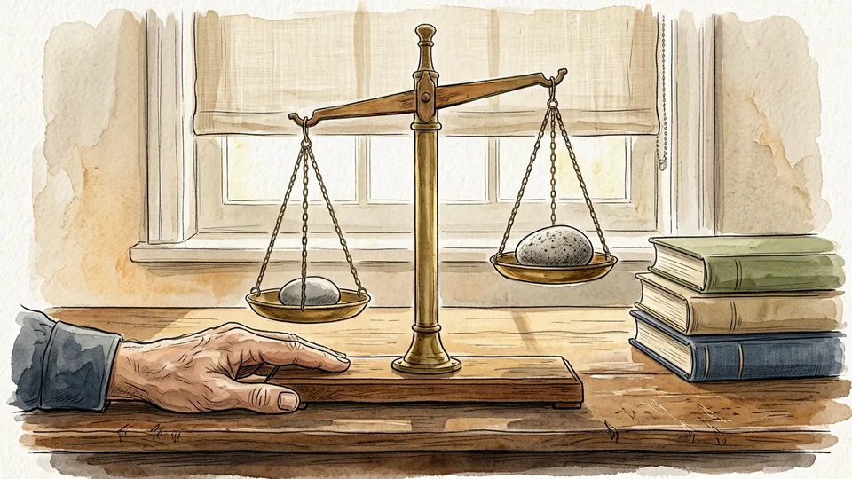

Every position pays somewhere. One buys simplicity and pays in counterintuitive verdicts; another matches our judgements case by case and pays in extra machinery; a third is airtight within a narrow scope and silent outside it. List the bill for each side, then compare bills rather than hunting for a view with no costs at all. There is no such view, and demanding one just hands the win to whichever position you understand least.

**Tip:** Write the costs in the same grid, as a final row. A comparison with no costs row is an advertisement.

### Step 13 — Write a thesis, not a tie

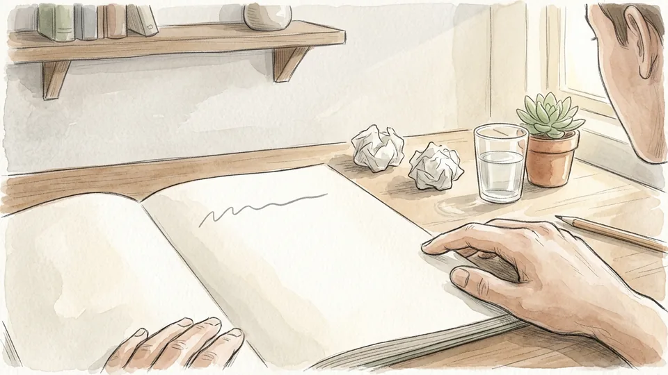

Both views are similar in some ways and different in others is not a conclusion; it is a description of the exercise. Say which view handles the shared question better, and in what respect, with the qualification the evidence supports. Suspending judgement is a legitimate conclusion, but only when you can say what blocks a decision and what would unblock it. A reader should finish your comparison knowing where you stand and why.

**Tip:** Draft the thesis in the form: on the question of X, view A does better at Y, at the cost of Z.

### Step 14 — Choose an order before you write it up

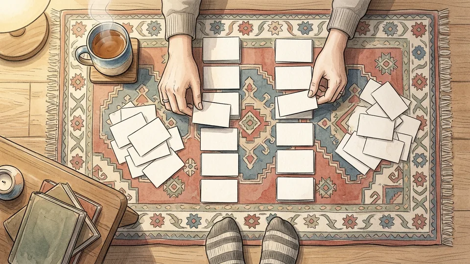

There are two standard shapes. Point by point takes one criterion at a time and gives both views in each section, which suits close comparison. Side by side gives all of one view, then all of the other, which suits the case where one view is really a lens for examining the other. Either way, place your strongest point last, since that is the one a reader carries away.

**Tip:** For a talk rather than an essay, point by point is safer. Listeners cannot flip back to check what you said about the first view.

### Step 15 — Date the verdict and leave it open

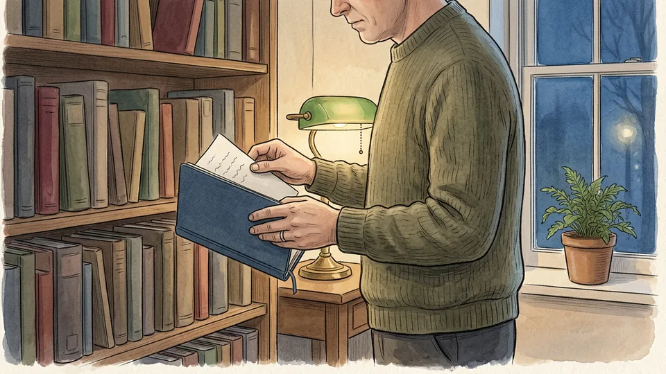

Write the date next to your conclusion, together with the one thing that would reopen it, and file the grid with the essay. Disagreement with a well-informed person who has seen your evidence is not a scoreboard to be settled this afternoon; it is a standing reason to keep checking. Come back after the next book, the next seminar, the next argument with a friend, and see whether the comparison still looks the way you left it.

**Tip:** Reopen the file when you meet a case neither view predicted. That is the cheapest new evidence you will ever get.

## Tips

- Do the grid in pencil. A comparison you cannot rub out becomes a position you have to defend.
- Read the two views in the opposite order the second time. Whichever you read first tends to set the terms for the other.
- If a view seems obviously stupid, assume you have the wrong version of it and go back to the source.
- Keep quotations short and exact, with page numbers, so that a disputed claim can be checked in seconds.

## Warnings

- A comparison written for a course is assessed against that course's marking criteria and citation rules, including any rules about generative AI. Follow those first, and treat a generic structure like this one as scaffolding rather than as a template to hand in.
- Do not take a position's content from an opponent's summary, a lecture slide or a chatbot and then quote it as the author's words. Check every quotation against the text you are citing before it goes into writing anybody else will read.
- When the two viewpoints are religious or political and belong to people close to you, a written comparison can read as a verdict on them rather than on the ideas. Ask before you circulate it, and keep the argument about the claims.

## Community Q&A

**What if the two views do not really conflict?**

That is a useful result and worth stating plainly. Either the two are answering different questions, or they are using one word in two senses. Show the reader where the apparent clash dissolves, then say which of the two questions you are going to pursue.

**Do I have to pick a winner?**

No, but you owe the reader more than a shrug. Suspending judgement is a defensible conclusion when you can name what is blocking a decision and what would settle it. What is not defensible is a conclusion that simply restates that both sides have points.

**How long should a comparison be?**

Shorter than most people expect. A one-page grid plus eight hundred words of argument usually beats a sprawling essay, because the grid does the descriptive work and leaves the prose free to argue. If the piece is assessed, the word limit decides.

**Can I compare three or more views?**

Yes, but add a column only when the third view changes the criteria rather than sitting between the first two. Compare pairs first, keep the same rows for every view, and expect the grid to stay readable only while it fits on one page.

## Useful external resources

- [Stanford Encyclopedia of Philosophy: Disagreement](https://plato.stanford.edu/entries/disagreement/) — On belief-disagreement versus action-disagreement, peer disagreement, and the independence rule against dismissing a peer because they disagree.
- [Stanford Encyclopedia of Philosophy: Reflective Equilibrium](https://plato.stanford.edu/entries/reflective-equilibrium/) — The method of adjusting principles and considered judgements about cases against each other until they agree.
- [UNC Writing Center: Comparing and Contrasting](https://writingcenter.unc.edu/tips-and-tools/comparing-and-contrasting/) — Practical mechanics: charts and Venn diagrams, choosing criteria, and the point-by-point versus subject-by-subject structures.
- [Stanford Encyclopedia of Philosophy: Argument and Argumentation](https://plato.stanford.edu/entries/argument/) — Arguments as premises supporting a conclusion, and argumentation as an exchange of reasons aimed at resolving a difference of opinion.

## References

1. Stanford Encyclopedia of Philosophy. Disagreement, first published 23 February 2018, substantive revision 29 February 2024. https://plato.stanford.edu/entries/disagreement/
2. Stanford Encyclopedia of Philosophy. Reflective Equilibrium, first published 27 November 2023. https://plato.stanford.edu/entries/reflective-equilibrium/
3. Stanford Encyclopedia of Philosophy. Argument and Argumentation, first published 16 July 2021. https://plato.stanford.edu/entries/argument/
4. The Writing Center, University of North Carolina at Chapel Hill. Comparing and Contrasting (handout), accessed 3 November 2026. https://writingcenter.unc.edu/tips-and-tools/comparing-and-contrasting/

## Internal links

- [How to Read a Philosophical Text](https://www.56juqingba.com/Read-a-Philosophical-Text)
- [How to Have a Difficult Conversation](https://www.56juqingba.com/Have-a-Difficult-Conversation)
- [How to Study for an Exam Without Cramming](https://www.56juqingba.com/Study-for-an-Exam-Without-Cramming)
- [How to Start a Club at School](https://www.56juqingba.com/Start-a-Club-at-School)
