# How to Discuss a Moral Dilemma Respectfully

*Agree what the case is and why you are talking about it, look at it through more than one ethical lens, and end the conversation without pretending the hard part went away.*

**Category:** Philosophy and Religion

**Slug:** `/Discuss-a-Moral-Dilemma-Respectfully`

**Primary keyword:** discuss a moral dilemma

**Meta description:** Run a respectful discussion of a moral dilemma: frame the case, agree ground rules, test it through six ethical lenses, and close without forcing consensus.

---

## Intro

A moral dilemma is not a quiz with a hidden answer. Philosophers describe it as a situation where someone is required to do each of two things, can do either, and cannot do both, so that whatever they choose something of real moral weight is left undone. Talking about a case like that in a group is worth doing, and easy to do badly: the conversation slides into debate, the loudest view wins, and the person closest to the problem says nothing. The fix is mostly structure. University teaching centres have spent decades working out how to run discussions on charged topics, and applied ethics centres have built frameworks that slow a decision down and widen it. These fifteen steps combine both, from setting the case up to following up afterwards.

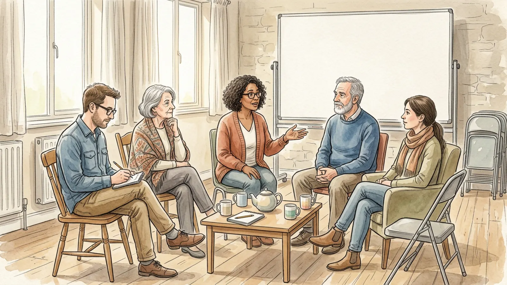

## Part 1 of 3 — Set the Conversation Up

### Step 1 — Write the case as a choice between two goods

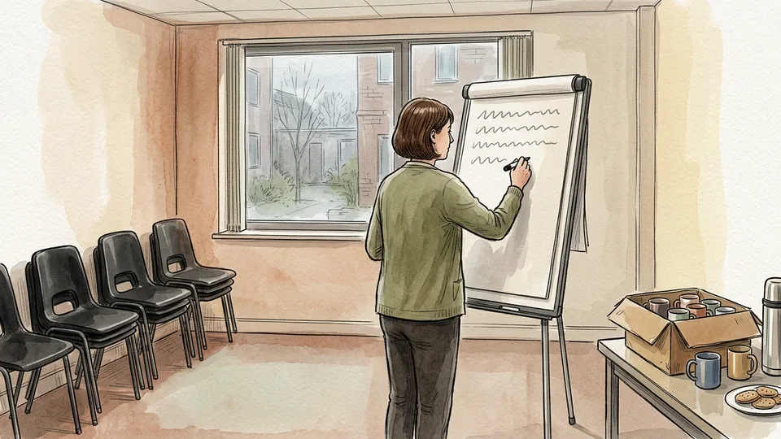

Put the dilemma on paper in two or three sentences: who has to act, what the two options are, and why each has something going for it. If one option is obviously right and the other is merely tempting, you have a hard decision rather than a dilemma, and the conversation should be about courage instead of ethics. A genuine dilemma survives the test that a reasonable person could choose either way and still be acting for a moral reason.

**Tip:** Read the written case aloud before you start. Half the disagreements in the first ten minutes are about what the case actually says.

### Step 2 — Agree what the conversation is for

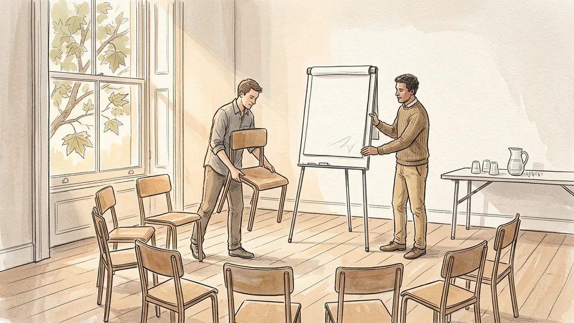

A discussion to reach a decision, a discussion to understand a case better, and a discussion to support somebody who has to decide are three different events. Say which one this is in the first minute, because it sets what counts as a good ending. Teaching centres treat a clearly stated purpose as the single most useful piece of preparation for a difficult discussion, and it is also the thing most groups skip.

**Tip:** Write the purpose at the top of the flip chart. When the talk drifts, point at it rather than arguing about relevance.

### Step 3 — Set ground rules together, before anyone is annoyed

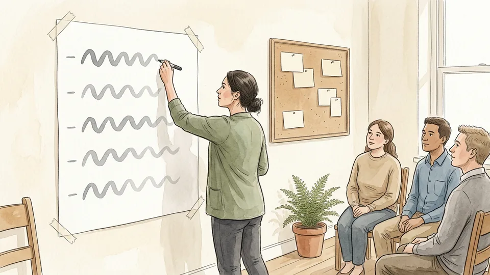

Agree a short list and make it visible: listen without interrupting, criticise ideas rather than people, avoid inflammatory language, let everybody speak, and never ask anyone to speak on behalf of a group they belong to. Add that passing is always allowed. Rules written by the group get followed; rules announced by a facilitator get ignored. Once they are agreed you can refer back to them later without it feeling like a personal reprimand.

**Tip:** Keep the list to five lines. A long charter is a sign that nobody intends to use it.

### Step 4 — Build a shared factual base

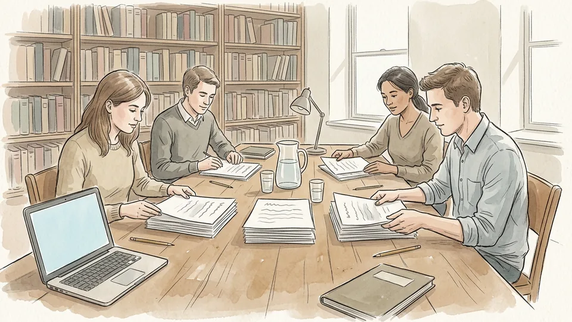

Before anyone argues, list what is known, what is unknown, and what is being assumed. Sort the claims into those three columns as a group. Most heated ethical arguments turn out to contain a buried factual dispute, and it is much easier to say the facts are unclear here than to accuse somebody of making things up. Note which missing facts would actually change the answer; those are the ones worth chasing.

**Tip:** Treat every number someone quotes from memory as unknown until it is checked. It usually is.

### Step 5 — List everybody with a stake

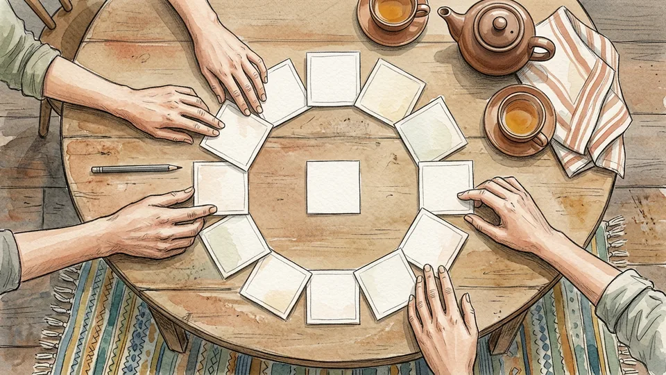

Name the people affected by each option, including the ones who are not in the room and will never read the minutes. Ethical frameworks start here for a reason: a decision usually looks different once the quiet stakeholders are written down. Mark whose stake is heaviest and whose is merely inconvenient. If somebody in the room is directly affected, say so openly and ask how they want to take part, rather than deciding for them.

**Tip:** Add a line for future people: the next patient, the next intake of students, the next person in that job.

## Part 2 of 3 — Keep It Honest and Unheated

### Step 6 — Open with a round, not with the loudest voice

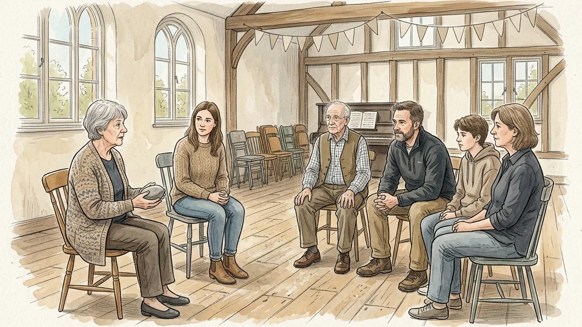

Go once around the group and let each person give a first reaction without interruption or comment, with the option to pass. A round takes five minutes and changes the whole session: quieter people have already spoken once, so speaking again is easier, and nobody has yet had the chance to stake out a position and defend it. Only after the round do you open the floor.

**Tip:** If the group is larger than eight, do the round in pairs first, then collect one sentence from each pair.

### Step 7 — Ask open questions with a boundary

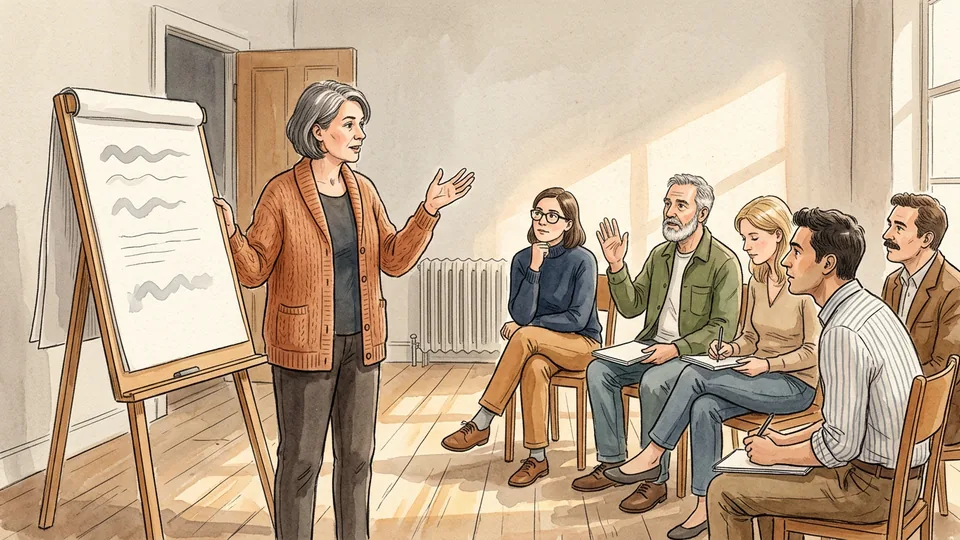

Good discussion questions invite several answers but still fence the topic: what would you need to know before deciding, or what makes this one hard to talk about. Avoid double-barrelled questions that pose two problems at once, and avoid questions where you are fishing for a particular answer, because people can tell and will either guess or go quiet. Keep two or three spare questions for the silence that follows a hard moment.

**Tip:** When an answer is thin, ask the person to say more about one word they used rather than repeating the question.

### Step 8 — Run the case through several ethical lenses

Applied ethics centres suggest looking through a set of lenses in turn: whose rights are at stake, what each option gives people their due, which option does most good and least harm overall, what serves the community as a whole, what kind of person each choice makes you, and what the relationships and feelings of those involved require. The lenses are complementary and will sometimes disagree. That disagreement is information, not a malfunction.

**Tip:** Assign one lens per pair for five minutes, then report back. It stops the group circling its favourite argument.

### Step 9 — Separate role duties from general duties

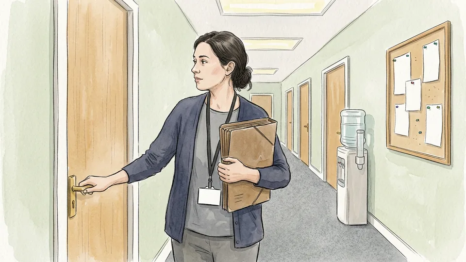

Some obligations belong to everybody and some come with a job. A lifeguard must go into the water when most bystanders need not; a lawyer must keep a client's disclosures confidential when an ordinary friend need not. Many workplace dilemmas are a collision between the two, and the collision is much easier to discuss once it has a name. Ask which duties in this case attach to the role and which would apply to anyone standing there.

**Tip:** If the case involves a regulated profession, find the relevant code of conduct and read the clause aloud.

### Step 10 — Cool the room when it heats up

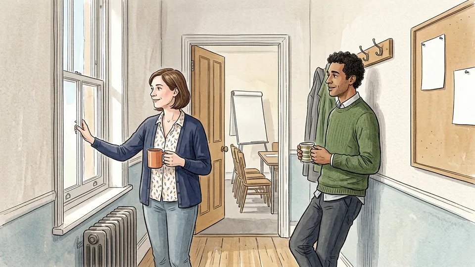

Charged moments are normal, and the fix is usually procedural rather than emotional. Name what is happening in plain terms, then give the group two minutes to write instead of speak. Return to the ground rules, restate the last point in neutral words, or call a short break and open a window. A facilitator who stays even-tempered and slows the pace is doing more good than one who tries to referee the argument on the spot.

**Tip:** Keep a kettle in the room. A five-minute tea break resolves more tension than a five-minute speech about tone.

## Part 3 of 3 — Finish Without Flattening It

### Step 11 — Make the best case for the option you reject

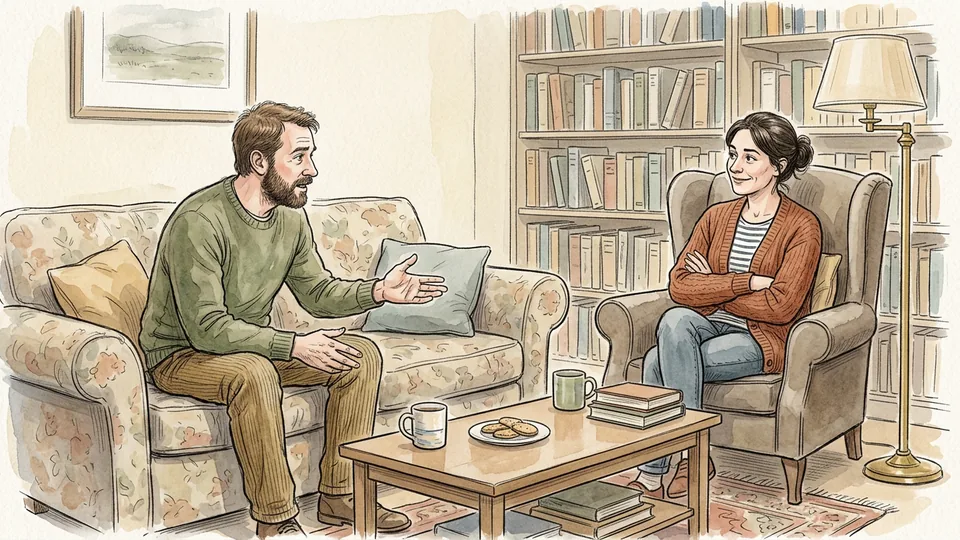

Ask each person, or each pair, to argue briefly for the side they do not hold, then ask somebody who actually holds that view whether the version was fair. This is the single quickest way to lower the temperature, because it forces everyone to notice that the other option has reasons behind it rather than motives. It also exposes the thin arguments on your own side, which is uncomfortable and useful.

**Tip:** If nobody in the room holds one of the views, read the strongest published statement of it aloud instead.

### Step 12 — Say out loud what is lost either way

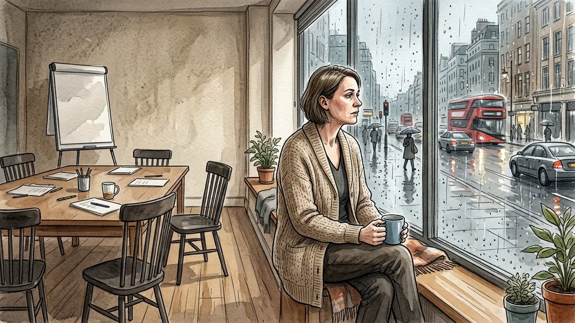

In a real dilemma every route costs something, and the cost does not disappear once a choice is made. Name it: the promise that will be broken, the person who will be let down, the risk somebody else now carries. Groups that skip this step tend to produce decisions that sound tidy and feel wrong afterwards. Groups that do it find the remaining disagreement shrinks, because people stop defending the claim that their option is free.

**Tip:** Write the losses on the same sheet as the decision. Future readers need to see what was weighed, not only what was chosen.

### Step 13 — Choose the kind of ending the group actually needs

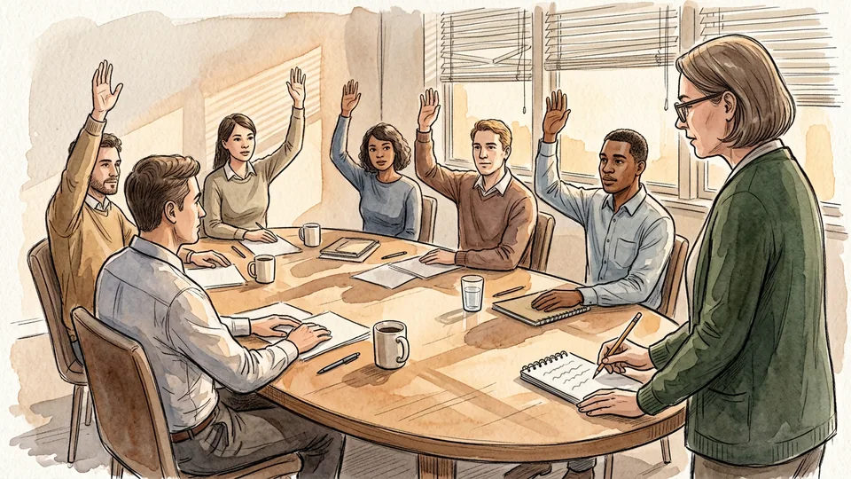

Sometimes you need a decision, sometimes a recommendation with the dissent recorded, sometimes nothing more than a clearer map of the disagreement. Decide which, and say it. Forcing consensus on a genuine dilemma produces a false unanimity that collapses the first time somebody is asked to act on it. A framework can structure the thinking, but it is not an algorithm: somebody still has to make the judgement call.

**Tip:** Record minority positions by name only with permission. Otherwise record them as an unattributed view that was argued in the room.

### Step 14 — Recap out loud, and in writing

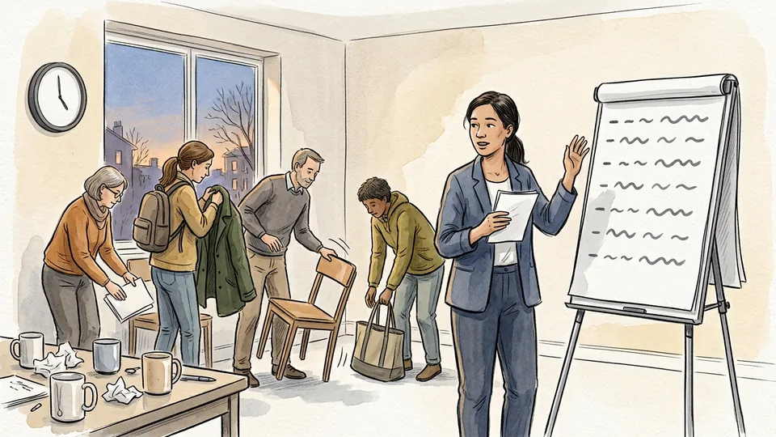

Save the last five minutes. Summarise the main points, the places the group split, the questions still open and anything anyone agreed to do next, and get that onto paper before people leave. Teaching centres also ask participants to write a private minute at the end: what you learned, what question remains, and what you heard from somebody else that you would not have thought of alone. Read those before the next session.

**Tip:** Circulate the recap within a day. A summary that arrives a week later reads like someone else's meeting.

### Step 15 — Follow up with the people, not just the file

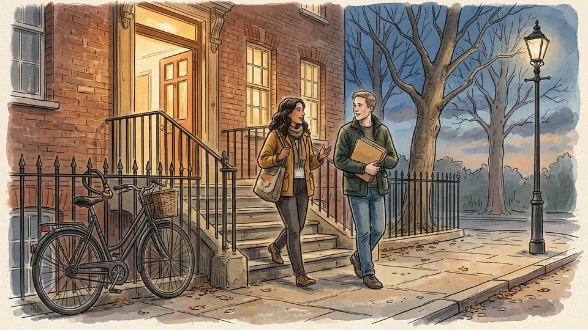

Check on anyone for whom the case was personal rather than theoretical, especially if they spoke. If the dilemma is live and belongs to a real person or organisation, make sure the proper route is being used as well as the conversation: a clinical ethics service, a safeguarding lead, a union representative, a professional body. Come back to the case when facts change, and ask the group what it would do differently next time.

**Tip:** Agree a date to revisit before you leave the room. Dilemmas that are parked without a date are simply dropped.

## Tips

- Use a written case rather than a live crisis when a group is new to this. People practise better on a case nobody in the room has to act on.
- Appoint someone other than the facilitator to take notes. Trying to steer a discussion and record it at the same time means doing both badly.
- Sit in a circle if the room allows it. Rows of chairs produce a lecture with interruptions rather than a conversation.
- Finish early rather than late. The last ten minutes of an overrunning ethics discussion are where most of the damage happens.

## Warnings

- A real situation involving harm, abuse, neglect, serious risk to someone's safety or possible illegality needs a reporting route, not only a discussion. Use the safeguarding, clinical ethics, compliance or legal channel that applies to your setting, and do not let the group's conversation become a substitute for it.
- Do not use somebody's current crisis as teaching material without their explicit consent. Anonymise cases, change identifying details, and follow the confidentiality rules of your workplace, school or profession before any case notes are shared or circulated.
- People may arrive at these discussions with personal experience of the situation under debate. Say at the start that anyone may leave or pass without explanation, and know where to point somebody who is distressed, such as a counselling service, an employee assistance line or their own doctor.

## Community Q&A

**What do I say when someone announces that morality is just opinion?**

Take it as a question rather than a wall. Ask whether they mean that nobody can be mistaken about ethics, or that this particular case is genuinely unsettled. Almost nobody holds the first view when it is spelled out, and the second is often correct and worth discussing on its own terms.

**Should the facilitator say what they think?**

It depends on what it will do to the room. Sharing a view can model how to take a position on hard ground; it can also close the discussion down if you hold any authority over the people in it. If you do share, do it late, mark it clearly as one view, and invite disagreement with it.

**What if the group cannot agree?**

Then record the disagreement properly: the options, the strongest reason for each, what each side would need to see to move, and what happens next. A well-mapped disagreement is a real outcome. A forced consensus is a worse one, because it hides who is actually prepared to act.

**Do we need any philosophy training for this?**

No. The structure does most of the work: a clear case, agreed ground rules, a round, a set of lenses and an honest recap. Reading one short piece of ethics beforehand helps, but a group that listens carefully will outperform a group that knows the vocabulary and talks over each other.

## Useful external resources

- [Markkula Center for Applied Ethics: A Framework for Ethical Decision Making](https://www.scu.edu/ethics/ethics-resources/a-framework-for-ethical-decision-making/) — Six ethical lenses (rights, justice, utilitarian, common good, virtue, care) and a five-stage process from identifying the issue to reflecting on the outcome.
- [University of Michigan CRLT: Guidelines for Discussing Difficult or High-Stakes Topics](https://crlt.umich.edu/publinks/generalguidelines) — Ground rules, bounded open-ended questions, the Round and Think-Pair-Share, active facilitation and end-of-session recap.
- [Stanford Encyclopedia of Philosophy: Moral Dilemmas](https://plato.stanford.edu/entries/moral-dilemmas/) — What makes a conflict a genuine dilemma, plus the distinction between general obligations and role-related ones.

## References

1. Markkula Center for Applied Ethics, Santa Clara University. A Framework for Ethical Decision Making, last revised 5 November 2021. https://www.scu.edu/ethics/ethics-resources/a-framework-for-ethical-decision-making/
2. Kwan, J., McLean, M. and Raicu, I. Introduction to "A Framework for Ethical Decision-Making", Markkula Center for Applied Ethics, 2021. https://www.scu.edu/ethics/ethics-resources/ethical-decision-making/introduction-to-a-framework-for-ethical-decision-making/
3. Center for Research on Learning and Teaching, University of Michigan. Guidelines for Discussing Difficult or High-Stakes Topics, accessed 3 November 2026. https://crlt.umich.edu/publinks/generalguidelines
4. Stanford Encyclopedia of Philosophy. Moral Dilemmas, first published 15 April 2002, substantive revision 25 July 2022. https://plato.stanford.edu/entries/moral-dilemmas/

## Internal links

- [How to Read a Philosophical Text](https://www.56juqingba.com/Read-a-Philosophical-Text)
- [How to Have a Difficult Conversation](https://www.56juqingba.com/Have-a-Difficult-Conversation)
- [How to Start a Club at School](https://www.56juqingba.com/Start-a-Club-at-School)
- [How to Split Household Chores Fairly](https://www.56juqingba.com/Split-Household-Chores-Fairly)
