# How to Handle a Disagreement Calmly

*Slow your first reply, work out what the argument is actually about, look for the need underneath each position, and agree the smallest thing you can both live with.*

**Category:** Relationships

**Slug:** `/Handle-a-Disagreement-Calmly`

**Primary keyword:** handle a disagreement calmly

**Meta description:** Handle a disagreement calmly: slow your first reply, find what the argument is really about, swap positions for needs, agree small, and take breaks that work.

---

## Intro

Staying calm in a disagreement is less about temperament than about sequence. Anger is a physical event — heart rate and blood pressure rise before the sentence does — and the American Psychological Association is blunt about the popular remedy: letting it rip escalates anger rather than discharging it. What works instead is slowing the reply, changing the language you argue in, and moving the conversation from positions to needs. Berkeley's guide for managers puts the aim plainly: the goal is not to decide who is right, but to reach something everyone can live with. The fifteen steps below cover one disagreement from the first flush of irritation to the follow-up two weeks later, including what to do when it gets too hot to continue.

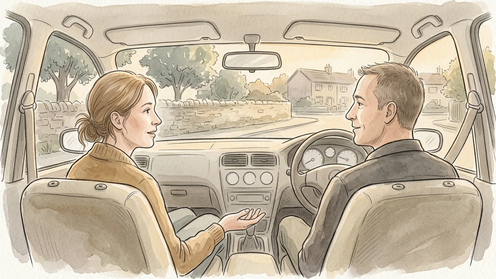

## Part 1 of 3 — Before You Answer

### Step 1 — Notice the body before the argument

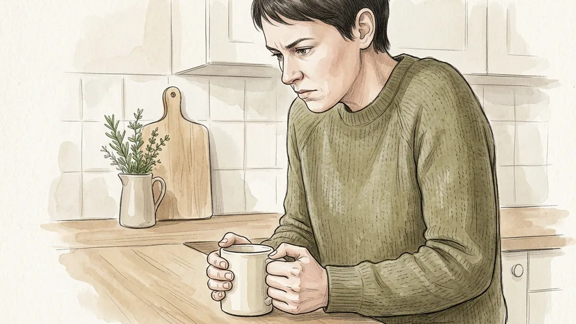

Anger arrives physically first: a hot face, a tight jaw, a faster heartbeat, the sudden clarity of exactly what to say. Those signals are the most reliable warning you will get, and they appear a second or two before the sentence you would regret. Learn your own pattern so you can recognise it mid-conversation rather than afterwards.

**Tip:** Grip is a good tell. If you have tightened your hand around a mug, a phone or the steering wheel, you are further up the scale than you think.

### Step 2 — Slow the first reply down

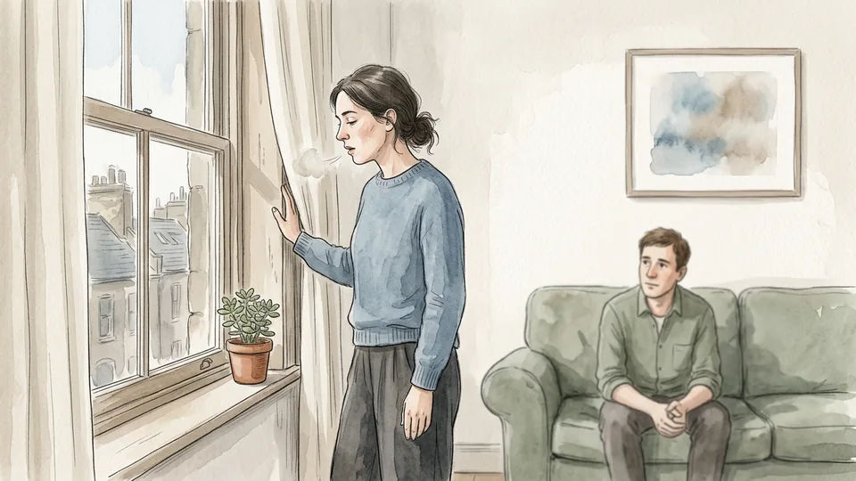

The first sentence sets the temperature of everything that follows, and it is almost always the worst one available. Breathe out slowly from the diaphragm, let two or three seconds pass, and answer the second thought rather than the first. If you need a phrase to buy the pause, use one: let me think about that for a second.

**Tip:** Lower and slower beats louder. Dropping your volume slightly makes the other person match it more often than not.

### Step 3 — Work out what the disagreement is actually about

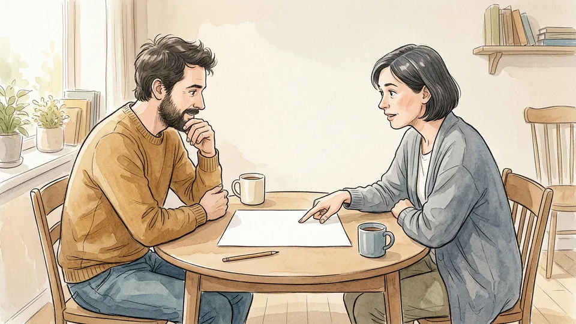

Most arguments are three different arguments tangled together: a disagreement about facts, about what something means, or about how the decision gets made. Say which one you are in. Facts can be checked, meaning has to be explained, and process can be renegotiated — and nothing moves while you are swapping evidence at someone who is upset about the process.

**Tip:** Ask it out loud: are we disagreeing about what happened, about what it meant, or about who decides?

### Step 4 — Check your own fairness story

People do not weigh fairness neutrally. Negotiation researchers call it self-serving fairness: we define what counts as fair in ways that happen to suit us, then experience that definition as objective. Before you argue the point, ask what a neutral observer would say about your claim, and whether the version in your head gives you a slightly flattering role.

**Tip:** If your account has you being reasonable throughout and them being difficult throughout, it is a story rather than a record.

### Step 5 — Take never and always out of your vocabulary

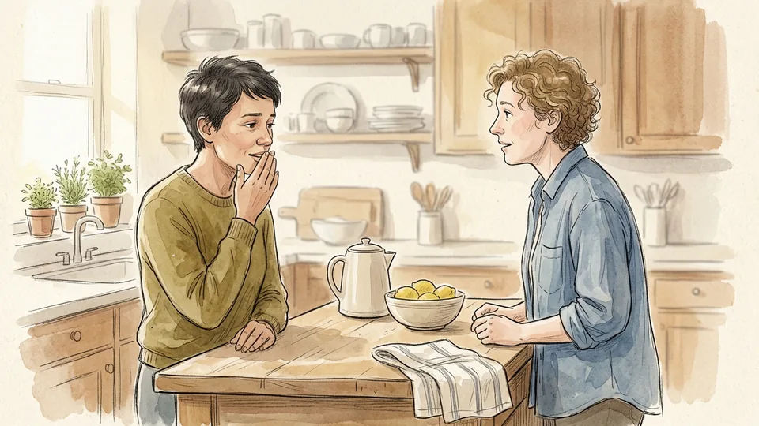

You always do this and you never listen are rarely accurate, and the APA notes that they do two bad things at once: they make your anger feel justified and they humiliate the person whose help you need to fix anything. Replace them with the specific instance and the specific effect. The argument becomes smaller and much easier to settle.

**Tip:** Swap demands for preferences. I would like us to decide this tonight lands very differently from we have to decide this tonight.

## Part 2 of 3 — In the Conversation

### Step 6 — Agree how you are going to talk before you talk

Thirty seconds of process saves an hour of heat. Agree out loud: one topic, no interruptions, we stop at half past, either of us can call a break. It sounds stiff, and it works, because it gives you something to point at later that is not the other person's behaviour. It also makes a break feel procedural rather than like storming off.

**Tip:** Sit at an angle rather than directly opposite. Face to face across a table reads as confrontation to most people.

### Step 7 — State your position once, then explain the why

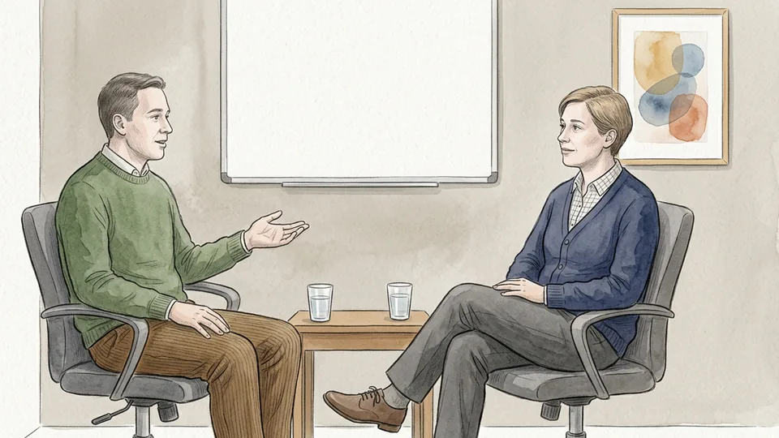

Say what you want in one sentence, then spend your time on the reason behind it rather than repeating the demand louder. I want to keep Sundays free is a position; what sits underneath — I am running out of recovery time and I am afraid of getting ill again — is the part that can actually be negotiated. People argue with positions and work with reasons.

**Tip:** Keep the reason about you rather than about them. It is information, not a charge sheet.

### Step 8 — Ask what sits underneath their position

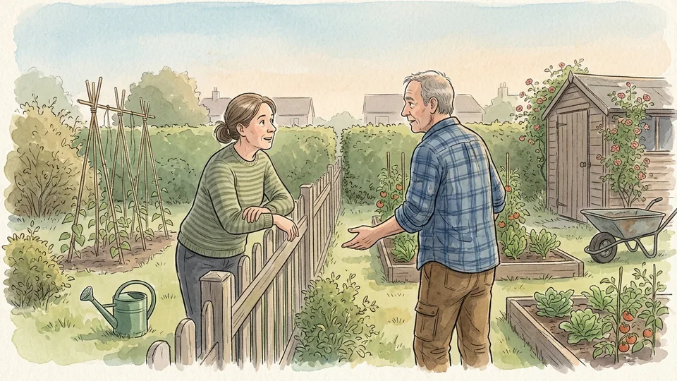

Then do the same for them: why do they want the solution they proposed, and what would it get them. Berkeley's conflict guidance treats this as the central move, because needs usually have several solutions while positions have only one. Ask, listen to the answer, and say it back before you respond to it.

**Tip:** The question that unlocks most disagreements is simply: what would that give you that the other option would not?

### Step 9 — Find the smallest thing you both agree on

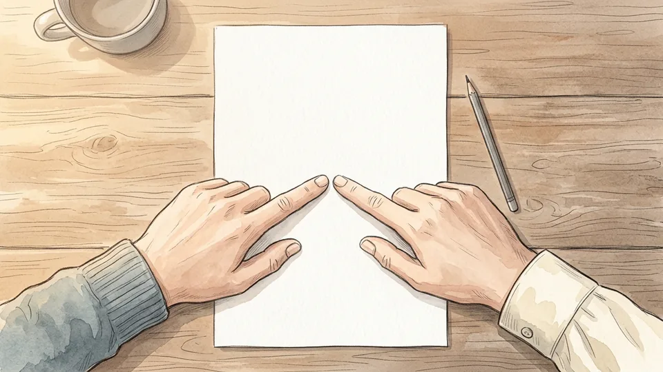

You do not have to agree on the conclusion to agree on something. Agree on the problem, on the procedure, on what you are each most worried about, or on one small change you can try this week. A small shared yes changes the shape of the conversation, because you are now two people with a problem rather than two problems facing each other.

**Tip:** Name the shared worry out loud. Neither of us wants this to drag on for a month is usually true and surprisingly disarming.

### Step 10 — Look for a trade rather than a win

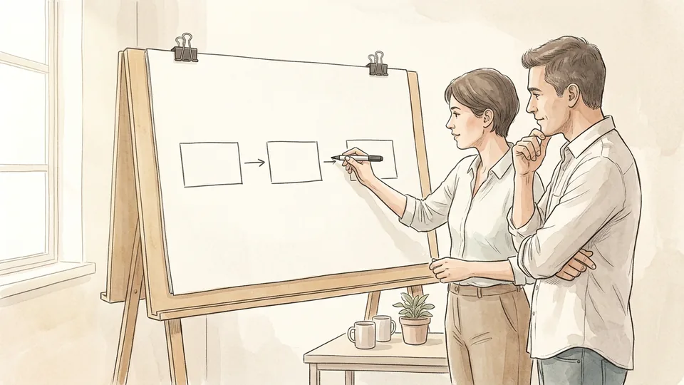

Put three or four options on the table rather than defending one, and look for the differences in what each of you cares about most — that is where trades live. You take the early mornings, I take the weekends. We try your version for a month and review it. Multiple options also lower the temperature, because the conversation stops being a referendum on one idea.

**Tip:** Know what you will do if you cannot agree, and keep it to yourself as a fallback rather than deploying it as a threat.

## Part 3 of 3 — When It Gets Hot, and Afterwards

### Step 11 — Call a break with a return time

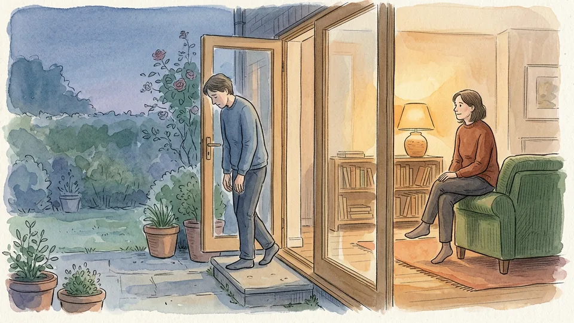

When either of you is too wound up to listen, stop — but stop properly. A break without a return time is an abandonment, and it teaches the other person to resist the next one. Say the sentence in full: I am too wound up to be fair right now, let us pick this up at eight. Then actually come back at eight, even if the subject has gone quiet.

**Tip:** Use the break to settle rather than to rehearse. Walking, washing up and slow breathing all work; replaying the argument does not.

### Step 12 — Do not vent to feel better

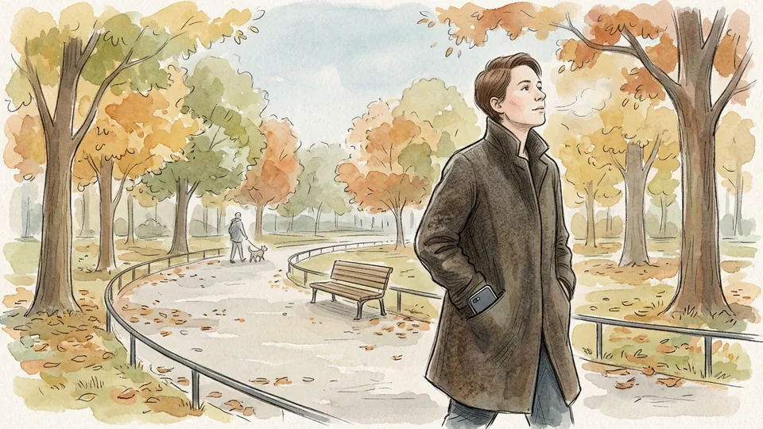

Shouting it out, hammering a pillow or ringing a friend to run through the whole thing again feels productive and is not. Research on anger is consistent: expressing rage tends to escalate it rather than drain it. Calming works — slow breathing, a repeated steadying word, a walk — and leaves you able to return to the actual problem.

**Tip:** There is a difference between talking something over with one trusted person and rehearsing your case to five. The second is practice for round two.

### Step 13 — Argue with the position, not the person

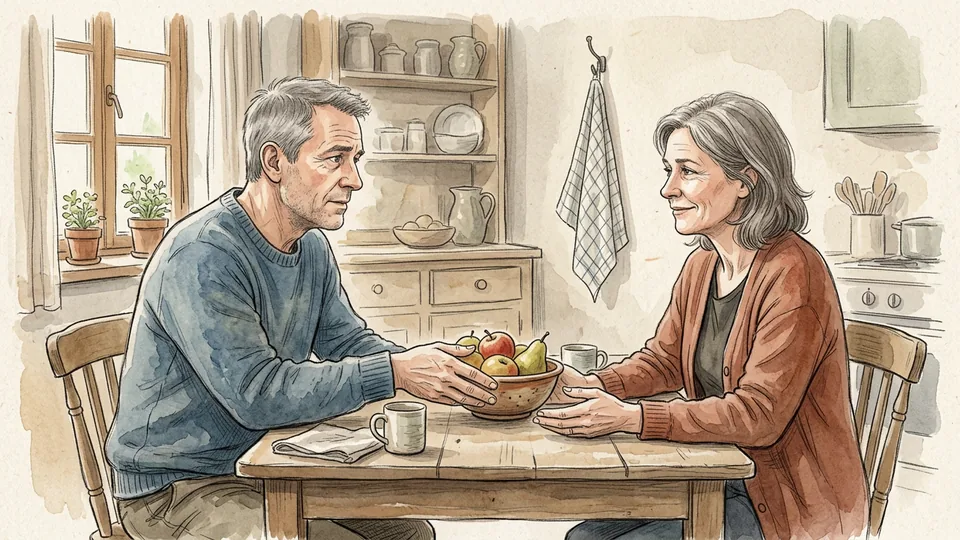

Sarcasm, eye-rolling and little digs at character do more damage than the disagreement itself, and they are remembered long after the subject is settled. Keep your criticism aimed at the idea, use humour only if it is warm rather than barbed, and allow the other person a route back that does not require humiliation.

**Tip:** Small physical courtesies — pouring the tea, moving your chair closer — do more to keep a hard conversation civil than any phrasing.

### Step 14 — Write down what you actually agreed

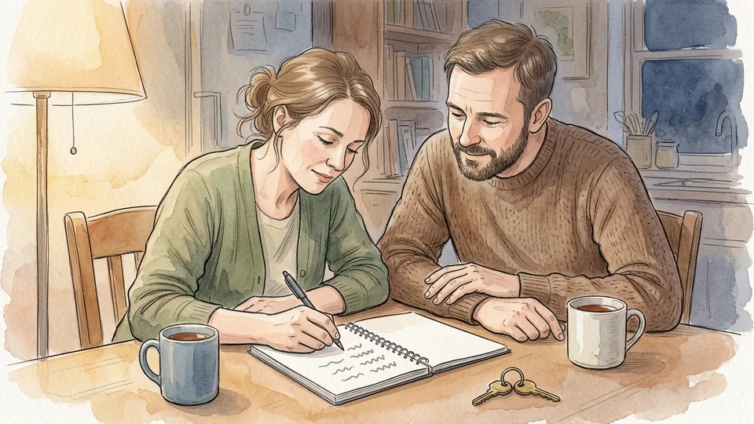

Memory is partisan, so finish by writing the agreement in plain terms: what each of you will do, by when, and what you will try first. Three lines on a shared note is enough. Then set a date to review it — a fortnight is about right — so that adjusting the arrangement is a planned conversation rather than the start of the next argument.

**Tip:** Read it back out loud before you both leave. Half of all apparent agreements turn out to be two different agreements.

### Step 15 — Know when to bring in a third person

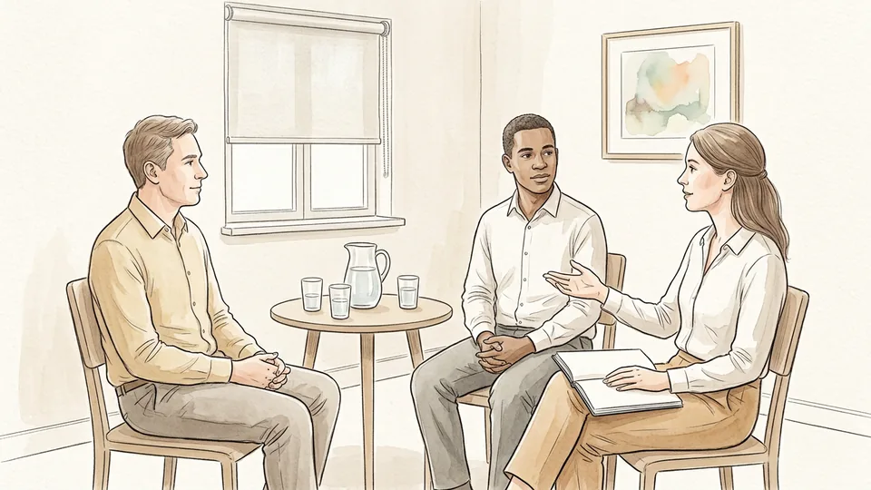

Some disagreements are stuck because of sunk costs rather than substance: both sides have invested too much pride to move. If you have been round the same loop three times, bring in someone neutral — a mediator, an ombuds service, HR, or in family matters a counsellor. Asking for help early is cheaper than the version where you ask for it after the relationship has worn through.

**Tip:** Agree the third party together. A referee chosen by one side starts the next argument instead of ending this one.

## Tips

- Decide the time of day you will not have hard conversations. Late at night, hungry, or in the car on the way somewhere are the three classic traps.
- If you are wrong, say so early and plainly. Conceding a point quickly makes the rest of your argument more credible, not less.
- Repeat their position back well enough that they would accept your version. You can do that without agreeing with a word of it.
- Written disagreements escalate faster than spoken ones. Move anything heated off email and messaging as soon as you can.

## Warnings

- These techniques assume two people who are safe with each other. If a disagreement involves intimidation, threats or any physical element, leave the conversation and contact a domestic abuse service or the police rather than negotiating.
- At work, keep a record and use the formal routes — manager, HR, union, ombuds or employee assistance — for anything involving bullying, discrimination, safety or pay. A private de-escalation is not a substitute for a reported concern.
- Anger that frightens you or others, or that regularly leads to shouting, slammed doors or broken things, deserves professional attention. A general practitioner can refer you to anger management or talking therapy.

## Community Q&A

**Does venting anger help you calm down?**

The evidence says no. The American Psychological Association describes letting it all hang out as a dangerous myth, because research finds that expressing rage escalates anger and aggression rather than discharging them. What reliably lowers arousal is the calming route: slow breathing from the diaphragm, a repeated steadying word, relaxing imagery, light exercise, and giving the body time to come down before you return to the conversation.

**How long should a break in an argument be?**

Long enough for your body to settle, which for most people is at least twenty minutes, and not so long that the subject gets buried. The important part is not the length but the return: name a specific time when you will come back, and keep it. A break with a stated return time reads as regulation; the same break without one reads as walking out, and makes the next disagreement harder.

**What if the other person will not stay calm?**

You cannot regulate someone else, but you can refuse to supply the next escalation. Lower your volume, slow your speech, stop defending and start asking questions, and keep your body open rather than squared up. If it continues, say plainly that you want to sort it out and that you will come back to it later, then leave the room. Repeated inability to discuss anything without rage is a reason to involve a third party.

**How do you disagree with your manager without damaging the relationship?**

Separate the decision from the person, and put your case in terms of shared goals and trade-offs rather than preference: if we take this on, the report moves to Friday — which would you rather have. Ask for the reasoning behind their position before you argue with it. If the decision stands after a fair hearing, say you will support it, and keep any formal concerns — safety, legality, workload — in the proper channel.

## Useful external resources

- [American Psychological Association: Control anger before it controls you](https://www.apa.org/topics/anger/control) — Why venting escalates anger, plus relaxation, cognitive restructuring and communication strategies.
- [UC Berkeley People & Culture: Resolving Conflict Situations](https://hr.berkeley.edu/hr-network/central-guide-managing-hr/managing-hr/interaction/conflict/resolving) — Define the problem, find the underlying need, agree on small areas of common ground, and set a follow-up.
- [Program on Negotiation, Harvard Law School: What is Conflict Resolution, and How Does It Work?](https://www.pon.harvard.edu/daily/conflict-resolution/what-is-conflict-resolution-and-how-does-it-work/) — The traps that fuel conflict — self-serving fairness, overconfidence, escalation of commitment, avoidance — and the negotiation and mediation routes out.

## References

1. American Psychological Association. Control anger before it controls you, last updated 3 November 2023. https://www.apa.org/topics/anger/control
2. University of California, Berkeley, People & Culture. Guide to Managing Human Resources, Chapter 15: Managing Conflict — Resolving Conflict Situations. https://hr.berkeley.edu/hr-network/central-guide-managing-hr/managing-hr/interaction/conflict/resolving
3. Program on Negotiation, Harvard Law School. What is Conflict Resolution, and How Does It Work? https://www.pon.harvard.edu/daily/conflict-resolution/what-is-conflict-resolution-and-how-does-it-work/
4. University of California, Berkeley, People & Culture. Guide to Managing Human Resources, Chapter 15: Managing Conflict. https://hr.berkeley.edu/hr-network/central-guide-managing-hr/managing-hr/interaction/conflict

## Internal links

- [How to Have a Difficult Conversation](https://www.56juqingba.com/Have-a-Difficult-Conversation)
- [How to Split Household Chores Fairly](https://www.56juqingba.com/Split-Household-Chores-Fairly)
- [How to Prepare for a Performance Review](https://www.56juqingba.com/Prepare-for-a-Performance-Review)
- [How to Build a Monthly Budget](https://www.56juqingba.com/Build-a-Monthly-Budget)
