# How to Hang a Picture Securely

*Weigh it, match the fixing to the wall, use two points instead of one: the museum approach to putting a picture up so it stays up.*

**Category:** Arts and Entertainment

**Slug:** `/Hang-a-Picture-Securely`

**Primary keyword:** hang a picture securely

**Meta description:** Hang a picture securely: weigh the frame, check the wire and D-rings, match anchors to your wall, use two fixing points, level it and re-check the hardware.

---

## Intro

Most pictures that come off a wall were never really attached to it. A single nail tapped into plasterboard, a wire that has rusted thin, a screw eye that has worked loose over ten years of door slams: conservators at the Canadian Conservation Institute note that works of art fall off display walls because hanging hardware is inadequate or badly installed, and the painting usually lands face down on a hard floor. Hanging a picture securely is not difficult, but it does involve three decisions people tend to skip: what the picture actually weighs, what the wall is actually made of, and whether the fixing has one point of failure or two. This guide works through fifteen steps, from weighing the frame to the check you should repeat once a year.

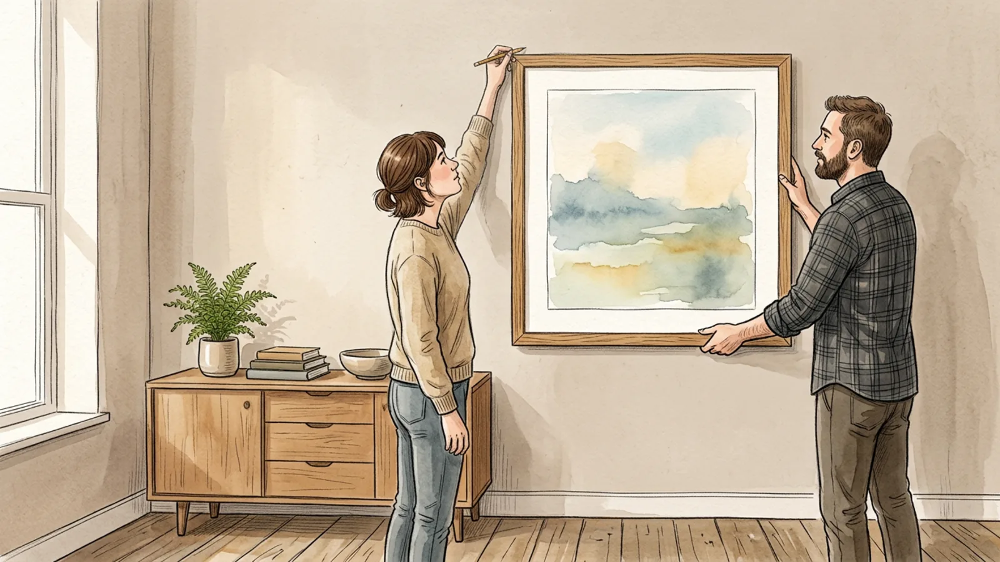

## Part 1 of 3 — Weigh It Up Before You Touch the Wall

### Step 1 — Weigh the picture on bathroom scales

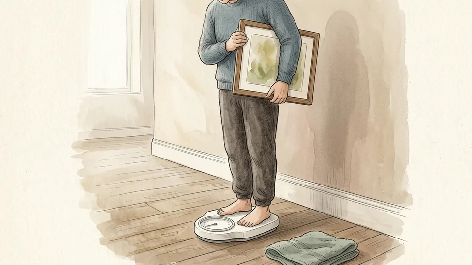

Every other decision follows from the weight, and almost everyone guesses low. Stand on the scales, note the number, then step off, pick up the framed picture and weigh yourself again; the difference is the weight of the picture. A modest print behind glass can reach five kilograms, and a large mirror or an oil in a heavy gilt frame can pass twenty. Write the figure down, because hooks and anchors are sold by exactly this number.

**Tip:** Weigh the picture with its glass and backing in place. That is the load the wall will actually carry.

### Step 2 — Choose a wall that will not damage the art

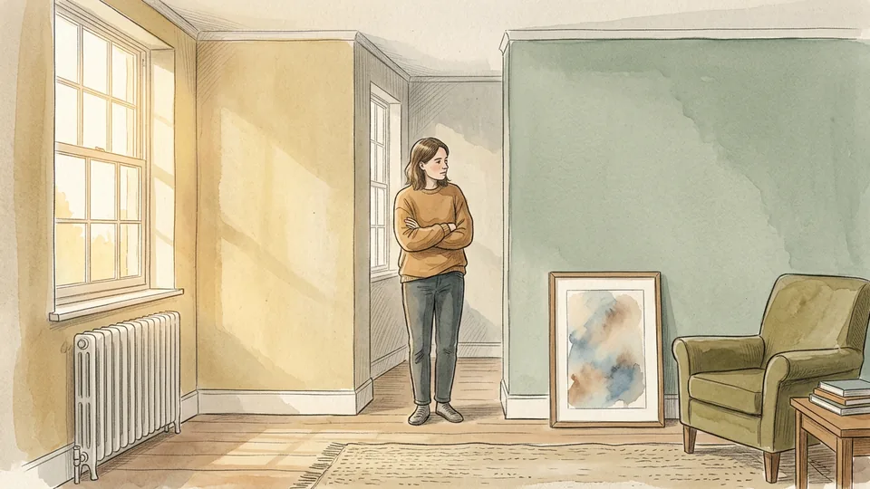

A secure fixing on a bad wall is still a bad home for a picture. The Canadian Conservation Institute advises against the space above a fireplace, where heat, dryness and soot all fluctuate, and warns about spots near open doors, windows, radiators and heating ducts, where humidity swings fastest. Keep works out of direct sunlight, and think about traffic: a narrow hallway where people brush past, or a wall people lean on, is a slow accident.

**Tip:** Interior walls are usually kinder than exterior ones. If you must use an outside wall, it should be insulated and have a proper vapour barrier.

### Step 3 — Inspect the back of the frame

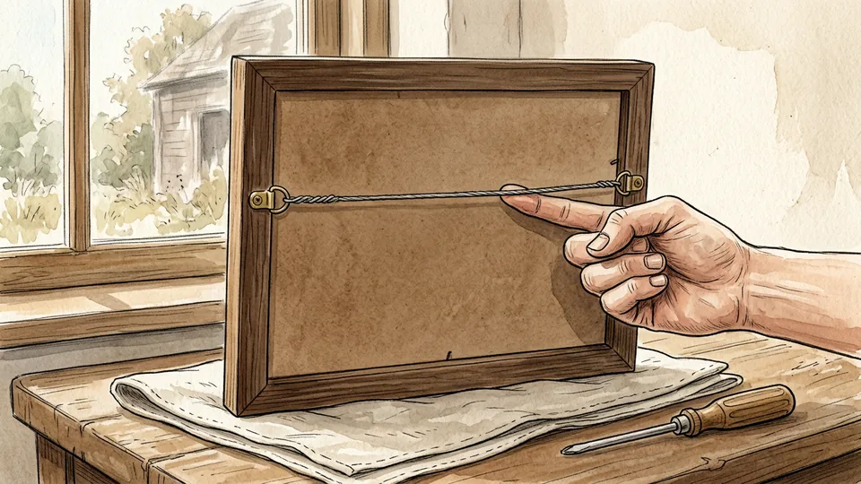

Turn the picture over on a padded surface and look at what is actually holding it together. Check the screw eyes or D-rings for rust and movement, press the backing board, and tug the wire gently. Hardware that twists in its hole, or wire that has gone thin and bright where it sits on the hook, is the part that fails. Museum guidance is to check this hardware before hanging and to replace anything rusty or loose.

**Tip:** Lay the picture face down on a towel or a piece of carpet, never on a bare floor where grit can scratch the frame.

### Step 4 — Fit D-rings and wire rated for the weight

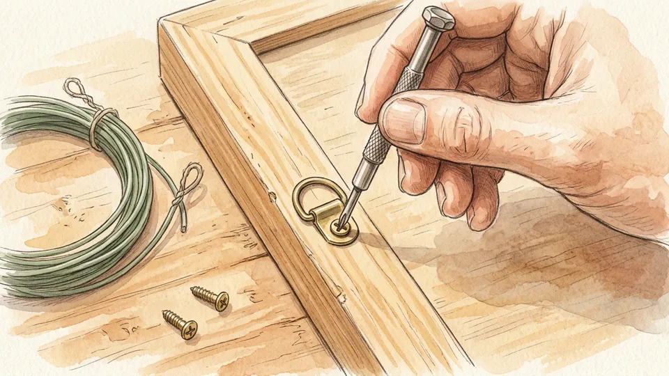

Conservators recommend D-rings with two points of attachment for most paintings of moderate weight, fixed about one third of the way down the frame so the picture sits flat against the wall. If you use wire, it should be plastic-coated, graded above the weight you measured, and secured properly at both ends. Replace any wire that looks thin or worn. For anything heavy, skip wire and hang from the D-rings themselves.

**Tip:** Drive the screws into the frame only, never into the stretcher or the panel behind it.

### Step 5 — Work out what the wall is made of

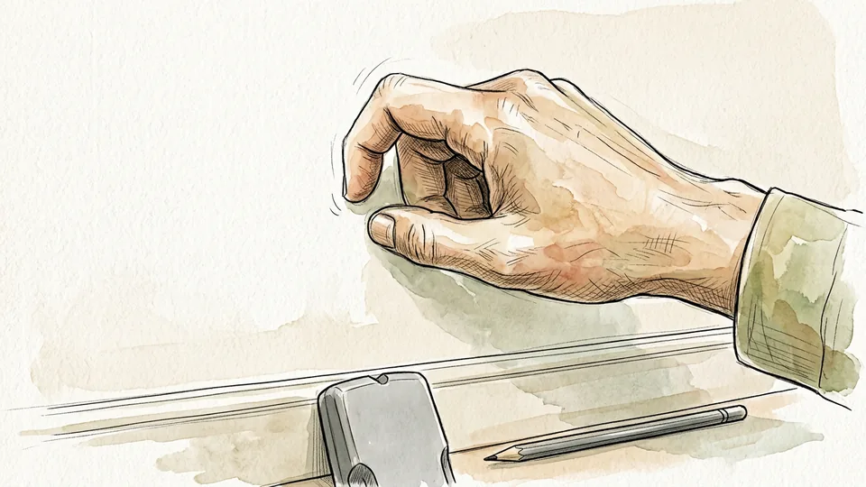

Knock along the wall with a knuckle: a hollow, drummy sound means plasterboard with a cavity, a dull solid sound means masonry or plaster on brick. Older houses may have lath and plaster, which crumbles easily. Museum practice is to fix into studs or solid masonry rather than relying on plaster or plasterboard alone. Find the studs with a detector or by tapping, and mark their edges lightly in pencil.

**Tip:** Check for wiring and pipes before you drill anywhere near a socket, a switch or a bathroom wall.

## Part 2 of 3 — Fix the Hardware Properly

### Step 6 — Set the height before you mark anything

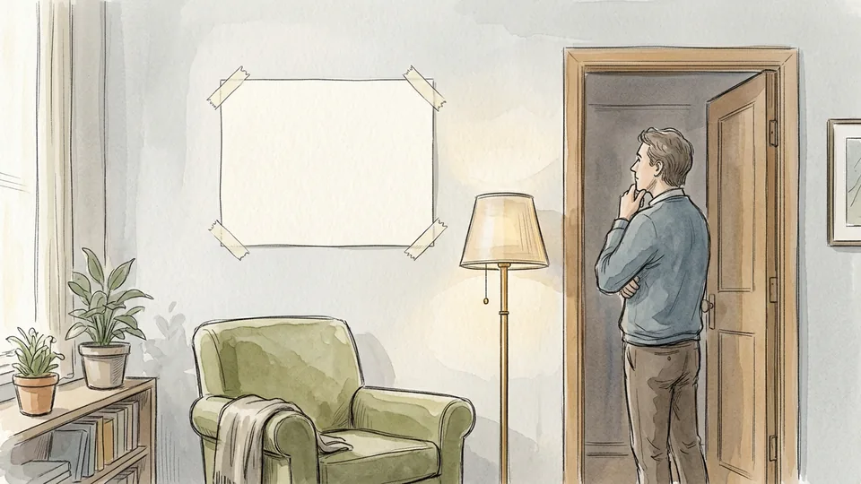

Galleries hang most work with its centre around eye level, roughly 145 to 150 centimetres from the floor, which keeps a wall of pictures visually consistent. Over furniture, leave a hand's width or two between the top of a sofa or sideboard and the bottom of the frame. Hold the picture up, have someone stand back, and agree the position before a pencil touches the wall.

**Tip:** Cut a sheet of newspaper to the size of the frame and tape it up first. It costs nothing and settles arguments quickly.

### Step 7 — Mark two fixing points, not one

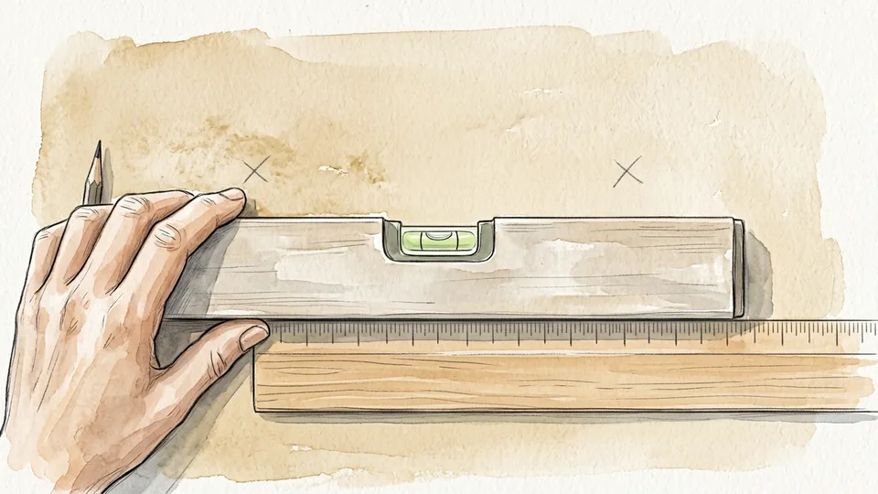

This is the single biggest improvement you can make. Conservation guidance is to place two points of contact in the wall so that if one fails, the second stops the picture falling. Two points also stop the frame swinging crooked every time a door closes. Measure the distance between the D-rings, transfer it to the wall with a ruler and a spirit level, and mark both points lightly in pencil.

**Tip:** Measure down from the top of the frame to the taut wire or ring, then subtract that from your line. It is the measurement people most often get wrong.

### Step 8 — Use picture hooks rather than bare nails

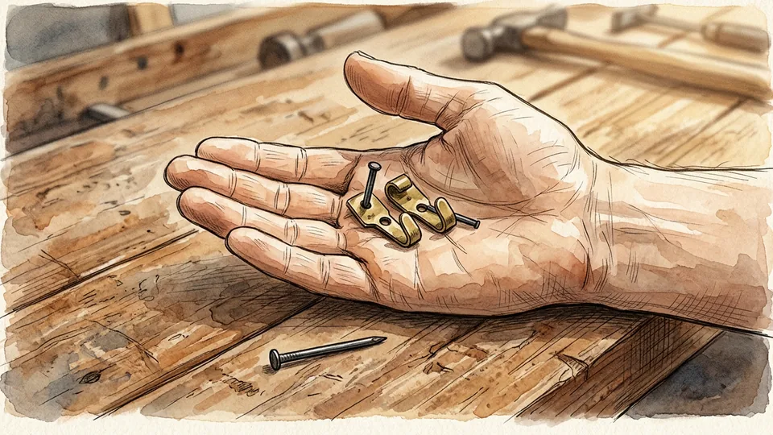

A nail driven straight into plasterboard relies on friction in a crumbly material and tends to lever its way out. Conservation advice is explicit: secure pictures with picture hanging hooks sized for the weight, because hooks are more reliable than nails and do less damage to the wall. Hooks spread the load through the pin at an angle into the wall, and two of them make it far easier to hang the picture straight.

**Tip:** Hook packets state a maximum weight. Choose one rated well above your measured figure rather than exactly at it.

### Step 9 — Match the anchor to the wall you have

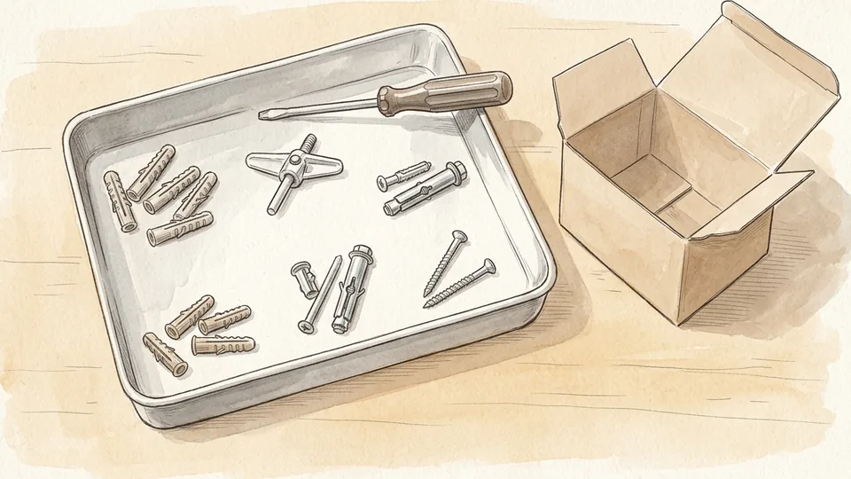

Hollow walls need an anchor that expands or toggles behind the board; masonry and concrete need a plastic or lead plug sized to the screw. The National Park Service lists the common types used for mounting hangers: hollow wall screw anchors that expand against the back of the board, plastic lipped anchors, lead expansion anchors for cement and masonry, and jack nuts for very thin cavities. The screw must match the anchor, not just the hole.

**Tip:** Take the picture hook and the screw with you when buying anchors. Guessing in the aisle is how people end up with three failed holes.

### Step 10 — Drill cleanly and fit the anchors

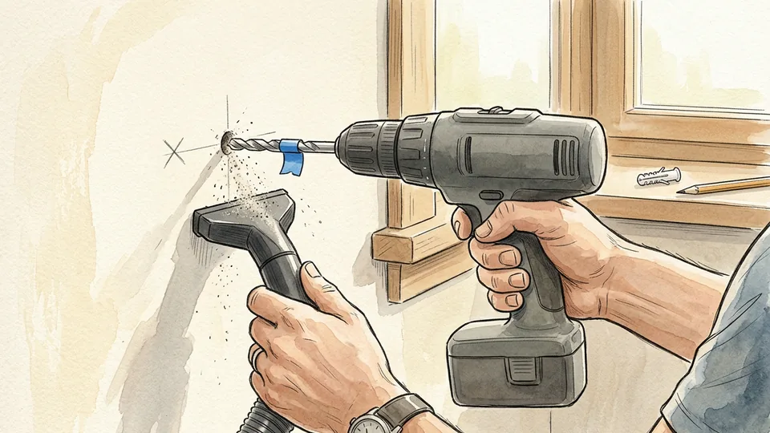

Use a bit the same diameter as the anchor body, not larger, and mark the depth with a wrap of tape so you stop at the right point. Masonry needs a masonry bit and, for concrete, hammer action. Hold a vacuum nozzle or a folded envelope under the hole to catch dust, then push the anchor in flush and tighten the screw until it is firm. A plug that spins in its hole has to come out and move.

**Tip:** Drill slowly through tile or plaster to stop the surface chipping, and never force a bit that has stopped biting.

## Part 3 of 3 — Hang It, Level It, Check It

### Step 11 — Use a French cleat for anything heavy

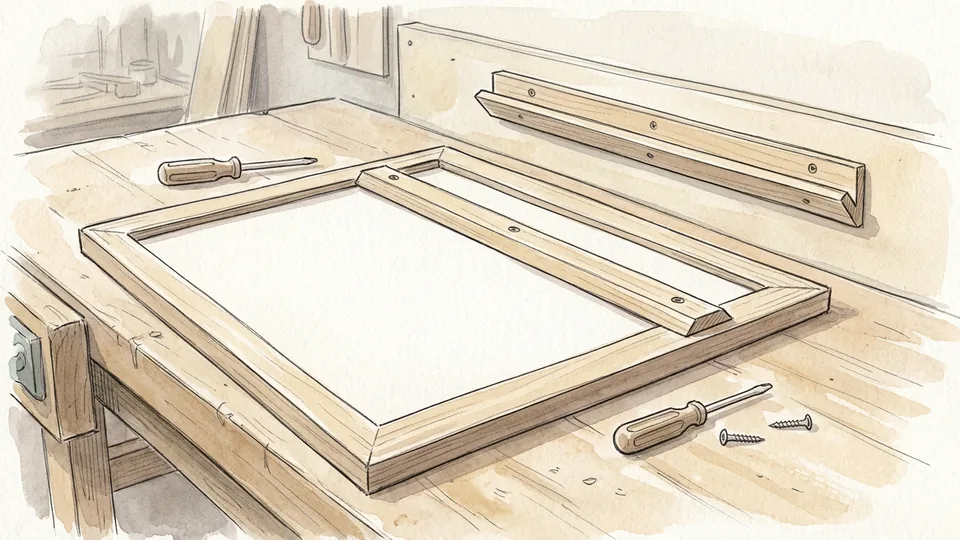

For large or heavy work, conservators recommend a hanging mechanism such as a French cleat: two interlocking bevelled rails, one screwed across the back of the frame, the other fixed into studs or masonry. The load spreads along the whole rail instead of hanging from two small points, the picture sits tight to the wall, and it cannot be lifted off sideways. Mirrors and big framed canvases are the obvious candidates.

**Tip:** Fit the wall rail with the bevel facing up and inwards. Upside down is the classic mistake, and the picture will not sit.

### Step 12 — Lift it with two people

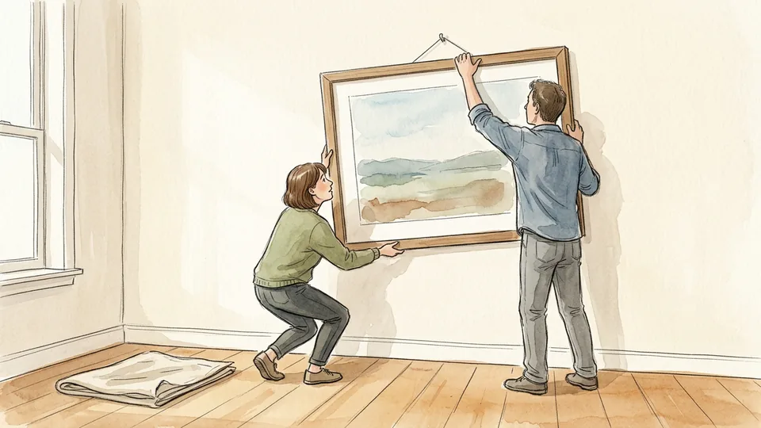

Handling is one of the main causes of damage to artwork, and a picture is at its most vulnerable in the moment between the floor and the hook. For anything large, work in a pair: one person takes the weight at the bottom edge with both hands, the other guides the wire or the cleat onto the fixing. Hold the frame, never the glass, and keep fingers off the painted surface.

**Tip:** Clear the floor under the wall first. Most dropped pictures are dropped onto something.

### Step 13 — Level it and check both bottom corners

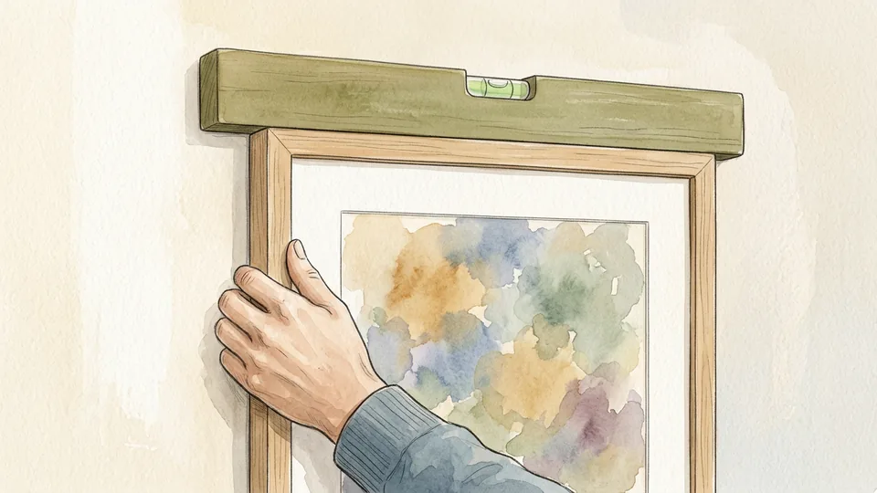

Set a spirit level on the top edge of the frame and adjust until the bubble sits centred, then measure from the floor to each bottom corner as a second opinion, because floors and ceilings are rarely true. If the picture hangs from a wire on two hooks, slide the wire a few millimetres rather than lifting the whole frame. Press the bottom edge gently to settle it against the wall.

**Tip:** A picture that keeps going crooked is usually hanging from one point. Add a second fixing rather than fighting it every week.

### Step 14 — Add guard hooks where falls are a real risk

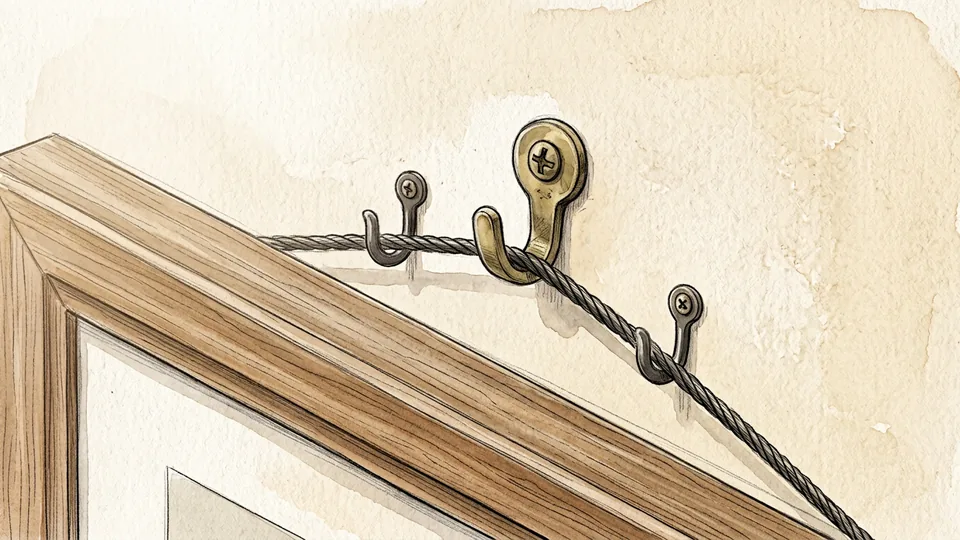

In an earthquake zone, or above a bed, a sofa or a cot, a wire can simply jump off its hook. The National Park Service describes fitting inverted guard hooks just above the suspension wire, flanking the main hook, so the wire cannot lift off quickly and the picture is far less likely to come down from shock. Security straps and angle brackets do a similar job for frames in exposed places.

**Tip:** The simplest version of this advice is also the best: do not hang heavy framed work directly above where people sleep or sit.

### Step 15 — Protect the wall and re-check once a year

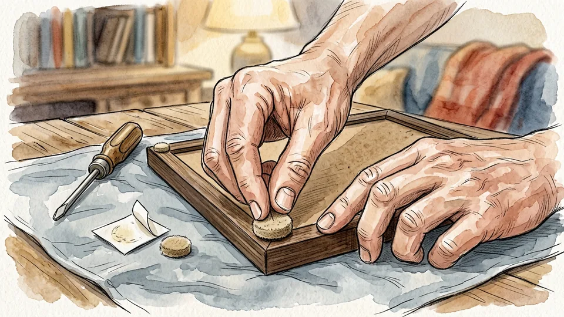

Stick small felt or rubber bumpers to the bottom corners on the back of the frame: they keep the frame off the paint, let a little air move behind the picture and stop the whole thing sliding sideways. Then put a yearly reminder somewhere you will see it. Museum guidance is to check hangers, hooks, screws, D-rings and wire regularly for rust and looseness, which takes about a minute per picture.

**Tip:** Check again after any building work, a house move or a picture that has been taken down and rehung.

## Tips

- Hang a group of pictures by laying the arrangement out on the floor first and photographing it, then work from the photograph.
- Keep the leftover hooks, anchors and the weight you measured in an envelope taped to the back of the frame for the next time it moves.
- Self-adhesive strips are fine for a light poster, but they are not a fixing for glass, mirrors or anything you would be upset to lose.
- A rigid backing board screwed to the back of a canvas reduces knocks, dust and rapid humidity changes, and is one of the most useful things you can add.
- If a picture has real monetary or family value, photograph the back as well as the front before you hang it.

## Warnings

- Do not drill blind near sockets, switches, light fittings or bathroom walls. Cables and pipes run in predictable channels and a detector costs far less than a repair.
- Lath and plaster, hollow tile and crumbling render will not hold a plug reliably. Fix into the studs or masonry behind them.
- Glass in old frames is often thin and unlaminated. Wear gloves and shoes, and never carry a large framed picture flat against your body.
- Heavy framed work above beds, cots and sofas is a safety issue as well as a conservation one, particularly in earthquake country.

## Community Q&A

**How high should a picture hang?**

Most galleries work to a centre line around 145 to 150 centimetres from the floor, which puts the middle of the work near standing eye level. Over a sofa or sideboard, position relative to the furniture instead and leave roughly fifteen to twenty centimetres between the top of the furniture and the bottom of the frame, so the picture reads as part of the group.

**Do I really need to find a stud?**

For light frames, a properly rated picture hook in plasterboard is usually fine. For anything heavy, mirrors especially, fix into a stud or into masonry with the correct plug. Museum guidance is to drill into studs or concrete rather than relying on plaster or plasterboard, because the board itself is weak and tears out under a sustained load.

**Is wire or are D-rings better?**

D-rings hung straight onto two hooks are more stable, sit flatter and have no wire to stretch or fray, so they are the better choice for heavier work. Wire is more forgiving when you cannot position hooks precisely, but it must be plastic-coated, rated above the frame's weight, firmly secured and checked for thinning where it crosses the hook.

**What should I do if the hole fails while I am drilling?**

Stop, do not keep enlarging it. Move the fixing at least five centimetres to one side and try again, or use a larger anchor designed for a damaged hole. Fill the failed hole with filler so the wall stays sound, and never bridge a weak hole by pushing in matchsticks or rolled paper with the screw.

## Useful external resources

- [Canadian Conservation Institute: Basic care – Paintings](https://www.canada.ca/en/conservation-institute/services/care-objects/fine-art/basic-care-paintings.html) — Where not to hang a painting, why hooks beat nails, and why two hooks per picture make levelling easier.
- [Canadian Conservation Institute: Caring for paintings (preventive conservation guidelines)](https://www.canada.ca/en/conservation-institute/services/preventive-conservation/guidelines-collections/paintings.html) — Hardware failure as a cause of falls, D-rings with two attachment points, graded wire and French cleats for heavy work.
- [National Park Service Conserve O Gram 2/7: Fabricating Secure Hangers for Framed Works of Art](https://www.nps.gov/subjects/museums/upload/02-07_508.pdf) — Guard hooks that stop a wire lifting off during an earthquake, plus the common wall anchor types for hollow and masonry walls.
- [Library of Congress: Care, Handling and Storage of Works on Paper](https://www.loc.gov/preservation/care/paper.html) — Light exposure, distance from radiators and vents, and why attics and basements are poor places for framed works.

## References

1. Canadian Conservation Institute. Basic care – Paintings. Government of Canada. https://www.canada.ca/en/conservation-institute/services/care-objects/fine-art/basic-care-paintings.html
2. Canadian Conservation Institute. Caring for paintings: preventive conservation guidelines for collections. Government of Canada. https://www.canada.ca/en/conservation-institute/services/preventive-conservation/guidelines-collections/paintings.html
3. Hunter JE. Fabricating Secure Hangers for Framed Works of Art. National Park Service Conserve O Gram 2/7, 1994. https://www.nps.gov/subjects/museums/upload/02-07_508.pdf
4. National Park Service. Curatorial Care of Easel Paintings, Museum Handbook Part I, Appendix L. https://www.nps.gov/subjects/museums/upload/MHI_AppL_Paintings.pdf
5. Library of Congress. Care, Handling, and Storage of Works on Paper. https://www.loc.gov/preservation/care/paper.html

## Internal links

- [How to Identify a Painting](https://www.56juqingba.com/Identify-a-Painting)
- [How to Start a Nature Journal](https://www.56juqingba.com/Start-a-Nature-Journal)
- [How to Build a Home First Aid Kit](https://www.56juqingba.com/Build-a-Home-First-Aid-Kit)
