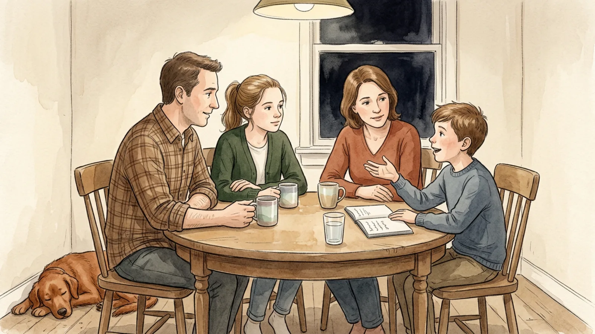
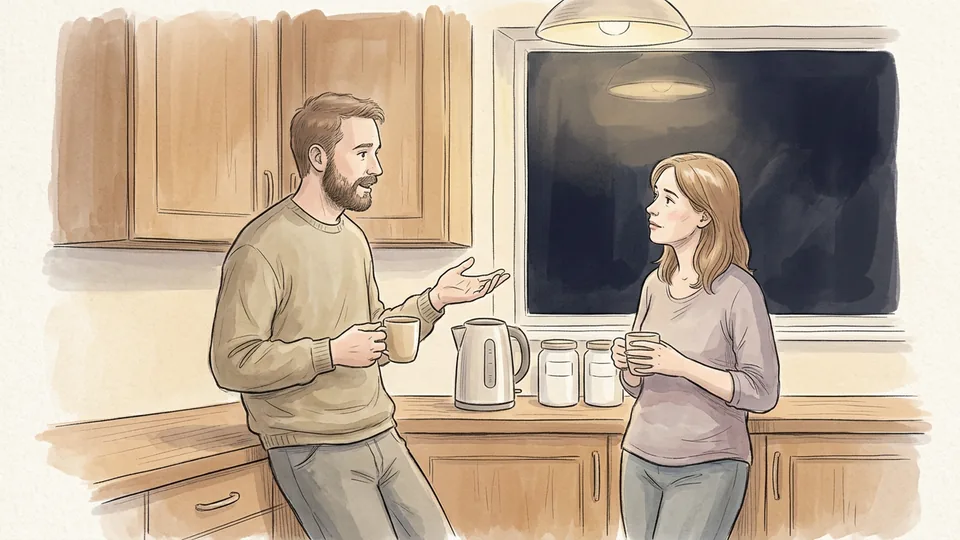
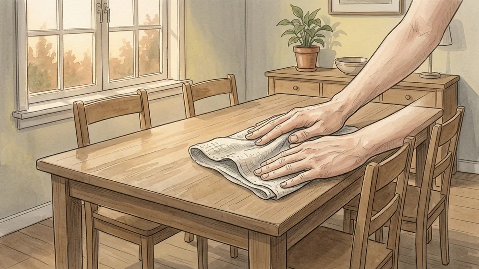
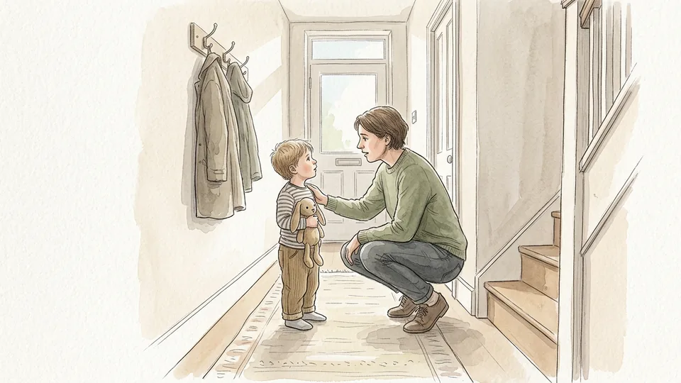
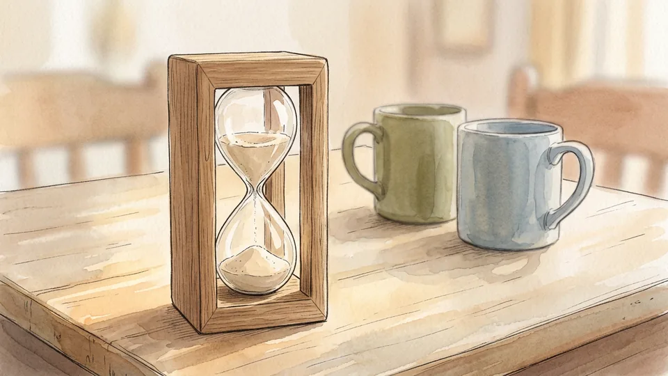
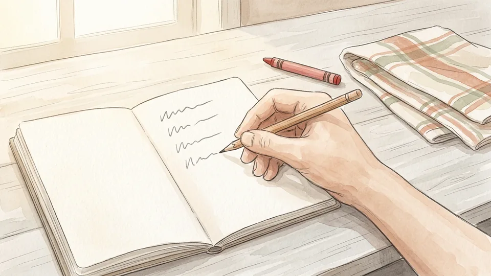
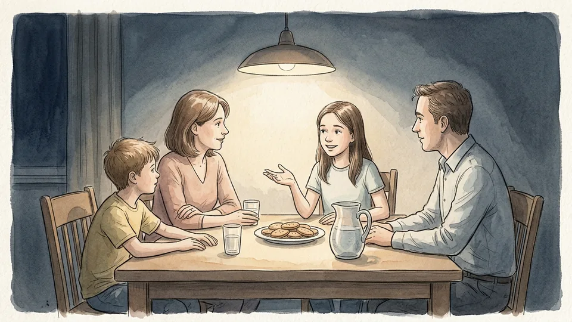
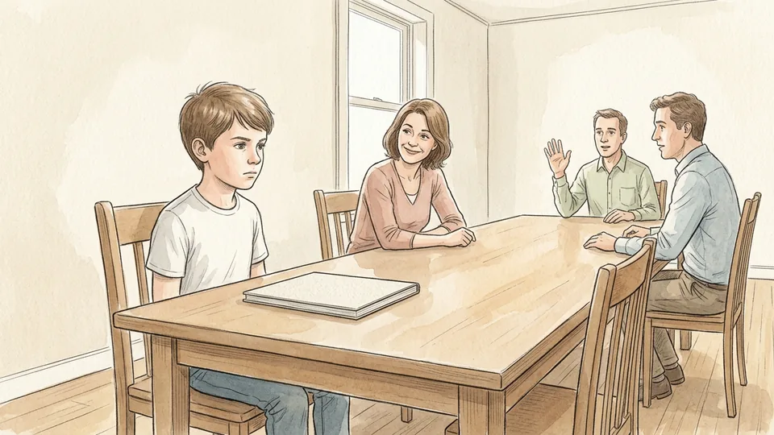
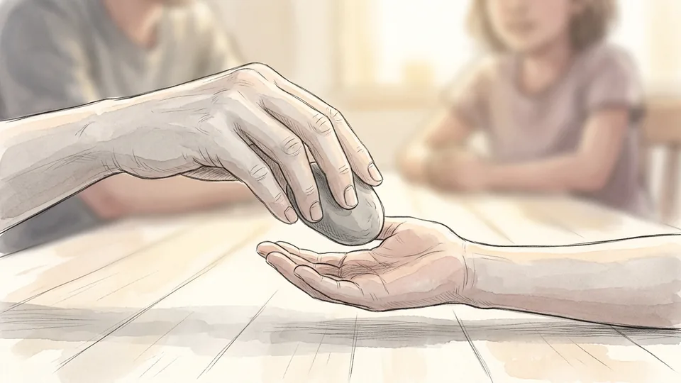
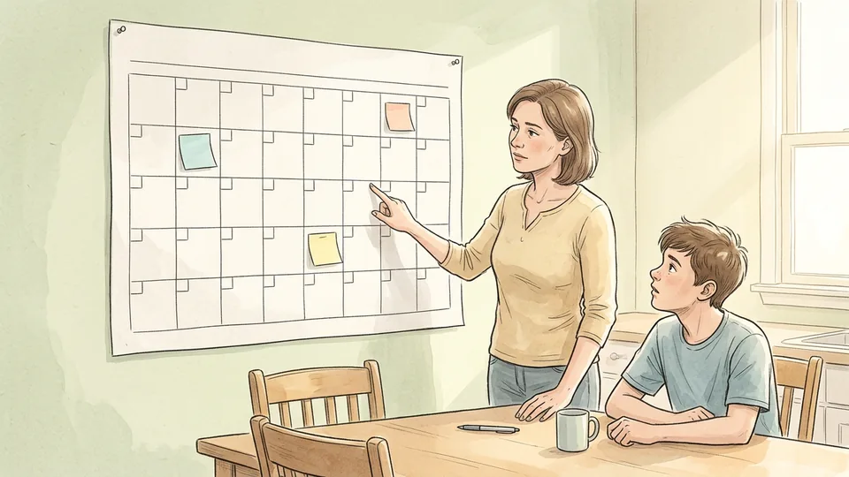

> DRAFT — do not publish or package: 6 of 16 illustrations are still missing, and the article has not been reviewed by a person.

# How to Hold a Family Meeting

*A short, repeatable meeting that plans the week, settles one argument at a time and gives every person in the house a turn to speak.*

**Category:** Family Life

**Slug:** `/Hold-a-Family-Meeting`

**Primary keyword:** how to hold a family meeting

**Meta description:** Run a short family meeting that works: pick a purpose and a fixed time, give everyone a turn, plan the week, and record decisions so they stick.

---

## Intro

Most households already make decisions together, but they make them in doorways and group chats, late at night, and usually when somebody is already annoyed. A family meeting moves that work to a fixed time at a table, where everyone can hear everyone else. Extension services have recommended the format for decades for the same practical reasons: it plans the week, it teaches children to negotiate instead of appeal, and it stops the same argument from being had five times. It does not need a constitution or an hour of anyone's evening. Fifteen minutes, a notebook, a rule about interrupting and something nice at the end will do. This guide sets up the first meeting, runs it, and makes the decisions stick afterwards.

## Part 1 of 3 — Set the Meeting Up So People Actually Come

### Step 1 — Decide what the meeting is for

Before you call anyone to the table, decide what the meeting is actually for. A family meeting works best when it has a job: planning the week, settling a recurring argument, or making one decision together. Vague meetings drift, and people stop turning up. Pick the job, say it out loud in one sentence when you start, and keep everything else for another week. One clear purpose is what makes the next meeting easy to call.

**Tip:** If two adults disagree about the purpose, settle that between yourselves first. Children should not arrive to watch a negotiation they cannot influence.

### Step 2 — Pick a time and a place and protect them

Choose a time when everyone can be present and awake, then guard it. Many families meet on Sunday or Monday evening, because the week ahead is still open to planning. The kitchen or dining table is the best place, as long as every person can pull up a chair. Sitting at the same height, facing each other, with the television off, does more for the tone of a meeting than anything you will actually say in it.

**Tip:** Clear the table first. A surface covered in post and homework invites people to start sorting it instead of talking.

### Step 3 — Invite everyone instead of summoning them

Invite people rather than ordering them to attend. Tell each person what the meeting is for and ask whether the time suits them, the way you would with anyone whose time you respect. Invite everybody in the household, including an older relative who lives with you. Do not force attendance. The natural consequence of staying away is that your views are missing when decisions are made, and that lesson lands better than an instruction.

**Tip:** Ask children directly rather than through another adult. Being asked is most of what makes them show up.

### Step 4 — Agree a length and keep the first one short

Agree how long the meeting will run before you begin, and make the first one short. Fifteen minutes is plenty. With children between two and six, ten to twenty minutes is the realistic ceiling, and you can lengthen things as everyone gets used to the format. Put a sand timer on the table so nobody has to police the clock. Finishing on time, with people still interested, is what makes the next meeting easy.

**Tip:** If an item will clearly overrun, park it and name the meeting it will come back to. Parked items need a date or they become grievances.

### Step 5 — Write a short agenda everyone can add to

Keep a notebook in one known place and write a short agenda in it. Three or four items is enough: compliments, last week's decisions, the coming week, and one piece of family business. Let anyone add an item during the week, children included, so the meeting belongs to the household rather than to whoever called it. Anything that does not fit is carried to the next meeting rather than rushed through at the end.

**Tip:** Leave the notebook open on the side with a pencil beside it. An agenda you have to ask for is an agenda only adults use.

## Part 2 of 3 — Run the Meeting So Everyone Gets a Turn

### Step 6 — Open with a round of compliments

Start every meeting with a round of compliments. Each person names something another member of the family did well that week: help that was given, a skill that improved, a kindness nobody mentioned at the time. It takes two minutes and it changes everything that follows, because the first thing each person hears is that they were noticed. Families who skip this step usually find the meeting drifts into a list of complaints.

**Tip:** Compliment the person on your left so nobody is left out and nobody has to choose a favourite.

### Step 7 — Give the meeting a chair and rotate the job

Appoint a chairperson and rotate the role. The chair starts on time, moves the discussion along, invites quiet people to speak and makes sure every view is heard. Begin with an adult who genuinely believes that everyone at the table has an equal right to speak, then hand the job to older children once the shape of the meeting is familiar. Rotating it stops the meeting from becoming one person's platform.

**Tip:** The chair runs the meeting but does not win it. If the chair also decides every question, children work out the difference immediately.

### Step 8 — Let one person speak at a time

Set one rule above the others: one person speaks at a time, and nobody is interrupted, corrected or lectured. A physical object helps enormously. Whoever holds the stone, the spoon or the toy has the floor, and it passes round the table. Young children grasp the object long before they grasp the rule. Adults need it more than they expect, because interrupting a child is a habit most of us never notice ourselves doing.

**Tip:** Hand the object to the youngest person first. Going eldest to youngest teaches children to wait for the version adults have already agreed.

### Step 9 — Walk through the week ahead

Spend a few minutes on the coming week. Go round the table and let each person say what they need: a lift somewhere, a late shift, kit that must be clean by Thursday, a friend coming to stay. Write down the clashes as you find them and negotiate them there, while everyone is still in the room. This is the part that pays for itself, because it removes the arguments that otherwise happen in the doorway.

**Tip:** Put the week somewhere everyone can see it afterwards. A planner on the wall ends more disputes than a shared calendar nobody opens.

### Step 10 — Bring one problem, two at the most

> IMAGE PENDING for step 10: A parent sitting on a sofa between two children of different ages, all three turned towards each other in a calm conversation.

Bring one problem to the table, two at the very most. A meeting that tries to fix everything leaves everyone flattened, and the family quietly learns that these meetings hurt. State the problem as something the household has rather than something a person is: the bathroom runs out of hot water, instead of somebody takes too long in the shower. The rest keeps until next week, and usually looks smaller by then.

**Tip:** If a problem is really about one child, talk to that child separately. A meeting is a poor place to be singled out.

## Part 3 of 3 — Make the Decisions Stick

### Step 11 — Ask for solutions before you give yours

> IMAGE PENDING for step 11: A young child kneeling at a low table drawing with crayons while two adults talk behind her on the sofa.

Invite the whole family to suggest answers before you offer your own. Parents who brainstorm get better cooperation than parents who announce a rule, because children keep to decisions they helped to make. Hold a clear idea of the outcome you need, then mostly listen and guide. Give young children something to do with their hands, such as paper and crayons on the floor, since many of them talk more freely while they are drawing.

**Tip:** Write down the silly suggestions too. Taking them seriously for ten seconds is what keeps the sensible ones coming.

### Step 12 — Write the decision down where it can be seen

> IMAGE PENDING for step 12: A hand pressing a plain sheet of paper onto a fridge door under a round magnet, with a second magnet held ready.

Record the decision and put it somewhere everybody passes. Memory is not neutral: a week later each person remembers the version that suited them, and the argument starts again. A line in the family notebook, or a sheet on the fridge door, settles it. Write what was decided, who is doing it and when it starts. Three short things are enough, and minutes of the whole meeting are not.

**Tip:** Keep the notebook in the same drawer every week. A record nobody can find is the same as no record.

### Step 13 — End on something everyone likes

> IMAGE PENDING for step 13: A family of four playing a simple board game at the same table, laughing as a child moves a wooden counter, with a plate of sliced cake nearby.

Finish with a treat. A short game, a pudding nobody had to earn, a few songs, or a plan for Saturday: the point is that the meeting ends in good feeling rather than on the hardest item. Children who associate the table with dessert and a game come back willingly. This is also why the treat belongs at the end, after the business, instead of being offered as a bribe at the start.

**Tip:** Let a different person choose the treat each week. It is the easiest job to hand over and children take it seriously.

### Step 14 — Check last week's decisions at the start of the next one

> IMAGE PENDING for step 14: A parent and a teenager leaning over an open notebook on the table, the parent's pencil resting beside a line of ticks.

Open the following meeting by reading out what was decided last time and asking how it went. Did the new washing-up rota survive? Did anybody get stranded? Checking back is what turns a pleasant conversation into a working system, and it shows children that what they said in the meeting changed the real week. Keep the decisions that worked and take the rest back to the table.

**Tip:** Mark the ones that worked with a tick rather than re-reading them aloud. The list should get shorter as things settle.

### Step 15 — Redesign the meeting as the family changes

> IMAGE PENDING for step 15: A family of four walking together along a park path in autumn, two of them turned towards each other in conversation.

Expect to rebuild the format over time. Shorten the meeting when attention runs out, move to a monthly slot if the household is mostly adults, and hold it on a walk or a car journey if the table feels too formal for teenagers. The structure is a tool, not a ritual to be defended. Only three things are worth protecting: that it happens, that everyone can speak, and that decisions are written down.

**Tip:** If the meeting has been skipped three times, the format is wrong rather than the family. Change the time before you give it up.

## Tips

- Keep the whole thing to fifteen minutes until the family asks for longer.
- Hold the meeting at the same time each week so nobody has to be reminded.
- Let children chair the meeting once they can follow the running order.
- Keep one notebook for agendas and decisions, and keep it in one place.
- Make the first two or three meetings mostly pleasant: plans, compliments and a treat.

## Warnings

- A family meeting is not the place for abuse, violence, or any safety concern involving a child or adult in the household. Those need professional help, not a round-table discussion.
- Do not use the meeting to ambush one person. If an issue is about a single child, raise it privately first.
- Decisions that affect money, schooling or care arrangements should be checked with the relevant professional before they are acted on.

## Community Q&A

**How often should we hold a family meeting?**

Weekly suits most households with children, because it matches the planning horizon of school, work and activities. Extension guidance commonly suggests meeting at the same time every week or fortnight. Households made up mainly of adults, or several generations, often find monthly meetings easier to sustain. The interval matters less than keeping it the same, so nobody has to negotiate when the next one will be.

**At what age can children take part?**

As soon as they can use words. Very young children will manage ten to twenty minutes at most, and they take part best when their hands are busy, so keep crayons and paper on the table. Older children can hold roles: chairing the meeting, writing down decisions, timing the agenda. A child who has a job at the meeting is far less likely to ask whether they can leave.

**What if someone refuses to come?**

Hold the meeting anyway, even if only two people want it. Do not make attendance compulsory. The consequence of staying away is that decisions get made without your view, which is usually persuasive within a few weeks. Keep inviting the person each time, tell them afterwards what was decided, and leave the door open rather than making the absence itself the next agenda item.

**How do we stop it turning into an argument?**

Three rules carry most of the weight: one person speaks at a time, no lectures or put-downs, and one or two problems per meeting. A talking object makes the first rule visible to young children. If a discussion heats up, park the item, summarise what was agreed so far and come back to it next week. Ending early in good order beats finishing the agenda badly.

## Useful external resources

- [NC State Extension: Family Meetings Build Healthy Families](https://content.ces.ncsu.edu/family-meetings-build-healthy-families) — Scheduled versus informal meetings, the go-around method and brainstorming with children.
- [University of Wisconsin-Extension: Family Meetings](https://fonddulac.extension.wisc.edu/files/2011/10/Family-Meeting-handout.pdf) — Sample agenda, ground rules and the fifteen-minute first meeting.
- [CDC: Tips for Relying on Routines and Rules](https://www.cdc.gov/parenting-toddlers/structure-rules/index.html) — Why consistency, predictability and follow-through make household rules work.

## References

1. NC State Extension. Family Meetings Build Healthy Families. Publication FCS-521-03, published June 22, 2020, reviewed March 27, 2025. https://content.ces.ncsu.edu/family-meetings-build-healthy-families
2. University of Wisconsin-Extension, Fond du Lac County. Family Meetings, adapted from the Strengthening Families Program. https://fonddulac.extension.wisc.edu/files/2011/10/Family-Meeting-handout.pdf
3. Centers for Disease Control and Prevention. Tips for Relying on Routines and Rules, Essentials for Parenting Toddlers and Preschoolers. Reviewed April 30, 2026. https://www.cdc.gov/parenting-toddlers/structure-rules/index.html

## Internal links

- [How to Split Household Chores Fairly](https://www.56juqingba.com/Split-Household-Chores-Fairly)
- [More Family Life guides](https://www.56juqingba.com/Category/Family-Life)
- [How to Build a Monthly Budget](https://www.56juqingba.com/Build-a-Monthly-Budget)
