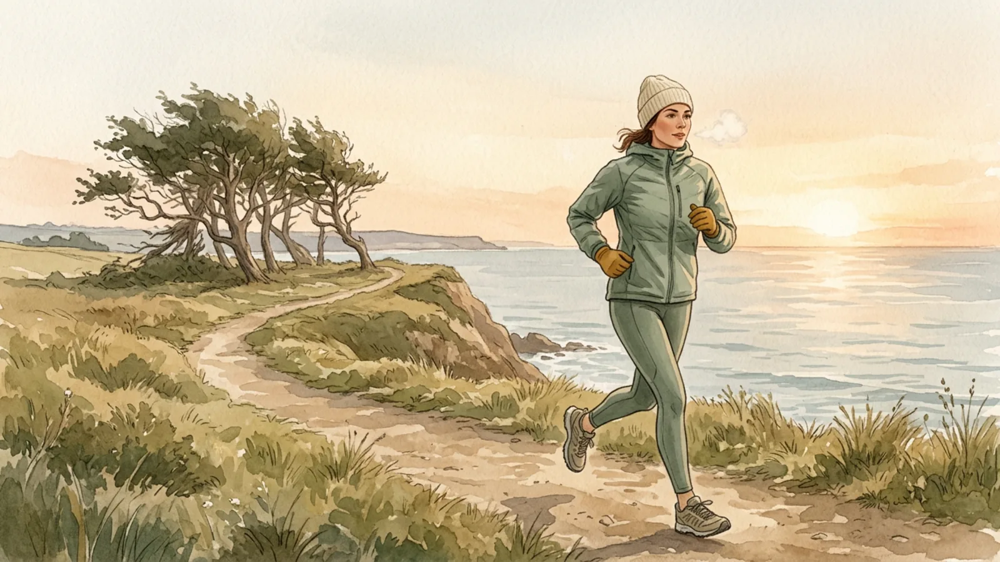
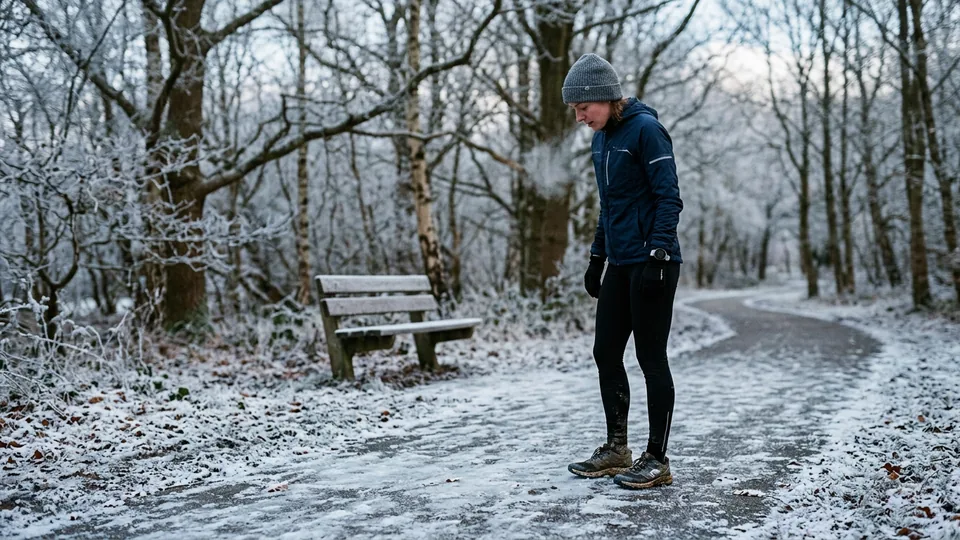
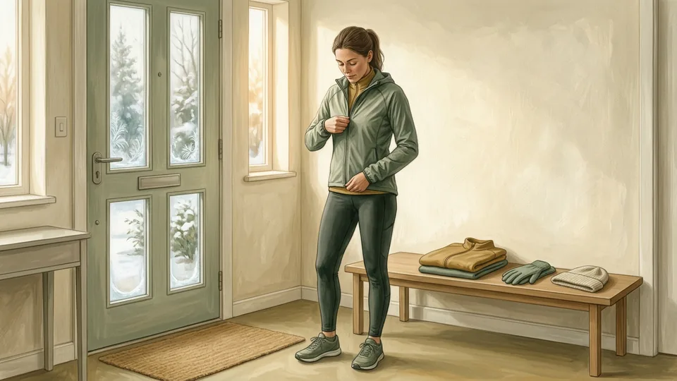
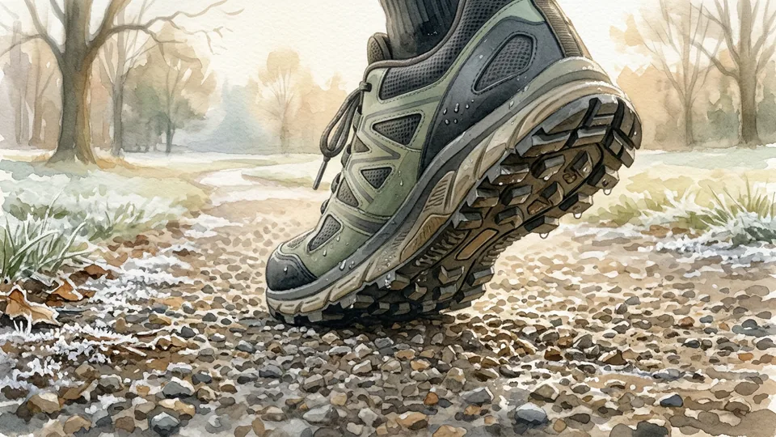
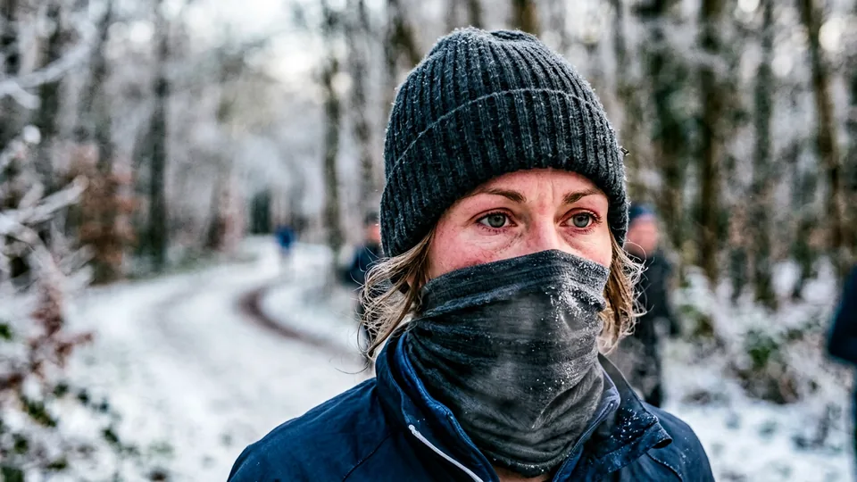
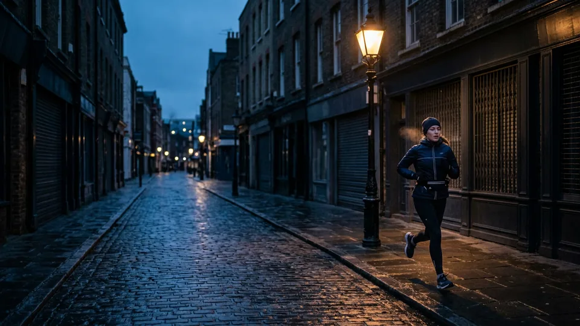
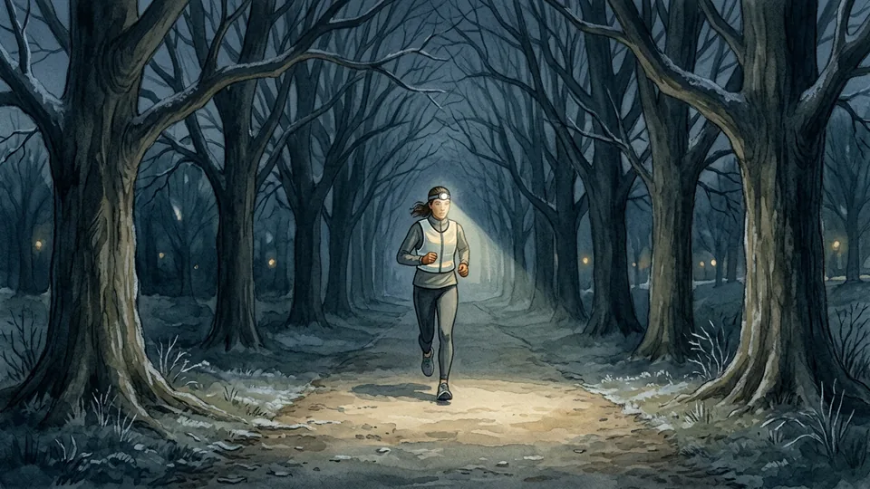
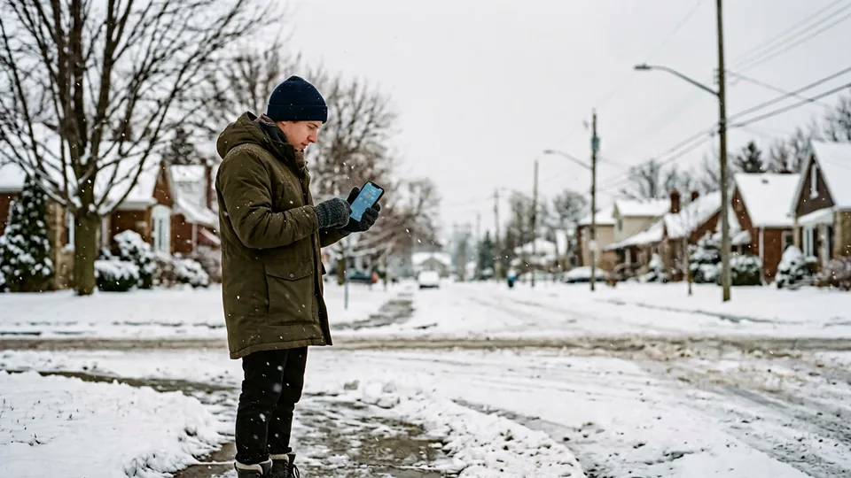
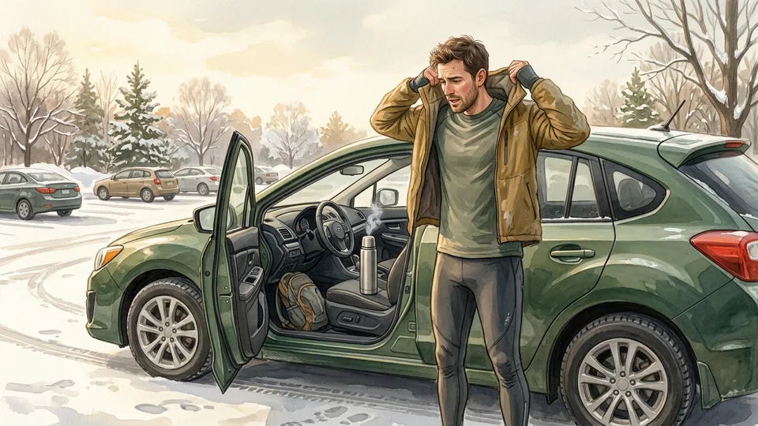
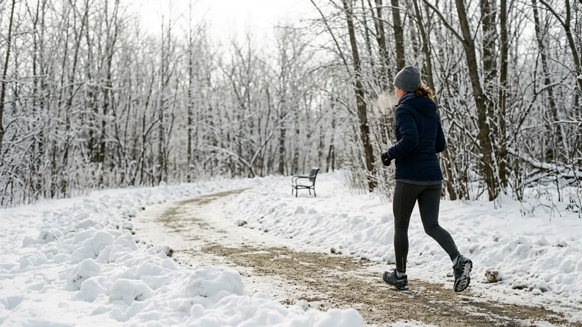

# How to Keep Running Through Winter

*Winter running fails on logistics, not motivation. Shorten the loop, dress for ten degrees warmer, start into the wind, and keep a ten-minute minimum for the days when the weather wins.*

**Category:** Sports and Fitness  
**Slug:** `/Keep-Running-Through-Winter`  
**Primary keyword:** how to keep running through winter  
**Meta description:** Keep running through winter with 12 practical steps: how to layer, breathe in cold air, run safely in the dark, handle ice, and restart after a missed week.

---

## Intro

Most winter running plans fail in the first cold week, when the gap between a warm room and a dark pavement stops being an obstacle and becomes a reason. The runners still going in January are not tougher than the ones who quit; they have smaller sessions, better layers, and a route they can shorten. Here is how to build a winter that survives ordinary cold Tuesdays.

## Part 1 of 3 — Getting Out of the Door

### Step 1 — Set a ten-minute minimum

Decide now that ten minutes outside counts as a session, and that the only real failure is not going out at all. Ten minutes is long enough to keep the habit and short enough to survive a dark, wet evening — and most days you will stay out longer once you are moving. Write the minimum on the same calendar as the full session, so a bad week has something to fall back on.

**Tip:** The hardest part of a winter run is the first three minutes outdoors. Promise yourself only ten minutes; the rest is optional.

### Step 2 — Dress for ten degrees warmer

Dress for conditions about 10°C warmer than the air temperature, because you will heat up within the first kilometre. Three thin layers beat one thick one: a wicking base layer, a light mid layer, and a windproof shell or vest. Cotton holds sweat and turns cold; synthetic or merino does not. Hands, ears and feet cool first, so gloves, a hat over the ears and wool socks matter more than a fourth torso layer.

**Tip:** If you are warm and comfortable standing on the doorstep, you are already wearing too much.

### Step 3 — Warm up indoors, not at the doorstep

Cold muscles and cold joints are more easily strained, and standing outside in a T-shirt stretching is the worst of both. Spend four or five minutes indoors on leg swings, hip circles, walking lunges and a flight of stairs, then walk briskly for the first few minutes outside. The first kilometre is a warm-up, whatever your watch says about pace.

**Tip:** Put your shoes on last. Getting dressed while moving around the house is already a warm-up.

### Step 4 — Choose the surface before the pace

In frost and snow, route choice matters more than speed. Prefer cleared, gritted paths and main streets, and avoid shaded north-facing pavements, wooden boardwalks, metal plates and wet leaves, which are slicker than they look. Deeper tread helps on snow, but nothing grips black ice reliably. If a foot slips when you push off gently, walk that section or take another route entirely.

**Tip:** Test the first fifty metres with a gentle push-off. Ice that fails that test will fail you at speed.

## Part 2 of 3 — Cold Air, Wind and Darkness

### Step 5 — Slow down, and breathe through a layer

Cold air is dry, and hard breathing through it irritates the airways, which is why winter runs sometimes end in a cough. Run at an easy effort, keep your mouth mostly closed, and let a neck gaiter cover your mouth so the air is warmed a little before it reaches your lungs. If you have asthma or exercise-induced breathing trouble, warm up longer and carry your inhaler.

**Tip:** If you can hear your own breathing over your footsteps, you are going too fast for the temperature.

### Step 6 — Hold an easy effort, even into the wind

Wind removes heat far faster than still air, and pushing into a headwind turns an easy run into a hard one within minutes. Run the exposed half of your loop while you are dry and warm, and let the wind push you home. Check wind speed as well as temperature: 2°C with a 30 km/h wind feels closer to -3°C, and that is the number your body responds to.

**Tip:** Dress for the wind, not the thermometer. A thin windproof front panel beats an extra fleece.

### Step 7 — Be visible before the sun goes down

In winter, most after-work runs happen in the dark. Wear reflective material at ankle and chest height, choose streets with pavements and streetlights over unlit shortcuts, and assume drivers cannot see you until proven otherwise. Junctions are where it goes wrong: a car turning across a crossing looks straight through a runner in dark clothing.

**Tip:** Reflective ankles move, and movement is what catches a driver's eye at night.

### Step 8 — Carry a light on unlit routes

A small headlamp or a chest light lets you see broken pavement, roots and ice, and lets others see you from much further away than reflective fabric alone. Keep the beam low so you do not blind oncoming traffic or other runners. If your route has no lighting at all, choose a shorter loop you know well rather than exploring in the dark.

**Tip:** Tell someone your route and expected return time when you run after dark. It costs one message.

## Part 3 of 3 — Keeping the Habit

### Step 9 — Set your cold and ice limits in advance

Decide before winter what makes you move indoors or skip: ice on the pavements, windchill below about -15°C, or the tail end of a fever. Deciding in advance removes the negotiation at 6am, when the answer is always the sofa. Keep a backup session ready — stairs, a treadmill, or a brisk twenty-minute walk — so a cancelled run is still a session.

**Tip:** Most healthy runners handle about -10°C in layers. Wind, wet and your own health matter more than the number.

### Step 10 — Change out of wet layers immediately

The risk in winter running is rarely the run itself; it is standing around afterwards in damp clothes while your body temperature drops. Keep a dry top and dry socks in your bag or car, change within fifteen minutes of finishing, and get warm before you drive or sit down. This one habit prevents most of the 'I caught a cold from running' stories.

**Tip:** Dry socks and a dry hat do more for how you feel an hour later than a hot drink does.

### Step 11 — Fuel before you leave, not after

Cold weather makes you burn more energy to stay warm, and hunger arrives later than it does in summer, so it is easy to under-eat before a winter run. Eat something small and easy an hour or two before you go, carry water even when you do not feel thirsty, and take a snack on runs longer than about seventy-five minutes. Do not rely on thirst in the cold.

**Tip:** If you finish a winter run shaky or unusually cold, you probably started it under-fuelled.

### Step 12 — Use the three-week restart rule

You will miss a week, sometimes two, for weather, illness or work. When you come back, restart at about half your previous weekly time and rebuild over two to three weeks instead of resuming where you stopped. A planned restart is part of a winter season; an unplanned one attempted at full volume is how a two-week gap becomes a season off.

**Tip:** If you have not run for three weeks, treat the next run as a first run, not a comeback.

## Tips

- Keep a ten-minute version of every session. A short run protects the habit; a skipped run erodes it.
- Dress for about 10°C warmer than the forecast, and check windchill rather than temperature alone.
- Prefer several thin layers to one thick one, and nothing made of cotton next to your skin.
- Reflective material at ankle height and a light on unlit routes. Assume you are invisible to drivers.

## Warnings

- Ask a clinician before running in the cold if you have a heart condition, uncontrolled asthma, Raynaud's, or a recent injury. Cold adds cardiovascular strain.
- Do not run on black ice or untreated snow. A fall on ice is a fracture risk, especially for wrists and hips.
- Stop and seek help for chest tightness, unusual breathlessness, dizziness, or fingers that stay white and numb after you are warm.
- Do not increase weekly volume by more than about ten percent when coming back from a break. Most winter injuries come from ramping back too fast.

## Community Q&A

**How cold is too cold to run?**

There is no single number. Wind, wetness and your own health matter more than the thermometer, and most healthy runners manage well to about -10°C in layers. Below that, or in serious windchill, shorten the session or move it indoors. Asthma, heart conditions and pregnancy are reasons to ask a clinician rather than follow a general rule.

**What should I wear for a winter run?**

A wicking base layer, a light mid layer, and a windproof outer layer or vest, plus gloves, a hat that covers the ears and synthetic socks. Dress for roughly 10°C warmer than the air temperature, because you will heat up within the first kilometre.

**Is it bad to breathe cold air when running?**

Cold air is dry and can irritate the airways, which is why winter running sometimes causes a cough. Your body warms the air before it reaches your lungs, and slowing down with a buff over your mouth reduces the irritation. People with asthma should warm up longer and carry an inhaler.

**How do I run safely in the dark?**

Choose lit streets with pavements, wear reflective material at ankle and chest height, and use a light on unlit sections. Tell someone your route and expected return time, and run the section with traffic risk first, while you are fresh.

**What if I miss two or three weeks?**

Restart at about half your previous weekly time and rebuild over two to three weeks. Do not try to make up the missed sessions in one go; that is how people get injured on the return.

## References

1. American College of Sports Medicine. “ACSM's Guidelines for Exercise Testing and Prescription.” 11th edition, 2018.
2. Castellani, J. W. and Young, A. J. “Human physiological responses to cold exposure: acute responses and acclimatization to prolonged exposure.” Autonomic Neuroscience, 2016.
3. UK Chief Medical Officers. “Physical Activity Guidelines.” 2019.
4. Nielsen, R. O. et al. “Training errors and running related injuries: a systematic review.” International Journal of Sports Physical Therapy, 2012.

## Internal links

- [Start with How to Start Running When You Hate Running](https://www.56juqingba.com/Start-Running-When-You-Hate-Running)
- [More Sports and Fitness guides](https://www.56juqingba.com/Category/Sports-and-Fitness)
- [Build a home first-aid kit for the season](https://www.56juqingba.com/Build-a-Home-First-Aid-Kit)
- [Search guides like “How to Keep Running Through Winter”](https://www.56juqingba.com/search?q=How%20to%20Keep%20Running%20Through%20Winter)
