# How to Listen More Actively

*Give someone your whole attention, say back what you heard before you say anything of your own, and ask what they want from you rather than deciding it for them.*

**Category:** Relationships

**Slug:** `/Listen-More-Actively`

**Primary keyword:** listen more actively

**Meta description:** Learn to listen actively: clear the distractions, ask open questions, let silences run, say back what you heard, and ask what the person wants before advising.

---

## Intro

Active listening is not a mood, it is a set of things you do and a longer list of things you hold back. The Samaritans teach it as five habits — show you care, have patience, use open questions, say it back, have courage — and the hardest ones are the quiet parts: letting a pause run, and resisting both advice and your own matching story. There is evidence that the effort registers. In a study of first conversations between strangers, people who received paraphrased reflections and follow-up questions felt more understood and more satisfied with the conversation than people who got sympathetic noises, or advice. The fifteen steps below walk through one conversation from the moment you notice something is up to the point, days later, where you check how you are doing yourself.

## Part 1 of 3 — Make the Conversation Possible

### Step 1 — Notice the opening before you make one

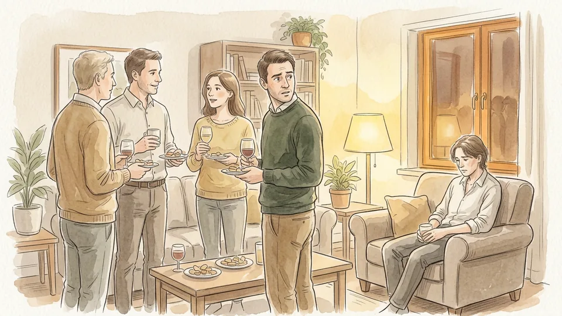

People rarely announce that they want to talk. The signals are smaller: not replying to messages, dropping out of things they used to enjoy, being short with everyone, looking tired in a way sleep does not fix. Noticing is the first listening skill, because it tells you who to go to and roughly when. Do not wait for a crisis to give you permission to ask.

**Tip:** If you have noticed something, say so rather than hinting: you have seemed a bit flat this week, how are things.

### Step 2 — Strip out the competition for your attention

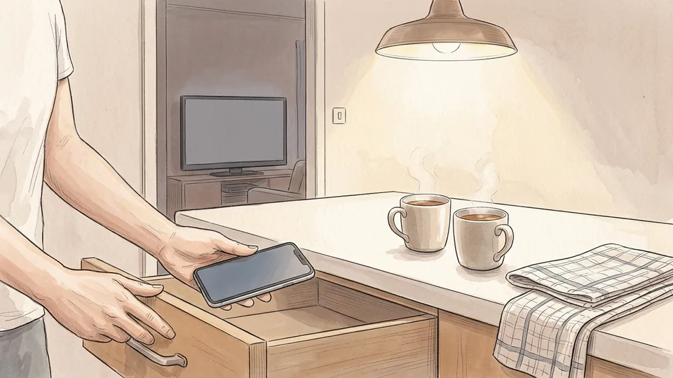

Attention is the thing you are actually offering, so clear everything that would split it. Phone away rather than face down on the table, television off rather than muted, laptop closed. If the house is busy, move: a walk, a drive or a cafe will do more for the conversation than the right words would. Doing this openly also tells the other person what is about to happen.

**Tip:** Side by side is easier than face to face for anything difficult. Walking and driving both remove the pressure of constant eye contact.

### Step 3 — Decide you are not here to fix it

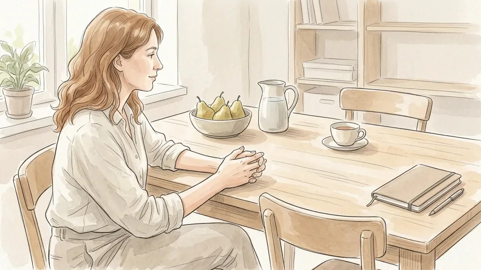

Most poor listening comes from a good motive: the urge to solve the problem and relieve the discomfort. Set that job down before you start. Your task for the next twenty minutes is to understand the situation as the other person experiences it, accurately enough that you could describe it back to them. Solutions, if any are wanted, come later and usually from them.

**Tip:** If your mind keeps producing suggestions, note them silently and keep listening. They will still be there at the end.

### Step 4 — Open with a question that cannot be answered yes or no

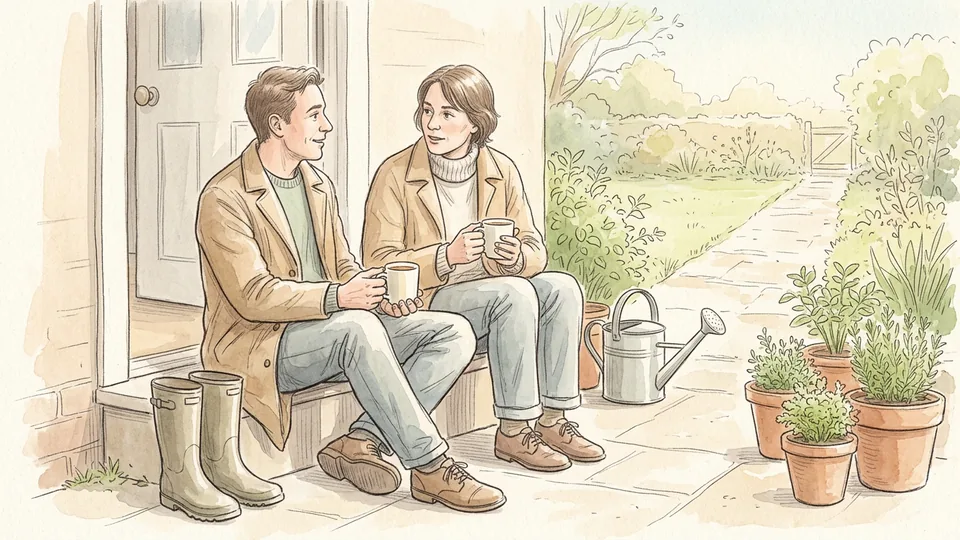

Are you all right invites the word fine and closes the subject. Ask instead what has been going on for you this week, or how has it been since the move. Open questions hand the other person the shape of the answer, which is the whole point: you want their account, not confirmation of your guess about it. Then wait, and add tell me more if the first answer is thin.

**Tip:** Avoid leading questions. Have you had an awful week suggests the answer you are hoping for.

### Step 5 — Be honest about how much time you have

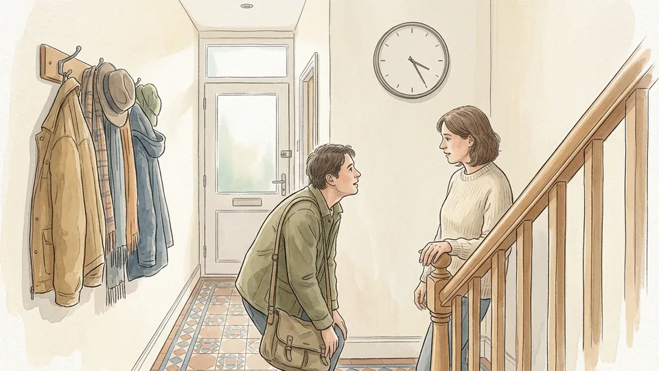

A listener who is secretly watching the clock is worse than one who says at the start that they have half an hour before the school run. Honesty about time lets the other person pace what they say and removes the sting of a sudden ending. If what emerges needs more time than you have, say that plainly and set the next time before you leave.

**Tip:** Never start a serious conversation in the last five minutes of a visit or a call. It teaches people to keep things to themselves.

## Part 2 of 3 — While They Are Talking

### Step 6 — Let the pauses run

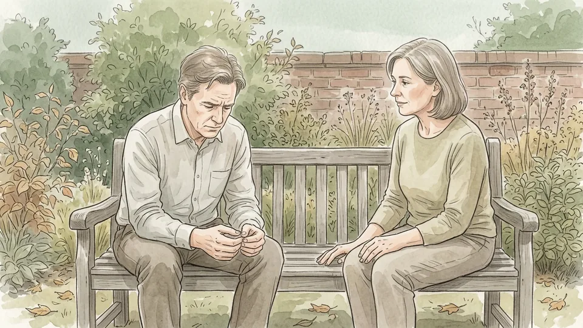

Silence is where the real thing usually arrives. People stop to find a word, to decide whether to say the harder sentence, or simply to breathe, and a listener who fills the gap takes that chance away. Count three slow seconds before you speak into a pause. It feels much longer to you than it does to them, and it is the single cheapest improvement most listeners can make.

**Tip:** If you must make a sound, make it small: a quiet mm, or a nod. Keep whole sentences out of other people's pauses.

### Step 7 — Stop drafting your reply

The moment you start composing a response you are reading your own script instead of hearing theirs, and it shows in the answer you eventually give. Catch yourself doing it — most people do it constantly — and put your attention back on the actual words being said. A useful anchor is to listen for the one sentence they would most want you to repeat back.

**Tip:** If you lose the thread, say so and ask them to go back a step. It is far better than guessing.

### Step 8 — Say it back in your own words

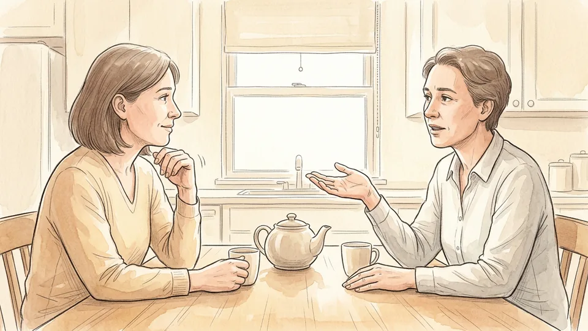

Paraphrasing is the backbone of active listening: so it sounds like the job itself is fine, it is the commute and never seeing the children that is wearing you down. Use your own phrasing rather than parroting, and keep it to a sentence. This is the move that research links to people feeling genuinely understood — more so than sympathetic noises, and more so than advice.

**Tip:** End the paraphrase slightly open, as a check rather than a verdict: have I got that right.

### Step 9 — Name the feeling as a question

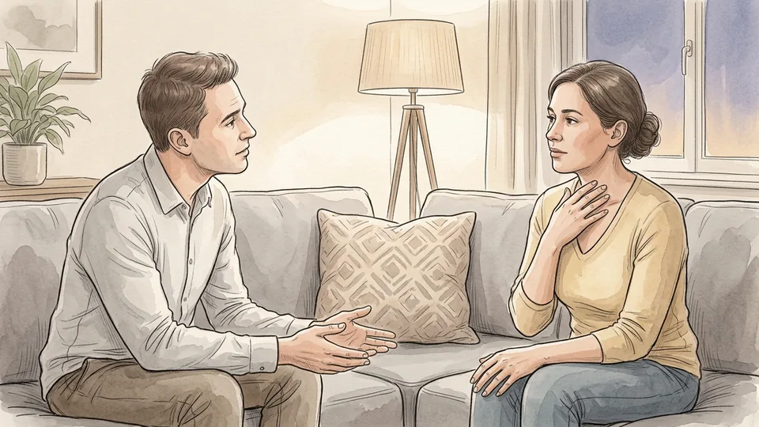

Add a tentative guess at the emotion underneath, offered so it can be corrected: that sounds exhausting rather than relieving, is that close. Getting it slightly wrong is useful, because people correct you precisely and tell you more. What you must avoid is announcing what they feel, which turns your interpretation into something they now have to argue with.

**Tip:** Keep your interpretation out of it. Say what you heard, not what you think it really means.

### Step 10 — Keep your own story out of it

Matching someone's difficulty with your own is the most common way a listener accidentally takes the conversation. The same goes for comparison and silver linings: at least you still have the job, my cousin had that and it was fine. Every one of those moves the subject. If your experience is genuinely useful, offer it later, briefly, and only when the other person has finished.

**Tip:** Watch the phrase that is just like when I. It is almost always the start of your turn rather than theirs.

## Part 3 of 3 — Finish the Conversation Well

### Step 11 — Ask what they want from you before you offer it

There are three usual answers — a sounding board, help thinking it through, or practical suggestions — and you cannot tell which from the outside. Ask: do you want ideas, or do you want to talk it out. Advice given to someone who wanted the first is experienced as not being listened to, however good the advice happens to be.

**Tip:** If they say they just want to talk, respect it completely. Holding back your solution is part of the help.

### Step 12 — Ask the direct question if you are worried

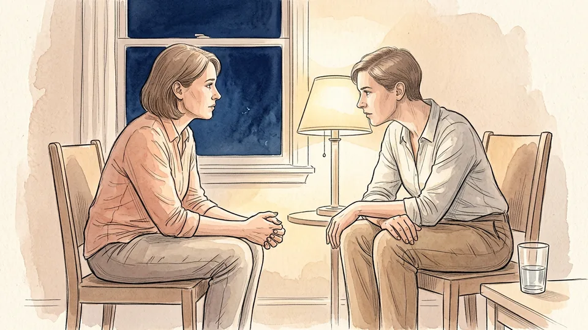

If what you are hearing worries you, say so plainly and ask. Vagueness protects the listener, not the speaker. Asking someone directly whether they are having thoughts of suicide does not plant the idea; crisis organisations are clear that it gives people permission to say how they really feel and signals that they are not a burden. Then listen to the answer without flinching.

**Tip:** Learn the number of a listening or crisis line in your country before you need it, and say it out loud rather than sending a link later.

### Step 13 — Offer one practical next step, not a plan

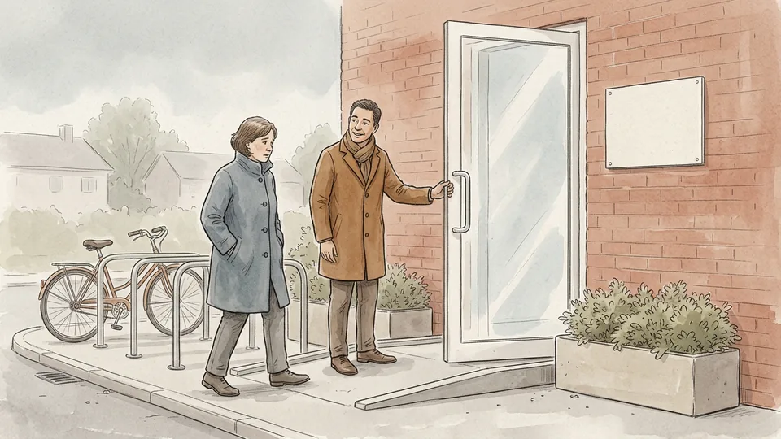

Help is easier to accept when it is small and specific: I can drive you, I can sit with you while you make the call, I can take the children on Thursday. Make the offer concrete and let them decline it. A long plan handed over at the end of a hard conversation usually becomes one more thing the person feels unable to do.

**Tip:** Offering to go with someone to an appointment removes the hardest part of it for many people.

### Step 14 — Close with a short summary and a word about privacy

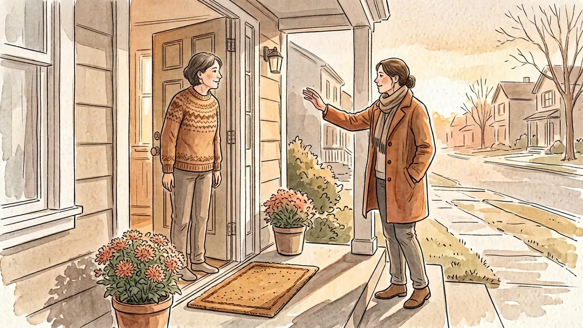

End by saying back the two or three things you took away, and check them. Then be explicit about what you will do with it: this stays with me, and I will not raise it in front of the others. If you may have to pass something on — because a child is at risk, or because someone's safety is at stake — say that honestly rather than promising a confidence you cannot keep.

**Tip:** Send one short message the next day. Thinking of you, no reply needed, does more than a longer conversation often does.

### Step 15 — Check what the listening cost you

Carrying someone else's difficulty is tiring, and listeners who ignore that become brittle or start avoiding the person. Notice what you are left holding, talk to someone yourself if you need to, and accept that it is legitimate to say you are not available for a while. Practice helps too: keeping a short listening diary for a week shows you where your attention habitually goes.

**Tip:** Being a good listener is a skill, not a personality. It gets easier with repetition and with rest.

## Tips

- Three slow seconds of silence before you reply will change more conversations than any phrase you can learn.
- Open questions start with what, how or tell me. Questions starting with why often sound like an accusation.
- Listening by message works, but it is slower and misses tone. If something matters, move to a voice call or a walk.
- If the person says they do not want to talk, leave the door open rather than pressing. Saying you are around any time is not a failed conversation.

## Warnings

- If someone is in immediate danger or needs urgent medical help, stop listening and get help: call your local emergency number rather than handling it alone.
- Active listening is a way of supporting someone, not a substitute for treatment. Where there are signs of depression, self-harm, abuse or substance dependence, encourage contact with a doctor or a qualified service and offer to help make it happen.
- Do not promise absolute confidentiality where a child or vulnerable adult may be at risk, or where your workplace imposes reporting duties. Say upfront what you may have to pass on and to whom.

## Community Q&A

**What is the difference between active listening and just listening?**

Ordinary listening is receptive; active listening is visible. It combines giving undivided attention, using open questions, tolerating silence, and feeding back what you heard in your own words so the speaker can confirm or correct it. The feedback is what distinguishes it. Research comparing responses in first conversations found that people who received paraphrases and follow-up questions felt more understood and more satisfied than those who received only nods or advice.

**Is it wrong to give advice?**

No, but the order matters. Advice offered before the person feels understood lands as dismissal, and advice nobody asked for is often heard as criticism. Listen first, say back what you heard, then ask whether they would like suggestions. If they say yes, offer one or two and leave the choice with them. If they say no, holding your suggestion back is the more useful thing to do.

**How do I listen well when I disagree with what I am hearing?**

Separate understanding from agreement. You can repeat someone's position accurately without endorsing it, and doing so usually lowers the temperature rather than conceding ground. Keep your paraphrase factual, avoid loaded words, and save your own view until they have confirmed you have understood theirs. If you must disagree, do it after the summary, briefly, and without reopening the whole account.

**What if I am a bad listener by nature?**

Listening is a trainable skill and most of the gains are mechanical rather than emotional: put the phone away, wait three seconds, ask one open question, say back one sentence. Try the five habits taught by listening charities one at a time rather than all at once. Keeping a brief diary of conversations for a week — what you learned, what distracted you — gives you a clear picture of which habit to work on next.

## Useful external resources

- [Samaritans: SHUSH active listening tips](https://www.samaritans.org/how-we-can-help/if-youre-worried-about-someone-else/how-support-someone-youre-worried-about/what-do-if-you-think-someone-struggling/) — The five listening habits — show you care, have patience, use open questions, say it back, have courage — with examples.
- [University of Minnesota REACH: The Relative Effectiveness of Active Listening in Initial Interactions](https://reachfamilies.umn.edu/sites/default/files/prtw/2021-09/Weger_2014__2021091010606.pdf) — Research summary of the study comparing active listening with simple acknowledgement and advice, including its limitations.
- [Samaritans: Little tips for helping someone open up](https://www.samaritans.org/how-we-can-help/if-youre-worried-about-someone-else/little-tips/) — Signs that someone may be struggling, how to start the conversation, and how to move towards further help.

## References

1. Samaritans. What to do if you think someone is struggling: SHUSH active listening tips. https://www.samaritans.org/how-we-can-help/if-youre-worried-about-someone-else/how-support-someone-youre-worried-about/what-do-if-you-think-someone-struggling/
2. Weger H, Castle Bell G, Minei EM, Robinson MC. The Relative Effectiveness of Active Listening in Initial Interactions. International Journal of Listening, 2014;28(1):13-31. https://doi.org/10.1080/10904018.2013.813234
3. University of Minnesota, Center for Research and Outreach (REACH). Putting Research to Work for Families: The Relative Effectiveness of Active Listening in Initial Interactions. https://reachfamilies.umn.edu/sites/default/files/prtw/2021-09/Weger_2014__2021091010606.pdf
4. Samaritans. How to support someone you're worried about: Looking after yourself. https://www.samaritans.org/how-we-can-help/if-youre-worried-about-someone-else/how-support-someone-youre-worried-about/looking-after-yourself/

## Internal links

- [How to Have a Difficult Conversation](https://www.56juqingba.com/Have-a-Difficult-Conversation)
- [How to Prepare for a Performance Review](https://www.56juqingba.com/Prepare-for-a-Performance-Review)
- [How to Split Household Chores Fairly](https://www.56juqingba.com/Split-Household-Chores-Fairly)
