# How to Make Effective Study Flashcards

*One idea per card, a question on the front, and two short sessions a week: how to build a deck that survives contact with an exam.*

**Category:** Education and Communications

**Slug:** `/Make-Effective-Study-Flashcards`

**Primary keyword:** make effective study flashcards

**Meta description:** Make effective study flashcards: one idea per card, a question on the front, real recall before flipping, shuffled decks and two short sessions a week.

---

## Intro

Flashcards have a bad reputation among people who have only ever used them badly. A deck copied out of a textbook the night before an exam does very little, and flipping through cards while half-watching something else does less. Used properly, though, they combine the two study strategies that researchers rate most highly. In a review of ten common techniques for American Educator, cognitive psychologist John Dunlosky and his colleagues put practice testing and distributed practice at the top, noting that any motivated student can use them with nothing more than a pen, some index cards and a calendar. This guide covers fifteen steps: how to decide what deserves a card, how to word the two sides, how to review in a way that forces real recall, and how to space the sessions so the knowledge is still there weeks later.

## Part 1 of 3 — Build Cards That Are Worth Reviewing

### Step 1 — Decide what actually deserves a card

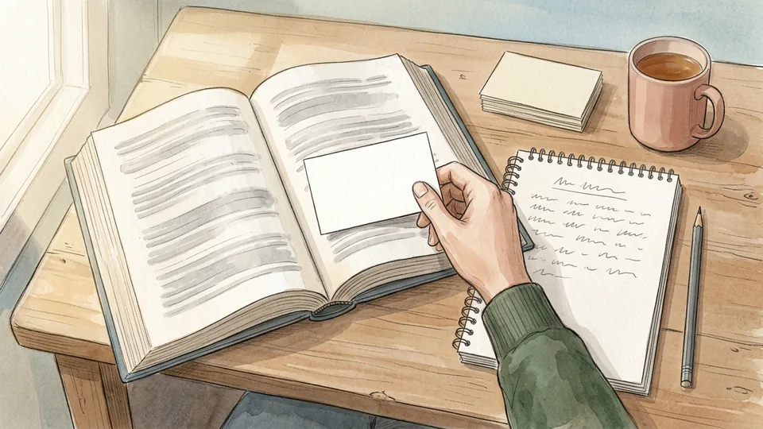

Not every sentence in a chapter is testable, and a deck that contains everything gets abandoned by week two. Go through your notes and mark only the things you could be asked to produce from memory: definitions, mechanisms, dates that carry meaning, formulas, the four causes of something. Everything else is context you will absorb by reading. A tight deck of eighty useful cards beats three hundred you never finish.

**Tip:** If you cannot imagine an exam question that the card would help you answer, the card does not need to exist.

### Step 2 — Put a question on the front, not a topic

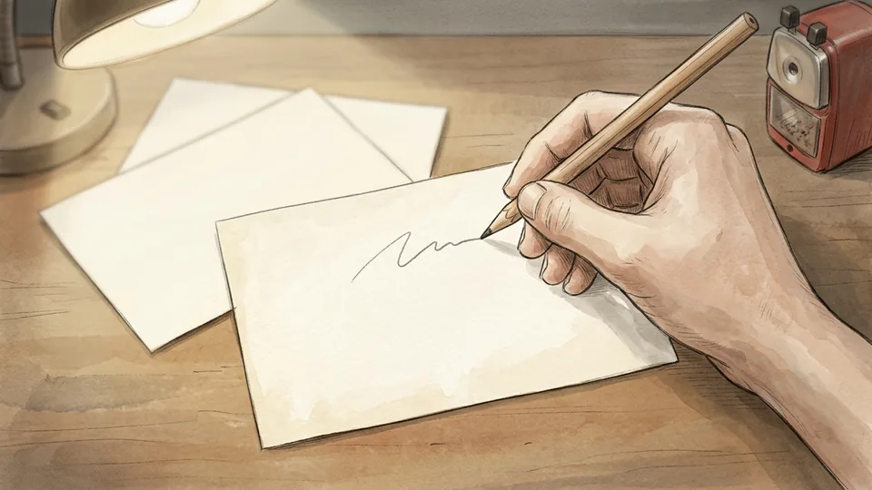

A front that reads like a heading lets you nod along without retrieving anything. A front phrased as a question forces an answer. Dunlosky's review makes the same point about practice tests in general: students benefit most from tests that require recall from memory rather than tests that only ask them to recognise the right answer. Write the front so that there is exactly one thing you are being asked to produce.

**Tip:** Starting the front with a verb helps. Explain, compare, list, calculate and define all demand something; a noun on its own does not.

### Step 3 — Keep one idea on each card

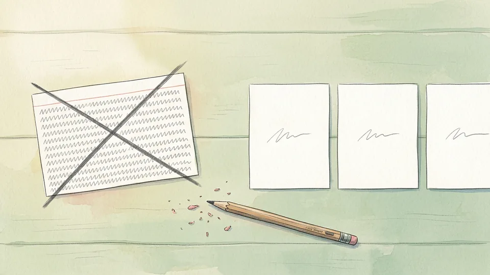

Cards carrying three facts fail in a confusing way: you half-remember one part, count it as a win, and never find out which piece is missing. Split them. Three small cards with one idea each give you three honest signals instead of one muddy one, and they are quicker to review, which matters when you are doing this most days rather than once a term.

**Tip:** A card you cannot answer in about fifteen seconds is usually two or three cards wearing a trench coat.

### Step 4 — Write the back short and in your own words

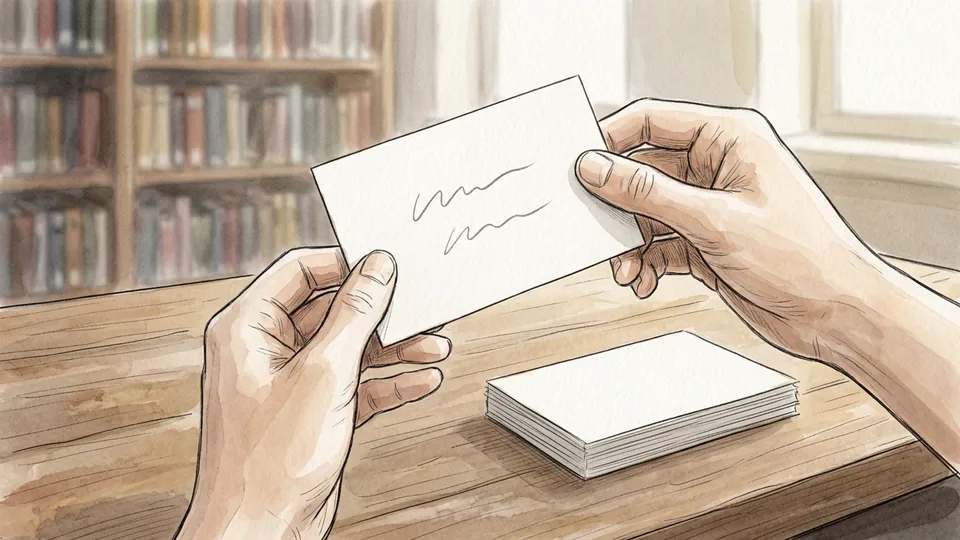

The Learning Center at the University of Rochester puts it simply: it is best to try to remember information in your own words. Copying a textbook sentence onto the back gives you something to compare against that you will never say out loud in an exam. Write the answer the way you would explain it to a classmate, and keep it to the minimum that counts as correct.

**Tip:** If the back needs more than about twenty-five words, the question on the front is too big.

### Step 5 — Make the cards yourself, the same day

Writing the cards is itself a study session: you are deciding what matters and rephrasing it, which is most of the work. University learning centres routinely tell students to write their own practice questions for exactly this reason. Make them within a day of the lecture while the material is still fresh enough to compress, and leave the reviewing until at least the next day.

**Tip:** Downloaded decks are somebody else's thinking. If you must use one, rewrite the cards you get wrong in your own wording.

## Part 2 of 3 — Review in a Way That Forces Recall

### Step 6 — Pause and commit before you flip

The whole value of the card is in the few seconds before you turn it over. Read the front, look away, and produce an answer, even a wrong one. Flipping immediately turns the session into reading, and reading feels productive while doing very little. Retrieval practice means attempting to recall something without looking, and the attempt is the part that strengthens the memory.

**Tip:** Count to three before flipping. If nothing arrives by then, say what you do know, then check.

### Step 7 — Say the answer out loud

Saying it aloud exposes the gaps that silent nodding hides: the mumble, the missing step, the phrase you cannot finish. Learning-centre guidance recommends answering out loud with a study partner, or asking yourself the question and answering it aloud when you are alone. It also rehearses the thing an exam asks for, which is production rather than a feeling of familiarity.

**Tip:** Grade yourself on what you actually said, not on what you meant. "I knew that" is not a score.

### Step 8 — Shuffle, and mix topics on purpose

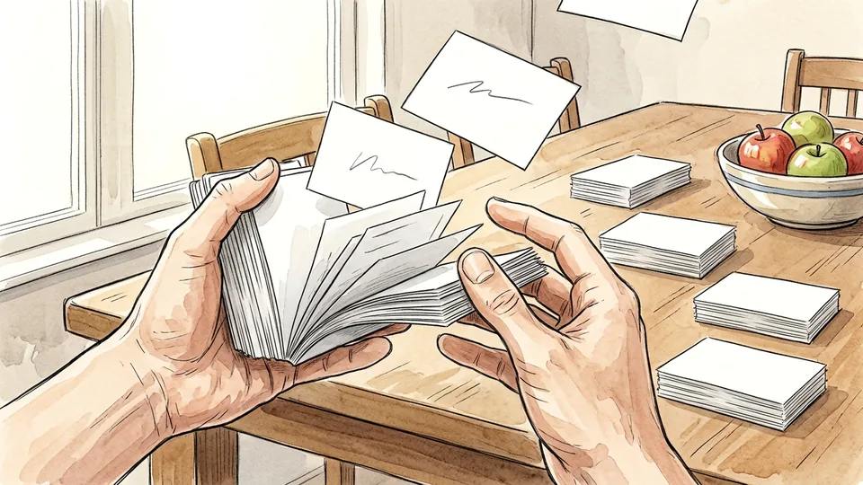

Reviewing a deck in the order you wrote it teaches you the order. Shuffle every session, and pull cards from several weeks rather than finishing one chapter at a time. Dunlosky describes interleaved practice as mixing different kinds of problems within a session, and notes that massed practice produces a misleading fluency: performance climbs during the session and fades afterwards.

**Tip:** Mixing feels worse than blocking. That extra effort of working out what kind of question this is happens in the exam too.

### Step 9 — Sort into three piles as you go

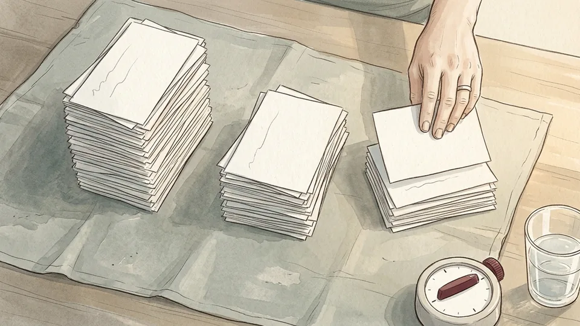

Deal each card after answering: got it cleanly, got it with effort, did not get it. Three piles turn a vague feeling about the deck into something you can see. The pile sizes tell you where the next twenty minutes should go, and the act of judging each answer honestly is a skill in itself, because confidence and accuracy come apart badly under exam conditions.

**Tip:** Be strict about the middle pile. Anything you got by half-remembering a keyword belongs there, not in the easy stack.

### Step 10 — Spend the session on the cards you missed

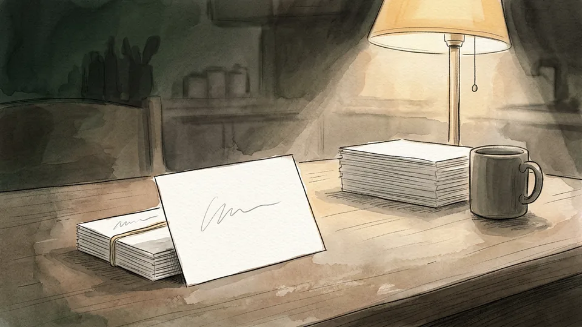

Most people review the cards they know, because it feels good. Push the easy pile aside and work the difficult one until those cards move. Come back to the easy pile occasionally, a week or two later, so it does not quietly rot. The goal of a session is not to touch every card; it is to move cards from one pile to a better one.

**Tip:** Put a small mark in the corner each time a card defeats you. Three marks means the card needs rewriting, not more attempts.

## Part 3 of 3 — Space the Sessions and Keep the Deck Honest

### Step 11 — Book two short blocks a week per subject

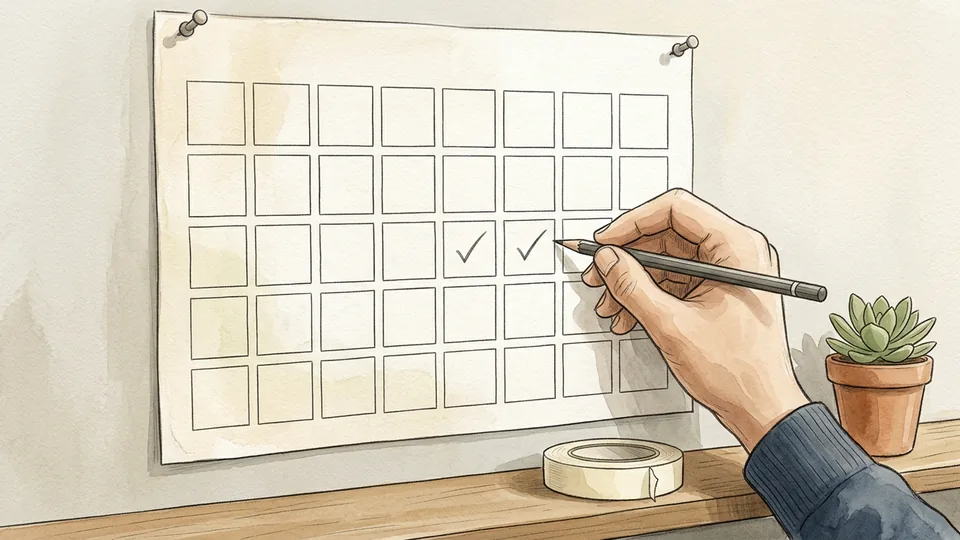

Distributed practice was the other top-rated strategy in Dunlosky's review, and his practical advice is modest: for any given class, two short study blocks per week may be enough to begin new material and to restudy what came before. Put them in the calendar like lectures. Twenty-five minutes twice a week, kept for ten weeks, outperforms the heroic weekend that happens once.

**Tip:** Pair each block with something already fixed in your week, such as straight after a seminar. Habits attach to other habits more easily than to good intentions.

### Step 12 — Let yourself forget a little between sessions

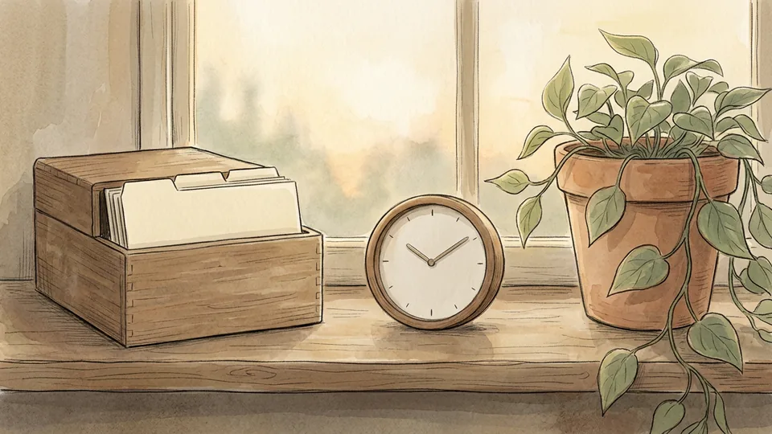

Rochester's guidance is counter-intuitive and worth taking seriously: let yourself forget a little before trying to retrieve, because forgetting and then remembering is what builds a lasting memory. Reviewing a card an hour after writing it mostly tests your short-term memory. Leave at least a day, then longer gaps as cards get easier, and accept that some will have slipped. That slip is the practice working, not failing.

**Tip:** Twelve hours of study spread over two weeks beats the same twelve hours in one day. Same effort, different result.

### Step 13 — Carry a small stack for dead time

The bus, the queue, the ten minutes before a seminar starts: short gaps suit flashcards better than any other study method, because a single card takes fifteen seconds and nothing is lost if you stop. Band twenty cards together and keep them in a coat pocket. Three of those small sessions in a week add up to a proper review block you did not have to schedule.

**Tip:** Keep the pocket stack small and current. A brick of two hundred cards never leaves the bag.

### Step 14 — Practise in the format the exam uses

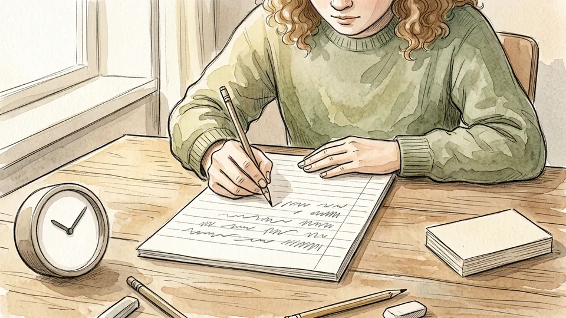

Cards are excellent for facts, definitions and steps, and poor preparation for a three-hour essay. The rule of thumb from Rochester's learning centre is to practise in the way you will be tested: write essays if you will write essays, solve problems if you will solve problems. Use the deck to secure the raw material, then spend separate sessions producing the thing the exam asks for.

**Tip:** Turn a cluster of related cards into one essay plan. If you cannot, the cards are facts without a structure around them.

### Step 15 — Retire, rewrite and prune the deck

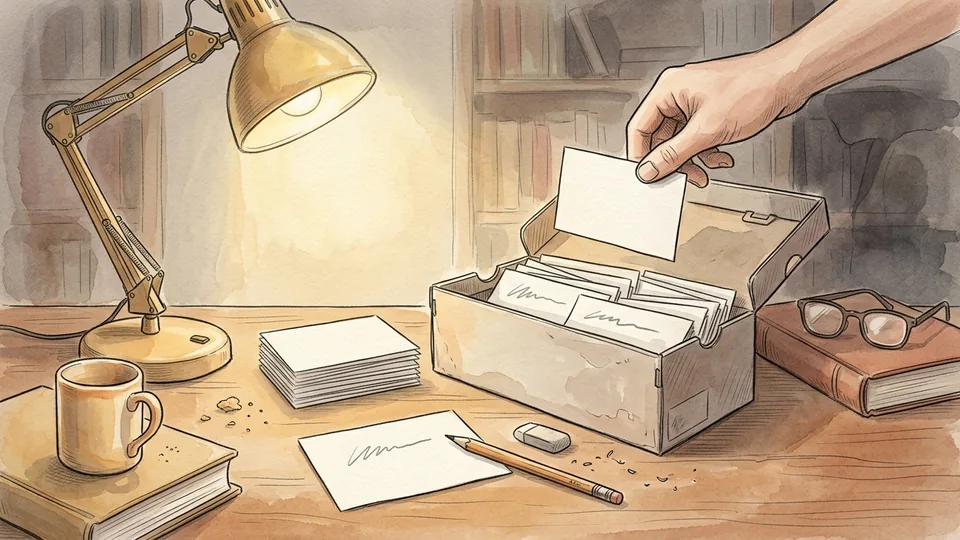

A card you have answered cleanly several sessions in a row has done its job; move it to a retired box and check it once before the exam. A card that keeps defeating you is usually badly written rather than hard: too broad, two ideas in one, or an answer you copied and never understood. Rewrite those, and delete anything the syllabus turned out not to need.

**Tip:** Prune the deck once a fortnight. Ten minutes of tidying buys back far more than ten minutes of reviewing dead cards.

## Tips

- Write the date in the corner of each card when you make it. Months later you will want to know which lecture it came from.
- Colour or a corner cut can mark a subject, so a mixed pocket stack is still sortable afterwards.
- Apps that schedule reviews for you are a fine substitute for piles, as long as you still attempt the answer before pressing a button.
- Two people with the same module can swap decks for one session. The questions you did not write are the ones that find your blind spots.
- A deck is a study tool, not a trophy. Nobody gets marks for the number of cards.

## Warnings

- Making cards is not the same as learning them. A beautiful deck finished the night before an exam has delivered almost none of its value.
- Recognition flatters you. If you can only pick the right answer when you see it, you have not yet learned it well enough to produce it.
- Do not use flashcards as your only method for subjects assessed by essays, problem sets or practicals. Practise the format you will be marked on.
- Downloaded decks can contain errors, and errors reviewed repeatedly are learned very efficiently. Check anything you did not write against your own notes.

## Community Q&A

**Are paper cards better than a flashcard app?**

Both work, and the research on retrieval practice does not depend on the medium. Paper makes sorting into piles tangible and keeps you off a device; apps schedule the intervals for you and travel in your pocket. The deciding factor is whether you genuinely attempt the answer before revealing it, which is equally easy to skip on either.

**How many cards should I review in one session?**

Judge by time rather than by count. Twenty to thirty focused minutes is a realistic block, and it is normal to cover forty or fifty cards in that time once a deck is familiar. Stopping with cards left over is fine, because they will come round in the next session anyway.

**How far in advance should I start making cards?**

From the first week of the course, a handful after each class. That way the deck grows with the material and every card gets many spaced reviews. Starting a deck in the final fortnight turns flashcards into cramming with extra stationery, which is the one way of using them that research does not support.

**What do I do with a card I get wrong every single time?**

Rewrite it rather than repeating it. Split it if it holds more than one idea, rephrase the front as a sharper question, and make sure the back is in your own words. If it still defeats you, the underlying concept probably needs a textbook or a tutor rather than another lap of the deck.

## Useful external resources

- [John Dunlosky: Strengthening the Student Toolbox (American Educator)](https://files.eric.ed.gov/fulltext/EJ1021069.pdf) — Why practice testing and distributed practice outrank highlighting and rereading, and how often to schedule study blocks.
- [University of Rochester Learning Center: Spaced Retrieval Practice](https://www.rochester.edu/college/learningcenter/assets/pdf-doc/spaced-retrieval-practice-final.pdf) — Recalling without looking, answering in your own words, letting yourself forget first, and practising in the way you will be tested.
- [UNC Chapel Hill Learning Center: learning strategies and active recall](https://learningcenter.unc.edu/tips-and-tools/biology-learning-strategies/) — Checking your understanding without notes, writing your own practice questions, and explaining concepts out loud.

## References

1. Dunlosky J. Strengthening the Student Toolbox: Study Strategies to Boost Learning. American Educator, Fall 2013;37(3):12-21. https://files.eric.ed.gov/fulltext/EJ1021069.pdf
2. The Learning Center, University of Rochester. Spaced Retrieval Practice. https://www.rochester.edu/college/learningcenter/assets/pdf-doc/spaced-retrieval-practice-final.pdf
3. The Learning Center, University of North Carolina at Chapel Hill. Biology Learning Strategies. https://learningcenter.unc.edu/tips-and-tools/biology-learning-strategies/

## Internal links

- [How to Study for an Exam Without Cramming](https://www.56juqingba.com/Study-for-an-Exam-Without-Cramming)
- [How to Speed Up a Slow Laptop](https://www.56juqingba.com/Speed-Up-a-Slow-Laptop)
- [How to Start a Nature Journal](https://www.56juqingba.com/Start-a-Nature-Journal)
