# How to Make a Sincere Apology

*Own the thing you actually did, say what it cost the other person, offer a repair you will really carry out, and then let them decide what happens next.*

**Category:** Relationships

**Slug:** `/Make-a-Sincere-Apology`

**Primary keyword:** make a sincere apology

**Meta description:** Make a sincere apology: take responsibility first, name the impact, skip the excuses, offer a concrete repair, and let the other person decide what comes next.

---

## Intro

Most failed apologies fail in the same two places: they explain before they admit, and they ask to be forgiven before anything has been repaired. Research on what makes apologies land is unusually clear on the order of importance. In two studies with 755 participants, Ohio State researchers found that the single most important component is an acknowledgement of responsibility — saying plainly that it was your fault — followed by an offer of repair, because it commits you to action rather than words. Expressions of regret, explanations and promises to change came next, and the request for forgiveness mattered least of all. The steps below put those findings in the order you will actually need them: work out what you did, say it without hedging, offer something concrete, and then accept that the response belongs to the other person.

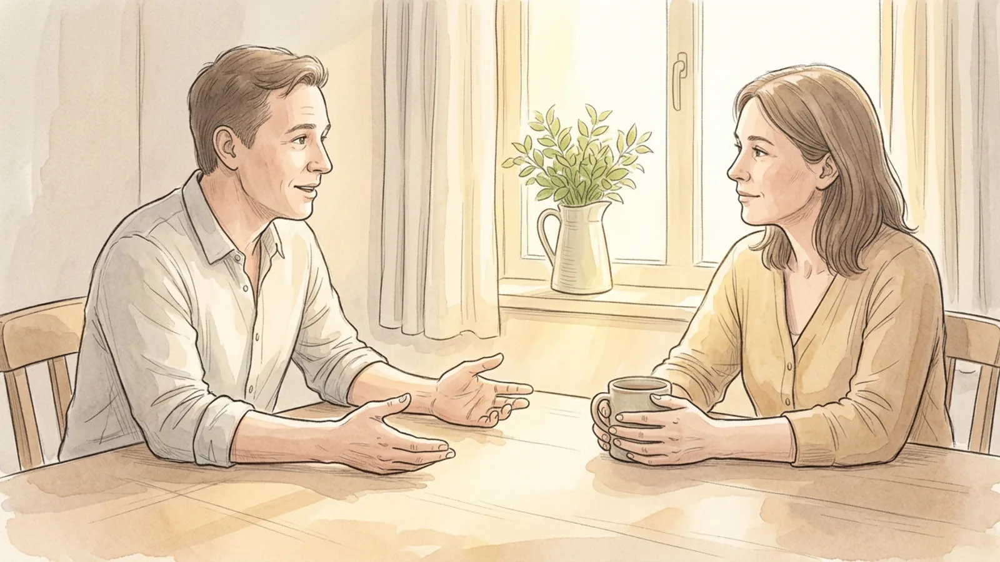

## Part 1 of 3 — Work Out What You Are Apologising For

### Step 1 — Let your own defensiveness drop first

An apology delivered while you are still arguing in your head comes out as a negotiation. Give yourself the hour or the night you need to stop rehearsing your side of it. The signal that you are ready is simple: you can describe what happened without adding the part where it was understandable. If every version in your head still ends with a justification, you are not ready to speak yet.

**Tip:** Waiting is not the same as avoiding. Tell them you want to talk properly and give a time, rather than going quiet for a week.

### Step 2 — Work out the impact, not your intention

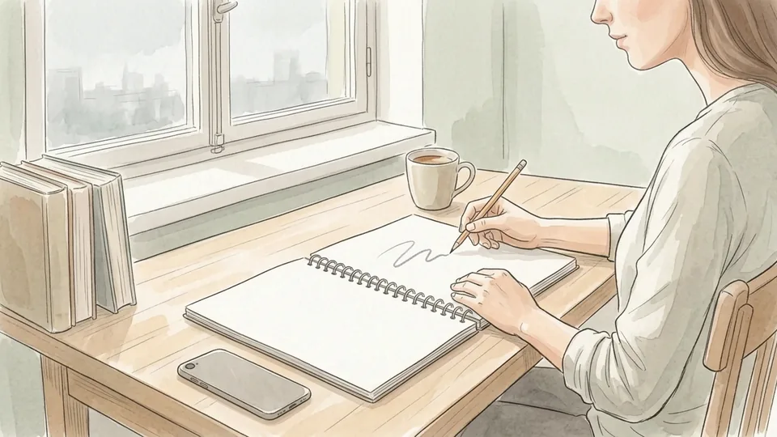

Ask what the other person actually experienced: embarrassed in front of colleagues, left waiting, not believed, made to do your share. Impact is what you are apologising for, and it is often quite different from what you meant to do. Writing the impact down in one sentence is the single most useful preparation, because that sentence is the thing they need to hear you say out loud.

**Tip:** If you genuinely do not know what the impact was, that is a question to ask them rather than a blank to fill in yourself.

### Step 3 — Stop measuring the harm against what you meant

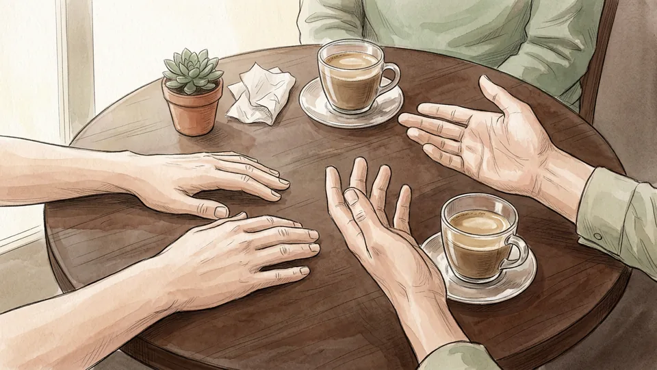

Good intentions are not a defence and saying so out loud makes things worse. I did not mean it that way asks the other person to manage your discomfort at the exact moment they are dealing with their own. Hold both things privately — you did not intend harm, and harm happened — and say only the second one. Intention can be discussed later, once the person you hurt is no longer the one doing the reassuring.

**Tip:** A useful test: if the sentence would make you feel better and them feel worse, keep it out of the apology.

### Step 4 — Decide exactly what is yours to own

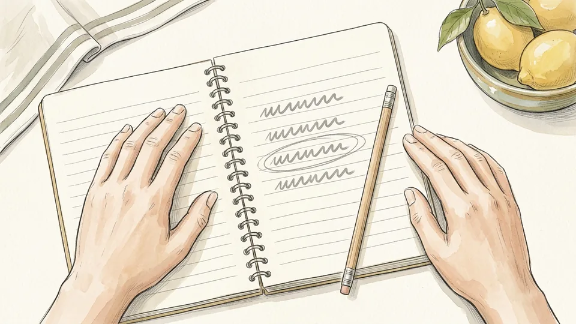

Separate what you did from what the situation did and from what they did. Then apologise for your part completely and without qualification, even if it is only a share. Over-apologising for everything is its own problem: it reads as performance, it can bury the real admission, and it quietly pressures the other person to say that it was fine. One clear admission beats a flood of general remorse.

**Tip:** Write the sentence as I did X and it caused Y. If you cannot fill in X with a specific action, keep thinking.

### Step 5 — Pick a time and a channel that suit them

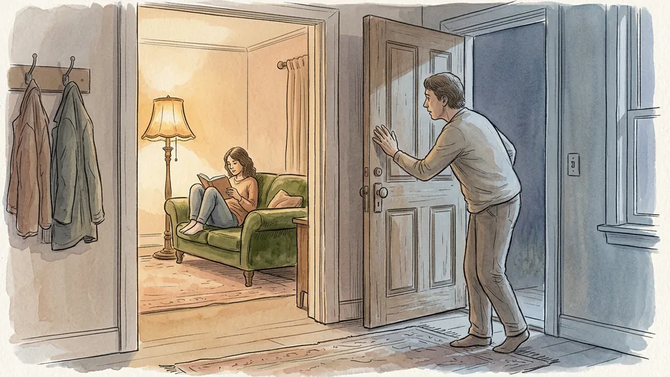

Apologise in person where you can, by voice where you cannot, and by message only when distance or safety requires it — tone and eye contact carry a great deal of what makes an apology credible. Ask first rather than ambushing them: is now a good time, or would later today be better. Giving the other person control over when the conversation happens is itself part of the repair.

**Tip:** Never deliver an apology when either of you is about to leave. An apology with four minutes attached to it is a tick on your list, not a repair.

## Part 2 of 3 — Say It Properly

### Step 6 — Lead with responsibility

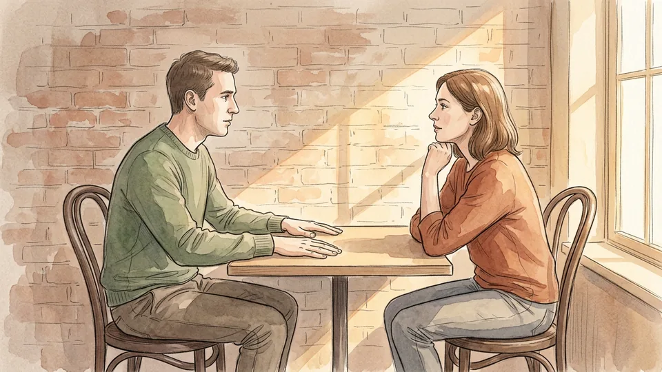

Open with the admission, not the preamble: I was wrong to do that, it was my fault. Acknowledgement of responsibility is the component researchers found mattered most, and putting it first changes the whole conversation, because the other person stops waiting to find out whether you are going to defend yourself. Everything else in the apology is easier to hear once that sentence is out.

**Tip:** Say it in your own words but keep it short. Long sentences of responsibility usually have an excuse hidden in the middle.

### Step 7 — Say you are sorry, and say what for

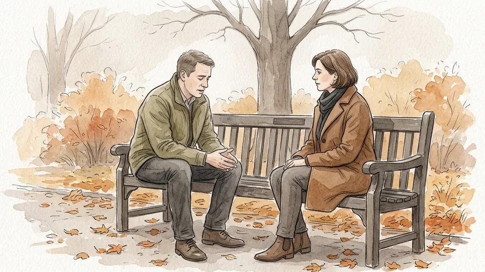

Express regret plainly and attach it to the specific thing: I am sorry I spoke over you in the meeting, and I am sorry about how that left you looking. Naming the event and the effect shows you understood what happened rather than that you noticed someone was upset. Regret on its own is weak; regret attached to a concrete act and its consequence is not.

**Tip:** Avoid apologising for how they feel. I am sorry you were upset shifts the subject from your action to their reaction.

### Step 8 — Keep any explanation to one sentence

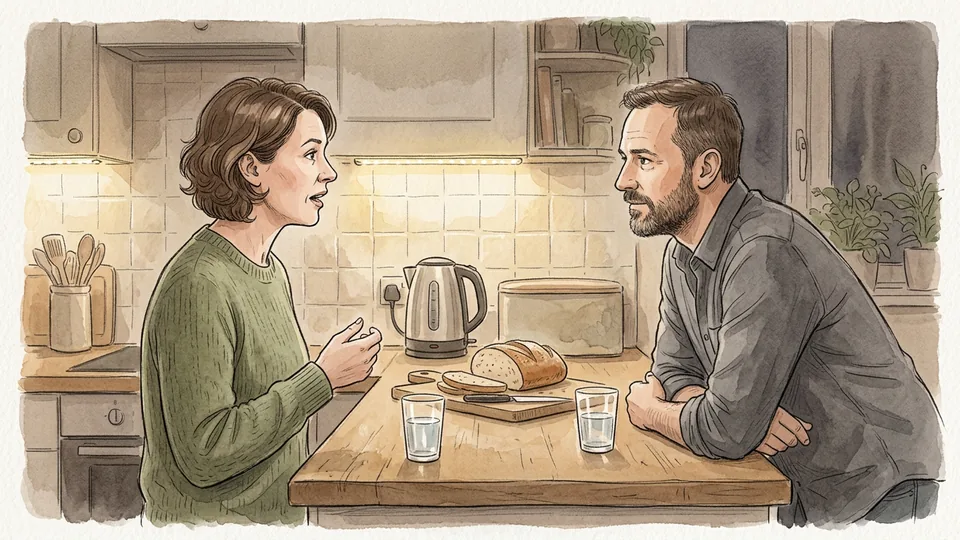

An explanation helps a person make sense of what happened, but it turns into a defence the moment it runs long or arrives first. Give it after the admission, in a single sentence, and tie it back: it is no excuse, but I had agreed to two things at once and I handled it badly. If you cannot say it in one sentence without sounding like a case for the defence, leave it out entirely.

**Tip:** Watch for the word but. Almost everything after it in an apology undoes what came before.

### Step 9 — Strip out every conditional word

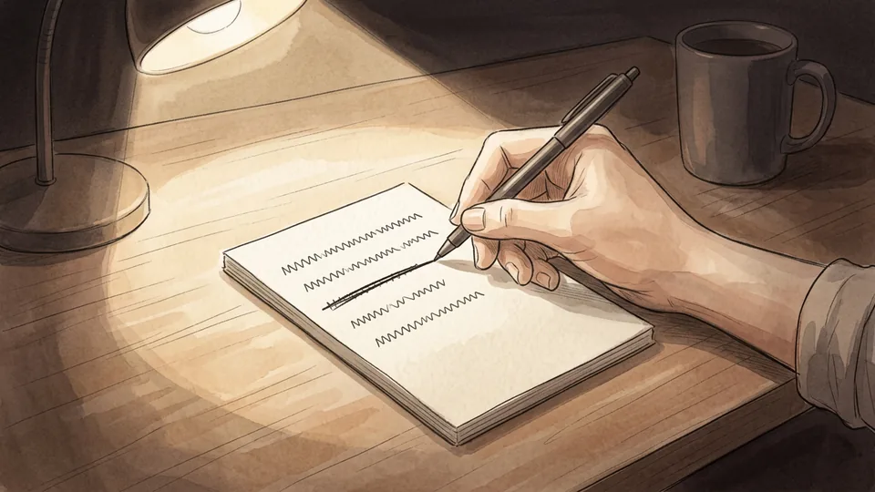

If I upset you, sorry you took it that way, and I apologise if anyone was offended are not apologies. They put the harm in doubt and leave the other person arguing for their own hurt. Say what happened as a fact: I upset you. The difference is one word and the whole meaning of the sentence turns on it.

**Tip:** Read your apology back and delete every if, maybe, somewhat and apparently. What remains is usually the real apology.

### Step 10 — Offer a repair you can actually deliver

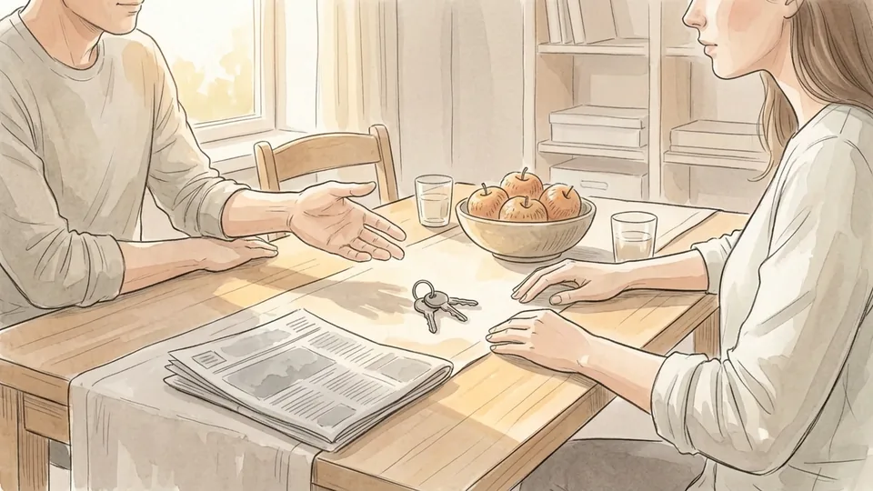

An offer of repair was the second most important component in the research, because it converts words into a commitment. Make it concrete and proportionate: I will tell the team tomorrow that the error was mine, I will take the next three school runs, I will pay for the replacement. If you do not know what would help, ask — is there anything I can do to put this right — and then accept the answer rather than negotiating it down.

**Tip:** Do not promise a repair you are unsure about to end the conversation faster. A broken repair costs more than the original mistake.

## Part 3 of 3 — After the Words

### Step 11 — Stop talking and let them answer

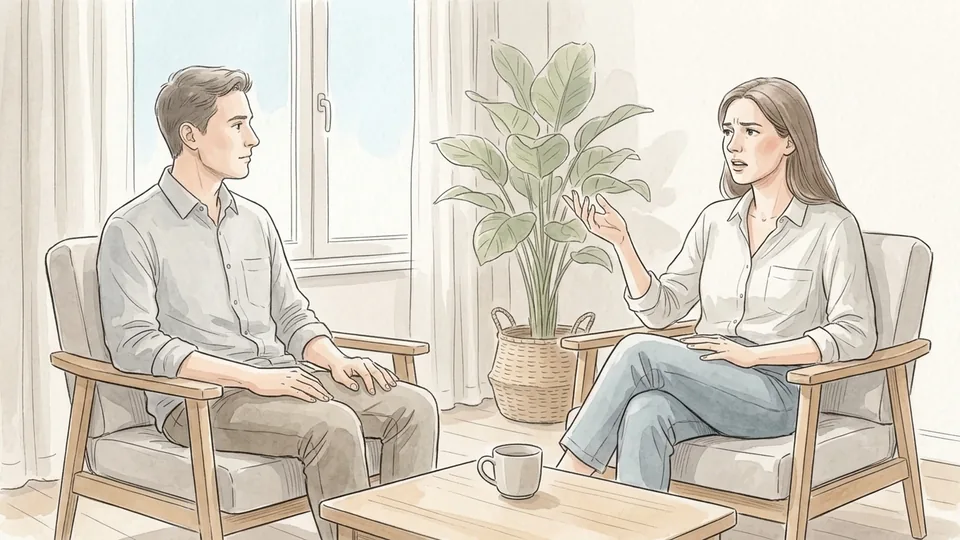

The hardest part of an apology is the silence after it. They may be short with you, list other things, or say nothing at all. Let the response happen without correcting it, and resist the urge to fill the gap by explaining again. An apology you are still managing is not an apology; it is a performance with an audience you are directing.

**Tip:** If they start listing other grievances, hear them out and offer to take each one properly another time rather than defending in the moment.

### Step 12 — Do not ask to be forgiven

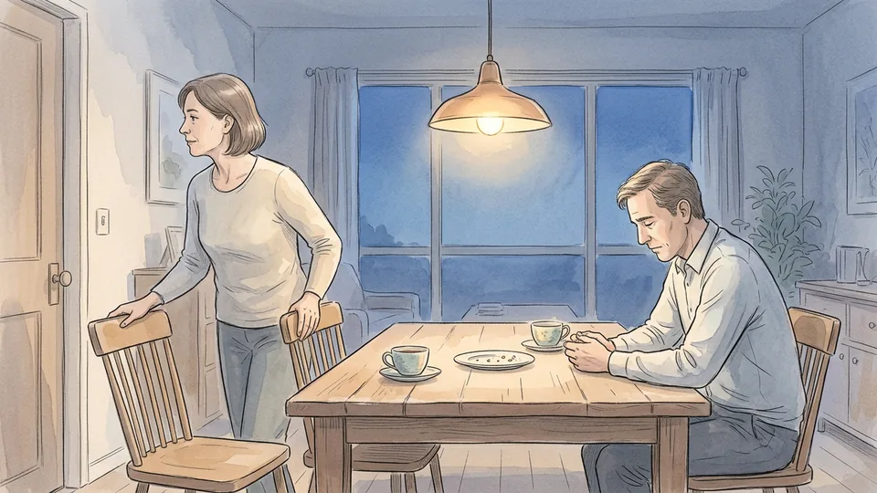

Requesting forgiveness was the least effective component in the research — the one to leave out if you leave anything out. It also quietly transfers the work to the person you hurt, who now has to look after your guilt. Forgiveness is theirs to give in their own time, if at all, and it is not the same thing as reconciliation. Your job ends with the admission, the repair and the change.

**Tip:** If they say they need time, say that is fair and mean it. Asking again next week is pressure, not sincerity.

### Step 13 — Change the thing that caused it

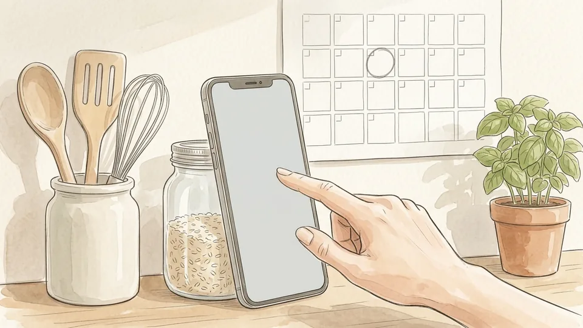

A declaration of repentance only counts once it is visible. Decide what you will do differently, tell them in a sentence, and then make the change where they can see it — the calendar reminder, the earlier departure, the habit of checking before you commit to something. Repeated apologies for the same behaviour read as a negotiation to be allowed to keep doing it.

**Tip:** Name one change, not five. Five promises after one mistake is a sign that nothing specific is going to change.

### Step 14 — Repair in front of the people who saw it

If the harm was public, part of the repair has to be public too, at the same scale: a correction in the same meeting, a word to the friends who heard it, an email to the same list. A private apology for a public humiliation leaves the other person to carry the consequence alone. Keep it brief and factual — say that you were wrong, not the whole story.

**Tip:** Agree with them first what you will say publicly. Being apologised about in front of others is not always welcome.

### Step 15 — Then let it rest

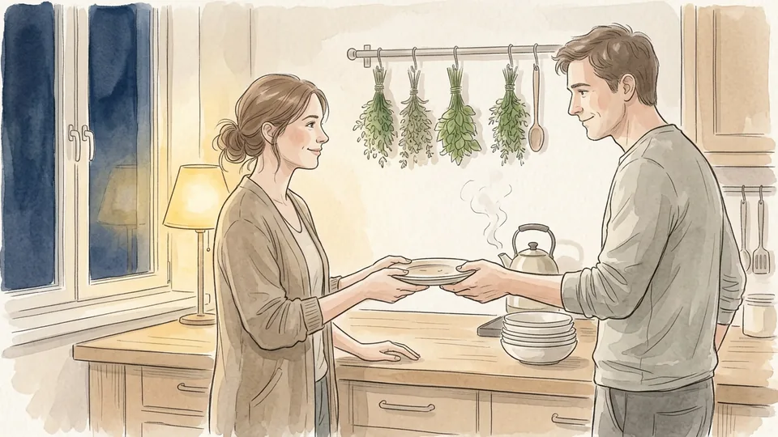

Resist going back to the subject to check that things are all right now. Repeated returns are usually about relieving your own discomfort, and they ask the other person to reassure you again and again. Check in once, days later, with something small and practical. After that, the evidence has to be the change itself: the repair carried out, the behaviour different, the subject no longer needing to be raised.

**Tip:** Keep your own note of what you promised and the date. Remembering the repair weeks later does more than any further conversation.

## Tips

- Write the apology out before you say it, then cut every sentence that defends you. What survives is usually about four lines long.
- Apologise for one thing at a time. Bundling three admissions into one conversation makes all of them sound rehearsed.
- Text is better than nothing when you cannot meet, but keep it short and follow it with a conversation when you can.
- If you are the one receiving an apology, you can accept it, decline it, or ask for time. None of those answers requires you to say that it was fine.

## Warnings

- An apology does not entitle you to reconciliation. Forgiveness and reconciliation are different things, and someone can forgive and still decide the relationship will not continue.
- Where there is a pattern of controlling, frightening or violent behaviour, apologies are frequently part of the cycle rather than a repair of it. Support from a domestic abuse service or a qualified counsellor matters more than better wording.
- In workplace, medical or legal disputes, an admission of fault can carry formal consequences in some jurisdictions. If the matter may become a complaint or a claim, take advice before putting responsibility in writing.

## Community Q&A

**What are the components of an effective apology?**

Research by Lewicki, Polin and Lount identified six: expression of regret, explanation of what went wrong, acknowledgement of responsibility, declaration of repentance, offer of repair, and request for forgiveness. Across two studies, apologies containing more of these were rated more effective. Acknowledgement of responsibility mattered most and an offer of repair came second; regret, explanation and repentance were roughly equal in third place; and the request for forgiveness mattered least.

**Should I apologise if I do not think I did anything wrong?**

You can still apologise for the impact without pretending to agree about the cause, and it is usually worth doing when the relationship matters. Say what you can say honestly: that you can see they were hurt, that you did not want that, and that you want to understand it. What you should avoid is a hollow apology designed to end the conversation, because insincere apologies are easy to detect and usually cost more trust than silence would have.

**How do I apologise for something that happened years ago?**

Ask before you deliver it. An old apology can reopen something the other person has settled, so send a short message saying there is something you would like to apologise for and asking whether they would welcome hearing it. If they say yes, keep it to the admission, the impact and any repair still possible. If they say no, accept that: honouring the refusal is itself part of the apology.

**What should I do if my apology is rejected?**

Accept the answer without arguing with it. Rejection may mean the harm is still fresh, that the repair has not happened yet, or that trust has run out. Say you understand, state the one change you are making, and then demonstrate it over time rather than asking again. Repeating an apology that has been declined puts pressure on the other person and usually confirms the impression you were hoping to correct.

## Useful external resources

- [Ohio State University: The 6 elements of an effective apology, according to science](https://news.osu.edu/the-6-elements-of-an-effective-apology-according-to-science/) — Summary of the two studies, the six components, and why responsibility and repair rank highest.
- [Greater Good Science Center, UC Berkeley: The Three Parts of an Effective Apology](https://greatergood.berkeley.edu/article/item/the_three_parts_of_an_effective_apology) — Why impact matters more than intention, how explanations turn into excuses, and what reparation looks like.
- [American Psychological Association: Forgiveness can improve mental and physical health](https://www.apa.org/monitor/2017/01/ce-corner) — What forgiveness is and is not, including why it does not require reconciliation with someone who remains harmful.

## References

1. Ohio State University News. The 6 elements of an effective apology, according to science, 12 April 2016. https://news.osu.edu/the-6-elements-of-an-effective-apology-according-to-science/
2. Lewicki RJ, Polin B, Lount RB. An Exploration of the Structure of Effective Apologies. Negotiation and Conflict Management Research, 2016;9(2):177-196. https://doi.org/10.1111/ncmr.12073
3. Carter C. The Three Parts of an Effective Apology. Greater Good Magazine, Greater Good Science Center at UC Berkeley, drawing on the work of Aaron Lazare. https://greatergood.berkeley.edu/article/item/the_three_parts_of_an_effective_apology
4. Weir K. CE corner: Forgiveness can improve mental and physical health. Monitor on Psychology, American Psychological Association, January 2017;48(1):30. https://www.apa.org/monitor/2017/01/ce-corner

## Internal links

- [How to Have a Difficult Conversation](https://www.56juqingba.com/Have-a-Difficult-Conversation)
- [How to Split Household Chores Fairly](https://www.56juqingba.com/Split-Household-Chores-Fairly)
- [How to Prepare for a Performance Review](https://www.56juqingba.com/Prepare-for-a-Performance-Review)
