# How to Map a Philosophical Argument

*Find the conclusion, list the reasons, draw the connections, and discover the unstated assumption the whole argument was resting on.*

**Category:** Philosophy and Religion

**Slug:** `/Map-a-Philosophical-Argument`

**Primary keyword:** map a philosophical argument

**Meta description:** Map a philosophical argument: find the conclusion, extract premises, set them in standard form, draw linked and convergent support, then test validity.

---

## Intro

An argument map is a picture of reasoning: boxes for claims, lines for support. It sounds like a classroom exercise, and it is the fastest way to find out whether a passage you have read three times actually proves anything. Mapping forces three questions into the open. What is this author trying to get me to believe? What reasons are offered? And does each reason do the work on its own, or only alongside something the author never bothered to say? The method below is the one taught in critical thinking courses and philosophy syllabuses: identify the conclusion, extract the premises, set them out in standard form, then draw the structure and test it. You need paper and a pen. Software helps with long arguments, but nothing about the method requires it, and the discipline of writing one claim per box is where most of the value lives.

## Part 1 of 3 — Find the Argument Before You Draw Anything

### Step 1 — Check that the passage is an argument at all

Descriptions, explanations and summaries all look like arguments and are not. The test is whether the author is trying to persuade you of something. The bus was late, so I was late for school explains an event; the bus is late, so I will probably be late explains nothing and argues for a claim. Mapping a passage that contains no argument produces a tidy diagram of nothing, so settle this question first.

**Tip:** If you cannot say what the author wants you to believe by the end of the passage, you are probably reading an explanation.

### Step 2 — Find the conclusion first

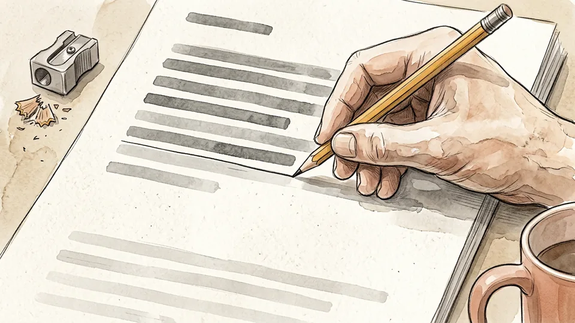

The conclusion is the claim the author wants you to accept. Indicator words help — therefore, so, hence, it follows that, consequently, this shows that — but conclusions often arrive first and often carry no signal at all. The reliable test is to ask which single claim all the other sentences are working for. Write it at the bottom of your page and leave room above it.

**Tip:** Rewrite the conclusion as one plain sentence in your own words before you go hunting for premises.

### Step 3 — Collect the premises by asking why

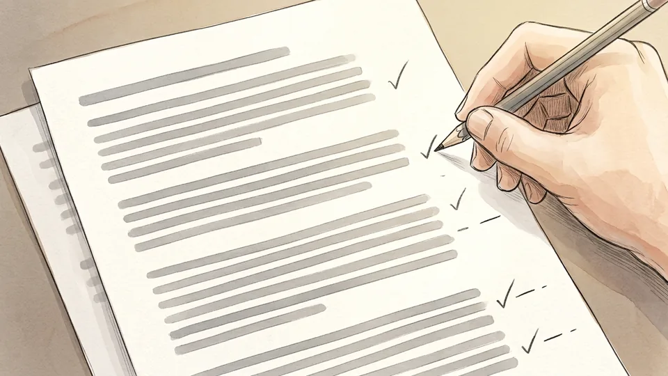

With the conclusion fixed, ask the only question that matters: why am I meant to believe this? Every answer the text offers is a premise. Premise indicators include because, since, for, as, firstly, in view of the fact that, and may be inferred from. List them roughly at this stage; tidying comes next. Expect some sentences to be neither premise nor conclusion but illustration, which you will discard.

**Tip:** Number each candidate premise in the margin of the text itself. You will need to find them again when the map disagrees with the page.

### Step 4 — Write it out in standard form

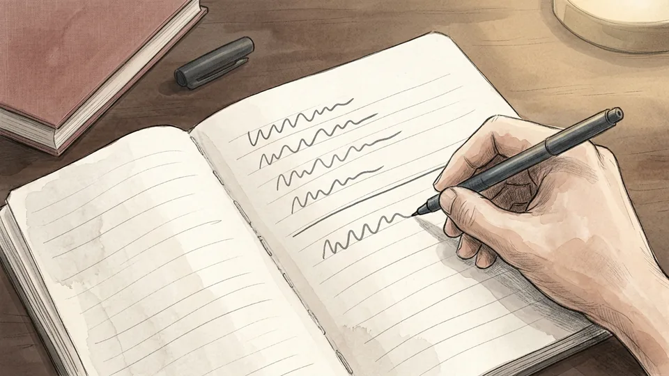

Standard form is one premise per line, numbered, with the conclusion last and marked. Reword each line so it stands alone as a statement that could be true or false — no pronouns pointing back at earlier sentences, no half clauses. This is the step people skip and the step that does the work: an argument that cannot be written in standard form usually contains two arguments tangled together.

**Tip:** Keep every line short enough to read aloud in one breath. Long premises hide extra claims.

### Step 5 — Strip out everything that is not a claim

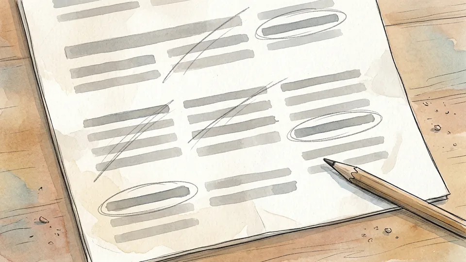

Cross off rhetorical questions, restatements, examples, jokes and background. Keep statements — sentences that can be true or false. Questions, commands and exclamations cannot be premises because they cannot be believed or disbelieved. A long paragraph often reduces to three claims, and seeing that reduction is itself informative: much philosophical prose is one argument plus a great deal of persuasion around it.

**Tip:** Keep the discarded material in a second column rather than deleting it. Sometimes an example is doing argumentative work after all.

## Part 2 of 3 — Draw the Map

### Step 6 — Give every claim its own box

Draw the conclusion in a box at the top or bottom of a large sheet, and each premise in its own box. One claim per box, always. The word and is the usual smuggler: a premise reading voting is a duty and turnout is falling is two claims that may need different support and may fail independently. Splitting them is often the moment a hidden weakness appears.

**Tip:** Work on paper that is bigger than you think you need. Maps grow sideways, and cramped maps get simplified to fit.

### Step 7 — Decide whether premises are linked or independent

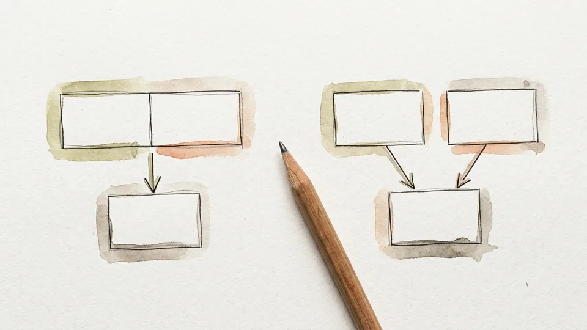

Apply the removal test to each premise: if you delete it, does the remaining reason still support the conclusion at all? If support collapses, the premises are linked co-premises and belong joined together with a single arrow to the conclusion. If each would still give some support alone, they are independent and converge on the conclusion by separate arrows. This distinction is the whole reason to draw a map rather than write a list.

**Tip:** Linked premises fail together: refute one and the pair is gone. Independent ones must be refuted one at a time.

### Step 8 — Follow the chains to intermediate conclusions

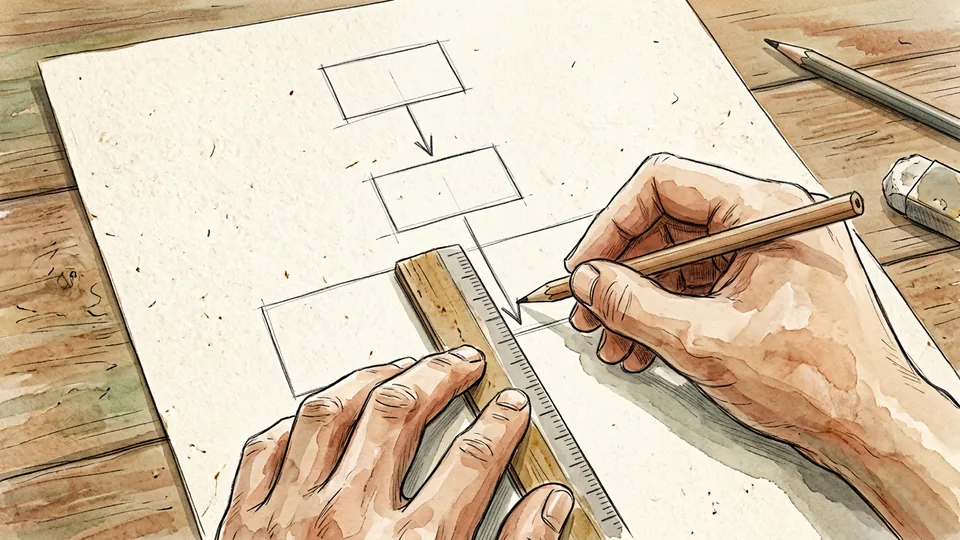

Longer arguments are serial: a claim is supported by earlier premises and then itself supports the final conclusion. That middle claim is an intermediate conclusion, and on the map it has arrows coming in and an arrow going out. Marking these correctly shows you where the argument is load-bearing — attack an intermediate conclusion successfully and everything above it in the chain loses its support.

**Tip:** If your map is a single flat row of boxes pointing at a conclusion, look again. Most real arguments have at least one step in the middle.

### Step 9 — Dig out the unstated premise

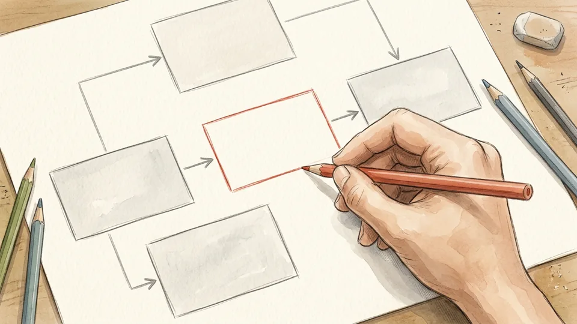

Most arguments lean on something the author never says. The standard way to find it: ask whether the conclusion really follows, and if not, what claim would have to be added to make it follow. You should not give whole grapes to babies because grapes are a choking hazard needs the unstated premise that you should not give choking hazards to babies. Write hidden premises in a different colour — they are usually the most contestable part.

**Tip:** A hidden premise is not a flaw by itself. The question is whether it is one everyone would accept.

### Step 10 — Put objections and replies on the same sheet

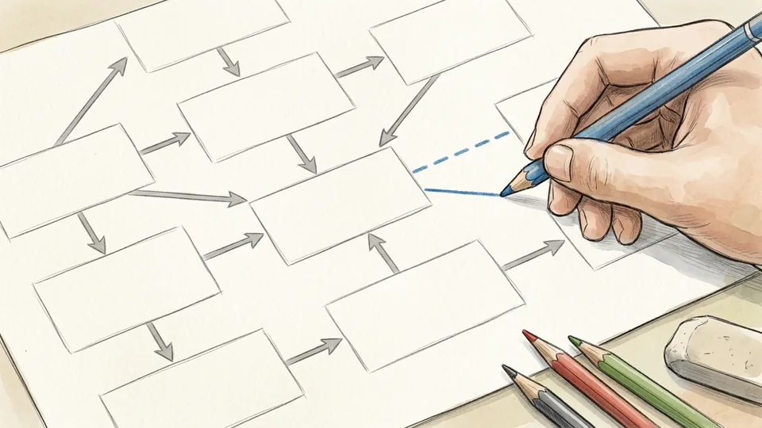

A map is not only for the author's reasoning. Add the strongest objection you can think of as a branch pointing at the premise it attacks, and any reply the author gives as a branch pointing back at the objection. Keeping attack and defence on one sheet shows you something a list cannot: whether an objection would bring the whole argument down or merely remove one of several independent supports.

**Tip:** Mark objections with a different arrowhead or a dashed line so support and attack never look alike at a glance.

## Part 3 of 3 — Test What You Have Drawn

### Step 11 — Ask what kind of support is being offered

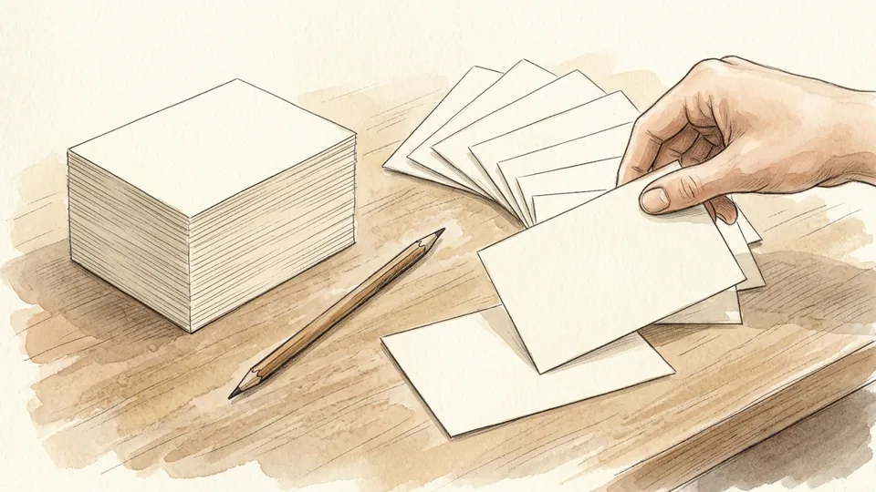

Deductive arguments claim the conclusion must be true if the premises are; inductive arguments claim only that it is probably true. The difference decides which tests apply, and applying the wrong one is a common and unfair criticism. Demanding certainty from an argument from evidence misses its point; accepting mere plausibility from an argument that claimed to prove its conclusion lets it off too lightly.

**Tip:** Words like must, necessarily and it follows signal deduction. Words like likely, tends to and suggests signal induction.

### Step 12 — Test the structure for validity

An argument is valid when there is no possible situation in which all the premises are true and the conclusion is false. Validity is about structure alone, not truth: an argument can be valid with false premises, and a true conclusion does not make an argument valid. Test by imagining the premises true and then trying to make the conclusion false. If you cannot, the structure holds.

**Tip:** Keep the vocabulary straight. Statements are true or false; arguments are valid or invalid. Mixing the two causes most confusion in essays.

### Step 13 — Then ask whether the premises are actually true

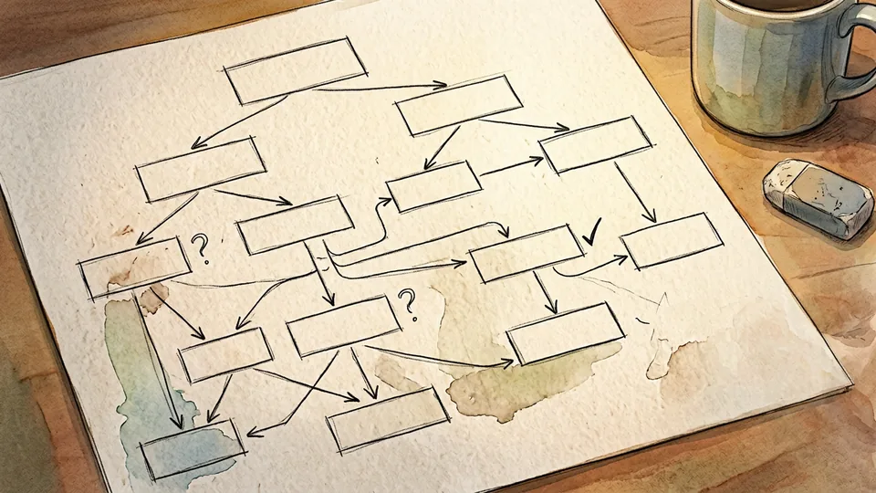

A valid argument with true premises is sound, and only a sound argument gives you a conclusion you must accept. So work down the map and judge each premise separately: is it true, is it the kind of claim that could be checked, and would a reasonable opponent accept it? Mark every premise you doubt. A single false premise undoes the whole argument, however elegant the structure.

**Tip:** Separate the premises you think are false from the ones you simply cannot assess. They lead to very different responses.

### Step 14 — Try to break it with a counterexample

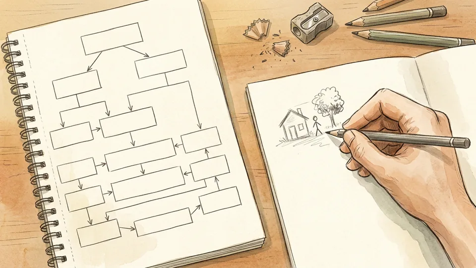

A counterexample is a described case in which the premises hold and the conclusion fails. If you can build one, the argument is invalid and you have shown exactly where. Aim at the premise you find least obvious rather than the one you dislike most. If the argument survives several honest attempts, you have learned something more useful than a refutation: you have learned the argument is strong.

**Tip:** Write the counterexample out in full sentences. Half-formed ones usually smuggle in an extra assumption of their own.

### Step 15 — Turn the map back into prose

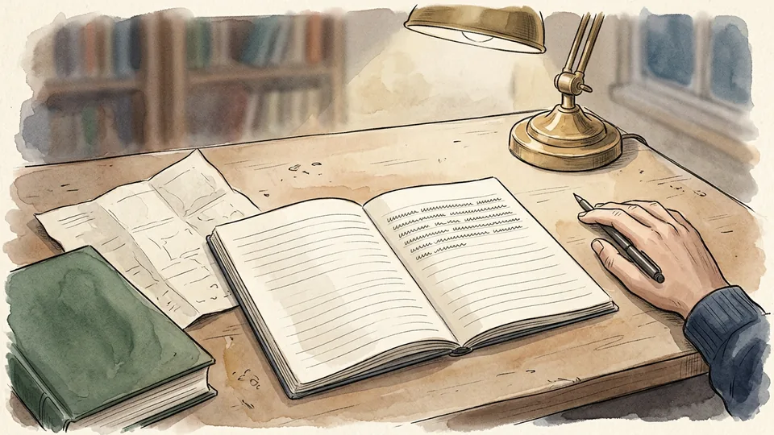

Finish by writing one short paragraph: the conclusion, the main reasons, the unstated assumption, and the single point where you think the argument is weakest. The map was scaffolding; this paragraph is what you keep. It is also the thing you can bring to a seminar, use in an essay, or reread next year — and if you cannot write it without looking at the map, the analysis is not finished yet.

**Tip:** Date the sheet and keep it with your notes on the text. Rebuilding a map from scratch costs an hour you will not have.

## Tips

- Map someone whose conclusion you agree with. Mapping only your opponents teaches you to find weaknesses rather than structure.
- Colour has to mean something: one colour for the author's claims, one for hidden premises, one for objections. Decorative colour makes maps harder to read.
- Rebuild the strongest version of the argument before criticising it. An objection that only defeats a careless version proves nothing.
- Keep maps to one sheet. If the argument genuinely needs more, map the sections separately and link them by their intermediate conclusions.

## Warnings

- A neat map is not a correct interpretation. Check your reconstruction against the text itself, because it is easy to map the argument you expected rather than the one that was written.
- Mapping shows structure, not truth. A beautifully structured argument built on false premises proves nothing, and a messy passage can still be sound.
- Be careful applying this to religious or sacred texts, which are frequently not making deductive arguments at all; treating liturgy, parable or poetry as a set of premises misreads what the text is doing.

## Community Q&A

**What is the difference between an argument map and standard form?**

Standard form is a numbered list: premises on separate lines, conclusion at the bottom. An argument map is a diagram of the same material that also shows how the premises relate to each other and to the conclusion — which ones work together, which stand alone, and where intermediate conclusions sit. Standard form is quicker and enough for short arguments; mapping earns its keep as soon as an argument has more than about four claims or includes objections.

**How do I tell linked premises from independent ones?**

Remove one premise and ask whether what remains still supports the conclusion at all. If deleting it leaves the other premise unable to support the conclusion on its own, the two are linked co-premises and should be joined before the arrow. If the remaining premise still offers some support, even weaker support, they are independent and each gets its own arrow. The test is about support, not about how persuasive the argument feels.

**Is it cheating to add premises the author never wrote?**

No, provided you mark them as your own additions. Supplying an unstated premise is a standard part of reconstruction and is how you make an argument valid enough to evaluate fairly. The error to avoid is quietly improving the argument and then praising it, or quietly worsening it and then refuting it. Write hidden premises in a different colour so the distinction between what was said and what was assumed stays visible.

**Do I need argument mapping software?**

No. Paper and coloured pencils handle almost every argument you will meet in a course, and the physical act of writing one claim per box is where most of the learning happens. Software is genuinely useful for very large arguments, collaborative work and maps you intend to revise many times, because moving boxes by hand means redrawing. Start on paper; move to software only when redrawing becomes the main cost.

## Useful external resources

- [University of Saskatchewan Library: Argument Mapping](https://libguides.usask.ca/CriticalThinkingTutorial/ArgumentAnalysis/ArgumentMapping) — What an argument map is for, and how independent and co-dependent premises appear differently on a map.
- [Oklahoma State University: Logic and the Study of Arguments (open textbook)](https://open.library.okstate.edu/criticalthinking/chapter/__unknown__/) — Premises, conclusions and statements, indicator words, and the definitions of validity and soundness.
- [SQA: Philosophy — Arguments in Action support notes](https://www.sqa.org.uk/sqa/files_ccc/n5-h-philosophy-arguments-action-additional-support.pdf) — Linked, convergent and serial argument diagrams, hidden premises, and how to tell arguments from explanations.

## References

1. University of Saskatchewan Library. Argument Mapping. Critical Thinking Tutorial. https://libguides.usask.ca/CriticalThinkingTutorial/ArgumentAnalysis/ArgumentMapping
2. Oklahoma State University Libraries. Logic and the Study of Arguments. In: Critical Thinking (open textbook). https://open.library.okstate.edu/criticalthinking/chapter/__unknown__/
3. Scottish Qualifications Authority. National 5 and Higher Philosophy: Arguments in Action — Additional Support Notes. https://www.sqa.org.uk/sqa/files_ccc/n5-h-philosophy-arguments-action-additional-support.pdf
4. Davies M, Barnett A, van Gelder T. Studies in Critical Thinking. eCampusOntario Pressbooks, on co-premises, linked reasoning and the history of argument mapping. https://ecampusontario.pressbooks.pub/criticalthinking1234/chapter/introduction/

## Internal links

- [How to Read a Philosophical Text](https://www.56juqingba.com/Read-a-Philosophical-Text)
- [How to Study for an Exam Without Cramming](https://www.56juqingba.com/Study-for-an-Exam-Without-Cramming)
- [How to Start a Club at School](https://www.56juqingba.com/Start-a-Club-at-School)
