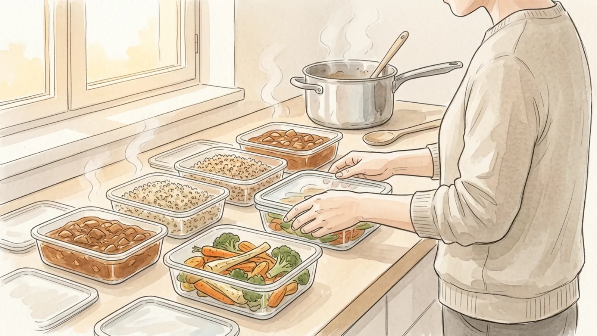
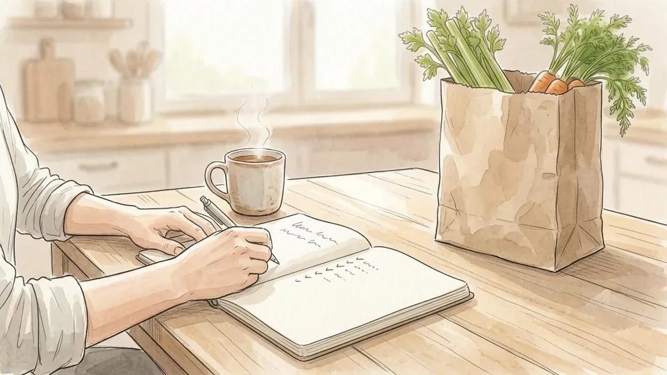
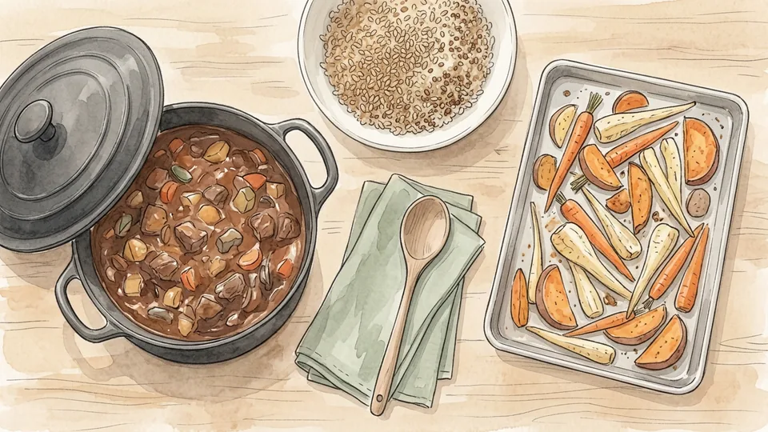
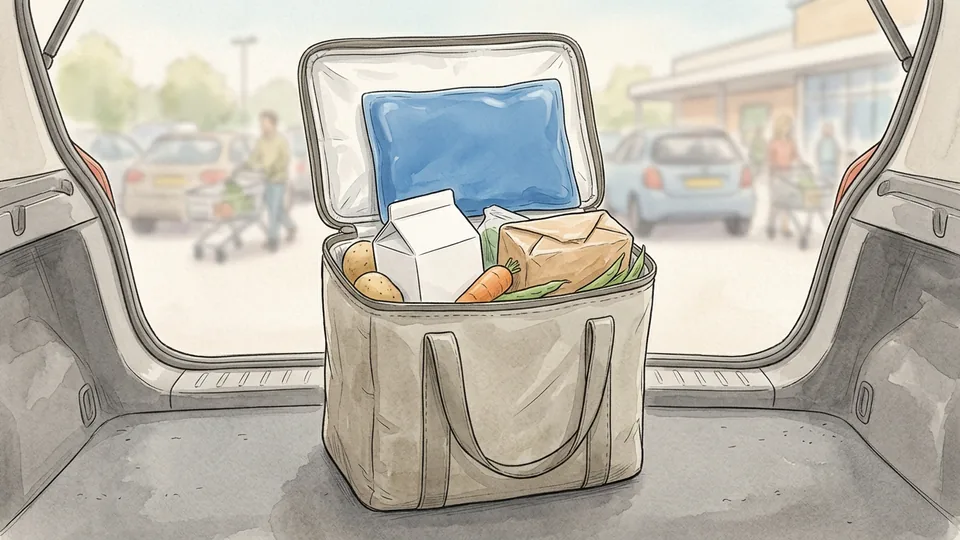

> DRAFT — do not publish or package: 12 of 16 illustrations are still missing, and the article has not been reviewed by a person.

# How to Meal Prep Safely for the Week

*Batch cooking saves time and money right up until a container sits out too long. The safety part is four numbers and one habit.*

**Category:** Food and Entertaining

**Slug:** `/Meal-Prep-Safely-for-the-Week`

**Primary keyword:** meal prep safely for the week

**Meta description:** Batch cook for the week without the food-safety risk: the cold chain, safe cooking temperatures, two-hour cooling and the three-to-four-day rule.

---

## Intro

Most meal prep advice is about efficiency: the right containers, the right order, the one pot that does everything. Almost none of it mentions that cooking four days of food at once is also the moment a home kitchen most resembles a small catering operation, with the same cooling and storage problems. The guidance below comes from USDA and FoodSafety.gov material, and it comes down to four numbers worth memorising: 40 and 140 degrees Fahrenheit mark the range where bacteria multiply fastest, two hours is the longest cooked food should sit out, and three to four days is how long most of it keeps once chilled.

## Part 1 of 3 — Plan the Week

### Step 1 — Count the meals you will genuinely eat

Work out how many meals you will really eat at home this week, then cook for that number and stop. Most of the waste in a meal prep routine comes from optimism: six lunches made on Sunday, three eaten, three thrown out on Friday. Start with four portions rather than seven. A batch you finish is a batch that never sits in the fridge past its safe window.

**Tip:** Mark the evenings you are out before you write the shopping list. One meal elsewhere turns a tidy plan into forgotten leftovers.

### Step 2 — Choose dishes that survive four days

Stews, braises, grains, beans, roasted root vegetables and cooked meats all hold up through several days of refrigeration. Dressed salad leaves, fried food and sauces thickened with cornflour do not. If you want something crisp or fresh in the finished meal, prepare it separately and add it on the day. Egg, chicken, ham and tuna salads keep only three to four days, so make those midweek rather than on Sunday.

**Tip:** Keep sauces and dressings in their own small pots. Food turns soggy long before it turns unsafe.

### Step 3 — Keep the cold chain on the way home

Pick up chilled and frozen items last, pack them together in one bag, and go straight home. Perishable food should not spend more than two hours out of refrigeration in total, and that drops to one hour once the air is above ninety degrees Fahrenheit. Time in a warm car counts against the same budget, before the food has even reached your kitchen.

**Tip:** An insulated bag with a frozen gel pack in the boot buys you an hour on a hot day for the price of a sandwich.

### Step 4 — Check the fridge is actually cold enough

> IMAGE PENDING for step 4: An open refrigerator with a small dial thermometer resting on the middle shelf among stacked containers of food.

A refrigerator needs to hold food at forty degrees Fahrenheit or below, and a freezer at zero. The dial on the door is a setting, not a measurement. Put a cheap appliance thermometer on the middle shelf and read it after a full day. Fridges that are packed solid, or opened constantly, often run several degrees warmer than the dial suggests.

**Tip:** Leave a gap at the back of each shelf. Cold air has to circulate, and a crammed fridge develops warm pockets.

### Step 5 — Start with clean hands and clean surfaces

> IMAGE PENDING for step 5: Soapy hands under a running tap at a kitchen sink, with a clean folded towel on the worktop beside it.

Wash your hands with soap and warm water for at least twenty seconds before you start, and again after handling raw meat, poultry, eggs or fish. Wipe down the worktop and put out a fresh cloth rather than the one that has been beside the sink since Tuesday. Most cross-contamination in a home kitchen travels on hands, cloths and the handle of the fridge door.

**Tip:** Twenty seconds is longer than it feels. It is roughly as long as humming a chorus twice through.

## Part 2 of 3 — Cook and Cool

### Step 6 — Keep raw meat away from everything else

> IMAGE PENDING for step 6: Two chopping boards set apart on a worktop, one holding sliced vegetables and the other raw chicken pieces.

Give raw meat, poultry and fish their own board and their own corner of the worktop, and keep them on the lowest shelf of the fridge where nothing can drip onto the food below. Prepare vegetables and anything you will eat uncooked first, while the surfaces are still clean. Wash the board, the knife and your hands before they touch anything ready to eat.

**Tip:** Two boards in different colours cost very little and take the decision out of your hands entirely.

### Step 7 — Cook each food to its safe internal temperature

> IMAGE PENDING for step 7: A probe thermometer pushed into the thickest part of a roasted chicken breast resting on a baking tray.

The targets are specific rather than general. Poultry of every kind, including ground poultry and any stuffing cooked inside a bird, needs 165 degrees Fahrenheit. Ground meat and sausage need 160. Whole cuts of beef, pork, lamb and veal need 145 with a three-minute rest, and fish 145 or until the flesh separates easily with a fork. Egg dishes land at 160 and casseroles at 165.

**Tip:** Tape the temperature chart inside a cupboard door. Nobody memorises six numbers in the first week.

### Step 8 — Trust the thermometer, not the colour

> IMAGE PENDING for step 8: A hand holding a digital probe thermometer in a pan of browned minced meat on a hob.

Browning tells you about the heat at the surface, not in the middle. Minced beef can turn grey well before it is safe, and a chicken thigh can look done while the centre is still short. Push the probe into the thickest part, away from bone and away from the pan itself, and wait for the reading to settle before you pull it out.

**Tip:** Check the thickest piece in the batch, not the convenient one at the edge of the tray.

### Step 9 — Divide hot food into shallow containers

> IMAGE PENDING for step 9: Several shallow containers of stew and rice spread across a worktop with steam rising, their lids resting beside them.

A deep pot of stew left on the hob can take hours to cool through the middle, and improper cooling of cooked food is one of the most common causes of foodborne illness. Portion everything into shallow containers no more than about two inches deep, leave the lids ajar while the steam escapes, and spread them across the worktop instead of stacking them.

**Tip:** A tray of cold water in the sink under the containers pulls heat out far faster than air alone.

### Step 10 — Get it into the fridge within two hours

> IMAGE PENDING for step 10: Hands sliding a covered container of food onto a refrigerator shelf beside other stacked containers.

Cooked food must be refrigerated at forty degrees or below within two hours of leaving the heat, or within one hour if the kitchen is above ninety. Bacteria multiply fastest between forty and a hundred and forty degrees, doubling in number in as little as twenty minutes. You do not need to wait for food to reach room temperature first; a modern fridge copes perfectly well with warm containers.

**Tip:** Start a timer when the pot comes off the hob. Two hours vanishes quickly while you are washing up.

## Part 3 of 3 — Store, Reheat and Review

### Step 11 — Label every container with the date

> IMAGE PENDING for step 11: A hand pressing a strip of masking tape onto the lid of a food container, with a marker pen lying on the worktop.

Write the date the food was cooked on a strip of masking tape and press it onto the lid. Memory is unreliable after three days and useless after five, and a tub of something brown with no date is a tub you will eventually throw out untouched. Labelling also means anyone else in the house can use the food instead of buying lunch.

**Tip:** Write the day it was cooked, not the day it should be eaten. One is a fact and the other is a guess.

### Step 12 — Work to the three-to-four-day rule

> IMAGE PENDING for step 12: An open refrigerator shelf with labelled containers lined up front to back, a hand reaching for the one nearest the front.

Cooked meat and poultry, soups, stews and pasta dishes keep three to four days in the refrigerator. Egg, chicken, ham, tuna and macaroni salads are the same. That window is about safety rather than taste, and it does not reset because the food still smells fine. Arrange the shelf so the oldest container sits at the front and gets eaten first.

**Tip:** Sunday cooking reaches Wednesday or Thursday, not Friday. Plan the back half of the week as a separate exercise.

### Step 13 — Freeze what you will not reach in time

> IMAGE PENDING for step 13: Flat sealed bags of cooked food stacked in a freezer drawer, one being slid into the gap between the others.

Anything you will not eat within four days should go into the freezer on the day it is cooked, not on day three when half of it has already gone. Food held continuously at zero degrees Fahrenheit stays safe indefinitely, and the time limits printed on freezer charts are about quality rather than risk. Cooked meat and poultry hold their texture for two to six months.

**Tip:** Freeze flat in bags rather than in tubs. Flat portions stack, thaw faster and take up half the space.

### Step 14 — Reheat until it is hot and steaming through

> IMAGE PENDING for step 14: A bowl of food being lifted out of a microwave with a cloth, steam rising from the surface.

Leftovers of any kind should reach a hundred and sixty-five degrees Fahrenheit before you eat them. In a microwave, cover the food, stir or rotate it partway through, then let it stand for a minute so the heat evens out, because microwaves leave cold spots that a quick stir will not fix. Check with a thermometer rather than judging by how hot the outside feels.

**Tip:** Reheat only the portion you are about to eat. Heating and cooling a whole batch repeatedly burns through the time you have left.

### Step 15 — Throw out anything you cannot account for

> IMAGE PENDING for step 15: A container being emptied into a kitchen caddy beside the sink, with a washed container draining on the rack.

If a container is unlabelled, has been in the fridge longer than four days, or was left out overnight, discard it. Food that has spent hours in the danger zone can look, smell and taste entirely normal, because the bacteria that cause illness are not the ones that cause spoilage. Tasting a doubtful portion is not a test of whether it is safe; it is the exposure itself.

**Tip:** Clear and wipe the fridge on the same day each week. It takes five minutes and it resets the whole system.

## Tips

- Cook two dishes well rather than four badly. A smaller batch cools faster, fits the fridge properly and actually gets eaten.
- Buy one appliance thermometer for the fridge and one probe thermometer for food. Together they cost less than a single takeaway and they answer almost every safety question in this guide.
- If a recipe tells you to cool something on the worktop overnight, ignore it. Overnight is roughly eight hours in the danger zone.

## Warnings

- Never thaw frozen food on the worktop. Thaw it in the refrigerator, in cold water changed every thirty minutes, or in the microwave if you are cooking it immediately afterwards.
- Food left out of refrigeration for more than two hours, or more than one hour above ninety degrees Fahrenheit, should be discarded rather than reheated. Reheating kills bacteria but does not destroy the toxins some of them leave behind.
- This guide covers general home food safety. People who are pregnant, very young, over sixty-five or immunocompromised face higher risk from foodborne illness and should follow advice from a health professional.

## Community Q&A

**How long do meal prep leftovers actually keep?**

Three to four days in the refrigerator for cooked meat and poultry, soups, stews, pasta dishes and most mixed salads such as egg, chicken or tuna. That is a safety limit rather than a quality one, so it applies even when the food still looks and smells fine.

**Can I put hot food straight into the fridge?**

Yes, and you should. Waiting for food to reach room temperature is exactly what puts it at risk. Divide it into shallow containers first so it cools quickly, leave the lids ajar until the steam stops, and get everything in within two hours of cooking.

**What is the danger zone?**

The range between 40 and 140 degrees Fahrenheit, where bacteria grow fastest and can double in number in as little as twenty minutes. Keeping cold food at or below 40 and hot food at or above 140 is the whole principle behind every other rule here.

**Do I have to reheat everything to 165 degrees?**

For leftovers, yes. FoodSafety.gov gives 165 degrees Fahrenheit for leftovers of any type, or until the food is hot and steaming throughout. Food you are eating cold straight from the fridge, such as a prepared salad, is fine as long as it has stayed chilled and is within its three-to-four-day window.

**Is it safe to refreeze something I thawed?**

Food thawed in the refrigerator can be refrozen without cooking, though the texture will suffer. Food thawed in cold water or a microwave should be cooked first, then frozen. Anything that has been left out at room temperature to thaw should not be refrozen at all.

## Useful external resources

- [USDA FSIS: The Danger Zone (40°F – 140°F)](https://www.fsis.usda.gov/food-safety/safe-food-handling-and-preparation/food-safety-basics/danger-zone-40f-140f) — Two-hour rule, shallow-container cooling, and the 165°F reheating figure.
- [FoodSafety.gov: Safe Minimum Internal Temperatures](https://www.foodsafety.gov/food-safety-charts/safe-minimum-internal-temperatures) — Printable chart of cooking temperatures for meat, poultry, seafood and egg dishes.
- [FoodSafety.gov: Cold Food Storage Chart](https://www.foodsafety.gov/food-safety-charts/cold-food-storage-charts) — How long specific foods keep in the refrigerator and the freezer.

## References

1. U.S. Department of Agriculture, Food Safety and Inspection Service. "Danger Zone" (40°F – 140°F). Last updated June 28, 2023. https://www.fsis.usda.gov/food-safety/safe-food-handling-and-preparation/food-safety-basics/danger-zone-40f-140f
2. FoodSafety.gov. Cook to a Safe Minimum Internal Temperature. Last reviewed November 21, 2024. https://www.foodsafety.gov/food-safety-charts/safe-minimum-internal-temperatures
3. FoodSafety.gov. Cold Food Storage Chart. Last reviewed September 19, 2023. https://www.foodsafety.gov/food-safety-charts/cold-food-storage-charts
4. U.S. Department of Agriculture, Food Safety and Inspection Service. Cleanliness Helps Prevent Foodborne Illness. Accessed October 30, 2026. https://www.fsis.usda.gov/food-safety/safe-food-handling-and-preparation/food-safety-basics/cleanliness-helps-prevent

## Internal links

- [How to Cook Rice Without a Rice Cooker](https://www.56juqingba.com/Cook-Rice-Without-a-Rice-Cooker)
- [How to Build a Monthly Budget](https://www.56juqingba.com/Build-a-Monthly-Budget)
- [Food and Entertaining](https://www.56juqingba.com/Category/Food-and-Entertaining)
