# How to Organize Medicines Safely at Home

*The bathroom cabinet is the worst place in the house for them. Here is how to sort what you have, store it where it will keep, and get rid of the rest without poisoning anyone.*

**Category:** Health

**Slug:** `/Organize-Medicines-Safely-at-Home`

**Primary keyword:** organize medicines safely at home

**Meta description:** Sort, store and dispose of household medicines safely: why the bathroom cabinet fails, where to keep them instead, and how to use drug take-back properly.

---

## Intro

Most households keep medicines in the one room guaranteed to damage them. A bathroom cabinet sits in repeated heat and steam, and the US Food and Drug Administration warns that damp storage like this can weaken a medicine before it ever reaches the expiry date printed on the box. The pile-up matters too: leftover prescriptions in an unlocked drawer are a standing risk to children, visitors and pets. This guide is a single afternoon's job. You will empty everything onto one table, separate what is current from what is finished, give the keepers a cool dry home that children cannot reach, and dispose of the rest the way the FDA and the Drug Enforcement Administration actually recommend.

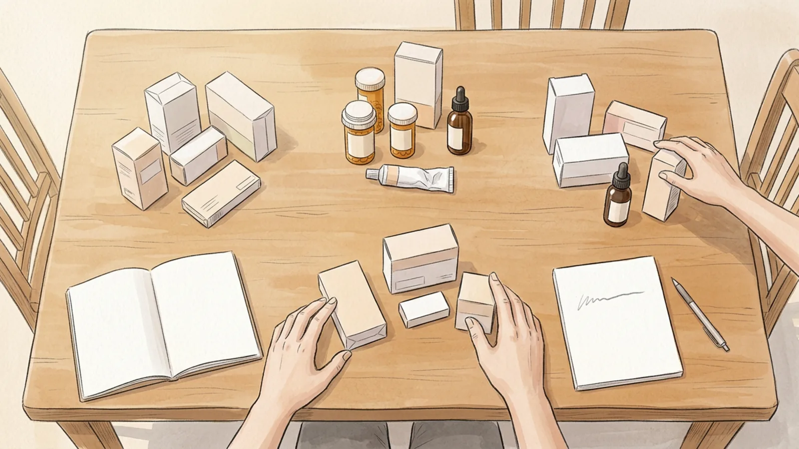

## Part 1 of 3 — Gather and Sort

### Step 1 — Collect every medicine in the house into one place

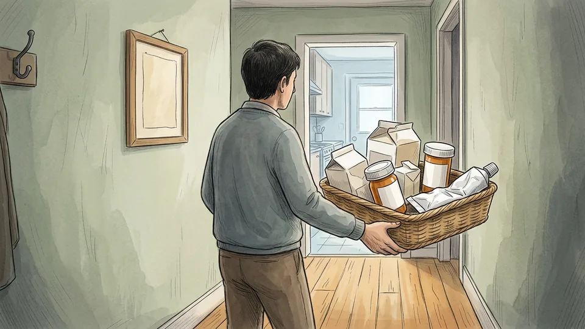

Medicines spread. There will be a box in the kitchen, a strip of tablets in a bag, a tube in the bedside drawer, something in the car. Walk the whole house with a basket and bring all of it to one clear table, including vitamins, supplements, creams, eye drops, inhalers and anything for a pet. You cannot see duplicates or gaps while the collection is scattered across four rooms, and the sorting that follows only works if the pile is whole.

**Tip:** Check the places that are not storage: coat pockets, handbags, the glove box, a holiday washbag. Those are where single strips of painkillers hide.

### Step 2 — Clear a work surface and put children and pets elsewhere

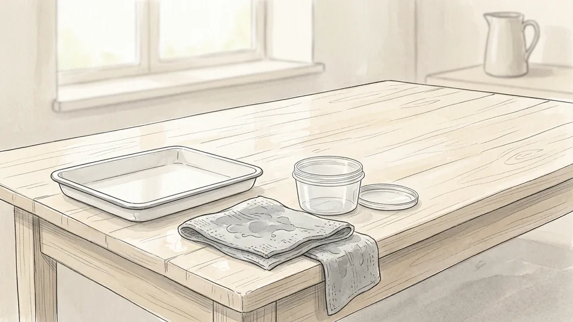

You are about to have every medicine in the house loose on one surface at child height. Pick a table you can give over for an hour, wipe it, and make sure small children and animals are somewhere else for the duration. Put a bin bag and a sealable tub on the floor beside you before you start, so nothing that is coming out of circulation ever has to sit unattended while you go looking for a container.

**Tip:** Work on a tray or a towel. Loose capsules roll, and a tray stops one disappearing under the fridge.

### Step 3 — Split the pile into current, occasional and finished

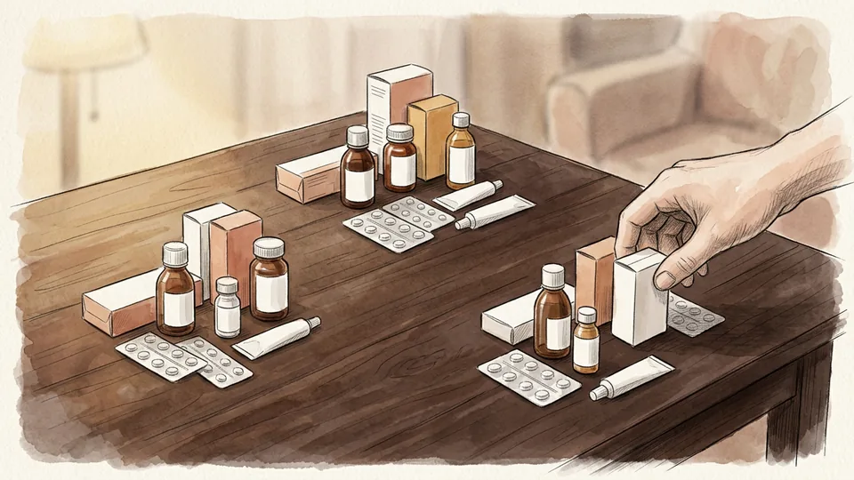

Three groups, nothing more subtle. Current is what someone in the house takes now, on a schedule. Occasional is what you genuinely reach for a few times a year: painkillers, antihistamines, rehydration sachets, antiseptic. Finished is everything else, including the tail end of a course nobody is taking any more. Most households are surprised by how large the third group is, and that group is the one creating the risk.

**Tip:** If nobody can say what a box is for, it belongs in the finished group. An unidentifiable medicine is not a resource.

### Step 4 — Read every expiry date, including the ones you trust

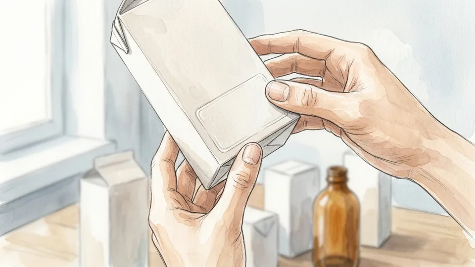

Go through all three groups and check the date on each item. The FDA's position is blunt: once a medicine is past its expiry date there is no guarantee it is safe or effective. An antibiotic that has lost strength is worse than no antibiotic, because it can leave an infection to get worse. Date-check the occasional group especially carefully, since those are the items that sit untouched the longest.

**Tip:** Liquids, eye drops and anything you opened months ago often carry a short in-use date separate from the printed expiry. Check for both.

### Step 5 — Look for the same active ingredient in two places

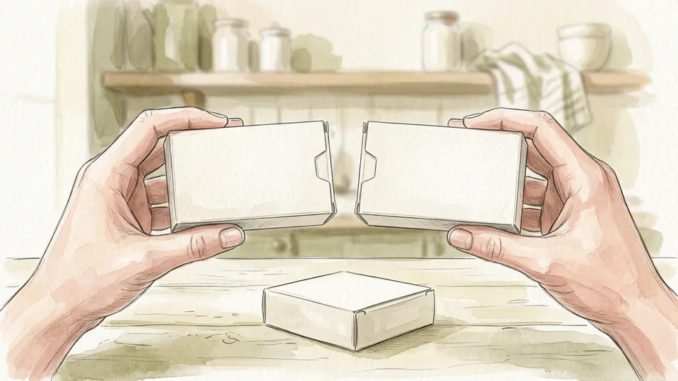

This is the check that prevents a real accident. A cold remedy, a sinus tablet and a painkiller can all contain the same active ingredient, and someone taking two together can go well over a safe dose without ever exceeding what either label said. The CDC advises reading the active ingredients on both prescription and over-the-counter products for exactly this reason. Line up anything that looks like a painkiller or a cold remedy and compare the ingredient panels.

**Tip:** Keep one of each duplicate and retire the others. Three half-used boxes of the same thing is how people lose track of what they have taken.

## Part 2 of 3 — Store What You Are Keeping

### Step 6 — Move everything out of the bathroom

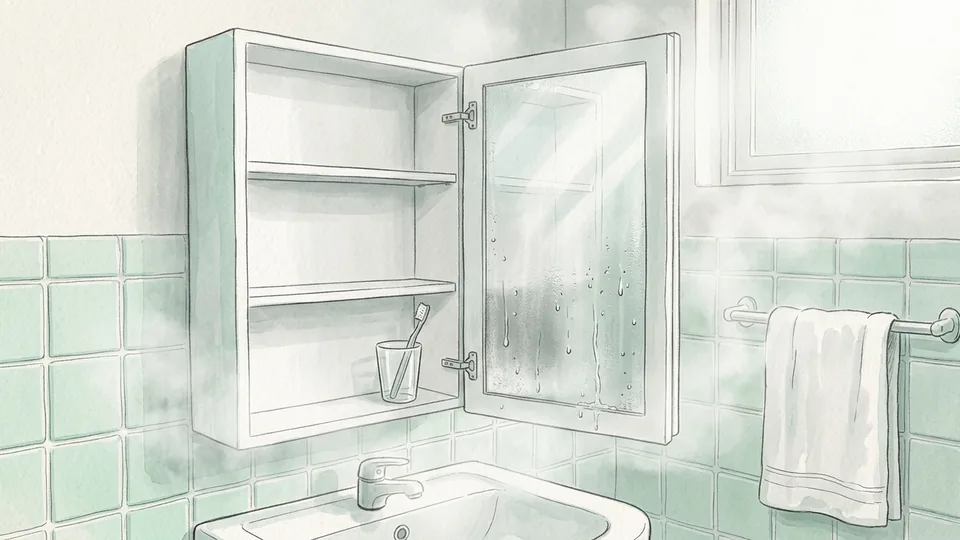

The phrase medicine cabinet has done a lot of damage. A bathroom goes through repeated heat, steam and temperature swings every day, and the FDA states plainly that damp storage of this kind can reduce a medicine's effectiveness before the expiry date is reached. Nothing you intend to keep should live in there. The same applies to the window sill, the car glove box and the shelf directly above a radiator.

**Tip:** If the bathroom cabinet is the only lockable spot you have, keep it for things that are not medicines and solve the locking problem elsewhere.

### Step 7 — Pick a cool, dry, dark home for the collection

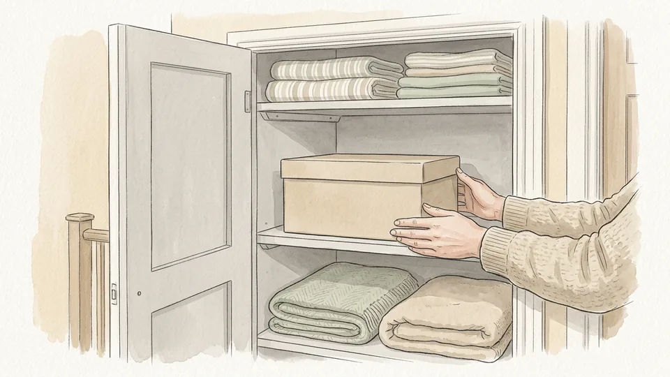

The FDA suggests a dresser drawer, a storage box, a closet shelf or a kitchen cabinet. If you use the kitchen, choose a cabinet away from the sink, the kettle, the oven and the top of the fridge, because all of those produce the heat and humidity you are trying to avoid. Aim for ordinary room temperature, out of direct sunlight, and somewhere the temperature does not swing much across the day.

**Tip:** A high cupboard on an internal wall is usually the steadiest spot in a home. Exterior walls and attic cupboards move with the weather.

### Step 8 — Put the regular medicines in one labelled box

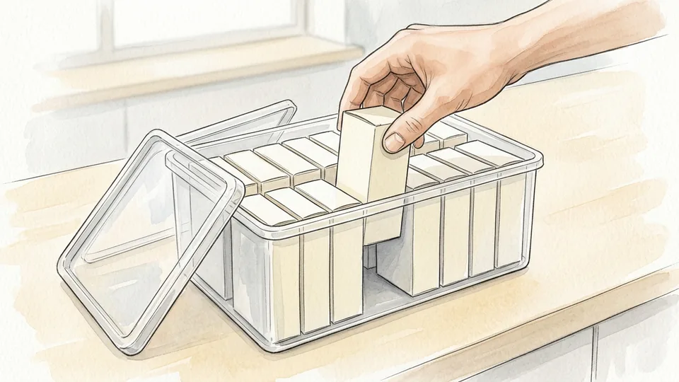

A single lidded box beats a shelf of loose cartons. Everything stays upright, nothing migrates to another room, and you can carry the whole collection to the table at review time. Keep each medicine in its original packaging inside the box so the dose, the warnings and the leaflet travel with it. A clear box lets you see the contents, and a plain opaque one is better if the box will sit somewhere visible.

**Tip:** Stand boxes on end like books rather than stacking them flat. You can read the ends without unpacking the whole tub.

### Step 9 — Give refrigerated and emergency items their own spot

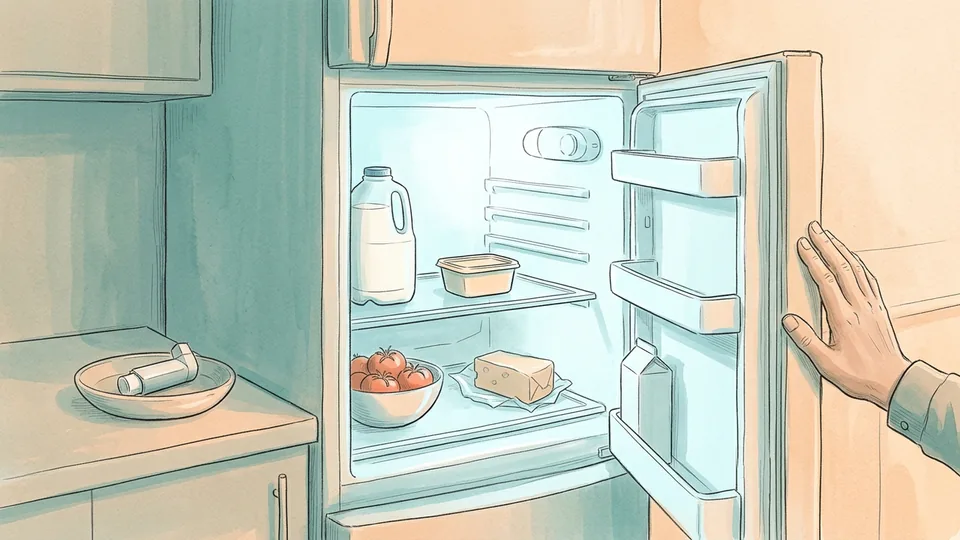

Some medicines have to be refrigerated and will say so on the label. Give them a shallow tub on a fridge shelf, not the door, because the door is the warmest and most disturbed part of the fridge. Rescue items are the opposite problem: an inhaler, an adrenaline auto-injector or a glucose gel is useless in a locked box in another room. Keep those where the person who needs them can reach them in seconds, and tell the household where that is.

**Tip:** Put a plain note in the main box saying where the refrigerated and rescue items live, so a review never misses them.

### Step 10 — Put the whole lot up high and out of sight

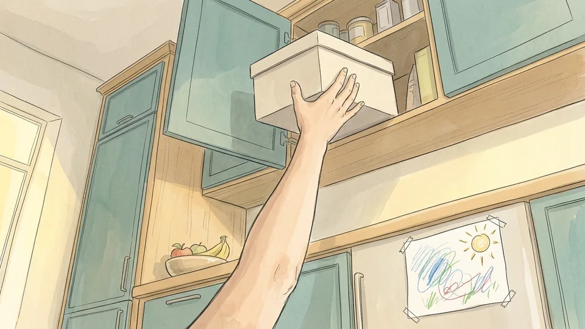

Up and away is the standard advice for a reason: a curious child works on what they can see as much as what they can reach. Choose a shelf above adult eye level, close the lid, and shut the cupboard. If anyone in the household is at risk, whether a toddler, a visiting grandchild or an adult who should not have access to a particular prescription, use a cupboard that locks or fit a childproof latch. A locked box on a low shelf beats an open box up high.

**Tip:** Handbags and overnight bags belonging to visitors are a common blind spot. Offer guests the high shelf too.

### Step 11 — Lock the safety cap every single time

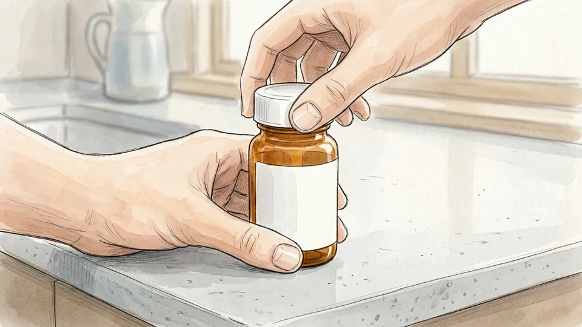

A child-resistant cap only works when it is engaged. The CDC's advice is to check that the cap is locked after every dose and to put the medicine straight back in its storage place rather than leaving it on the counter until later. Most paediatric poisonings happen in the gap between taking a dose and putting the bottle away, not because a child defeated a cap. Build the two actions into one movement: dose, click, return.

**Tip:** Child-resistant is not childproof. Treat the cap as a delay, not a barrier, and keep the height as well.

### Step 12 — Keep a written list of everything anyone takes

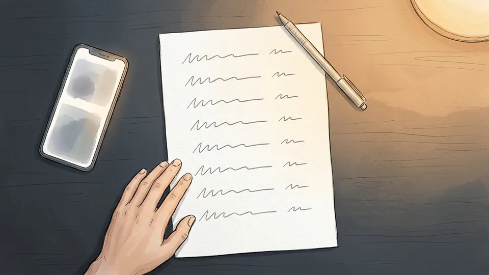

The CDC asks people to keep a list of their medicines, vitamins and supplements and to make sure their doctor sees all of it. Write one page per person: the medicine, the strength, the dose, what it is for, and who prescribed it. Include supplements, because they interact too. Keep a copy with the storage box and a photograph on your phone, and it is ready for an appointment, a pharmacy review or an emergency when nobody can remember the name of the small white tablet.

**Tip:** Update the list the same day a prescription changes. A list that is six months out of date is worse than none, because it will be believed.

## Part 3 of 3 — Dispose of the Rest Properly

### Step 13 — Take the finished pile to a drug take-back point

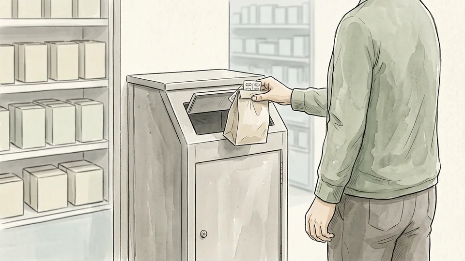

This is the FDA's first choice and it is the easiest option to get right. Many pharmacies have a permanent drop-off kiosk, and the DEA runs National Prescription Drug Take Back Day along with a year-round search for authorised collectors. Take-back accepts tablets, capsules, patches and most other prescription and over-the-counter medicines. It does not accept needles or other sharps, which have their own route.

**Tip:** Phone the pharmacy first and ask whether their kiosk is in service that day. A wasted trip is the main reason people give up and use the bin.

### Step 14 — Use a prepaid mail-back envelope if you cannot travel

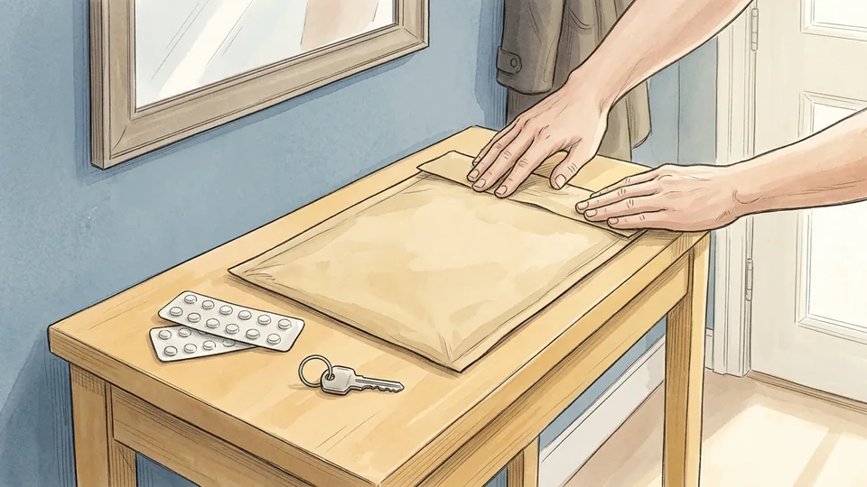

A prepaid drug mail-back envelope is the FDA's second route and it needs no collection point at all. The envelopes are sold at many pharmacies and online, and some pharmacies hand them out free. Fill the envelope with the unused or expired medicines, seal it, and post it. For anyone without a car, without a nearby kiosk, or without the mobility to queue, this is the realistic option rather than a compromise.

**Tip:** Ask at the counter rather than searching the shelves. Mail-back envelopes are usually kept behind the dispensary.

### Step 15 — Mix the remainder into something unappealing before binning it

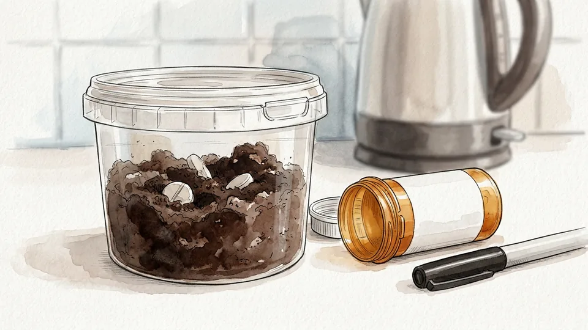

If neither route is available, almost everything except items on the FDA flush list can go into household trash, but not as it comes. Tip the medicine out of its container, mix it with something undesirable such as used coffee grounds, dirt or cat litter, and seal the mixture in a closable bag or tub so it cannot leak. The mixing makes it unrecognisable and unappealing to a child, a pet or anyone going through the bin. Then scratch out your name and prescription details on the empty packaging before throwing that away.

**Tip:** Inhalers and aerosols are the exception. They can be dangerous if punctured or burned, so ask your waste or recycling service how to hand them in.

## Tips

- Do the whole sort in one sitting rather than a shelf at a time. Duplicates only become obvious when everything is on the same table.
- Photograph the finished storage box with your phone. If someone else has to find a medicine for you in a hurry, the picture is faster than a description.
- Ask your pharmacist to do a free review of everything you take. They will spot duplicate active ingredients and interactions that are invisible when the boxes live in different rooms.

## Warnings

- This guide is general household information, not medical advice. It does not tell you whether to take, stop or change any medicine. Those decisions belong to your doctor or pharmacist.
- Never flush a medicine unless it appears on the FDA flush list or its own label tells you to. Everything else goes to take-back or, as a fallback, into the household trash after mixing.
- If a child or pet may have swallowed a medicine, do not wait for symptoms and do not try to make them vomit. Call your poison centre or emergency number immediately. In the United States, Poison Help is on 1-800-222-1222.

## Community Q&A

**Why is the bathroom cabinet such a bad place for medicines?**

Because a bathroom cycles through heat and steam several times a day. The FDA is explicit that damp storage like a bathroom cabinet can reduce a medicine's effectiveness before its printed expiry date, and recommends a cool dry spot instead: a dresser drawer, a storage box, a closet shelf, or a kitchen cabinet kept away from the sink and hot appliances.

**Can I just throw old medicines in the bin?**

It is the fallback, not the first choice. The FDA's preferred route is a drug take-back location or a prepaid mail-back envelope. If neither is available, almost everything except items on the flush list can go in household trash, but only after you take it out of its container, mix it with something unappealing like used coffee grounds or cat litter, and seal the mixture in a closable bag or tub.

**What is the flush list?**

A short FDA list of medicines, mostly strong opioids, considered dangerous enough that flushing them is safer than leaving them around when no take-back option is at hand. Fentanyl patches are the classic example: a used patch still holds a lot of medicine. Check the label or the FDA list, and do not flush anything that is not on it.

**Should I keep medicines in their original boxes?**

Yes for storage. The original container carries the dose, the expiry date, the warnings and the leaflet, and for a prescription it carries the name of the person it belongs to. Use a weekly pill organiser for the doses you are taking now, but keep the source packaging so the information survives.

**How often should I go through everything?**

Twice a year suits most households, and it is easier to remember if you attach it to something you already do, like the clock change. Add a check whenever a prescription ends, because leftovers from a finished course are the most common thing still sitting in the drawer a year later.

## Useful external resources

- [FDA: Where and How to Dispose of Unused Medicines](https://www.fda.gov/consumers/consumer-updates/where-and-how-dispose-unused-medicines) — The source for the disposal order used in this guide: take-back first, flush list second, mixed household trash last.
- [FDA: Don't Be Tempted to Use Expired Medicines](https://www.fda.gov/drugs/safe-disposal-medicines/dont-be-tempted-use-expired-medicines) — Why a damp bathroom cabinet weakens medicines, and which cool dry places the FDA suggests instead.
- [DEA: National Prescription Drug Take Back Day](https://www.dea.gov/takebackday) — Find a collection event, and a year-round search for authorised collectors near you.
- [CDC: Medication Safety and Your Health](https://www.cdc.gov/medication-safety/about/index.html) — The at-home habits in the last section: keep a list, use the supplied dosing device, lock the cap, put it back.

## References

1. U.S. Food and Drug Administration. Where and How to Dispose of Unused Medicines. Consumer Updates. https://www.fda.gov/consumers/consumer-updates/where-and-how-dispose-unused-medicines
2. U.S. Food and Drug Administration. Don't Be Tempted to Use Expired Medicines. https://www.fda.gov/drugs/safe-disposal-medicines/dont-be-tempted-use-expired-medicines
3. U.S. Drug Enforcement Administration. National Prescription Drug Take Back Day. https://www.dea.gov/takebackday
4. Centers for Disease Control and Prevention. Medication Safety and Your Health, reviewed 18 November 2024. https://www.cdc.gov/medication-safety/about/index.html
5. Health Resources and Services Administration. Poison Help. https://poisonhelp.hrsa.gov/

## Internal links

- [How to Build a Home First-Aid Kit](https://www.56juqingba.com/Build-a-Home-First-Aid-Kit)
- [More Health guides](https://www.56juqingba.com/Category/Health)
- [How to Split Household Chores Fairly](https://www.56juqingba.com/Split-Household-Chores-Fairly)
