# How to Organize a Holiday Potluck

*A sign-up list that balances the table, allergen labels people can trust, and the two-hour rule that decides what goes in the bin.*

**Category:** Holidays and Traditions

**Slug:** `/Organize-a-Holiday-Potluck`

**Primary keyword:** organize a holiday potluck

**Meta description:** Organize a holiday potluck: balance the sign-up list, collect allergy information, transport food safely, hold it at the right temperature and label every dish.

---

## Intro

A potluck is the cheapest way to feed a crowd and the easiest way to end up with nine desserts, one fork and a tray of lukewarm chicken that nobody should eat. The social side is straightforward once you have a list. The food safety side needs a little more care than a normal dinner, because dishes are cooked in different kitchens, driven across town, and then left on a table for hours. The United States Department of Agriculture puts the problem simply: bacteria multiply quickly between 4 and 60 degrees Celsius, and perishable food should not sit in that range for more than two hours. This guide covers fifteen steps, from drawing up the sign-up list to packing the leftovers, so the gathering is generous, balanced and safe.

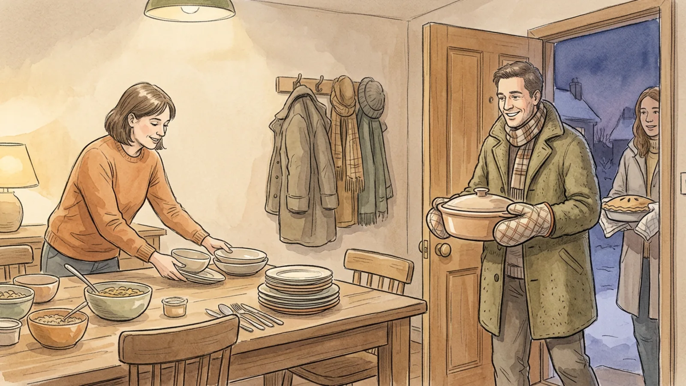

## Part 1 of 3 — Build the List Before Anyone Cooks

### Step 1 — Fix the shape of the meal first

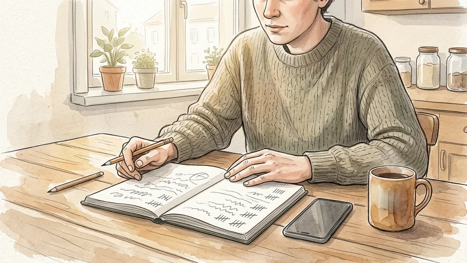

Decide four things before you invite anyone: how many people, what time they eat, whether it is a sit-down meal or a buffet, and what you are supplying yourself. A host who provides the main dish and the drinks is running a different event from one who provides only the room. Write the four answers at the top of your list, because every later decision, from how many serving spoons you need to how much oven space you can offer, follows from them.

**Tip:** Count guests by households rather than by name. People bring partners, and a potluck built for twelve feeds sixteen badly.

### Step 2 — Sign people up by category, not by whim

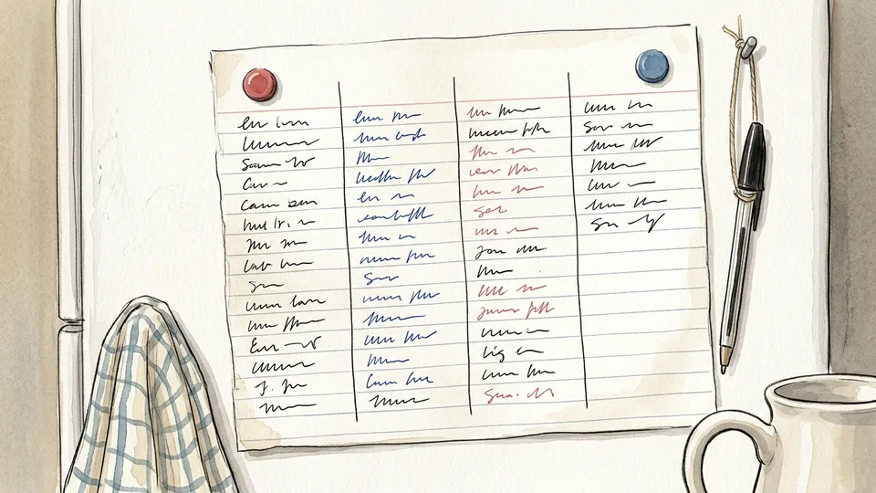

Left to themselves, guests bring what they like making, which is usually pudding. Divide the list into mains, hot sides, cold sides and salads, bread, desserts, and drinks, then cap each category. A rough target for a buffet is one substantial main for every four or five people, with sides and salads making up the rest. Let people choose within a category rather than assigning dishes outright; you get better cooking and less resentment.

**Tip:** Keep the list somewhere everyone can see, such as a shared note or a sheet on the fridge, so two people do not both bring the same thing.

### Step 3 — Ask about allergies and mean it

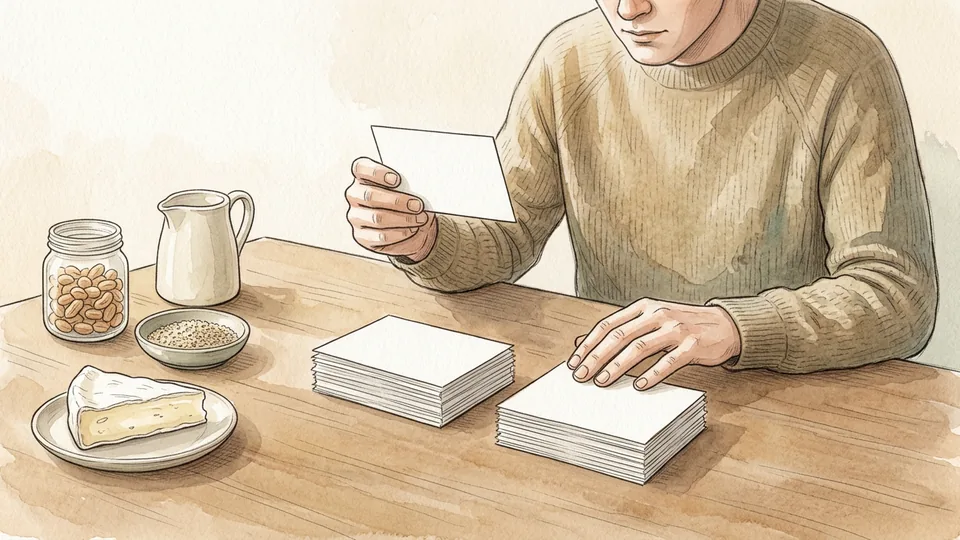

Ask every guest, in writing, what they cannot eat. In the United States the law recognises nine major food allergens: milk, eggs, fish, crustacean shellfish, tree nuts, peanuts, wheat, soybeans and sesame, which joined the list in 2023. Reactions range from hives to anaphylaxis, so this is not a preference survey. Pass the answers on to whoever is cooking, and ask them to bring the recipe card with the dish.

**Tip:** Collect the answers in one message thread rather than in scattered conversations. Allergy information that lives in someone's memory is information you do not have.

### Step 4 — Tell people what your kitchen can actually do

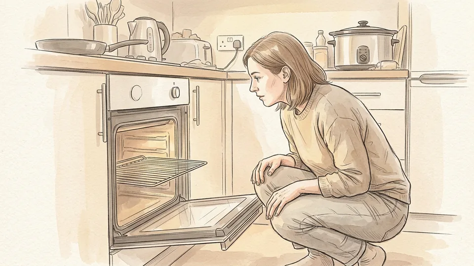

Most potluck chaos happens in the last thirty minutes, when six dishes need an oven that fits two. Count your oven shelves, your hob rings, your fridge space and your power sockets, then publish those limits with the invitation. Ask for dishes that arrive ready to eat, or that need no more than a short reheat. If you only have two sockets free, you can only take two slow cookers.

**Tip:** Reserve the oven for one or two dishes you nominate in advance, and ask everyone else to bring food hot or cold rather than halfway.

### Step 5 — Assign the unglamorous items

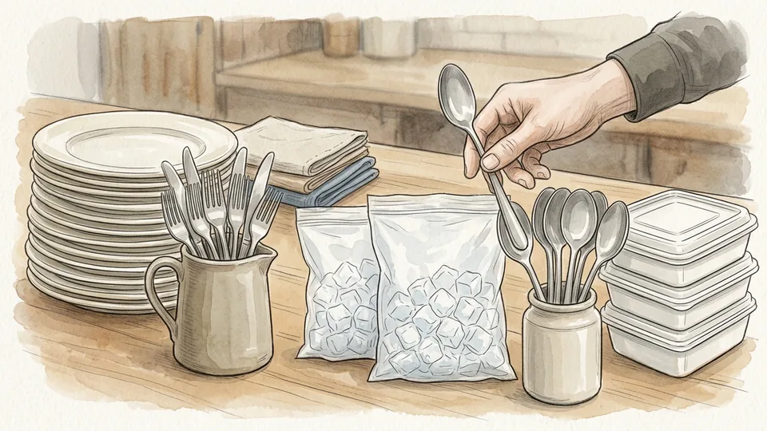

Somebody has to bring ice, serving spoons, a bin bag, foil, cups and a couple of trivets. Nobody volunteers for this list, so add it to the sign-up sheet as a category of its own and claim the items you cannot borrow. Ice matters more than people expect: keeping cold dishes genuinely cold needs a bag of it, and a party that runs out is a party with warm potato salad.

**Tip:** Ask two people to bring ice. It is cheap, it is always needed, and the spare bag keeps drinks cold.

## Part 2 of 3 — Cook, Carry and Set Up Without Losing Temperature

### Step 6 — Cook each dish to its safe internal temperature

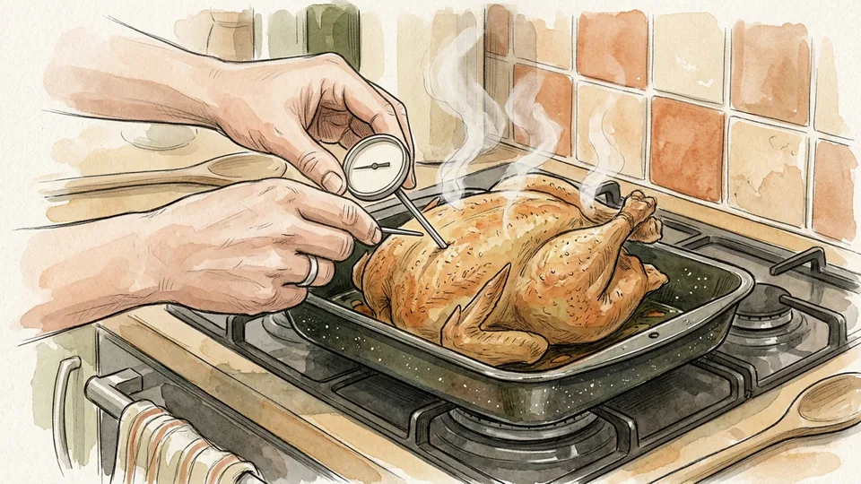

Colour is not a test. Use a food thermometer in the thickest part of the dish and cook poultry of every kind, casseroles and anything reheated to 74 degrees Celsius. Ground meat and egg dishes need 71 degrees, while steaks, roasts, chops and most fish reach 63 degrees followed by a three-minute rest. These are the United States Department of Health and Human Services figures, and they are the same whether the dish is for four people or forty.

**Tip:** Check the temperature in two or three places in a large tray. A casserole can be fully cooked at the edge and cold in the middle.

### Step 7 — Chill cold dishes properly before they travel

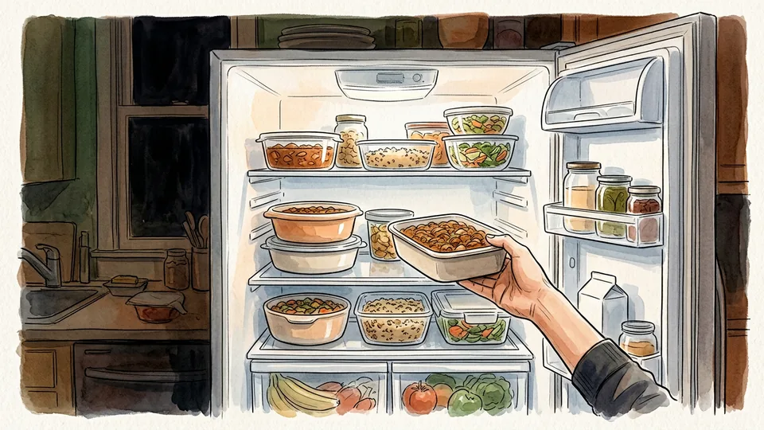

A salad containing cooked potato, pasta, chicken, ham or egg is a perishable dish, not a safe one. Cool the cooked ingredients in shallow containers in the fridge before you mix and dress them, and keep the finished dish at or below 4 degrees Celsius right up to the moment it goes into the cool box. Shallow containers matter: a deep tub of warm potato cools from the outside in and stays warm in the middle for hours.

**Tip:** Make the mayonnaise-based salads the night before, not an hour before you leave. They need the time in the fridge.

### Step 8 — Pack hot and cold food for the journey

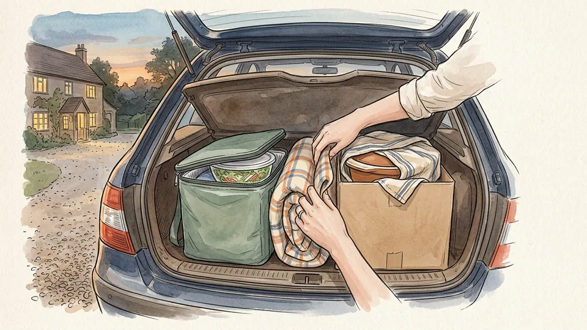

Hot dishes should leave home at 60 degrees Celsius or above, wrapped well and packed in an insulated container or a slow cooker still holding heat. Cold dishes travel in a cool box with plenty of ice or frozen gel packs, held at 4 degrees or below, with a thermometer inside if you have one. Put the food in the passenger compartment rather than a cold or baking boot, and drive straight there without side trips.

**Tip:** Fill a vacuum container with boiling water for a few minutes and tip it out before adding hot soup or chilli. The preheated container holds temperature far longer.

### Step 9 — Reheat on the stove or in the oven, not in the slow cooker

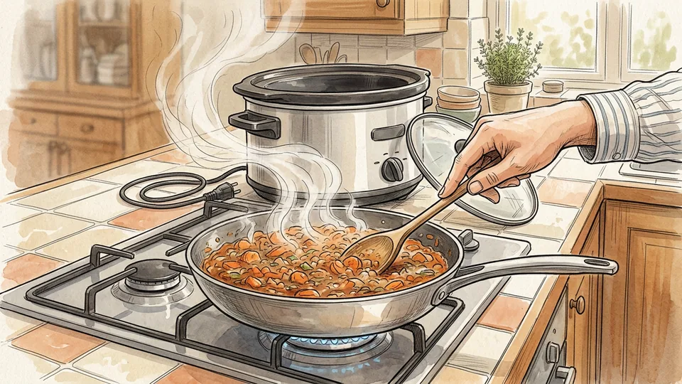

Food that was cooked earlier and cooled must be reheated all the way to 74 degrees Celsius before it goes onto the table, and sauces, soups and gravies should be brought to a boil. Do not use a slow cooker, chafing dish or warming tray to do the reheating: those appliances are designed to hold food hot, and they take it up through the bacterial danger zone far too slowly. Heat it properly first, then transfer it.

**Tip:** Stir halfway through reheating and check the temperature in the middle, not at the edge of the pan.

### Step 10 — Set the table so hot stays hot and cold stays cold

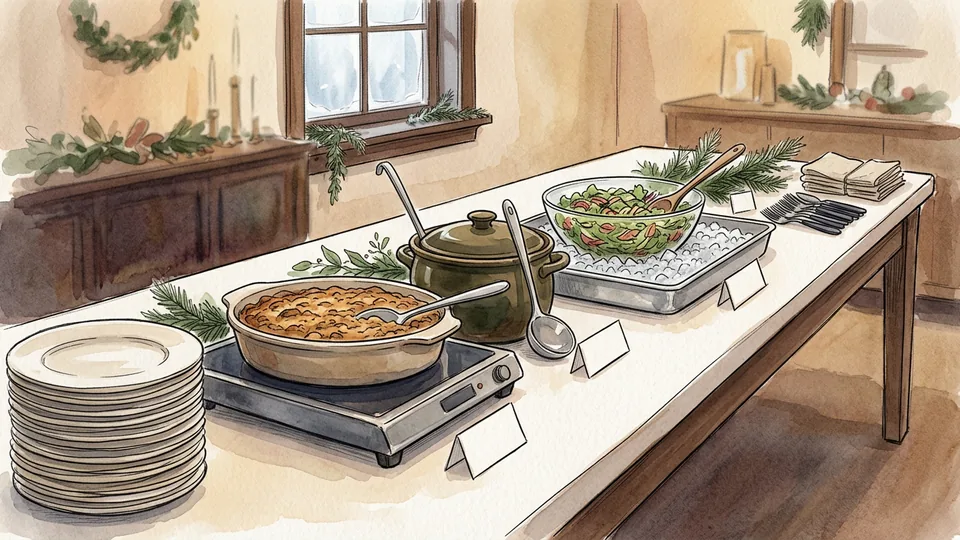

On the table, hot dishes need to stay at or above 60 degrees Celsius in chafing dishes, warming trays or slow cookers, and cold dishes need to sit at or below 4 degrees. The usual trick for cold food is to nest the serving bowl inside a larger bowl of ice and drain the meltwater as it goes. Check that your warming equipment really reaches holding temperature, because some trays only manage 43 to 49 degrees.

**Tip:** Put the drinks and the bread at the far end of the table. They do not need temperature control and they slow the queue down in a useful way.

## Part 3 of 3 — Serve It, Watch the Clock, Pack It Away

### Step 11 — Label every dish with what is in it

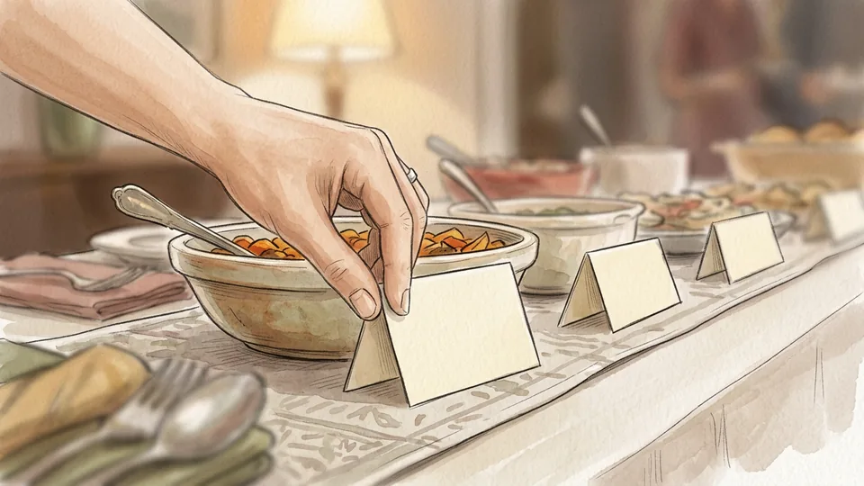

Write a card for each dish naming the food and the allergens it contains, and put it where a guest can read it without lifting a lid or asking the room. Milk, egg, wheat, soy, sesame, nuts and shellfish hide in dressings, stuffings, sauces and bought pastry, so ask cooks to check their own ingredient lists rather than guessing. A card also stops the polite guest who eats nothing all evening rather than making a fuss.

**Tip:** Keep each dish's recipe card or packaging in the kitchen. If somebody asks a detailed question, you have the actual answer.

### Step 12 — Serve in small platters and replace them

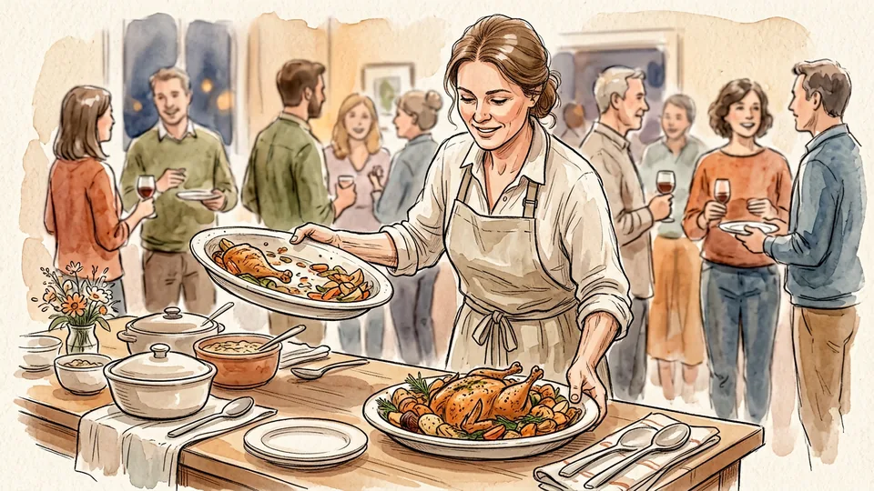

Put out half of each dish and keep the rest cold in the fridge or hot in the oven, then swap the platter when it empties. Never top up a dish that has been sitting out: adding fresh food to a part-used platter mixes food that has been in the warm room for an hour with food that has not. Replacing platters also keeps the table looking generous all evening instead of picked over.

**Tip:** Wash or swap the serving spoon when you change the platter. The spoon has been on the table the whole time.

### Step 13 — Watch the clock on every perishable dish

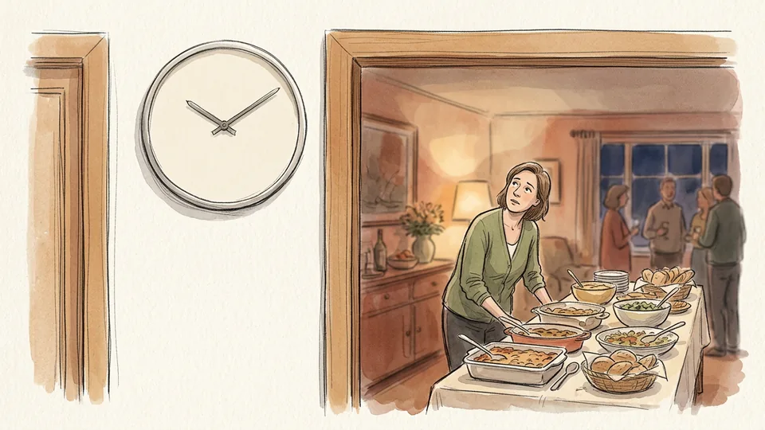

Two hours is the limit for perishable food left out of temperature control, and one hour if the room is above 32 degrees Celsius. Note the time each dish arrives on the table, either on its card or on a list in the kitchen. When the time is up, the food goes away: into the fridge if it is still cold, into the bin if it has sat out. Food in this state looks and smells completely normal.

**Tip:** Set a quiet timer on your phone when the first dish lands. Nobody remembers the time once the room is full.

### Step 14 — Pack the leftovers down fast

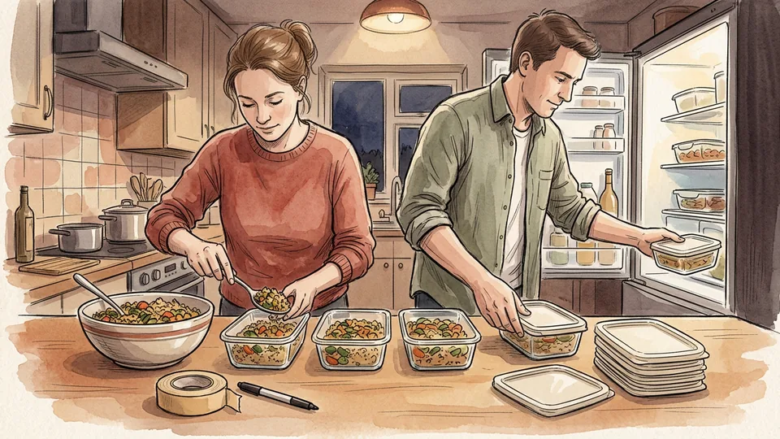

Divide leftovers into clean, shallow, covered containers and get them into a fridge at 4 degrees or below, or into the freezer, within the two-hour window. Do not send guests home with a warm casserole dish to be refrigerated later. Eat refrigerated leftovers within three to four days, and reheat them to 74 degrees Celsius, bringing any sauce or gravy to a boil before serving.

**Tip:** Keep a stack of takeaway tubs by the sink. Packing down is far quicker when nobody has to hunt for containers.

### Step 15 — Write down what worked while you remember

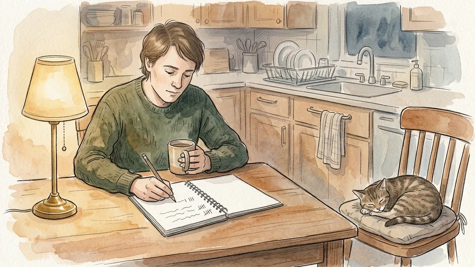

Before you go to bed, note three things: which dishes ran out first, what nobody touched, and anything that went wrong in the last half hour. Keep the sign-up list with those notes. Next year you will know that the table needed two more serving spoons, that one oven cannot reheat four trays, and who brought the dish everyone asked about.

**Tip:** Send the thank-you messages the next morning and ask each cook for their recipe. People are far more likely to come back.

## Tips

- A potluck needs about twice as many serving spoons as you think, and most of them end up in the wrong dish.
- Ask one guest to arrive early. Having a second pair of hands for the last twenty minutes changes the whole evening.
- Keep a kettle of hot water going for the dishes that arrive needing a quick warm-through in a water bath.
- If guests travel more than about thirty minutes, suggest cold dishes, bread and desserts rather than hot food.
- Label the bins clearly for rubbish, recycling and food waste before anyone arrives, or you will sort it all yourself.

## Warnings

- Perishable food left in the 4 to 60 degree Celsius range for more than two hours should be thrown away, not refrigerated for later. Cooling it does not undo bacterial growth.
- Never use a slow cooker, warming tray or chafing dish to reheat cold food. They hold temperature; they do not raise it quickly enough.
- Allergic reactions can be life-threatening. If a guest carries adrenaline for anaphylaxis, make sure one other person knows where it is.
- Dishes containing cooked rice, potato, pasta, egg or seafood are the ones that cause most trouble at buffets. Give them the ice and the clock they need.

## Community Q&A

**How much food should each person bring?**

A useful rule is that every dish should serve about eight to ten people at a buffet, because guests take small amounts of many things rather than a full portion of one. Ask for one substantial main dish per four or five guests across the whole event, and let the sides, salads and breads fill the table around them.

**Can guests bring food that needs cooking at my house?**

Only if you have agreed it in advance and counted the oven space. Potlucks fail in the last half hour when several dishes need heat at once. Publish how many oven shelves and sockets are available, nominate which dishes get them, and ask everyone else to arrive with food that is ready to serve hot or cold.

**What do I do with food that has been out too long?**

Throw it away. Perishable food held between 4 and 60 degrees Celsius for more than two hours, or one hour in a room above 32 degrees, is no longer safe, and it will look and taste entirely normal. Dry items such as bread, crackers, biscuits and whole fruit are the exception and can stay out.

**How do I handle allergies without making it awkward?**

Ask everyone the same question in writing when you invite them, put a card naming the allergens in front of every dish, and keep the recipe cards in the kitchen. That way nobody has to interrogate a stranger's casserole, and the guest with a serious allergy can simply read the table rather than quietly eating bread all evening.

## Useful external resources

- [FoodSafety.gov: Cook to a Safe Minimum Internal Temperature](https://www.foodsafety.gov/food-safety-charts/safe-minimum-internal-temperatures) — The official chart for poultry, casseroles, ground meat, seafood and leftovers, with rest times.
- [USDA Food Safety and Inspection Service: Kitchen Companion](https://www.fsis.usda.gov/sites/default/files/media_file/2020-12/Kitchen-Companion.pdf) — The danger zone, the two-hour rule and how to hold cooked food hot at 60 degrees Celsius or above.
- [US Food and Drug Administration: Food Allergies](https://www.fda.gov/food/nutrition-food-labeling-and-critical-foods/food-allergies) — The nine major food allergens recognised in US law, including sesame since January 2023.
- [Minnesota Department of Health: Keeping Food Safe During Buffets or Picnics](https://www.health.state.mn.us/people/foodsafety/away/buffet.html) — Buffet practice: nest cold dishes in ice, reheat to 74 degrees Celsius and replace platters rather than topping them up.

## References

1. US Department of Health and Human Services. Cook to a Safe Minimum Internal Temperature. FoodSafety.gov, reviewed November 2024. https://www.foodsafety.gov/food-safety-charts/safe-minimum-internal-temperatures
2. US Department of Agriculture, Food Safety and Inspection Service. Kitchen Companion: Your Safe Food Handbook. https://www.fsis.usda.gov/sites/default/files/media_file/2020-12/Kitchen-Companion.pdf
3. US Food and Drug Administration. Food Allergies: major food allergens and the FASTER Act. https://www.fda.gov/food/nutrition-food-labeling-and-critical-foods/food-allergies
4. Minnesota Department of Health. Keeping Food Safe During Buffets or Picnics. https://www.health.state.mn.us/people/foodsafety/away/buffet.html

## Internal links

- [How to Start a Family Holiday Tradition](https://www.56juqingba.com/Start-a-Family-Holiday-Tradition)
- [How to Split Household Chores Fairly](https://www.56juqingba.com/Split-Household-Chores-Fairly)
- [How to Cook Rice Without a Rice Cooker](https://www.56juqingba.com/Cook-Rice-Without-a-Rice-Cooker)
