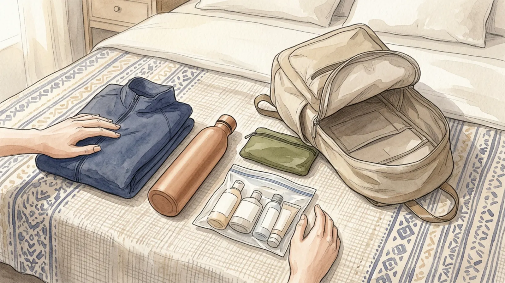
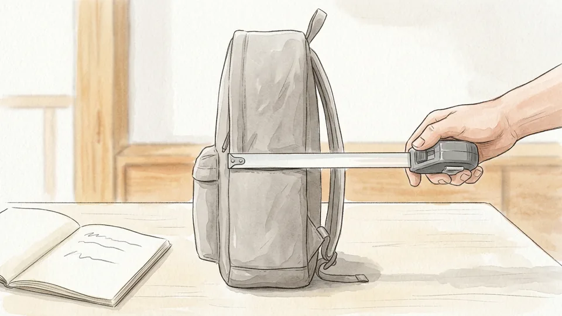
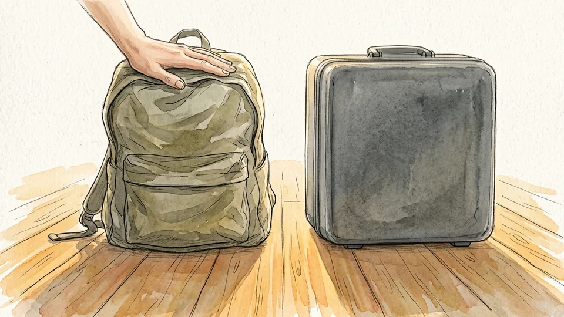
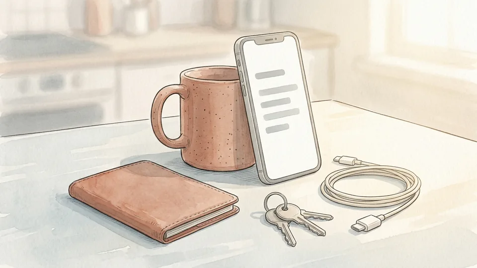

> DRAFT — do not publish or package: 12 of 16 illustrations are still missing, and the article has not been reviewed by a person.

# How to Pack a Personal Item for a Trip

*The bag under the seat is the only one you are guaranteed to keep. Pack it so that if everything else is gate-checked or delayed, your day still works.*

**Category:** Travel

**Slug:** `/Pack-a-Personal-Item-for-a-Trip`

**Primary keyword:** pack a personal item

**Meta description:** Pack the under-seat bag that nobody can gate-check: documents, medication, the TSA liquids bag, power banks that must stay in the cabin, and what to leave out.

---

## Intro

A personal item is the small bag that fits under the seat in front of you, and it is the only piece of luggage nobody can take away at the gate. That single fact should decide what goes in it. When the overhead bins fill and your cabin bag is checked at the door, the under-seat bag is what you keep, which makes it the right home for your documents, your medication, your chargers and anything you cannot replace. Aviation rules push in the same direction: the US Federal Aviation Administration requires spare lithium batteries and power banks to travel in the cabin, never in the hold, and tells passengers to pull them out of a bag that gets gate-checked. This guide packs that bag in order, starting with the things that must be there and finishing with the things that merely help. It assumes a flight, but most of it applies to a train or a long coach trip too.

## Part 1 of 3 — Choose the Bag and the Rules It Must Meet

### Step 1 — Find your airline's actual personal item dimensions

No regulator sets this size. Each airline publishes its own, and the allowance can also change with the fare you bought, so the basic economy ticket and the flexible one on the same aircraft may not carry the same bag. Look up the numbers for your specific airline and fare class, write them down, and measure the bag you intend to use rather than trusting the label sewn inside it.

**Tip:** Measure with the bag packed. An empty bag that fits the sizer can bulge two inches once it has a jumper and a laptop in it.

### Step 2 — Pick a soft bag over a rigid one

Under-seat spaces are not rectangles. They are interrupted by seat legs, entertainment boxes and whatever the person in front has pushed back towards you. A soft-sided backpack or holdall squashes into that awkward shape; a hard shell has to fit exactly or not at all. A soft bag is also the one that survives a gate agent's sizer, because a stubborn inch can be pressed in.

**Tip:** Avoid bags with rigid external frames or fixed wheels if you can. Both eat the depth you need and neither compresses.

### Step 3 — Decide what this bag has to survive without the other one

Pack for the version of the day where your cabin bag disappears into the hold at the gate and the hold is slow. That means the under-seat bag holds documents, medication, money, keys, chargers, glasses and anything irreplaceable. Everything else is negotiable. Making this decision before you start packing stops you filling the good space with a second pair of shoes and then discovering the passport is in the wrong bag.

**Tip:** Write the must-keep list on your phone once. It will be the same list on every trip you take.

## Part 2 of 3 — Pack the Things the Rules Decide

### Step 4 — Build the quart-sized liquids bag first

> IMAGE PENDING for step 4: A clear zip-top bag on a bathroom shelf holding several small bottles and a tube, filled roughly two-thirds and lying flat.

TSA allows one quart-sized bag of liquids, aerosols, gels, creams and pastes per passenger, and every container inside it must hold 3.4 ounces or 100 millilitres or less. The limit is on the container, not on how full it is, so a half-empty 200 millilitre tube is still not allowed. Anything bigger travels in checked baggage. Build this bag before anything else, because it sets how much toiletry you are actually bringing.

**Tip:** Decant into small bottles at home rather than buying travel sizes of everything. You will carry less and spend less.

### Step 5 — Put the liquids bag where you can pull it out in one move

> IMAGE PENDING for step 5: A hand drawing a clear zip bag out of the front pocket of a backpack that is standing upright on an airport bench.

TSA asks you to separate the small bag from your other belongings at the checkpoint, and doing so speeds up screening. That only works if the bag is reachable. Put it in the outermost compartment or the top of the main section, never underneath a laptop and a jacket. The thirty seconds you save is less important than not having to unpack the whole bag on a crowded belt.

**Tip:** Anything that alarms during screening gets additional screening. Wiping sticky bottles down at home genuinely reduces the odds.

### Step 6 — Keep medication separate and tell the officer about it

> IMAGE PENDING for step 6: A small fabric pouch unzipped on a table showing boxed tablets and a labelled bottle standing upright, a printed card tucked behind them.

Medications are an exemption from the quart-bag rule, as are infant and child nourishments, so a liquid medicine larger than 100 millilitres can travel with you. Declare it at the checkpoint and expect it to be screened separately. Keep medicines in the under-seat bag in their labelled packaging, and if you take something on a schedule, carry enough for a long delay rather than exactly the number of doses the journey needs.

**Tip:** If a medicine needs to stay cool, ask the airline about it in advance. Ice packs are screened differently from the gel in your liquids bag.

### Step 7 — Move every spare battery and power bank into this bag

> IMAGE PENDING for step 7: Two power banks and a coiled cable lying on a desk next to an open backpack, a laptop closed in the background.

The FAA is unambiguous: spare lithium batteries, power banks and phone charging cases must travel in carry-on baggage only, never in the hold. The reason is thermal runaway, which can start without warning and which cabin crew are trained to deal with but hold fires are not. This is not an airline preference you can negotiate at the desk. Everything loose and lithium goes in the bag that stays with you.

**Tip:** Most consumer power banks are inside the 100 watt-hour limit. If yours is between 101 and 160 watt-hours you need airline approval and you may carry at most two.

### Step 8 — Protect the battery terminals so nothing can short

> IMAGE PENDING for step 8: Fingers pressing a small piece of tape over the end of a cylindrical battery, two more batteries in a clear pouch beside them.

Loose batteries become a hazard when their terminals touch metal, which in a bag means keys, coins and the other battery. The FAA accepts several fixes: leave batteries in their retail packaging, tape over the terminals, use a battery case or sleeve, or put each one snugly in its own plastic bag. Pick one and apply it to every spare you carry, including the small camera cells that are easy to forget.

**Tip:** A strip of electrical tape over each end takes ten seconds and costs nothing. Do it at home, not at the gate.

### Step 9 — Plan for the gate check before it happens

> IMAGE PENDING for step 9: A traveller crouched at the end of a jet bridge lifting a charger and a pouch out of a wheeled cabin bag into a shoulder bag.

If the bins fill and your cabin bag is taken at the door, the FAA requires you to remove spare batteries and power banks and keep them with you. That is far easier if they already live in the under-seat bag. Do the same mental run for the laptop, the charger, the documents and the medication: if a bag is pulled away from you at the jet bridge with thirty seconds' notice, nothing you need should be in it.

**Tip:** Keep devices themselves accessible too. Phones, laptops and tablets belong in the cabin, not in a bag heading for the hold.

## Part 3 of 3 — Pack the Rest in the Right Order

### Step 10 — Load the heavy flat things against your back

> IMAGE PENDING for step 10: A backpack lying open on its face showing a laptop slid upright into the rear padded panel, a folded jumper waiting alongside.

A laptop, a tablet and a book should sit in the panel closest to your spine, standing upright rather than lying flat. That keeps the weight over your hips instead of hanging off your shoulders, and it stops the bag folding into a wedge that will not slide under a seat. Everything soft goes in front of that panel, where it can compress into whatever space is left.

**Tip:** A padded sleeve you can lift out whole is worth more than a padded compartment. Security screening sometimes wants the laptop in a tray on its own.

### Step 11 — Put one change of clothes in, even on a short trip

> IMAGE PENDING for step 11: Rolled t-shirt, socks and underwear tucked into the gaps around a laptop sleeve inside an open backpack on a bed.

A t-shirt, underwear and socks take up about the volume of a loaf of bread and they turn a lost-luggage night from a crisis into an inconvenience. Roll them tightly and push them into the gaps around the harder items rather than giving them their own flat layer. If the trip involves a connection, make it the set you would be happiest to be seen in the next morning.

**Tip:** Add a thin spare pair of socks separately. Dry feet fix more of a delayed evening than any other single item.

### Step 12 — Keep a layer where you can reach it in the seat

> IMAGE PENDING for step 12: A soft knitted jumper folded loosely across the top of a packed backpack, the zip half closed around it.

Cabins run cold and the bag will be under the seat for most of the flight, so a jumper or a packable jacket should be at the very top or clipped to the outside, not buried. The same goes for a scarf, which works as a blanket, a pillow and a layer depending on the hour. Put it in last so it comes out first.

**Tip:** Wear the bulkiest layer through the airport instead of packing it. It costs you nothing and it frees real space.

### Step 13 — Carry an empty bottle and fill it after security

> IMAGE PENDING for step 13: A person holding a reusable bottle under a water fountain spout in a bright terminal corridor, a backpack on their shoulder.

An empty bottle passes screening; a full one does not. Fill it at a fountain past the checkpoint and you have avoided both the airside price and the risk of being thirsty through a delay. Choose something that stands up on its own and seals properly, because the under-seat bag will spend the flight pressed against somebody's heel.

**Tip:** Collapsible bottles win on volume but lose on stability. A rigid bottle you can put down beside the seat is usually the better trade.

### Step 14 — Give documents and valuables one fixed pocket

> IMAGE PENDING for step 14: A zipped inner pocket of a bag held open to show a passport wallet, a folded paper and a set of keys sitting together.

Passport, boarding pass, cards, keys and glasses should live in a single pocket that you never use for anything else, ideally one that closes with a zip and sits against your body when the bag is on. The point is not security alone, it is that you stop searching. A pocket with one job lets you confirm everything is there with one hand, which is what you want at a gate change.

**Tip:** Photograph your passport and travel documents and keep the images somewhere you can reach offline as well as in the cloud.

### Step 15 — Do the under-seat rehearsal before you leave home

> IMAGE PENDING for step 15: A packed backpack being pushed into the floor space in front of a dining chair, a person crouching to watch it slide in.

Pack the bag completely, then put it on the floor and slide it into the space in front of a dining chair. If it does not go in easily there, it will not go in on the aircraft, where the gap is smaller and you are doing it in a queue. Lift it one-handed as well, since that is how you will get it into the space. Anything that fails either test comes out now rather than at the door.

**Tip:** Weigh it on bathroom scales while you are at it. Some airlines weigh cabin bags at the gate and the number is easier to fix at home.

## Tips

- Pack the bag, then sit on the floor and slide it in front of your knees. If it does not clear your shins, it will not clear the seat frame either.
- Put one empty folded tote in the bottom. It costs nothing and it saves you when a gate agent makes you consolidate two bags into one.
- Keep the bag's outer pockets empty at the checkpoint. Anything in them is what falls out on the belt.

## Warnings

- Personal item dimensions are set by the airline, not by any regulator, and they differ widely. Check the measurements for your specific airline and fare before you buy a bag or pack to the limit.
- Damaged, recalled, swollen or overheating batteries must not be carried at all. If a power bank is expanding or hot, leave it behind rather than trying to fly with it.
- Rules in this guide reflect US requirements. Liquid allowances, battery limits and the number of bags permitted vary by country and by airline, so confirm the rules for every leg of your trip.

## Community Q&A

**What is the difference between a personal item and a carry-on?**

A carry-on goes in the overhead bin; a personal item goes under the seat in front of you. The practical difference is what happens when the bins run out. A cabin bag can be taken at the gate and put in the hold, while the under-seat bag stays with you, which is why anything essential or irreplaceable belongs in the smaller one.

**Can I bring liquids in a personal item?**

Yes, under the same rule as any cabin bag. TSA allows one quart-sized bag of liquids, aerosols, gels, creams and pastes per passenger, with each container holding 3.4 ounces or 100 millilitres or less. Anything in a larger container goes in checked baggage, and anything that alarms during screening gets looked at more closely.

**Do medicines count towards the liquids allowance?**

TSA lists medications as an exemption from the quart-bag rule, along with infant and child nourishment. Declare them at the checkpoint and expect them to be screened separately. Keep them in the under-seat bag rather than a cabin bag, so a gate check never separates you from a dose.

**Where do power banks have to go?**

In the cabin, always. The FAA requires spare lithium batteries and power banks to travel in carry-on baggage only, and says that if your bag is checked at the gate or planeside you must take the batteries out and keep them with you. Terminals have to be protected from short circuit, which tape, a case or the original packaging all achieve.

**How heavy can a personal item be?**

It depends entirely on the airline. Some publish a weight limit for every cabin bag and weigh at the gate, others only check dimensions. Treat your own shoulders as the real constraint: you will carry this bag through security, along concourses and possibly up stairs to a train platform.

## Useful external resources

- [TSA: Liquids, Aerosols, and Gels Rule](https://www.tsa.gov/travel/security-screening/liquids-aerosols-gels-rule) — The 3-1-1 rule in full, plus the medication and infant-nourishment exemptions and the duty-free exception.
- [FAA PackSafe: Lithium Batteries](https://www.faa.gov/hazmat/packsafe/lithium-batteries) — Why power banks must stay in the cabin, the watt-hour limits, and how to protect terminals from short circuit.
- [TSA: What Can I Bring?](https://www.tsa.gov/travel/security-screening/whatcanibring) — Searchable item-by-item list for the things this guide cannot cover individually.

## References

1. Transportation Security Administration. Liquids, Aerosols, and Gels Rule. https://www.tsa.gov/travel/security-screening/liquids-aerosols-gels-rule
2. Federal Aviation Administration. PackSafe: Lithium Batteries, last updated 11 August 2026. https://www.faa.gov/hazmat/packsafe/lithium-batteries
3. Transportation Security Administration. What Can I Bring? https://www.tsa.gov/travel/security-screening/whatcanibring
4. Federal Aviation Administration. Airline Passengers and Batteries. https://www.faa.gov/hazmat/packsafe/airline-passengers-and-batteries

## Internal links

- [How to Pack for a Week in a Carry-On](https://www.56juqingba.com/Pack-for-a-Week-in-a-Carry-On)
- [More Travel guides](https://www.56juqingba.com/Category/Travel)
- [How to Build a Home First-Aid Kit](https://www.56juqingba.com/Build-a-Home-First-Aid-Kit)
