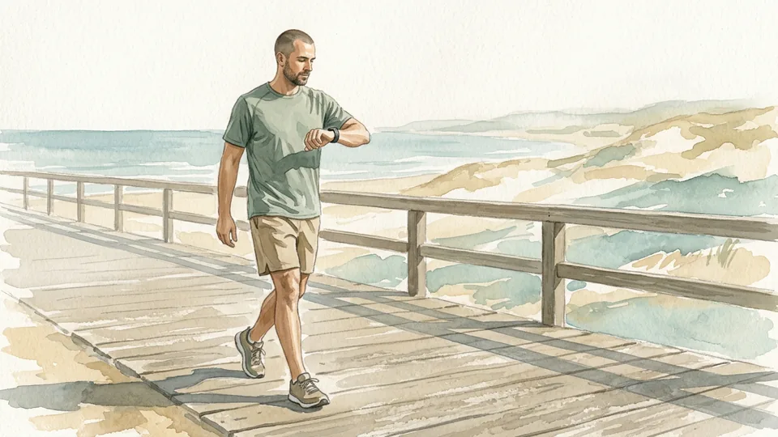
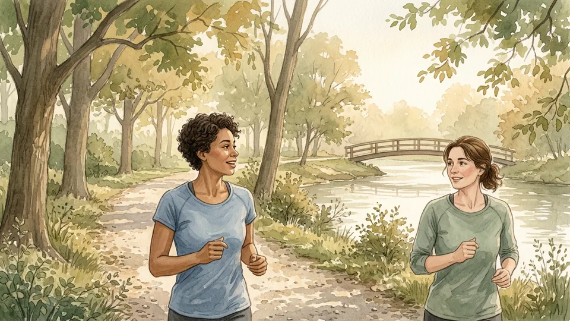

> DRAFT — do not publish or package: 12 of 16 illustrations are still missing, and the article has not been reviewed by a person.

# How to Plan a Run-Walk Workout

*Build a single run-walk session you can repeat: a safe route, timed intervals, an easy warm-up, an effort you can talk through, and a cool-down.*

**Category:** Sports and Fitness

**Slug:** `/Plan-a-Run-Walk-Workout`

**Primary keyword:** how to plan a run-walk workout

**Meta description:** Plan a run-walk workout in 15 steps: pick a safe route, set interval times, warm up, judge effort with the talk test, cool down, and adjust safely.

---

## Intro

A run-walk workout alternates short runs with deliberate walking instead of asking you to run continuously. Beginner programmes are built this way: the NHS Couch to 5K plan starts with a five-minute warm-up walk, then one minute of running and one minute thirty seconds of walking, repeated seven times. These 15 steps show how to plan one session of your own, judge the effort sensibly, and adjust it afterwards.

## Part 1 of 3 — Set Up the Session

### Step 1 — Decide what this session is for

> IMAGE PENDING for step 1: A person writing a short training note at a kitchen table beside a water bottle and trainers

Name one purpose before you leave the house: getting moving again, practising a steady rhythm, or covering a familiar loop more comfortably. A run-walk workout is a complete session in its own right, not a lesser version of continuous running. Pick a purpose you can meet on an ordinary day rather than on your best day.

**Tip:** Write the purpose down. It makes it easier to judge the session afterwards.

### Step 2 — Check whether to ask a clinician first

> IMAGE PENDING for step 2: An adult talking with a healthcare professional in a bright consulting room

Ask a health professional about a suitable plan if you have a heart or lung condition, a recent injury, if you are pregnant, or if activity brings on symptoms. The NHS also advises speaking to a GP first if you are worried about your health before starting Couch to 5K. Follow individual medical advice over any general plan, including this one.

**Tip:** Bring a short description of the session you intend to do; it makes the advice more specific.

### Step 3 — Choose a realistic total session length

> IMAGE PENDING for step 3: A hand marking a blank weekly planner beside a mug and a pair of running shoes

Decide how long the whole workout will take, including the warm-up and cool-down. Many beginner sessions sit near half an hour: the first Couch to 5K run totals about 28 minutes 30 seconds before stretching. Choose a length that fits your week rather than one that depends on everything going perfectly.

**Tip:** If the day is tight, shorten the session rather than skipping the warm-up and cool-down.

### Step 4 — Pick a simple, safe route

> IMAGE PENDING for step 4: A runner looking along a quiet looped park path with benches and open grass

Choose a flat, familiar, well-maintained route where you can shorten the session easily, such as a park loop, a quiet path, or a track. Repeating a loop means you are never far from your start point. Check traffic, cyclists, footing, lighting, and the weather, and tell someone your route if you are going alone.

**Tip:** A short loop you repeat is easier to cut early than a long out-and-back route.

### Step 5 — Gather the few things you need

> IMAGE PENDING for step 5: Running shoes, a water bottle, a reflective band and a plain watch laid out on a wooden bench

You need shoes that fit comfortably, clothes suited to the weather, and something to keep time. Take water, especially in warm weather or for longer sessions. Add reflective items and a light for low light, and carry any medication you have been advised to keep with you. Nothing here needs to be expensive.

**Tip:** Lay everything out the night before so a missing item does not become a reason to skip.

## Part 2 of 3 — Build the Intervals

### Step 6 — Choose a starting run-walk ratio

> IMAGE PENDING for step 6: A notebook page with blank interval boxes drawn beside a stopwatch on a table

Pick a ratio you could repeat several times without straining. One minute of easy running with one minute thirty seconds of walking, repeated seven times, is the first NHS Couch to 5K session. If that feels like too much, shorten the running interval or lengthen the walk. The ratio is a starting point, not a test.

**Tip:** If you cannot finish the last interval at an easy effort, the first one was too hard.

### Step 7 — Set a timing method you do not have to watch

> IMAGE PENDING for step 7: A phone propped on a hallway shelf beside headphones and a key, ready for a timed session

Use a repeating timer, an audio-guided app, or landmarks such as lamp posts so you are not checking a screen constantly. Timing matters more than distance in a run-walk session, because it keeps both the running and the walking honest. The free NHS app times the intervals for you if you would rather not count.

**Tip:** Test the timer at home; an alert you cannot hear outdoors is worse than none.

### Step 8 — Warm up with easy walking

Begin with about five minutes of easy walking, as the NHS plan does at the start of every run. The American Heart Association suggests warming up for five to ten minutes, doing your planned activity at a slower pace, and warming up longer for more intense sessions. A warm-up should leave you ready to move, not tired.

**Tip:** Keep the warm-up gentle enough that you could easily hold a conversation.

### Step 9 — Keep the walking recovery deliberate

Walk the recovery interval at a purposeful pace and let it run its full length. Cutting the walk short to 'save time' usually makes the next running interval harder and the whole session less repeatable. The walk is scheduled training, not a lapse, and beginner plans build it in on purpose.

**Tip:** Start the next run only when your breathing has settled, even if the timer is ready first.

### Step 10 — Check the effort with the talk test

Run the intervals at an effort you can hold a conversation through. The CDC describes the talk test this way: during moderate-intensity activity you can talk but not sing, and during vigorous activity you cannot say more than a few words without pausing for breath. Slow down or walk if you cannot speak in phrases.

**Tip:** The same pace can be moderate for one person and vigorous for another; judge your own effort.

## Part 3 of 3 — Finish and Adjust

### Step 11 — Cool down instead of stopping suddenly

> IMAGE PENDING for step 11: A person walking slowly along a park path at dusk after a workout, shoulders relaxed

Finish with about five minutes of easy walking. The American Heart Association recommends reducing your walking speed for five to ten minutes so your heart rate comes down gradually, and notes that stopping abruptly can leave you light-headed because heart rate and blood pressure drop quickly.

**Tip:** Keep walking until your breathing is comfortable and you are no longer warming up.

### Step 12 — Stretch gently while you are still warm

> IMAGE PENDING for step 12: An adult holding a calf stretch against a low wall in a quiet park after exercising

Stretching after the cool-down walk can help your muscles recover. The American Heart Association suggests holding each stretch for 10 to 30 seconds, keeping the stretch strong but not painful, breathing through it, and not bouncing. Stop any stretch that causes sharp pain rather than working through it.

**Tip:** Stretch both sides evenly, even when only one side feels tight.

### Step 13 — Write down what actually happened

> IMAGE PENDING for step 13: A short handwritten training note on a desk beside a water bottle and a plain watch

Record the intervals you completed, how the effort felt, and anything unusual such as a niggle, poor sleep, or a very warm day. A few lines are enough. Over several weeks the notes show whether sessions are becoming easier, which a single difficult day never tells you.

**Tip:** Note how you felt the next morning as well as during the session.

### Step 14 — Change one thing at a time

> IMAGE PENDING for step 14: A runner moving at a steady, easy pace along a gravel path with open fields behind

When a session feels manageable, make a single change: lengthen the running intervals slightly, add one interval, or reduce the walk a little. Do not lengthen the runs, cut the walks and add a session in the same week. The NHS plan progresses gradually across nine weeks, with three sessions a week and a rest day between runs.

**Tip:** Keep a change for a couple of sessions before deciding whether it worked.

### Step 15 — Respond to pain and unusual symptoms

> IMAGE PENDING for step 15: A person sitting on a park bench resting a hand on one knee and checking how it feels

Stop the session if you develop pain, dizziness, unusual breathlessness, or anything that feels wrong, and seek medical advice if it persists, worsens, or changes how you walk. Chest pain, fainting, or severe difficulty breathing need emergency help rather than another attempt at the intervals.

**Tip:** Repeat an easier session instead of trying to make up what you missed.

## Tips

- Walking intervals are planned training, not a sign that the session failed.
- Time the intervals rather than chasing distance.
- Keep a shorter backup session for busy or difficult days.
- Judge progress over several weeks, not by one hard session.

## Warnings

- Ask a health professional about a suitable plan if you have a heart or lung condition, a recent injury, symptoms during activity, or other concerns about exercising.
- Stop and call local emergency services for chest pain, fainting, or severe difficulty breathing; do not try to finish the session first.
- Stop if pain or unusual symptoms develop, and seek medical advice if they persist, worsen, or affect how you move.
- Avoid unsafe roads, ice, severe weather, and poor visibility. Reflective clothing and lights help but do not make a hazardous route safe.

## Community Q&A

**Is run-walk real training?**

Yes. Established beginner programmes are built from run-walk intervals; the NHS Couch to 5K plan alternates running and walking from its first session. The walking is scheduled recovery that lets you accumulate time on your feet at a manageable effort.

**What run-walk ratio should a beginner start with?**

The first NHS Couch to 5K session uses one minute of running and one minute thirty seconds of walking, repeated seven times, between a five-minute warm-up walk and a five-minute cool-down walk. Shorten the run or lengthen the walk if that feels too hard.

**How do I know if I am running too fast?**

Use the talk test. The CDC notes that during moderate-intensity activity you can talk but not sing, while during vigorous activity you cannot say more than a few words without pausing for breath. If you cannot speak in phrases, slow down or walk.

**How long should the warm-up and cool-down be?**

The American Heart Association suggests warming up for five to ten minutes and reducing your walking speed for five to ten minutes afterwards. The NHS plan uses a five-minute walk at each end of every run.

**How often should I do a run-walk workout?**

Three sessions a week with a rest day between runs is the pattern the NHS plan uses, but your own schedule, recovery and health matter more than a fixed number. Repeat a week when sessions still feel hard.

## Useful external resources

- [NHS Couch to 5K running plan](https://www.nhs.uk/better-health/get-active/get-running-with-couch-to-5k/couch-to-5k-running-plan/) — Week-by-week run-walk intervals, warm-up and cool-down walks, and rest days.
- [CDC: How to Measure Physical Activity Intensity](https://www.cdc.gov/physical-activity-basics/measuring/index.html) — The talk test and the difference between moderate and vigorous effort.
- [American Heart Association: Warm Up, Cool Down](https://www.heart.org/en/healthy-living/exercise-and-physical-activity/fitness-basics/warm-up-cool-down) — How long to warm up and cool down, and how to stretch afterwards.

## References

1. National Health Service. Couch to 5K running plan. Accessed October 29, 2026. https://www.nhs.uk/better-health/get-active/get-running-with-couch-to-5k/couch-to-5k-running-plan/
2. Centers for Disease Control and Prevention. How to Measure Physical Activity Intensity. Updated December 4, 2025. https://www.cdc.gov/physical-activity-basics/measuring/index.html
3. American Heart Association. Warm Up, Cool Down. Last reviewed January 16, 2024. https://www.heart.org/en/healthy-living/exercise-and-physical-activity/fitness-basics/warm-up-cool-down
4. National Health Service. Get Running with Couch to 5K. Accessed October 29, 2026. https://www.nhs.uk/better-health/get-active/get-running-with-couch-to-5k/

## Internal links

- [How to Run Your First 5K](https://www.56juqingba.com/Run-Your-First-5K)
- [How to Start Running When You Hate Running](https://www.56juqingba.com/Start-Running-When-You-Hate-Running)
- [How to Keep Running Through Winter](https://www.56juqingba.com/Keep-Running-Through-Winter)
- [More Sports and Fitness guides](https://www.56juqingba.com/Category/Sports-and-Fitness)
