# How to Plan a School Club Meeting

*An agenda written in advance, a room that starts on time, one motion on the floor at a time, and minutes that survive until the next meeting.*

**Category:** Youth

**Slug:** `/Plan-a-School-Club-Meeting`

**Primary keyword:** plan a school club meeting

**Meta description:** Plan a school club meeting: build an agenda in the standard order of business, time-box each block, run motions fairly, record decisions and close on time.

---

## Intro

Most school clubs do not fall apart because the idea was weak. They fall apart in the forty minutes of a meeting that had no agenda, drifted into a conversation about what the club should be, and ended with nobody sure who agreed to do what. A planned meeting fixes that cheaply: one page written before anyone arrives, a fixed order of business, a decision taken by an actual vote, and five lines of minutes that make the next meeting possible. This guide walks through planning, running and closing a club meeting the way student organisations and youth clubs have done it for decades, using the order of business that school and 4-H clubs across the United States still teach. None of it requires a formal parliamentarian or a gavel. It requires an agenda, a clock, and the discipline to write down what was decided.

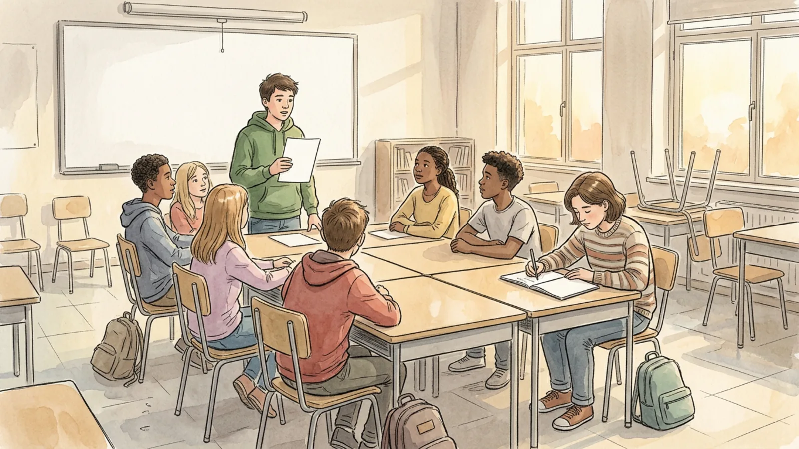

## Part 1 of 3 — Build the Agenda Before Anyone Arrives

### Step 1 — Decide the one thing the meeting must produce

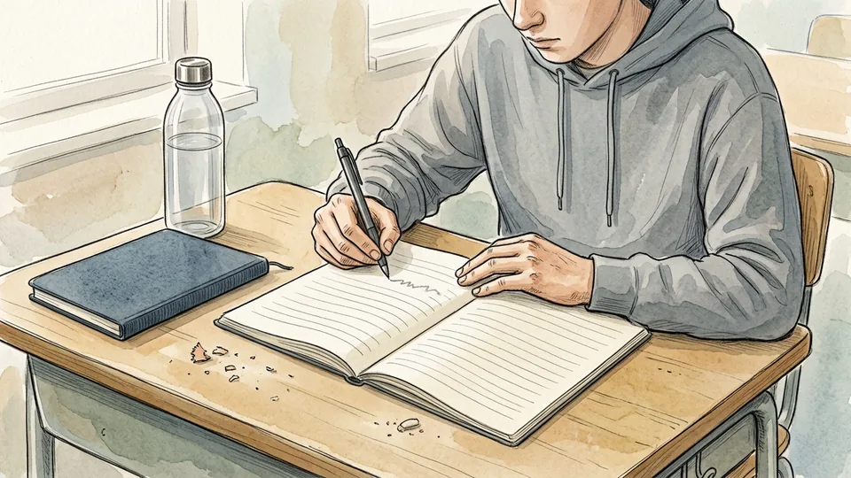

Before writing anything, finish this sentence: by the end of this meeting the club will have decided ___. One decision, stated plainly — the date of the fundraiser, who runs the stall, whether the format changes. Everything else on the agenda is reporting or discussion that can be cut if time runs short. A meeting with no required outcome becomes a conversation, and a conversation that repeats for three weeks is how members quietly stop coming.

**Tip:** If you cannot name the decision, consider cancelling and sending a two-line update instead. Members notice when their time is respected.

### Step 2 — Write the agenda in the standard order of business

Club meetings across school and 4-H programmes use the same backbone: call to order, roll call, reading and approval of the minutes, treasurer's report, committee reports, unfinished business, new business, announcements, adjournment. Use it. The order is not ceremony — it puts money and old commitments in front of the group before anyone proposes something new, so decisions are made with the facts already on the table.

**Tip:** Keep a reusable template file. You should be filling in items, not reinventing the structure each month.

### Step 3 — Give every block a number of minutes

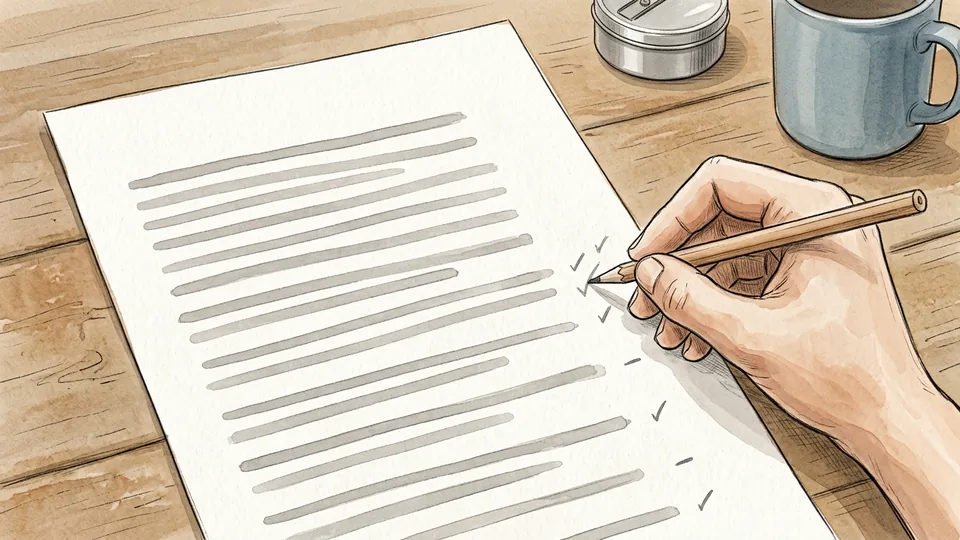

Write the minutes beside each item and total them. A common split used by club programmes is roughly fifteen to twenty minutes of business, forty to sixty minutes of the actual activity or learning, and fifteen to twenty minutes of social time; other handbooks run business a little longer, at twenty to thirty minutes. The exact numbers matter less than the habit of assigning them, because an unbudgeted agenda always overruns on the first item.

**Tip:** Put the hardest decision second, not last. The last item on an unbudgeted agenda is the one that gets postponed.

### Step 4 — Check the agenda with your sponsor and officers

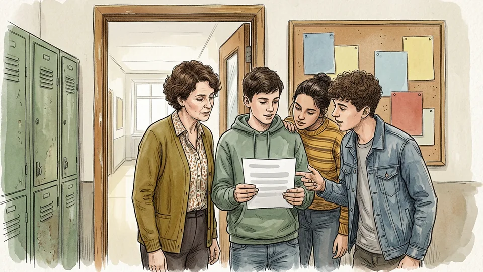

Meet the staff sponsor and the other officers briefly before the meeting — ten minutes in person or a short message thread. Confirm the room is booked, the treasurer has figures, committee chairs are ready to report, and nothing on the list needs permission you do not have. Officer handbooks make this pre-meeting check a standing duty of the president and vice-president, because surprises in the room cost far more time than a check beforehand.

**Tip:** Ask each officer directly whether their item is ready. Silence in a group chat is not confirmation.

### Step 5 — Send the agenda out before the meeting

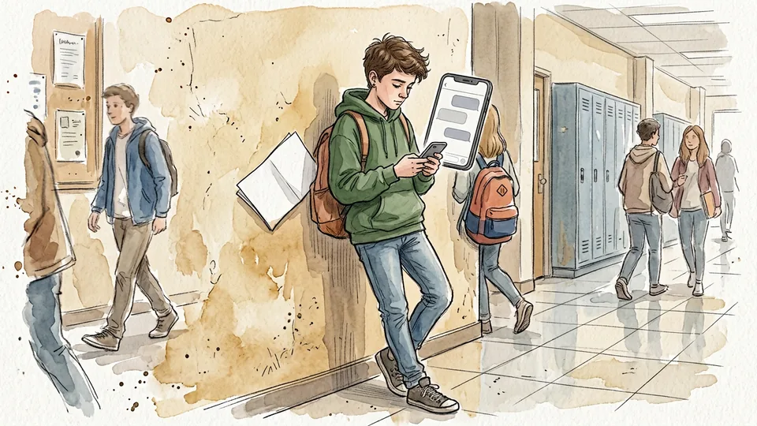

Send the agenda, the room, the start and finish times, and anything members should read, at least a day ahead. Invite additions with a deadline — items received after that go to the next meeting. Circulating the agenda converts the meeting from something that happens to members into something they arrive prepared for, and it gives quieter people time to think about a decision before being asked to vote on it.

**Tip:** Post it where the club already talks rather than a new channel nobody checks. Reach beats tidiness.

## Part 2 of 3 — Run the Room

### Step 6 — Arrive early and set the room so people face each other

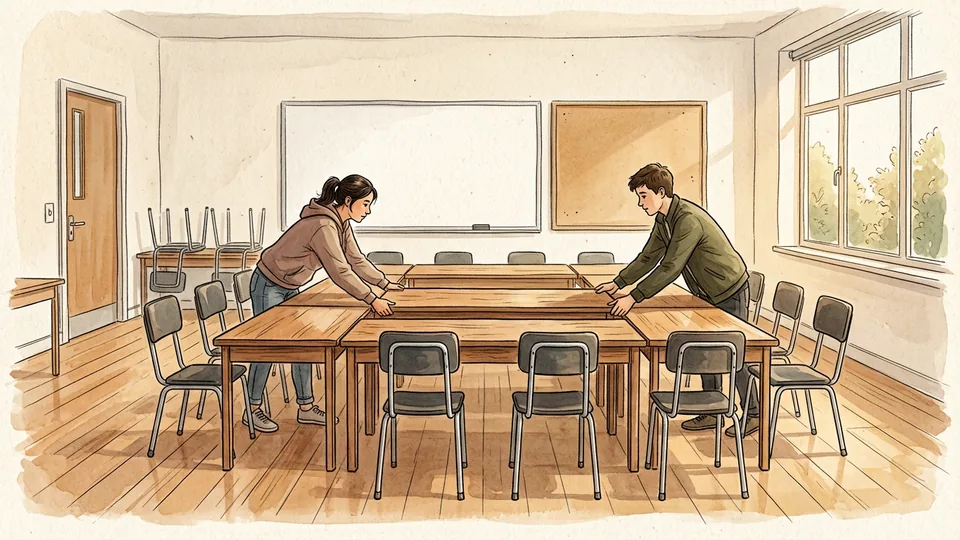

Get there fifteen to twenty minutes before the start, as club officer guides recommend, and arrange tables and chairs into a circle or rectangle with no back row. Seating decides participation more than any facilitation trick: people in a back row behind other people contribute roughly nothing. Put the agenda where everyone can see it, either a copy each or one large sheet at the front.

**Tip:** Count the chairs to the number you expect plus two. A half-empty room reads as a failing club even when attendance is normal.

### Step 7 — Call the meeting to order on time

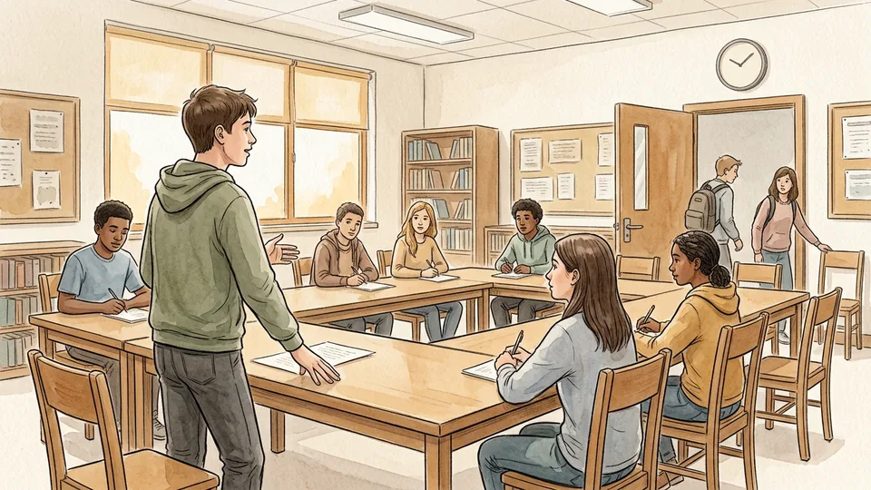

Start at the stated time whether or not everyone has arrived, and say the words — the meeting will come to order. Officer handbooks are blunt about this: the vice-president starts if the president is late, and waiting for stragglers teaches everyone that the stated time is fiction. Starting on time is also the only honest basis for promising members that the meeting will end on time.

**Tip:** Greet latecomers without rewinding. Catch them up after the meeting, not in front of everyone.

### Step 8 — Take attendance with a question everyone answers

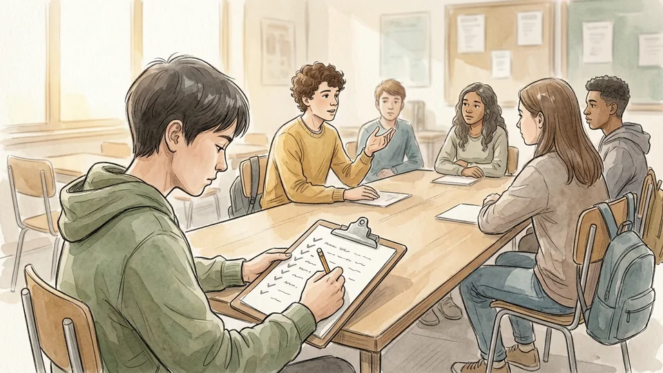

Have the secretary take the roll, but attach a one-sentence question to it — what you are working on, one thing you want from this term, a favourite anything. It takes two minutes and it means every person in the room has used their voice once before any discussion starts. People who have already spoken once are far more likely to speak again, and the attendance record is what you use later to defend your room booking.

**Tip:** Vary the question each meeting and keep answers to one sentence, or roll call eats the business block.

### Step 9 — Approve the minutes and hear the money

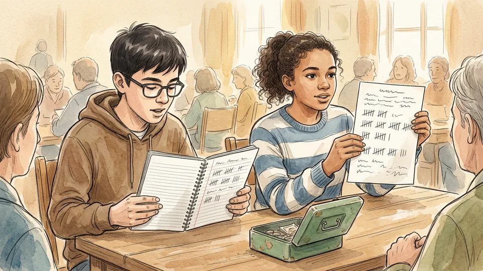

The secretary reads or circulates the minutes of the last meeting; the chair asks for corrections, then declares them approved. The treasurer then gives the balance and what has been spent since the last meeting. Doing both early keeps the club honest in public and prevents the familiar argument where two people remember a past decision differently. If the club holds money, this is also the moment anyone may ask a question about it.

**Tip:** Circulate the minutes in writing beforehand and read only the decisions aloud. Reading everything wastes the room.

### Step 10 — Handle one motion at a time

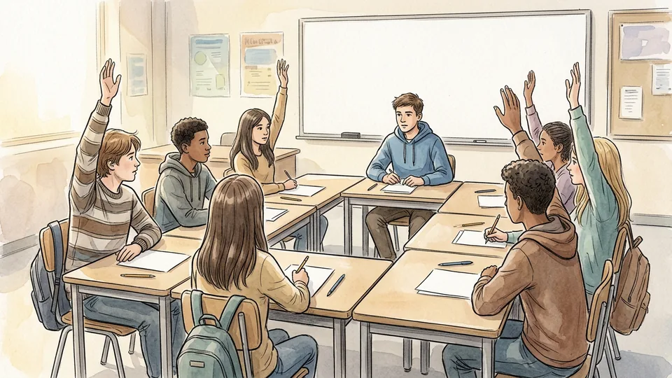

When a decision is needed, use the sequence that youth clubs teach: a member moves, another seconds, the chair states the motion and opens discussion, the chair restates it, and the group votes by voice, hands or ballot. Only one motion sits before the group at once. A majority — more than half of those voting — carries it. This is lighter than it sounds and it replaces the vague group nod that nobody can later be held to.

**Tip:** Write the motion down word for word before the vote. People vote differently once they see the exact wording.

## Part 3 of 3 — Decide, Record and Set Up the Next Meeting

### Step 11 — Keep the discussion fair and finite

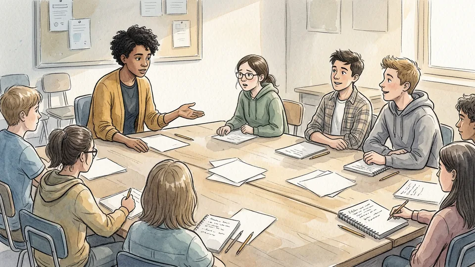

Recognise speakers one at a time, keep contributions to the item on the floor, and make sure the quiet half of the room is asked directly before any vote. The principles behind this are simple: one person speaks at a time, every motion gets time for debate, every member has equal rights, and the majority decides while the minority keeps the right to be heard. When the discussion starts repeating itself, say so and call the vote.

**Tip:** Cap each speaker at about a minute on contested items. The cap protects the people who never interrupt.

### Step 12 — Write minutes that record decisions, not atmosphere

Minutes are not a transcript. Record the date, who attended, each decision taken, the result of each vote, who agreed to do what, and the deadline. Five or six lines is usually enough. Those lines are the club's memory, the evidence your sponsor needs at budget time, and the document that opens the next meeting. Clubs lose months to the gap between two people remembering a decision differently.

**Tip:** Keep minutes in one shared document the whole committee can open, not scattered across chat threads.

### Step 13 — Give every job an owner and a date

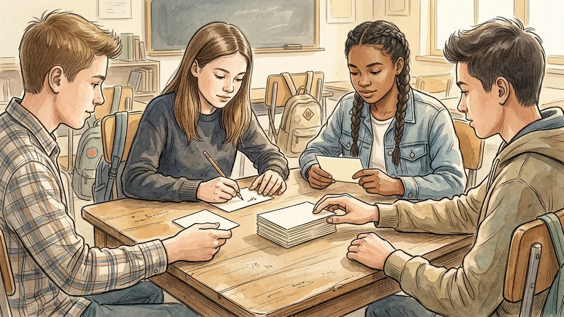

A decision without a named person is a wish. Before moving on, say out loud who is doing it and by when, and have the secretary write both down. Spread the jobs: officer guides ask the president and vice-president to delegate so that every member holds a role at some point, which is also the most reliable way to keep people coming back. Small jobs with clear deadlines beat large jobs with none.

**Tip:** Avoid assigning anything to a person who is absent without asking them first. Volunteering someone who is not in the room is how clubs lose members.

### Step 14 — Announce, adjourn and finish on time

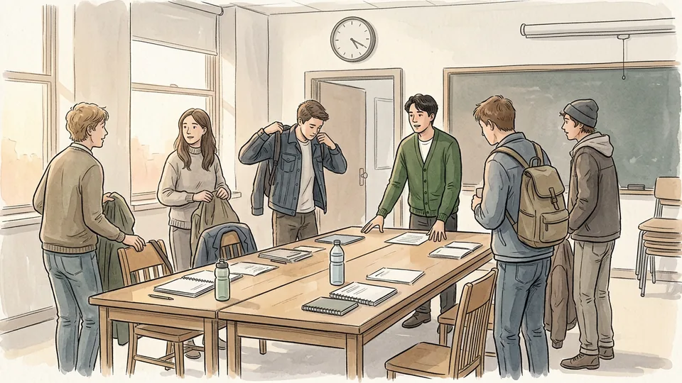

Take announcements last, then close properly — a motion to adjourn, or simply the chair stating that the meeting is adjourned. Finish at the time you promised even if an item is unfinished; carry it to unfinished business next time. A club that reliably ends on time can ask for ninety minutes of attention next month. A club that always overruns is quietly teaching members to arrive late or not at all.

**Tip:** Keep the social half after the formal close, so people who must leave can go without feeling rude.

### Step 15 — Spend ten minutes planning the next one

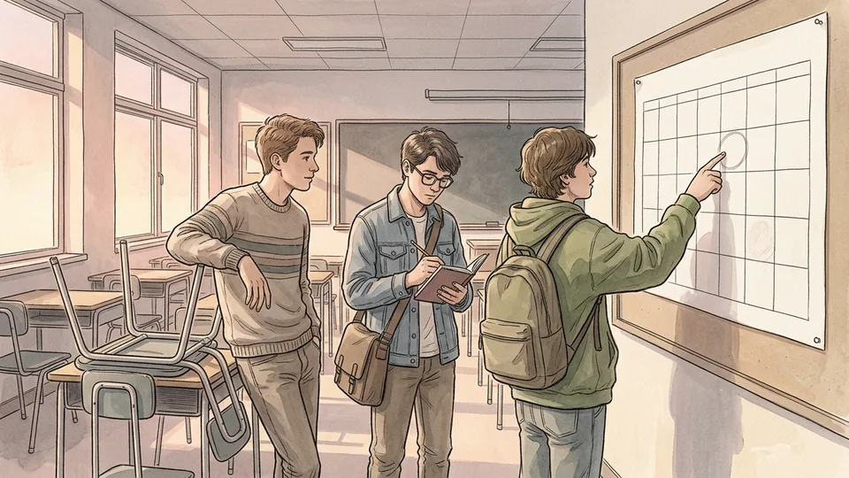

Before the room empties, the officers should agree three things: the date of the next meeting, the first item on its agenda, and anything that must be confirmed beforehand. Write them at the bottom of the minutes. Doing this while the meeting is fresh takes ten minutes; doing it a fortnight later takes an hour of reconstruction and usually produces a weaker agenda. This habit, more than enthusiasm, is what keeps a club alive in February.

**Tip:** Book the room for the whole term rather than meeting by meeting. A fixed slot is the strongest predictor that a club survives the year.

## Tips

- One page is the right length for an agenda. If it needs two, you are planning two meetings.
- Give the newest member a small, visible job at their second meeting. Ownership is what turns an attender into a member.
- Keep a single folder of agendas and minutes that passes to next year's officers. Most clubs die at handover, not at launch.
- If attendance falls below five for three meetings running, ask the remaining members whether to change the format or stop. Both are legitimate answers.

## Warnings

- Check your school's rules before the meeting makes commitments: many require a staff sponsor present, approval for posters and fundraising, and a signed form before any money is collected or spent.
- Do not photograph members or post their names online without permission; school policies on images of students are strict and usually require consent from a parent or guardian.
- Club funds should be handled through the school's approved process rather than a student's personal account, and two people should see every figure.

## Community Q&A

**How long should a club meeting be?**

Most school clubs work best in a single lunch break or a sixty to ninety minute after-school slot. Within that, club programmes suggest keeping the business portion to roughly fifteen to thirty minutes and leaving the majority of the time for the activity itself plus a short social stretch. The exact split matters less than writing the numbers on the agenda and holding to them, because the business block expands to fill whatever space it is given.

**Do we need formal parliamentary procedure and a gavel?**

No. What you need is the useful core of it: an agenda in a fixed order, one person speaking at a time, one motion considered at a time, and a recorded vote on anything the club will be held to. Youth club guides are explicit that involving members in decisions matters more than strict adherence to formal language. Use plain words — I propose, is anyone against, let us vote — and keep the structure.

**What if two or three people dominate every discussion?**

Make speaking an explicit process rather than a competition for gaps in the conversation. Recognise speakers by name, cap contributions on contested items, go round the table once before opening free discussion, and ask quiet members directly what they think. If it persists, put the decision to a written vote, which removes the advantage held by whoever is loudest and most confident in the room.

**Nobody reads the minutes. Why bother writing them?**

Minutes are not written to be read for pleasure; they are written to settle disputes and prove activity. They tell you what was decided when memories disagree, they show a sponsor or student council that the club is functioning, and they let a member who missed a meeting catch up in a minute. Keep them to five or six lines of decisions and owners and they cost two minutes to write.

## Useful external resources

- [UMass Amherst Mass 4-H: Parliamentary Procedure Guide](https://www.umass.edu/agriculture-food-environment/mass4h/volunteers/parliamentary-procedure-guide) — Plain-language order of business, definitions of motion, second, majority and floor, and the steps for taking a vote.
- [University of Missouri Extension: Planning and Conducting 4-H Club Meetings](https://extension.missouri.edu/media/wysiwyg/Extensiondata/Pro/4h/Docs/GetInvolved/ClubManagement/ClubLeader/LG903.pdf) — Suggested time split between business, learning and social time, plus a recommended order of business.
- [Iowa State University Extension: Conducting a 4-H Business Meeting](https://www.extension.iastate.edu/4h/files/documents/4-H%20Club%20Meeting%20(Parli%20Pro).pdf) — A full sample meeting script from call to order through adjournment, including how a motion is made and voted on.
- [Ohio State University Extension: Ohio 4-H Vice President's Handbook](https://ohio4h.org/sites/ohio4h/files/imce/Families/officer_resources/Vice%20President%20Handbook.pdf) — Officer duties, planning the agenda with an adviser in advance, and delegating so every member holds a role.

## References

1. University of Massachusetts Amherst, Center for Agriculture, Food and the Environment. Parliamentary Procedure Guide. Mass 4-H. https://www.umass.edu/agriculture-food-environment/mass4h/volunteers/parliamentary-procedure-guide
2. University of Missouri Extension. Letters to New Leaders, Letter 3: Planning and Conducting 4-H Club Meetings (LG903), updated 2022. https://extension.missouri.edu/media/wysiwyg/Extensiondata/Pro/4h/Docs/GetInvolved/ClubManagement/ClubLeader/LG903.pdf
3. Iowa State University Extension and Outreach. Conducting a 4-H Business Meeting (Parliamentary Procedure). https://www.extension.iastate.edu/4h/files/documents/4-H%20Club%20Meeting%20(Parli%20Pro).pdf
4. Ohio State University Extension. Ohio 4-H Vice President's Handbook, 2015. https://ohio4h.org/sites/ohio4h/files/imce/Families/officer_resources/Vice%20President%20Handbook.pdf

## Internal links

- [How to Start a Club at School](https://www.56juqingba.com/Start-a-Club-at-School)
- [How to Split Household Chores Fairly](https://www.56juqingba.com/Split-Household-Chores-Fairly)
- [How to Build a Monthly Budget](https://www.56juqingba.com/Build-a-Monthly-Budget)
- [How to Study for an Exam Without Cramming](https://www.56juqingba.com/Study-for-an-Exam-Without-Cramming)
