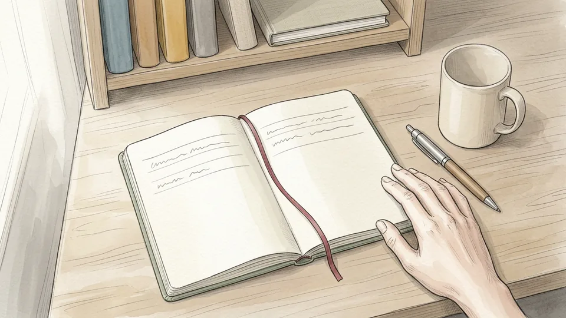
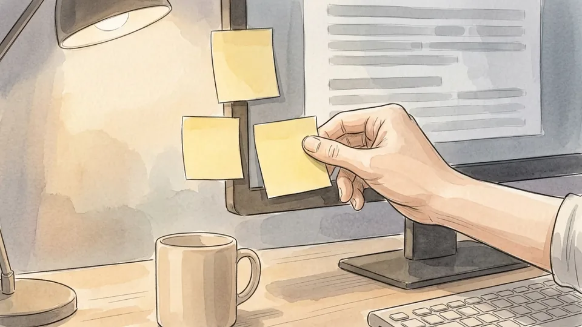
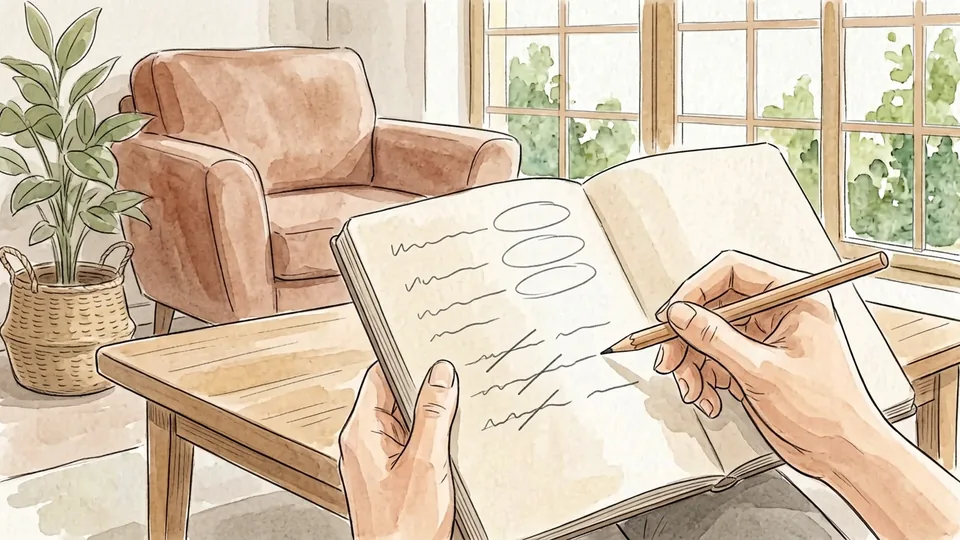
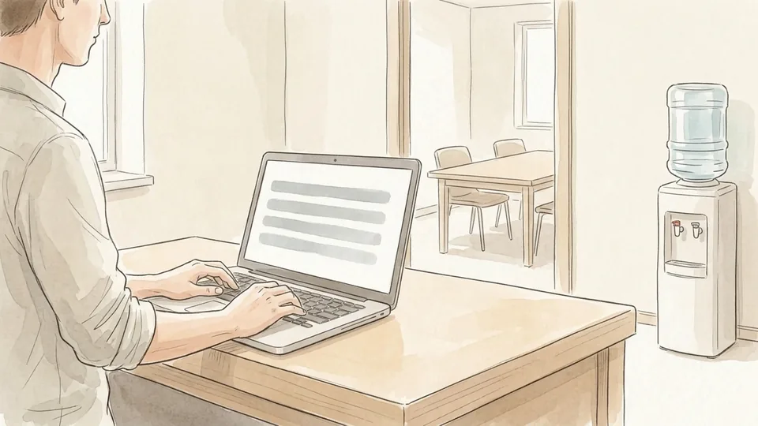
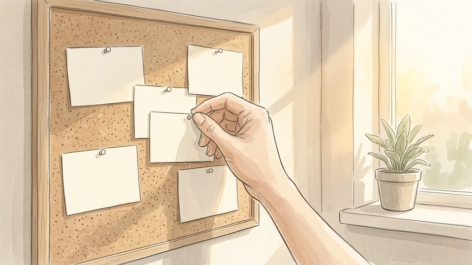
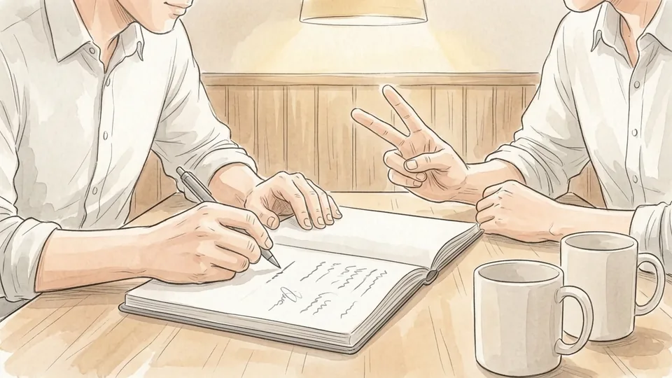
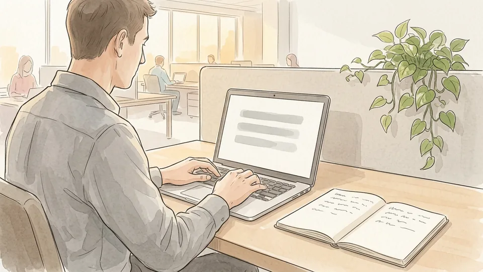

# How to Prepare for a One-on-One Meeting

*Thirty minutes, three topics and a short recap: how to turn a recurring check-in into the most useful half hour of your week.*

**Category:** Work World

**Slug:** `/Prepare-for-a-One-on-One-Meeting`

**Primary keyword:** prepare for a one-on-one meeting

**Meta description:** Prepare for a one-on-one meeting: agree a cadence, pick three topics, send an agenda a day early, listen in the room, and recap what you agreed.

---

## Intro

Most one-on-ones go wrong in the same way. Nobody writes anything down, the time fills with a status report your manager could have read in an email, and the two things you actually needed decided get raised in the last three minutes. The fix is not charisma. It is twenty minutes of preparation spread across the week, a short written agenda sent the day before, and a recap afterwards that records what you both agreed. University HR guidance is unusually blunt about this: the meeting works best when the employee owns the agenda and sends it in advance, because that keeps the conversation on the work the employee is actually doing. This guide walks through fifteen steps, from agreeing a cadence to filing the notes, written from the point of view of the person being managed.

## Part 1 of 3 — Set the Meeting Up So It Actually Happens

### Step 1 — Agree a cadence and defend it

A one-on-one is a standing appointment, not a favour you ask for. Baylor University's HR guidance describes the common pattern as thirty minutes once a week, stretched to forty-five or sixty minutes when the role is complex or the person manages others. The US Office of Personnel Management tells federal supervisors to hold check-ins monthly at the very least. Put the slot in the calendar as a recurring event and treat illness or a genuine emergency as the only reasons to drop it.

**Tip:** If the meeting has to move, propose the new time in the same message you use to cancel. A reschedule takes ten seconds; a gap of three weeks takes a month to repair.

### Step 2 — Decide together where it happens

Format changes how honest the conversation feels. Harvard Business School's Working Knowledge advises managers to settle the cadence and the setting with each person: a desk, a small meeting room, a coffee, or a walk around the block. The same piece warns against turning the meeting into after-work drinks, because the signal is that the discussion is not serious. If you work remotely, use video rather than audio, and try to get one or two in-person meetings a year.

**Tip:** A walking one-on-one suits a difficult conversation. Side by side with no screen between you, silences feel much less loaded than they do across a table.

### Step 3 — Keep one running notebook

Scattered notes are the same as no notes. Pick one place for every one-on-one you have with this manager, in date order, and never split it across a notebook, a phone app and three email drafts. A paper notebook, a single document or one long note all work. What matters is that you can scan back through six months in a minute and find the commitment you are about to ask about again.

**Tip:** Leave a wide margin down the side of each page. That empty strip is where you mark actions later, without rewriting the page.

### Step 4 — Re-read the last set of notes

Preparation starts with the previous meeting, not with this one. Baylor's guidance for managers is to review the earlier notes before arriving, and the advice is just as useful on the other side of the table. Go through the last page and mark three categories: what you finished, what slipped and why, and what you are still waiting on from your manager. That third category is the part most people quietly drop.

**Tip:** Carry unfinished items forward by copying them onto today's page. An item that has moved three pages in a row is either not important or genuinely blocked, and both are worth saying out loud.

### Step 5 — Collect material through the week

Nobody can reconstruct a fortnight of work the night before a meeting. Keep a slow-growing list instead. When something goes unusually well, when a decision gets stuck, when a piece of feedback lands, add one line on the spot. By the time you sit down to prepare, the raw material is already there and you are choosing between items rather than straining to remember any.

**Tip:** One line is enough: what happened and what it cost or saved. The detail will come back the moment you read the line.

## Part 2 of 3 — Build an Agenda Your Manager Can Use

### Step 6 — Choose two or three topics, not ten

Half an hour holds three topics if you want any of them discussed properly. Lay out everything you could raise, then cut until two or three remain, and leave a few minutes at the end for whatever your manager wants to bring. The cut items are not lost. They either go in the written update, wait for the next meeting, or turn out not to matter, which is its own answer.

**Tip:** Rank by what only your manager can unblock. Anything you could resolve with a peer this afternoon does not belong on the list.

### Step 7 — Write each topic as a question or a decision

A heading like "the migration" gives your manager nothing to prepare. A line that asks which of two options to run first, or who owns the sign-off, tells them exactly what you need from the next ten minutes. Phrase every item so that the meeting can end with an answer. If you cannot find the question inside a topic, you are probably about to deliver a status report.

**Tip:** Try completing the sentence "by the end of this meeting I want to know…" for each line. Anything that resists the sentence is not ready.

### Step 8 — Leave the status dump out

Baylor's tips are explicit: keep status updates out of the meeting when an email would do. Status is low-bandwidth information, and reading it aloud spends your most valuable half hour on the thing a document does better. Send the update separately in writing, keep it short, and bring to the meeting only the parts where progress depends on a judgement, a trade-off or a decision that is not yours to make.

**Tip:** If your team already posts written updates somewhere, link to yours in the agenda rather than repeating it.

### Step 9 — Keep one line for your own growth

The OPM roadmap asks supervisors to run development conversations regularly rather than saving them for the annual rating, and to make goals specific, measurable, achievable, relevant and time-bound. Its own example replaces "improve reporting accuracy" with "reduce reporting errors by 25% over the next six months". Put one development line on every second or third agenda: a skill you want, a project you want near, or feedback on something you are deliberately practising.

**Tip:** Name the next six months, not your career. Small, dated asks are easy for a manager to act on and easy for both of you to check later.

### Step 10 — Send the agenda a day ahead

Working Knowledge recommends sending the list roughly twenty-four hours before the meeting, and saying plainly if the other person needs to read or bring something. Keep it to a handful of bullet points in the body of a message, not an attachment. Close by asking what they would like to add. That single question turns your list into a shared agenda and gives your manager room for the topics they were saving.

**Tip:** Send it at the end of the working day before. A morning agenda often arrives after your manager has already planned the conversation.

## Part 3 of 3 — Run It and Close the Loop

### Step 11 — Arrive five minutes early and clear the decks

Walk in with the notebook, the agenda and nothing else running. Close the other tabs, silence the notifications on both your phone and your laptop, and leave the unrelated work where it is. If the meeting is remote, open the call early enough to check that the camera, the microphone and the light are all behaving, and sit where the window is to the side of you rather than behind.

**Tip:** A laptop raised on a couple of books puts the camera at eye level. It costs nothing and removes the upward angle that makes remote conversations feel oddly adversarial.

### Step 12 — Open with a check-in and one good thing

The first two minutes are not filler. Working Knowledge treats personal connection as a legitimate part of the agenda and suggests bookending hard topics with easier ones, so nobody leaves the room deflated. Start with a short human check-in, then one thing that went well since you last spoke, then move into the list. A single concrete win also quietly answers the question managers rarely ask directly.

**Tip:** Make the win specific and small. "The new checklist cut the handover to ten minutes" lands better than "things are going well".

### Step 13 — Work the list, then stop talking

Take each item in turn, give the context in a couple of sentences, ask your question and then leave the silence alone. Both HR guidance and management writing describe the same failure mode: one person filling the whole half hour. If there is feedback you want, ask for it by name. "How did the client call come across to you?" gets a real answer far more often than "any feedback for me?"

**Tip:** Write while they talk rather than after. Visible note-taking signals that the answer is going somewhere, and it keeps you from interrupting.

### Step 14 — Say the actions out loud before you leave

Spend the last three minutes repeating what you both agreed: who does what, and by when. Saying it aloud catches the mismatch while you can still fix it, which is the whole point. Include your manager's actions as well as yours. Then ask the one question that is easy to forget in your own meeting: is there anything they need from you before the next one?

**Tip:** Dates beat adjectives. "Before Thursday's release" is a commitment; "soon" is a feeling.

### Step 15 — Send a short recap and file it

Working Knowledge recommends following every one-on-one with brief notes covering what was discussed, what was decided and any feedback given. Keep it to a few lines and send it the same day. A recap keeps you both on one version of the conversation, and it builds a record you will be grateful for later. Paste the same lines into your running notebook so the next preparation session starts with a finished page.

**Tip:** Done steadily for a year, these recaps become the first draft of your self-assessment, which makes review season a copy-and-edit job rather than an archaeology project.

## Tips

- Own the agenda even if your manager never asks for one. The meeting is cheap for them and expensive for you, so the preparation is worth more to you than to anyone else.
- Keep a short standing list of things you are waiting on. Reading it out takes twenty seconds and saves whole weeks.
- Bring problems with two options attached. You will get a decision instead of a sigh.
- If your manager talks for twenty-five of the thirty minutes, send a shorter agenda rather than a longer one.
- Skipping a one-on-one during a quiet week is fine. Skipping it during a hard week is how small problems become review-season surprises.

## Warnings

- A one-on-one is not the channel for harassment, discrimination or safety complaints. Those go to HR or your organisation's formal reporting route, which exists to protect you and to create a proper record.
- Anything you write in a recap can be forwarded, stored and read later by people who were not in the room. Write notes you would be comfortable having quoted back to you.
- Do not let the weekly slot become the only place you raise blockers. Urgent problems should not wait five days for a calendar entry.
- Notes from a one-on-one do not replace your employer's formal appraisal process. Check your own HR policy for what has to be recorded and where.

## Community Q&A

**How long should a one-on-one meeting be?**

Thirty minutes every week is the most common pattern in university HR guidance, extended to forty-five or sixty minutes when the role is complex or the employee manages other people. A short, reliable meeting beats a long one that keeps getting cancelled, so if thirty minutes cannot survive in the calendar, ask for fifteen that will.

**What if my manager cancels every time?**

Reschedule inside the same week rather than letting the slot lapse, and keep sending the agenda and the recap even when the meeting does not happen. A written trail of unanswered questions is uncomfortable to ignore. If the pattern continues for months, raise it as its own agenda item instead of as a complaint in passing.

**Should I bring up pay or promotion in a one-on-one?**

Yes, but flag it in the agenda rather than springing it at minute twenty-eight. Your manager usually needs to check budget, timing and process before answering. Giving them a day's notice turns the conversation from a defensive one into a planning one, and most pay decisions are made in cycles you can learn in advance.

**Do I still need an agenda if my manager runs the meeting?**

Keep one anyway, even if you never send it. Managers steer towards what they are worried about this week, which may have nothing to do with what you need. A three-line list in your notebook is enough to make sure your questions get asked before the half hour disappears.

## Useful external resources

- [Baylor University HR: Manager Best Practices — One-on-One Meetings](https://hr.web.baylor.edu/news/story/2023/manager-best-practices-one-one-meetings) — Why the employee should own the agenda, the usual thirty-minute weekly cadence, and the instruction to keep status updates out of the meeting.
- [US Office of Personnel Management: Performance Management Roadmap](https://www.opm.gov/policy-data-oversight/performance-management/performance-management-toolkit/best-practices/performance-management-roadmap-for-supervisors/) — Federal guidance on check-in frequency, two-way feedback, development conversations and writing goals that are specific and time-bound.
- [Harvard Business School Working Knowledge: Master the One-on-One Meeting](https://www.library.hbs.edu/working-knowledge/master-the-one-on-one-meeting) — Sending the agenda about a day ahead, choosing a format together, bookending hard feedback, and writing a short recap afterwards.

## References

1. Baylor University Human Resources. Manager Best Practices: One-on-One Meetings, 14 June 2023. https://hr.web.baylor.edu/news/story/2023/manager-best-practices-one-one-meetings
2. US Office of Personnel Management. Performance Management Roadmap: Best Practices Guide for Supervisors. https://www.opm.gov/policy-data-oversight/performance-management/performance-management-toolkit/best-practices/performance-management-roadmap-for-supervisors/
3. Austin, Julia B. Master the One-on-One Meeting. Harvard Business School Working Knowledge, 22 August 2016. https://www.library.hbs.edu/working-knowledge/master-the-one-on-one-meeting

## Internal links

- [How to Prepare for a Performance Review](https://www.56juqingba.com/Prepare-for-a-Performance-Review)
- [How to Speed Up a Slow Laptop](https://www.56juqingba.com/Speed-Up-a-Slow-Laptop)
- [How to Split Household Chores Fairly](https://www.56juqingba.com/Split-Household-Chores-Fairly)
