# How to Repot a Houseplant

*Give a crowded houseplant fresh space and suitable mix without burying the stem, damaging healthy roots, or leaving the pot standing in water.*

**Category:** Home and Garden

**Slug:** `/Repot-a-Houseplant`

**Primary keyword:** how to repot a houseplant

**Meta description:** Repot a houseplant with a suitable pot, fresh mix, gentle root handling, and practical aftercare in 15 beginner-friendly steps.

---

## Intro

A plant does not need a bigger pot simply because time has passed. Check its roots, drainage, and species-specific needs first. These steps explain how to prepare a suitable container, move a common indoor plant gently, and care for it afterwards, with exceptions for plants such as orchids and succulents.

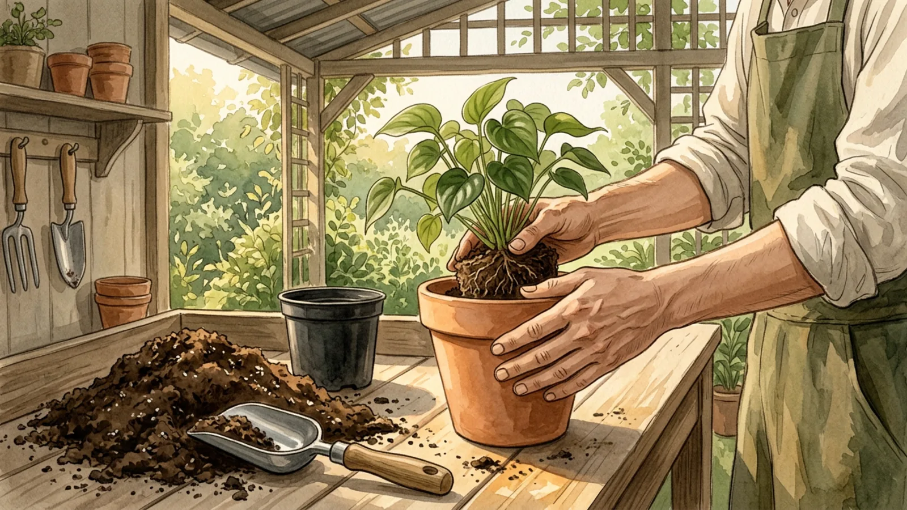

## Part 1 of 3 — Decide Whether to Repot

### Step 1 — Look for signs the plant needs space

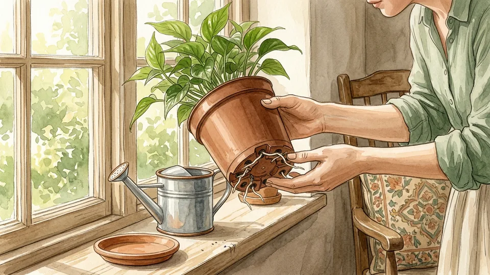

Check whether roots are circling densely, emerging from drainage holes, or pushing the plant out of its pot. A pot that tips repeatedly or mix that dries unusually quickly can also be a clue. No single sign proves the plant needs a larger pot; look at the roots and the plant's normal growth pattern together.

**Tip:** Some slow-growing plants need fresh mix more often than a larger container.

### Step 2 — Identify the plant and its needs

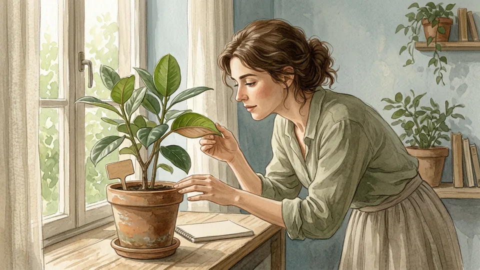

Find the plant's name and check whether it has special root, mix, or watering requirements. Common leafy houseplants, succulents, and orchids do not all use the same growing medium. If you cannot identify the plant, ask a local extension service or knowledgeable nursery before assuming a general repotting method will suit it.

**Tip:** Keep the plant label or a photo of it with your care notes.

### Step 3 — Pick a suitable time

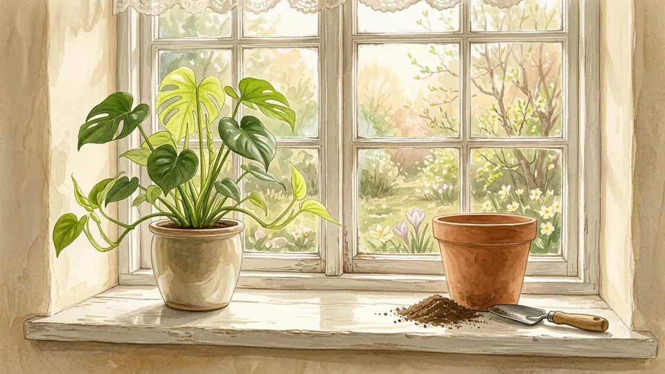

Many houseplants recover well when they are actively growing, though urgent drainage or container problems may need attention sooner. Avoid unnecessary repotting while a plant is severely stressed, unless its pot or root conditions are part of the problem. Follow species-specific advice and do not assume all plants follow the same seasonal calendar.

**Tip:** If the pot is damaged or water cannot drain, assess that problem rather than waiting for a perfect season.

### Step 4 — Prepare a clean work area

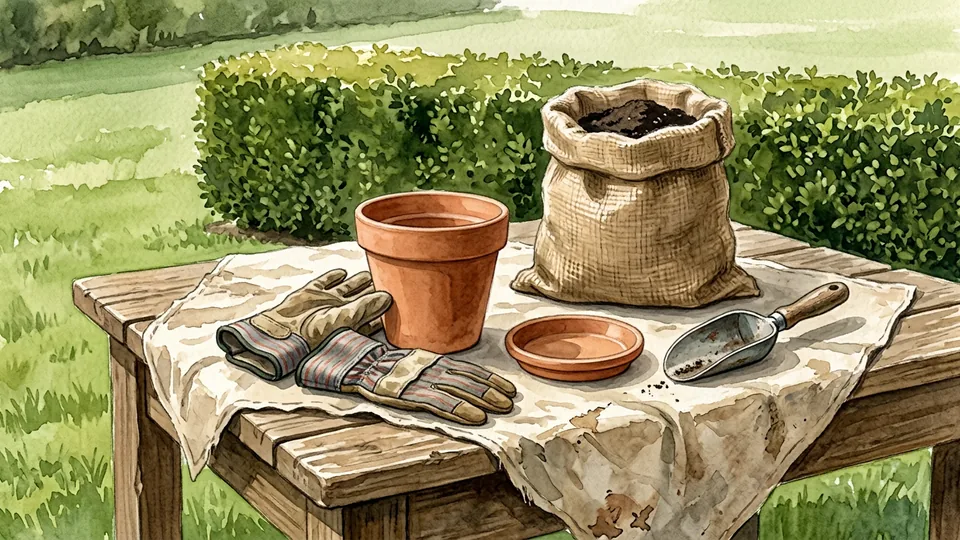

Cover a stable table or work outdoors where loose mix is easy to collect. Gather a clean pot, suitable fresh potting mix, a saucer, and a small scoop. Use gloves if you prefer, keep the work area away from food, and wash your hands afterwards. Keep potting materials and plants away from curious children and pets.

**Tip:** Place an old tray or sheet under the work area to catch spills.

### Step 5 — Choose a pot with drainage

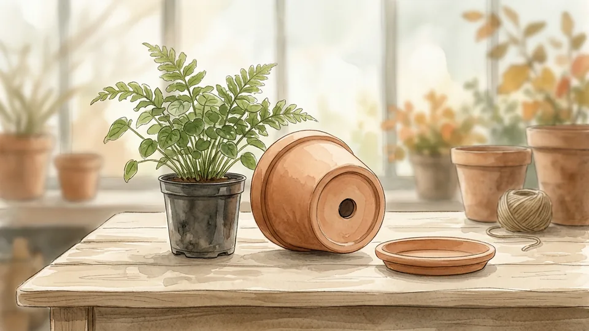

Select a container with an open drainage hole. If the plant needs more room, a pot roughly one to two inches wider than the current one is often a useful starting point; the right size depends on the species and root ball. A decorative pot without holes can hold a separate, draining nursery pot.

**Tip:** A much larger pot may hold more wet mix than a small root system can use.

## Part 2 of 3 — Move the Plant Carefully

### Step 6 — Select a mix for the species

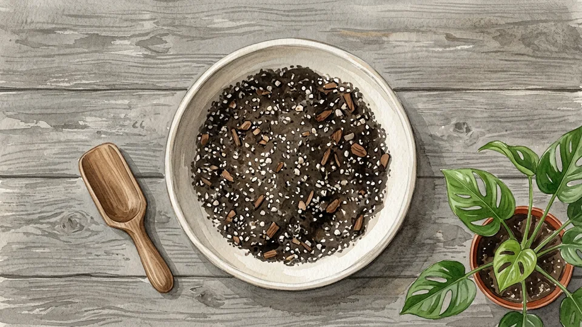

Choose a fresh, porous potting mix suited to your plant rather than using garden soil by default. Orchids and many succulents have different needs from common foliage plants, so follow a reliable plant-specific guide. Check whether the mix already contains fertilizer, and follow the package directions for handling and use.

**Tip:** Do not add a deep gravel layer to the bottom as a substitute for drainage holes.

### Step 7 — Check the moisture before moving

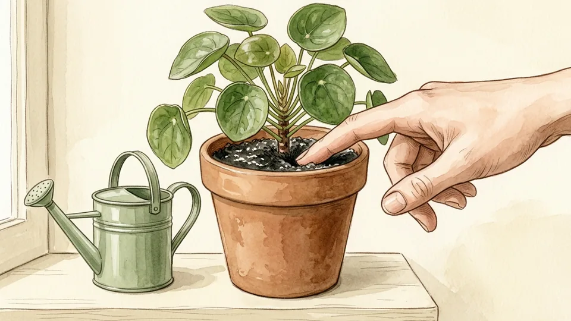

If the mix is very dry, water according to the plant's needs before repotting and allow excess water to drain. Slightly moist mix can be easier to handle than a dry, crumbling root ball. Do not soak a waterlogged plant just to follow a schedule; assess the existing moisture and any signs of root problems first.

**Tip:** A clean, stable root ball is easier to support while you remove the old pot.

### Step 8 — Release the plant from its old pot

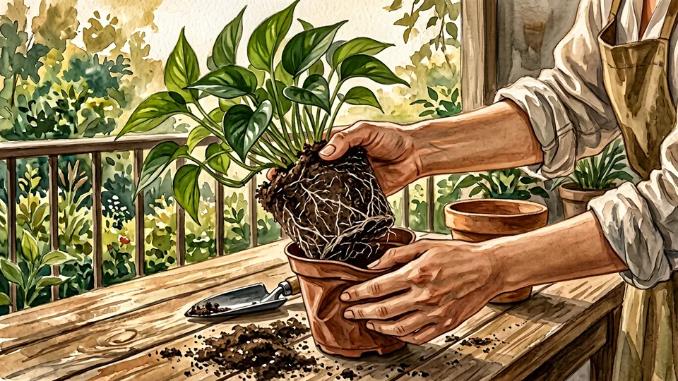

Support the plant near the soil line with one hand and gently tilt the container. Squeeze a flexible pot or tap its sides to loosen the root ball. Ease the pot away instead of pulling hard on the stems. If roots are attached to the container, work slowly and consider cutting a disposable plastic pot rather than tearing the plant.

**Tip:** Protect long leaves or stems with your free hand while turning the pot.

### Step 9 — Inspect the roots and old mix

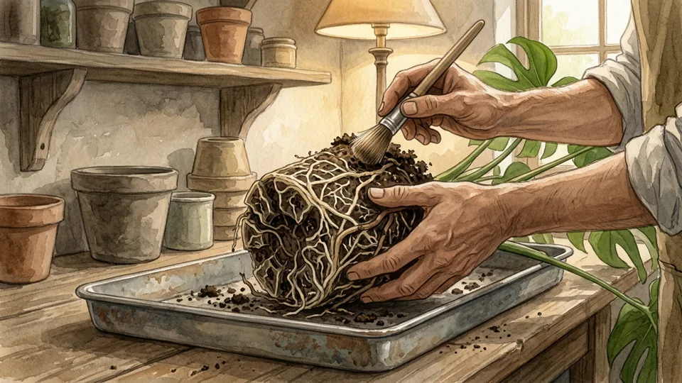

Look at the root ball before changing it. Healthy roots vary by species but are usually firm; soft, decayed roots or a sour smell can indicate a problem. Remove loose, degraded mix gently. If many roots appear damaged or you are unsure what you are seeing, ask an extension service or plant professional for advice.

**Tip:** Do not assume a brown root is dead based on color alone.

### Step 10 — Loosen crowded roots gently

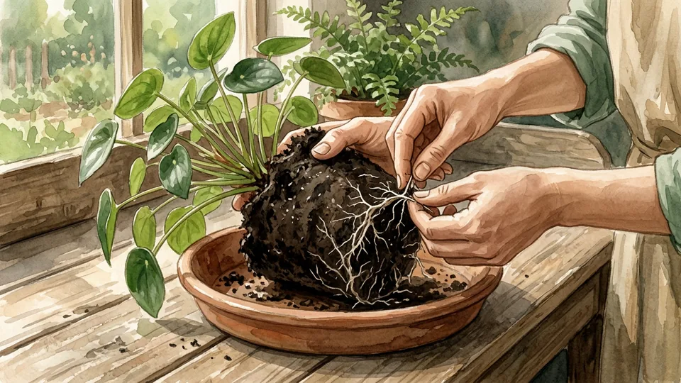

If roots form a tight circle around the outside, tease a few loose with clean fingers so they can extend into the new mix. Avoid pulling aggressively or removing healthy roots without a reason. Some plants are sensitive to disturbance, so use gentler handling or species-specific instructions if the root system is delicate.

**Tip:** Work on the outside of the root ball and keep as much healthy root tissue intact as possible.

## Part 3 of 3 — Settle the Plant In

### Step 11 — Place fresh mix in the base

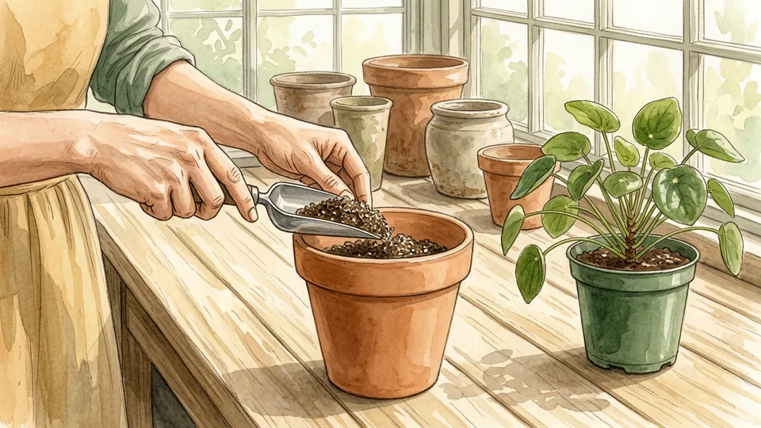

Add enough potting mix to the bottom of the new container so the plant will sit at about its previous soil depth, with space below the rim for watering. Test the height with the root ball in place, then add or remove mix as needed. Keep the drainage opening clear rather than filling the bottom with gravel.

**Tip:** A small piece of mesh can keep loose mix from falling through a large drainage hole.

### Step 12 — Center the plant at its former depth

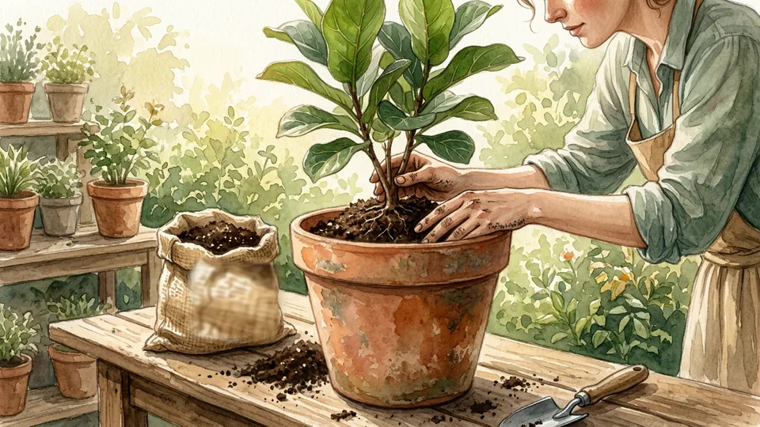

Set the root ball in the middle of the pot and check that the point where the stems meet the mix is not buried deeper than before. Adjust the base layer until the plant sits upright with room below the rim. Larger or top-heavy plants may need a sturdy container or suitable support.

**Tip:** Look at the plant from more than one side before filling around it.

### Step 13 — Fill around the root ball

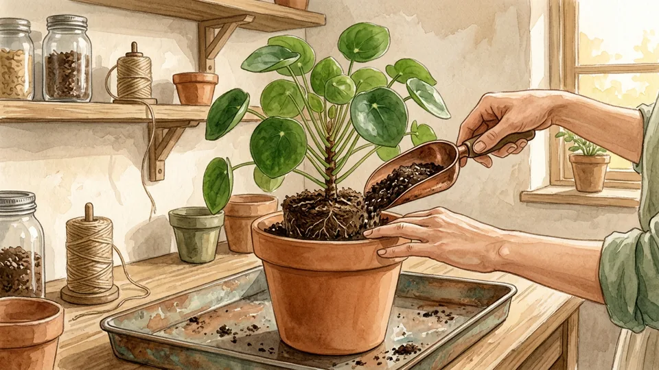

Add fresh mix around the sides in small amounts. Tap the pot lightly and use your fingers to settle the mix into gaps without packing it hard. Keep the original soil line visible and leave enough headroom to water without spilling over. Add support if needed without forcing a stake through the main root mass.

**Tip:** Firm enough to hold the plant upright while keeping the mix airy.

### Step 14 — Water and let the pot drain

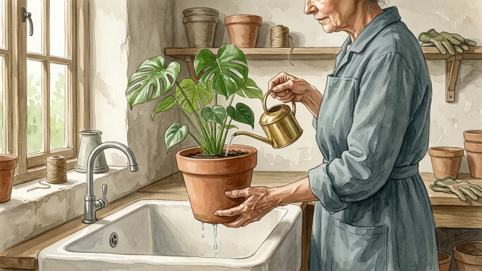

For many common foliage plants, water after repotting until excess drains, then empty the saucer. Follow a different schedule if the species or root condition requires it; some succulents need specific handling. Do not leave the container standing in drainage water. Check the new mix over the following days rather than watering automatically.

**Tip:** Place the pot in a sink or tray while the excess water drains.

### Step 15 — Return it to suitable light and observe

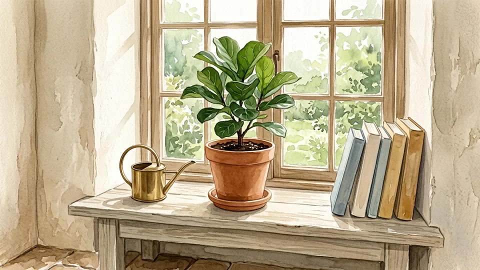

Place the plant in light appropriate for its species, avoiding an abrupt move into harsh direct sun. For the next few weeks, check the mix, leaves, and drainage before making further changes. Brief adjustment can occur, but persistent wilting may have several causes. Hold off on extra fertilizer unless reliable care instructions and the mix label indicate it is needed.

**Tip:** Record the repotting date so you can track how the plant settles in.

## Tips

- Inspect roots before buying a larger pot.
- Choose a pot and mix suited to the species.
- Keep the drainage hole open and empty collected water.
- Make one change at a time so you can see how the plant responds.

## Warnings

- Keep potting mix and plant parts away from children and pets; some plants can be toxic if eaten.
- Wear gloves if appropriate and wash hands after handling potting mix.
- Do not add gravel to compensate for a pot without drainage.
- Specialist plants, damaged roots, and serious pest problems may need species-specific or professional advice.

## Community Q&A

**How often should I repot a houseplant?**

There is no universal schedule. Look for crowded roots, poor drainage, degraded mix, or a pot that no longer supports the plant. Growth rate and species matter; a slow-growing plant may need fresh mix without a larger container.

**How much bigger should the new pot be?**

For many common houseplants, a pot one to two inches wider is a reasonable starting point if the roots need more space. Match the size to the root ball and species, and choose a container with drainage. A very large pot can retain too much wet mix.

**Can I use a decorative pot without a hole?**

Yes, as an outer cover for a separate nursery pot with drainage. Remove the inner pot to water and allow it to drain, then empty any collected water before returning it to the cover.

**Should I trim the roots?**

Gently loosen crowded outer roots when appropriate, but avoid cutting healthy roots without a reason. Species differ, and extensive root damage needs careful assessment. Seek reliable species-specific advice if you are unsure.

**Should I fertilize immediately?**

Check the species and the potting-mix label. Many mixes already contain nutrients, and newly disturbed roots may not need extra fertilizer immediately. Resume a suitable feeding routine when appropriate rather than adding fertilizer automatically.

## Useful external resources

- [University of Maryland: Potting and Repotting Indoor Plants](https://extension.umd.edu/resource/potting-and-repotting-indoor-plants/) — Repotting steps, containers, and different mixes.
- [University of Minnesota: Winter Houseplant Tips](https://extension.umn.edu/about/our-stories/news/winter-houseplant-tips) — Signs of a crowded pot and drainage advice.
- [University of Maryland: Watering Indoor Plants](https://extension.umd.edu/resource/watering-indoor-plants/) — How to check the mix and drain excess water.

## References

1. University of Maryland Extension. Potting and Repotting Indoor Plants. Updated March 10, 2023. https://extension.umd.edu/resource/potting-and-repotting-indoor-plants/
2. University of Minnesota Extension. Winter Houseplant Tips. February 2, 2026. https://extension.umn.edu/about/our-stories/news/winter-houseplant-tips
3. University of Maryland Extension. Watering Indoor Plants. Updated March 10, 2023. https://extension.umd.edu/resource/watering-indoor-plants/

## Internal links

- [How to Care for a Houseplant](https://www.56juqingba.com/Care-for-a-Houseplant)
- [More Home and Garden guides](https://www.56juqingba.com/Category/Home-and-Garden)
- [How to Start a Nature Journal](https://www.56juqingba.com/Start-a-Nature-Journal)
