# How to Run Your First 5K

*Prepare for your first 5K with a flexible run-walk routine, comfortable equipment, recovery time, and a race-day plan that puts finishing safely ahead of pace.*

**Category:** Sports and Fitness

**Slug:** `/Run-Your-First-5K`

**Primary keyword:** how to run your first 5k

**Meta description:** Train for your first 5K with a flexible run-walk routine, practical safety tips, beginner-friendly gear, and race-day preparation.

---

## Intro

A first 5K is 5 kilometres, or about 3.1 miles. You can complete one by running, walking, or combining both if the event allows it. Start from your own ability, build gradually, and leave room for recovery. These 15 steps cover training, practical safety, and the final preparations without promising a fixed finish time.

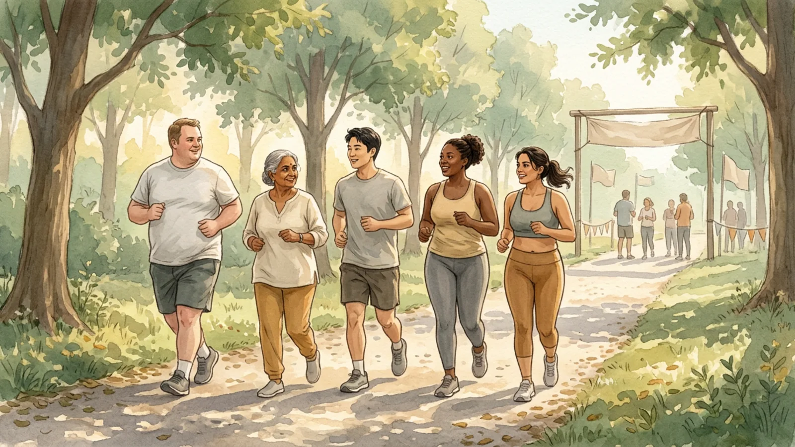

## Part 1 of 3 — Choose a Starting Point

### Step 1 — Set a flexible finishing goal

Decide what a successful first event means to you. It might be reaching the finish comfortably, completing the distance with planned walking breaks, or simply establishing a regular activity routine. You do not need a target pace. Allow extra time in your schedule if you are new to running, returning after a break, or need to repeat a training week.

**Tip:** A goal you can adjust is more useful than a deadline that makes you ignore warning signs.

### Step 2 — Choose a welcoming event or route

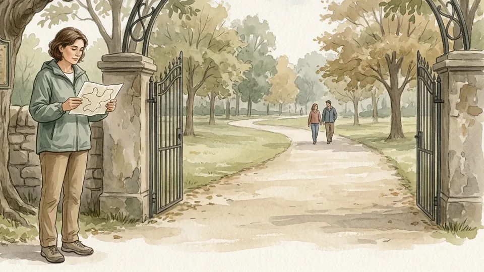

Look for a local 5K with a course and start time that fit your needs. Check whether walkers are welcome, whether there is a time limit, and what accessibility support is available. If you prefer a solo goal, measure a safe route of about 5 kilometres and invite someone to join you. Postpone if conditions or your health make the day unsuitable.

**Tip:** A walk-friendly event lets you use the same run-walk approach you practised in training.

### Step 3 — Notice how walking feels first

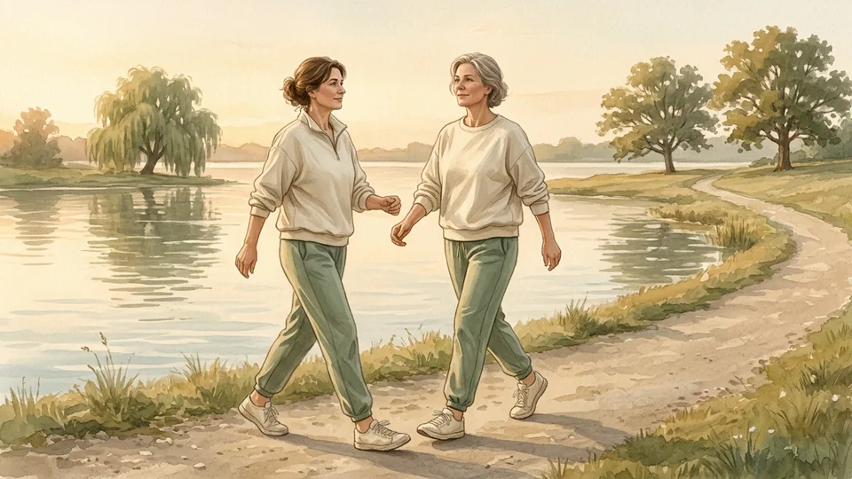

Before adding running, begin with walks at a comfortable pace and pay attention to how you feel during and afterwards. If you are not used to activity, build walking time gradually rather than forcing a particular distance. Ask a health professional for advice if you have a health condition, a recent injury, symptoms during activity, or are unsure how to start safely.

**Tip:** You can begin with a short walk and add time as it becomes comfortable.

### Step 4 — Choose comfortable shoes and suitable surfaces

Choose running shoes that fit comfortably without pinching or slipping, and try them with the socks you plan to wear. You do not need an expensive pair to begin. Check your route and the shoe's tread for the conditions; a good grip can help on some surfaces, but no shoe makes ice or an uneven path risk-free.

**Tip:** If shoes cause persistent rubbing, adjust the fit or ask a knowledgeable retailer for help.

### Step 5 — Place training sessions in your week

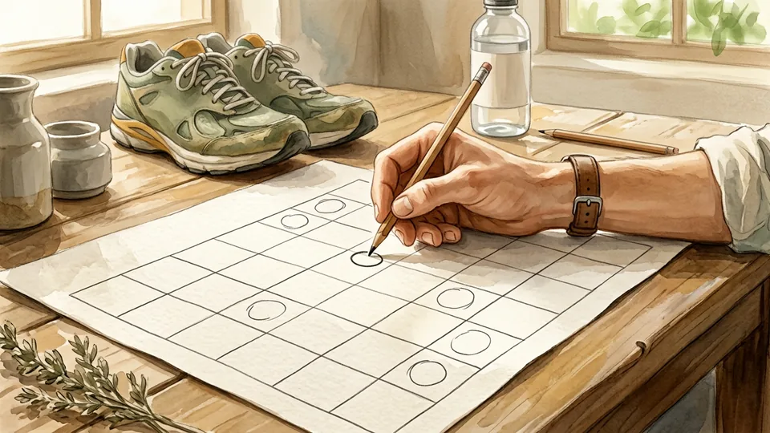

Choose realistic days and times, allowing a recovery day between running sessions. A beginner plan such as the NHS Couch to 5K uses three runs each week, but you can take longer or adapt the schedule to your circumstances. Include travel, work, and family commitments so the plan does not depend on a perfect week.

**Tip:** Write down a shorter backup session or a rest day for weeks when your normal plan is impractical.

## Part 2 of 3 — Build a Comfortable Routine

### Step 6 — Warm up before each run

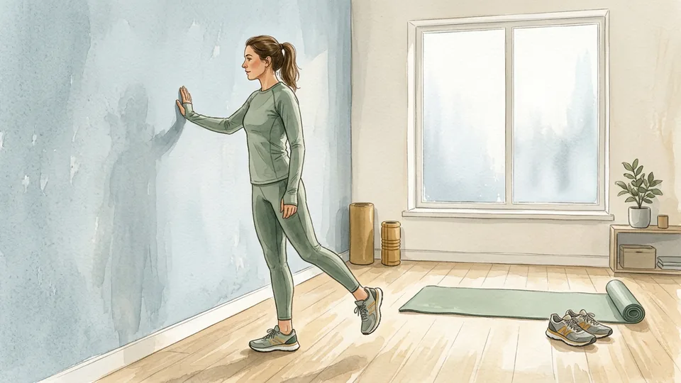

Start with gentle movement, then walk at an easy pace for about five minutes before the running portion. You can include comfortable mobility movements if they suit you. The aim is to ease into activity, not tire yourself out. If you follow a clinician's individual advice or an established plan, use the warm-up appropriate for you.

**Tip:** Keep the first few minutes easy enough that you could hold a conversation.

### Step 7 — Alternate easy running and walking

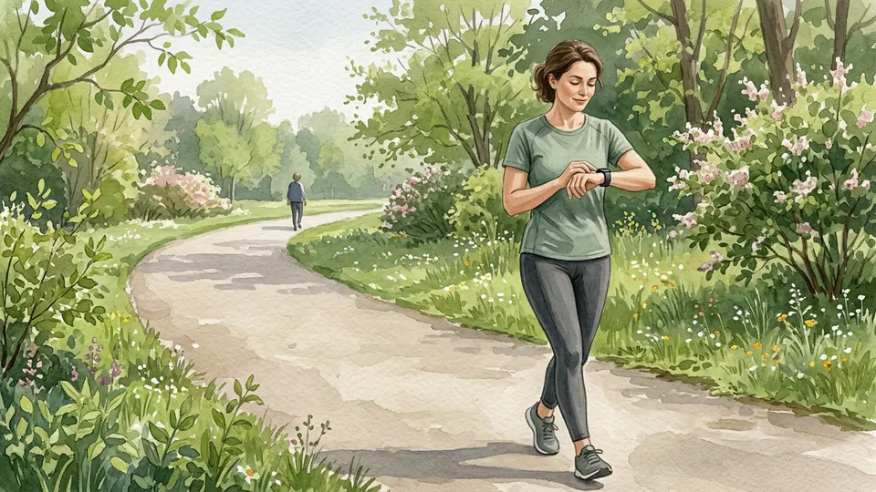

After warming up, try a few short intervals of easy running separated by walking breaks. For example, alternate one minute of running with a longer walk, then finish with an easy walk. Adjust the intervals to your ability; an example is not a test you must pass. The linked NHS plan offers a structured, progressive option.

**Tip:** Set a gentle timer so you can pay attention to the route instead of repeatedly checking the clock.

### Step 8 — Keep the effort conversational

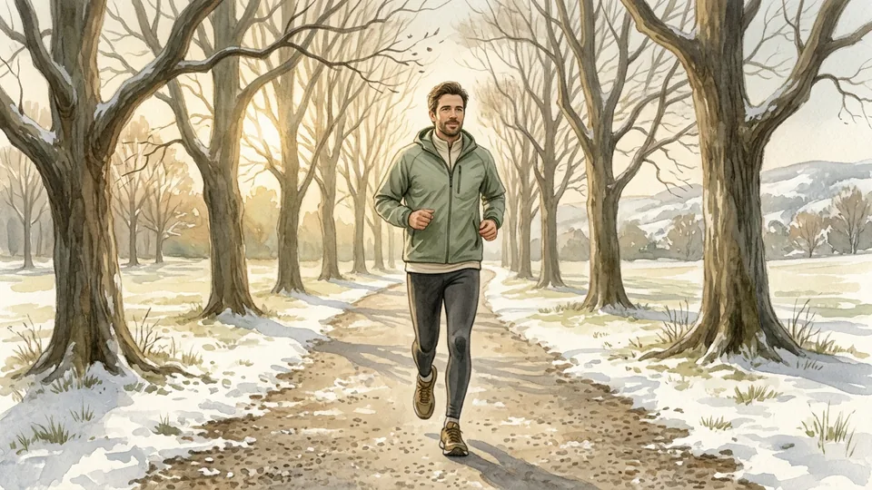

Slow down enough to speak in phrases or sentences while you move. If you cannot talk comfortably, walk until your breathing settles and resume more gently if you feel well. The CDC describes the talk test as one way to gauge relative intensity; running speed alone does not tell you how hard an effort feels for your body.

**Tip:** Walking is a planned part of the session, not a sign that the session has failed.

### Step 9 — Increase training gradually

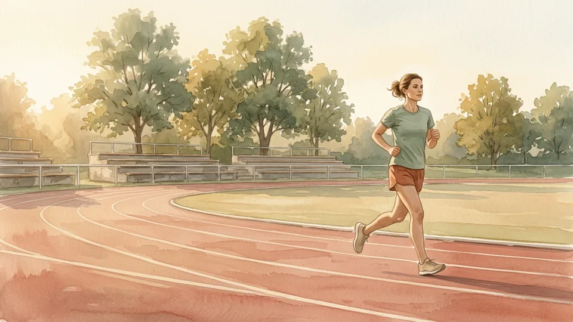

When your current sessions feel manageable, gradually lengthen some running intervals or total activity time. Change only as much as you can recover from, and repeat a week when needed. The NHS nine-week schedule is one example, not a guarantee that everyone will reach 5 kilometres in that time. Avoid adding speed work simply to catch up.

**Tip:** Judge progress over several weeks rather than by one unusually difficult day.

### Step 10 — Protect time for recovery

Leave at least one day between runs in a beginner schedule. A recovery day can mean rest or gentle activity that feels comfortable, such as an easy walk. Sleep and ordinary meals also support your routine. If tiredness accumulates, reduce the next session or take another rest day instead of treating the calendar as an obligation.

**Tip:** Keep recovery days in the plan from the start rather than adding them only after you feel exhausted.

### Step 11 — Respond to pain or unusual symptoms

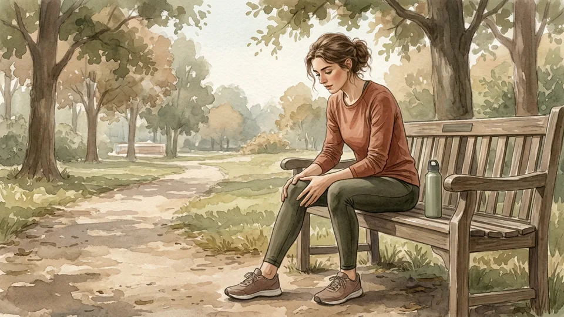

Stop a session if you develop pain, dizziness, unusual breathlessness, or another symptom that feels wrong. Do not use a fixed number of days to decide whether pain is harmless; ask a clinician if it persists, worsens, or changes how you walk. Chest pain, fainting, or severe trouble breathing warrants emergency help rather than another training attempt.

**Tip:** A missed session is easier to replace than time lost by continuing through a warning sign.

## Part 3 of 3 — Prepare for the Day

### Step 12 — Choose routes where you can see and be seen

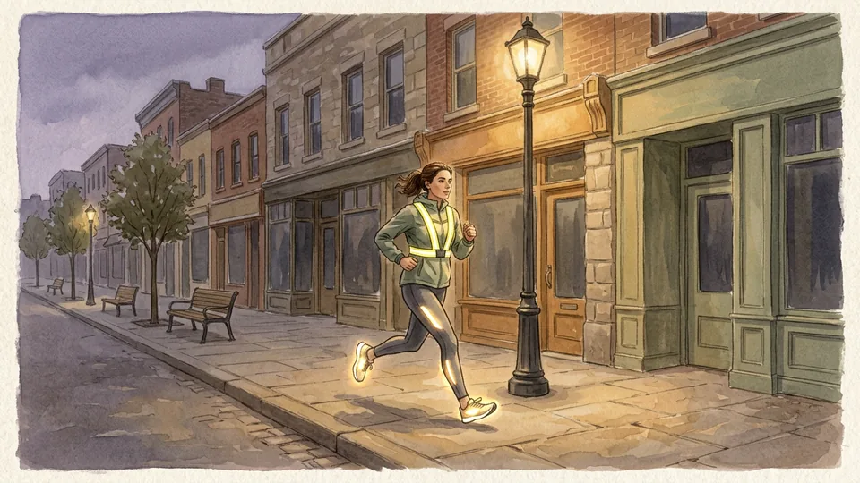

Practise on a familiar, well-maintained route with a way to shorten the session. Watch for traffic, cyclists, poor footing, and changing weather. If you run in low light, choose a lit route, wear reflective items, and use a light when needed. Let someone know your route and expected return time, especially when running alone.

**Tip:** If visibility or footing is unsafe, choose an indoor alternative or rest.

### Step 13 — Check the course and event details

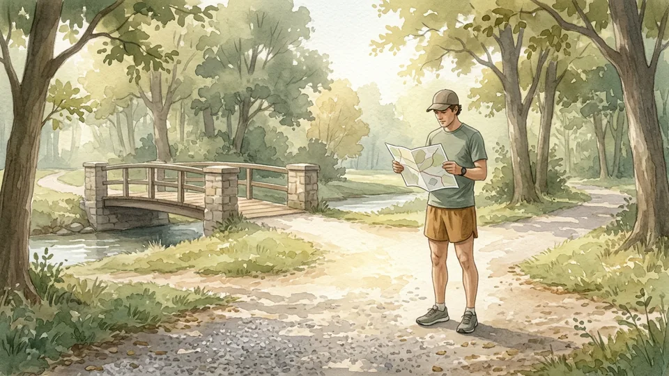

Before race day, look at the start location, route, toilets, water stations, transport, and any bag or accessibility arrangements. Practise a portion of the route if practical, or try a similar surface and start time. Check the organiser's current instructions and weather forecast. Give yourself enough time to arrive without rushing.

**Tip:** Save the organiser's information offline or make a short note in case reception is poor.

### Step 14 — Plan familiar food and fluids

Use the food and drink routine that has worked during your training rather than experimenting on race morning. Have water available and adjust to your needs and conditions; do not force large amounts of fluid. A light familiar snack may be useful if you normally eat before activity. Follow personal medical advice if you have a condition affecting nutrition or fluids.

**Tip:** Pack what you need the night before, including any prescribed medication you are directed to carry.

### Step 15 — Start easily and cool down afterwards

At the start, resist matching faster runners; use the easy effort and walking breaks you practised. After finishing, walk gently for several minutes, drink as needed, and change out of damp clothing when practical. If you feel unwell, tell an event volunteer or seek appropriate help. Celebrate the effort without treating a particular finish time as proof of success.

**Tip:** Arrange a warm, dry layer for after the finish when the weather calls for it.

## Tips

- A 5K is about 3.1 miles; walking breaks are fine when the event permits them.
- Repeat a comfortable training week when life, recovery, or your starting point calls for it.
- Check the weather and event information again close to the day.
- Use a training log to notice patterns in effort and recovery, not to judge every session.

## Warnings

- Ask a health professional about a suitable plan if you have a heart or lung condition, a recent injury, symptoms during activity, or other concerns about exercising.
- Stop and call local emergency services for chest pain, fainting, or severe difficulty breathing; do not try to finish the event first.
- Stop if pain or unusual symptoms develop. Seek medical advice if they persist, worsen, or affect your normal movement.
- Avoid unsafe roads, ice, severe weather, and poor visibility. Reflective clothing and lights help but do not make a hazardous route safe.

## Community Q&A

**How long does it take to prepare for a first 5K?**

It depends on your starting point, health, schedule, and whether you plan to walk or run. The NHS Couch to 5K is a nine-week example, but some people need more time or choose to repeat weeks. Finishing 30 minutes of running is not the same as completing 5 kilometres for every runner.

**Is it okay to walk during a 5K?**

Yes, if your chosen event welcomes walkers and its time limit works for you. Planned walking intervals can make the effort more manageable. Check the event rules before registering and practise your chosen run-walk rhythm on a safe route.

**How fast should a beginner run?**

There is no required beginner pace. Choose an effort at which you can talk, and use walking breaks whenever needed. If you have symptoms or a health condition that affects exercise, follow advice from your health professional instead of relying on a general pace target.

**What if I miss a week of training?**

Do not try to squeeze every missed session into the next week. Resume at an easier level that feels manageable, repeat a previous week, or move the event goal if needed. After illness, injury, or ongoing symptoms, ask a health professional about returning.

**Do I need special food for a short race?**

Many people can use familiar everyday food and water. Try your routine during training, keep water available, and account for your individual needs and weather. A clinician or registered dietitian can advise you if you have a medical condition or specific nutrition needs.

## Useful external resources

- [NHS Couch to 5K running plan](https://www.nhs.uk/better-health/get-active/get-running-with-couch-to-5k/couch-to-5k-running-plan/) — A structured beginner run-walk schedule with warm-ups and recovery days.
- [CDC: How to Measure Physical Activity Intensity](https://www.cdc.gov/physical-activity-basics/measuring/index.html) — An explanation of the talk test and relative activity intensity.
- [American Heart Association: Develop a Physical Activity Plan for You](https://www.heart.org/en/health-topics/cardiac-rehab/getting-physically-active/develop-a-physical-activity-plan-for-you) — Guidance on warm-ups, recovery, and warning signs, including for people in cardiac rehabilitation.

## References

1. National Health Service. Couch to 5K running plan. Accessed October 29, 2026. https://www.nhs.uk/better-health/get-active/get-running-with-couch-to-5k/couch-to-5k-running-plan/
2. Centers for Disease Control and Prevention. How to Measure Physical Activity Intensity. Updated December 4, 2025. https://www.cdc.gov/physical-activity-basics/measuring/index.html
3. American Heart Association. Develop a Physical Activity Plan for You. Reviewed April 24, 2024. https://www.heart.org/en/health-topics/cardiac-rehab/getting-physically-active/develop-a-physical-activity-plan-for-you
4. National Health Service. Get Running with Couch to 5K. Accessed October 29, 2026. https://www.nhs.uk/better-health/get-active/get-running-with-couch-to-5k/

## Internal links

- [How to Start Running When You Hate Running](https://www.56juqingba.com/Start-Running-When-You-Hate-Running)
- [How to Keep Running Through Winter](https://www.56juqingba.com/Keep-Running-Through-Winter)
- [More Sports and Fitness guides](https://www.56juqingba.com/Category/Sports-and-Fitness)
- [How to Build a Home First-Aid Kit](https://www.56juqingba.com/Build-a-Home-First-Aid-Kit)
