# How to Set a Personal Boundary

*Work out exactly which behaviour is costing you, say it in one plain sentence, name the thing you will do about it, and then hold the line the first time it is tested.*

**Category:** Relationships

**Slug:** `/Set-a-Personal-Boundary`

**Primary keyword:** set a personal boundary

**Meta description:** Set a personal boundary that holds: find the resentment, write a one-sentence script, say no without over-explaining, handle pushback, then follow through.

---

## Intro

A boundary is not a demand that somebody change. It is a clear statement of what you will and will not do, which is the only part of the arrangement you actually control. Most people already know where their boundaries are missing, because the place is marked by resentment: the Mayo Clinic lists resentment, seething anger and self-doubt among the costs of habitually saying yes when you mean no. The good news is that assertiveness is a learnable skill rather than a personality type, and the mechanics are surprisingly specific — a sentence structure, a short script, two techniques for handling pushback, and a plan for the moment the boundary is tested. These fifteen steps take one boundary from the first flicker of resentment through to reviewing it a month later.

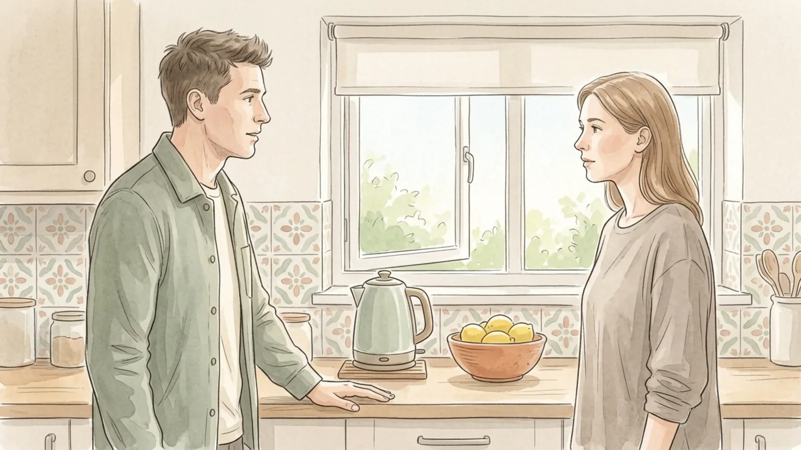

## Part 1 of 3 — Work Out What the Boundary Is

### Step 1 — Follow the resentment to the missing line

Resentment is the reliable signal. Notice which invitations you dread, which messages you leave unopened, and whose name on the screen makes your shoulders rise. Those reactions mark a place where you have been saying yes while meaning no. Write down the three situations that produce the most of it. The strongest one is the boundary to work on first.

**Tip:** Keep the first boundary small and low risk. Practising on a minor situation builds the skill for a harder one later.

### Step 2 — Pin down the exact behaviour

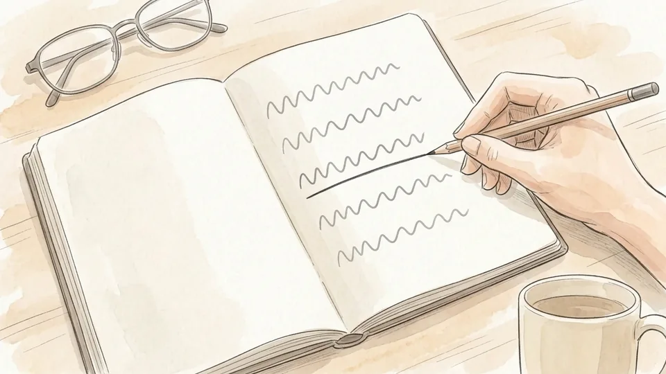

Boundaries fail when they are vague. Not she is inconsiderate, but she arrives forty minutes late and I start the meeting twice. Describe the behaviour, when it happens and how often, as though you were reporting facts rather than passing judgement. This is also the version you can say out loud without the conversation becoming an argument about character.

**Tip:** If your sentence contains always, never or typical, rewrite it with a date and a number instead.

### Step 3 — Sort it into yes, no and maybe

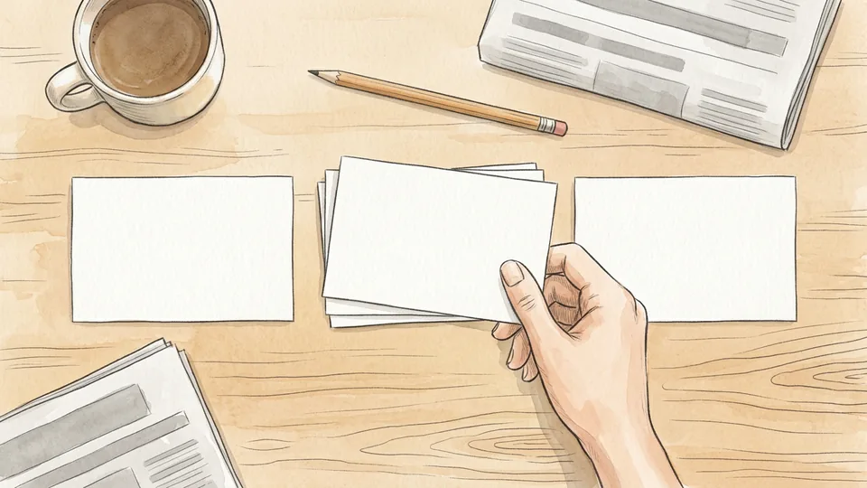

Before you decide what to say, decide what you actually want. Yes is what you can do without resentment and will deliver. No covers the things that cost too much or cut across something you care about. Maybe depends on detail, which means asking for the detail: which day, how long, who else is going. Specific beats vague in all three.

**Tip:** I can help for an hour on Saturday morning is a better answer than a reluctant yes that you will quietly resent all week.

### Step 4 — Write the sentence before you need it

Counselling services teach a simple structure: when you do this, I feel that, and the effect is this, so I would prefer that. For example: when you drop in without calling, I feel caught out, because I am usually working, so I would prefer a message first. Write it, read it aloud, and cut it until it fits in two breaths.

**Tip:** Use I statements throughout. I disagree lands very differently from you are wrong, even when the content is identical.

### Step 5 — Decide what you will do, not what they must do

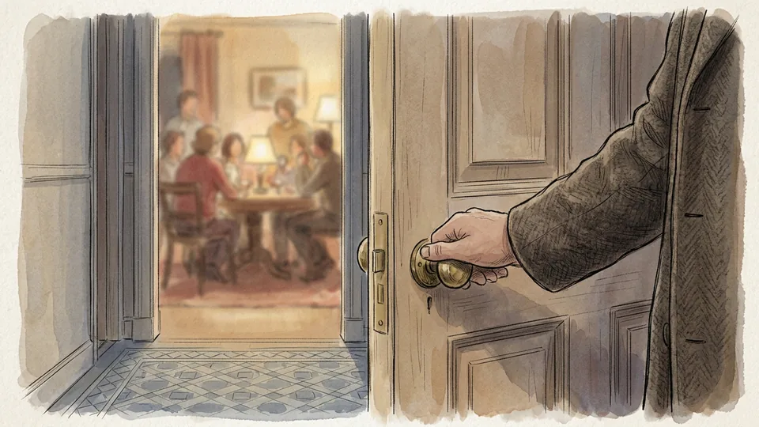

This is the step that turns a request into a boundary. A request asks for different behaviour; a boundary states the action you will take if it continues. If the shouting carries on, I am going to end the call. If the invoice is late again, I will stop holding the slot. Choose something proportionate that you are genuinely willing to do, because you will have to do it.

**Tip:** Never name a consequence you would not carry out. One empty threat teaches everyone that the boundary is decorative.

## Part 2 of 3 — Say It Once, Clearly

### Step 6 — Choose a time that is not the middle of the problem

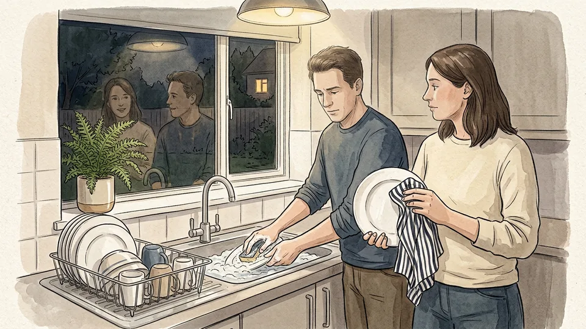

Raising a boundary during the incident guarantees defensiveness. Pick a time and place that suits both of you, when neither is rushing, drinking or already annoyed, and say at the start that you want to sort something out rather than have a row. Flat moments are the best moments: a walk, a drive, the washing up after everyone has gone.

**Tip:** Avoid doing it by message if you can. Short written boundaries read as colder than they sound out loud.

### Step 7 — Lead with the request, not the history

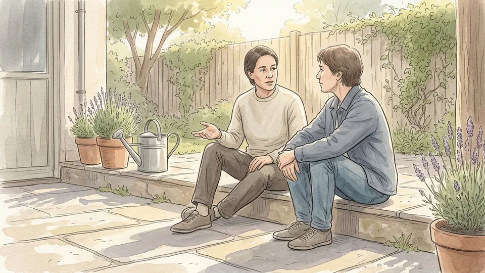

Start with the sentence you wrote, then stop. The temptation is to justify it with a catalogue of previous incidents, which invites a debate about whether each one really happened. One example is enough, and only if you need it. The point of the conversation is the arrangement going forward, not a verdict on the past.

**Tip:** If the other person disputes the history, say that you may remember it differently and return to the request.

### Step 8 — Say no without the paragraph

No is a complete sentence. If a reason helps, keep it to one, because every extra reason is another door for negotiation: I cannot take that on this month is finished, while I am just so busy with everything at the moment invites a discussion of your schedule. Decline the request, not the person, and do not apologise three times for it.

**Tip:** Buy time rather than blurting a yes. Let me check and come back to you today is a complete, honest answer.

### Step 9 — Let your body say the same thing as your mouth

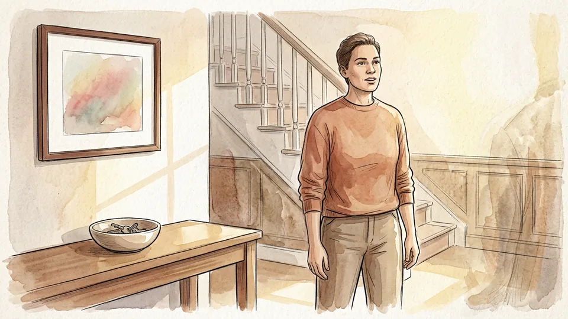

Delivery carries the message. Stand or sit upright, face the person, keep steady eye contact without staring, and let your voice stay level and a little slower than usual. Uncross your arms. A firm sentence delivered with an apologetic laugh and a backwards step reads as an opening offer rather than a limit.

**Tip:** Rehearse it once aloud, or with a friend. Hearing your own voice say the words removes most of the wobble.

### Step 10 — Say the consequence plainly, once

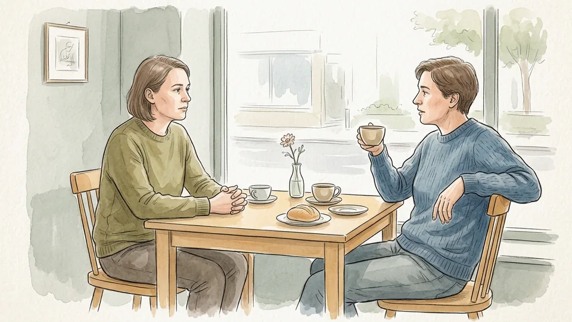

Add the part you decided in advance, without drama: if it happens again, I will leave early. Say it in the same level tone as the rest, then let it sit. Delivered calmly, it is information rather than a threat, and most people hear it as seriousness rather than hostility. Repeating or embellishing it is what makes it sound like a threat.

**Tip:** Do not bargain with yourself out loud. Stating the consequence and then immediately softening it undoes the whole sentence.

## Part 3 of 3 — Hold It When It Is Tested

### Step 11 — Use the broken record

When the pushback starts, choose one concise sentence and repeat it calmly, acknowledging what they said and returning to your line: I hear that it is awkward, and I am still not able to do it. Each repetition should get shorter, not longer. The aim is not to win the argument but to outlast the pressure without introducing new material to attack.

**Tip:** Adding a fresh justification on the third repetition is how most boundaries collapse. Keep the words the same.

### Step 12 — Fog the criticism and defuse the heat

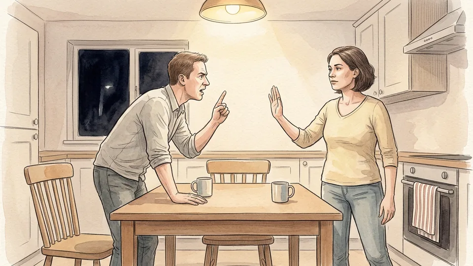

Two counselling techniques handle the usual counter-moves. Fogging agrees with the grain of truth and ignores the rest: that may be true, and I still need the evenings free. Defusing postpones a conversation that has become heated: I can see you are angry, let us talk this afternoon. Both let you concede nothing while lowering the temperature.

**Tip:** Jokes that trivialise the request are a form of pushback too. Smile, then repeat the sentence anyway.

### Step 13 — Follow through the first time

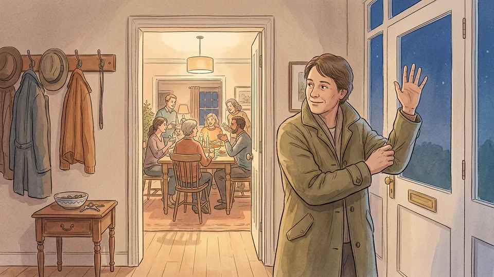

The first test decides whether the boundary exists. If you said you would leave at ten, pick up your coat at ten, pleasantly and without a speech. If you said you would end the call, end it. Doing the thing once, calmly, is worth more than a dozen repetitions of the sentence, and it is almost always less dramatic than you fear.

**Tip:** Follow through without punishing. Leave warmly, and get in touch the next day as normal.

### Step 14 — Expect the wobble, in them and in you

There is usually a bad fortnight. People who benefited from the old arrangement may sulk, test, or tell you that you have changed. Guilt tends to arrive in the quiet afterwards rather than during the conversation. Both pass. Most relationships absorb a clearly stated boundary and settle, and the ones that cannot were already running on your silence.

**Tip:** Tell one person what you have decided. Saying it out loud to a friend makes it much harder to quietly abandon.

### Step 15 — Review it a month later

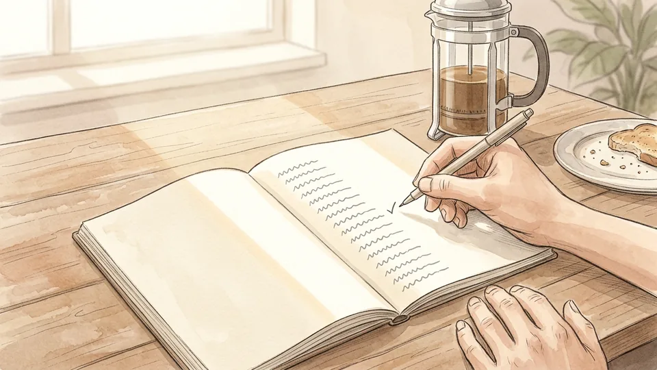

Boundaries are arrangements, not rulings, and they can be loosened as easily as they were set. After a few weeks, check what changed: is the resentment gone, did the behaviour shift, is the limit still the right one. Adjust it deliberately rather than letting it erode. Then, if it is holding, choose the next situation on your list and do it again.

**Tip:** Changing your mind on purpose is not caving. Caving is changing it in the middle of being pressed.

## Tips

- Boundaries are easier to keep when they are general rather than personal: no work email after seven applies to everyone and needs no new decision each time.
- Money and time are the two most commonly breached boundaries. Decide your limit on lending and on unpaid favours before anyone asks.
- You can set a boundary warmly. Warmth in the delivery and firmness in the content are not in competition.
- If you find every boundary impossible to state, the problem is usually practice rather than courage. Start with a stranger, a shop, or a cold caller.

## Warnings

- This guide assumes a relationship where both people are broadly safe to talk to. Where there is coercive control, intimidation or violence, stating a boundary can increase risk; contact a domestic abuse service and plan with them before changing anything.
- At work, boundaries interact with contracts and duties. For workload, hours or harassment, raise it with a manager, HR, a union representative or an employee assistance programme rather than relying on a private arrangement.
- Persistent guilt, dread or self-blame around saying no may point to something a guide cannot resolve. Assertiveness training and talking therapies both have evidence behind them, and a general practitioner can point you to either.

## Community Q&A

**What is the difference between a boundary and an ultimatum?**

A boundary describes what you will do; an ultimatum demands what the other person must do. If the shouting continues I will end the call is a boundary, because you control both the trigger and the response. Stop shouting or else is an ultimatum, and it invites a power struggle. The practical test is simple: if keeping your side of it depends entirely on the other person complying, it is not a boundary.

**How do I set a boundary without feeling guilty?**

Expect the guilt rather than trying to prevent it; it is usually strongest just after the conversation and fades as the relationship survives it. Keep your statement short, because long justifications create the feeling that you owe a defence. It also helps to remember what the alternative costs: habitually saying yes when you mean no is linked to stress, resentment and simmering anger, which damage relationships more slowly but more thoroughly.

**What should I do if someone keeps crossing the line?**

Repeat the boundary once in the same words, then move from saying to doing. Carry out the action you named, calmly and without a lecture, and do it every time rather than occasionally. If the behaviour continues after you have been consistent for a while, the question changes from how to phrase it to how much access that person should have to your time. Reducing contact is itself a boundary.

**Can you set boundaries with your parents or your boss?**

Yes, though the wording matters more where there is a power difference or a long history. With parents, be concrete about the specific behaviour and keep the first boundary small. At work, frame it around priorities and delivery rather than preference: taking that on means the report slips to Friday, which do you want. Where the issue is workload, hours or conduct, put it through the proper channel as well.

## Useful external resources

- [Mayo Clinic: Being assertive — reduce stress, communicate better](https://www.mayoclinic.org/healthy-lifestyle/stress-management/in-depth/assertive/art-20044644) — The differences between passive, aggressive, passive-aggressive and assertive styles, plus practical tips including I statements and saying no.
- [Mary Immaculate College Student Counselling Service: Assertiveness self-help sheet](https://www.mic.ul.ie/sites/default/files/uploads/21/4assertiveness.pdf) — The when you / I feel / I would prefer script, and the broken record, fogging and defusing techniques for handling pushback.
- [Michigan State University Extension: When boundaries are crossed](https://www.canr.msu.edu/news/when_boundaries_are_crossed) — A three-question method — what is the issue, how do I feel, what do I want — with worked example sentences.

## References

1. Mayo Clinic Staff. Being assertive: Reduce stress, communicate better. Mayo Clinic, 20 January 2024. https://www.mayoclinic.org/healthy-lifestyle/stress-management/in-depth/assertive/art-20044644
2. Mary Immaculate College Student Counselling Service. Self Help Sheet: Assertiveness. https://www.mic.ul.ie/sites/default/files/uploads/21/4assertiveness.pdf
3. Bottomley L. When boundaries are crossed. Michigan State University Extension, 29 July 2016. https://www.canr.msu.edu/news/when_boundaries_are_crossed
4. Pluut H, Wonders J. Not Able to Lead a Healthy Life When You Need It the Most: Dual Role of Lifestyle Behaviours in the Association of Blurred Work-Life Boundaries With Well-Being. Frontiers in Psychology, 2020;11:607294. https://doi.org/10.3389/fpsyg.2020.607294

## Internal links

- [How to Have a Difficult Conversation](https://www.56juqingba.com/Have-a-Difficult-Conversation)
- [How to Split Household Chores Fairly](https://www.56juqingba.com/Split-Household-Chores-Fairly)
- [How to Prepare for a Performance Review](https://www.56juqingba.com/Prepare-for-a-Performance-Review)
- [How to Build a Monthly Budget](https://www.56juqingba.com/Build-a-Monthly-Budget)
