# How to Start a Reflective Journal

*Set the thing up so you will actually use it, write to a simple structure instead of staring at a blank page, and reread it often enough that the writing changes something.*

**Category:** Philosophy and Religion

**Slug:** `/Start-a-Reflective-Journal`

**Primary keyword:** start a reflective journal

**Meta description:** Start a reflective journal: choose a format you will keep, write with what-so-what-now-what, borrow Stoic habits, reread monthly, and avoid rumination.

---

## Intro

A reflective journal is not a diary of events and it is not a mood dump. It is a short, deliberate piece of writing that turns something that happened into something you understand and can act on. The structures are old. Marcus Aurelius wrote his Meditations to and for himself, as reminders of the Stoic principles he wanted ready to hand, and his teacher-by-text Epictetus advised writing down daily the responses one ought to have when circumstances demand them. Modern reflective practice formalises the same move: the University of Edinburgh's Reflection Toolkit offers half a dozen frameworks, the simplest being Driscoll's three questions — what, so what, now what. These fifteen steps cover setting up a journal you will keep, writing entries that go somewhere, and knowing the difference between reflection and rumination.

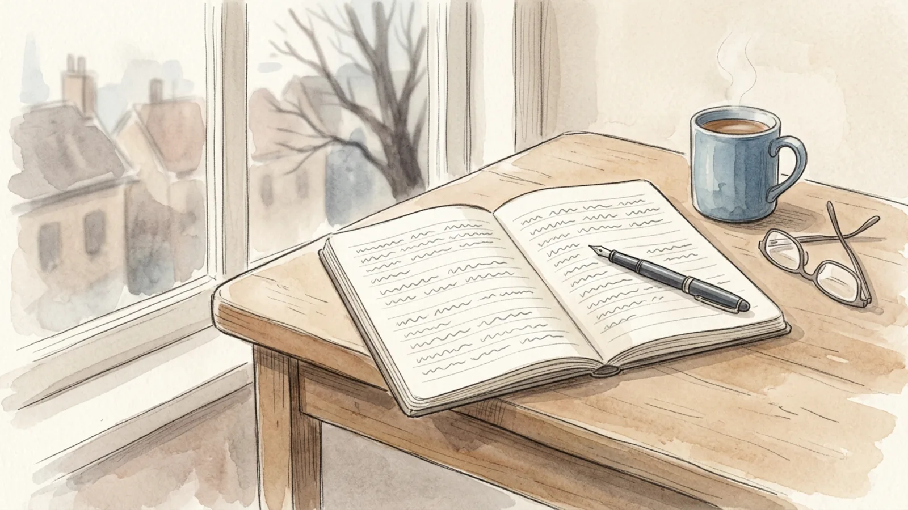

## Part 1 of 3 — Set It Up So You Will Keep It

### Step 1 — Decide what the journal is for

A journal for a course, a journal for work decisions and a journal for sorting out your own head need different things. Name the purpose in one sentence before you buy anything, because that sentence decides the format, the length and how honest you can afford to be. If the entries will ever be assessed or read by somebody else, decide that now rather than later.

**Tip:** Write the purpose on the inside cover. It is the thing you will forget first and need most.

### Step 2 — Choose paper or screen deliberately

Paper is slower, which suits reflection, and it cannot sync itself to a shared family account. A file is searchable, back-uppable and easier to keep private behind a passcode. Neither is better in the abstract. Pick the one that matches where you actually are when the thinking happens, and accept the trade-off that comes with it.

**Tip:** If you choose a file, keep it out of shared folders and photo backups. Journals leak through convenience, not hacking.

### Step 3 — Attach it to something you already do

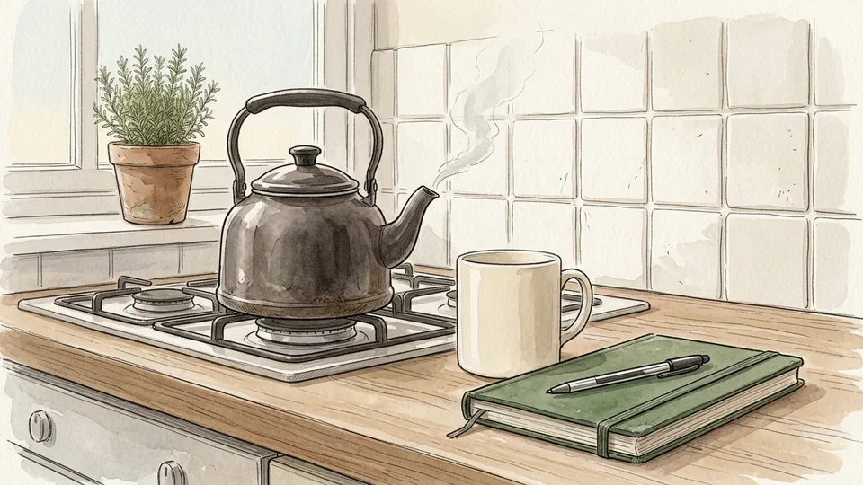

New habits survive when they ride on old ones. Put the journal where the trigger is — beside the kettle, in the bag you take to the train, on the bedside table — and write immediately after a fixed event rather than at a fixed time. After the commute, after the kids are down, after you close the laptop on Friday.

**Tip:** The notebook has to be visible and open-able in one move. A journal inside a drawer inside a bag never gets written in.

### Step 4 — Start with ten minutes, not a vow

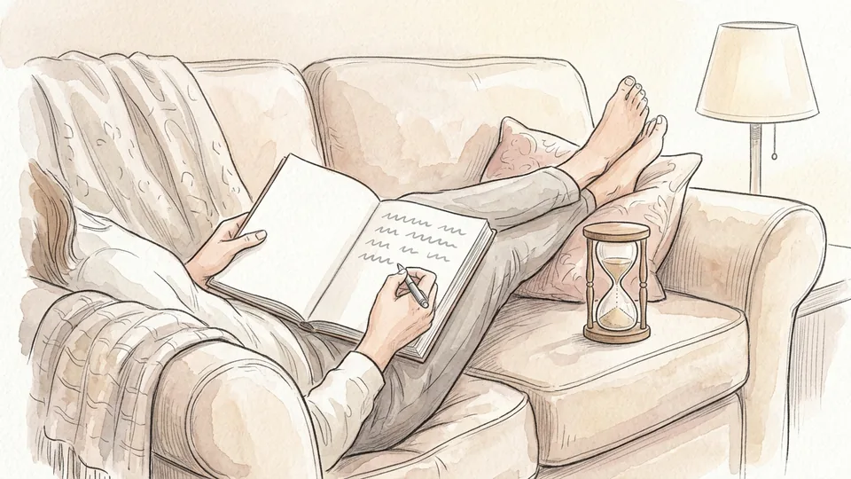

Most abandoned journals were started with a promise of daily entries. Begin with ten minutes, twice a week, on the understanding that a short entry is a real entry. Length is not a measure of insight: four sentences that name a situation and a decision beat two pages of narration you will never reread.

**Tip:** Set a timer and stop when it goes, even mid-thought. Leaving something unfinished makes the next session easier to start.

### Step 5 — Decide the privacy rules first

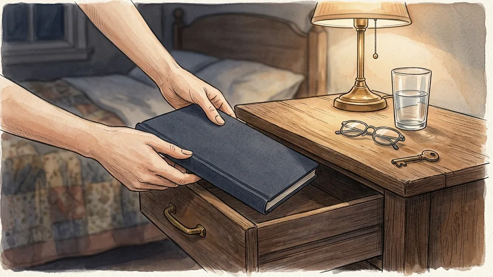

Edinburgh's guidance is blunt about this: private reflection can take any form you like, and you should never share something you are not comfortable sharing. Decide who could read this, what you will do if someone does, and whether certain material — other people's health, a colleague's disclosure — belongs in it at all.

**Tip:** If you need to write about something you would never want read, write it on loose paper and destroy it. Not everything has to be archived.

## Part 2 of 3 — Write Entries That Go Somewhere

### Step 6 — Use what, so what, now what

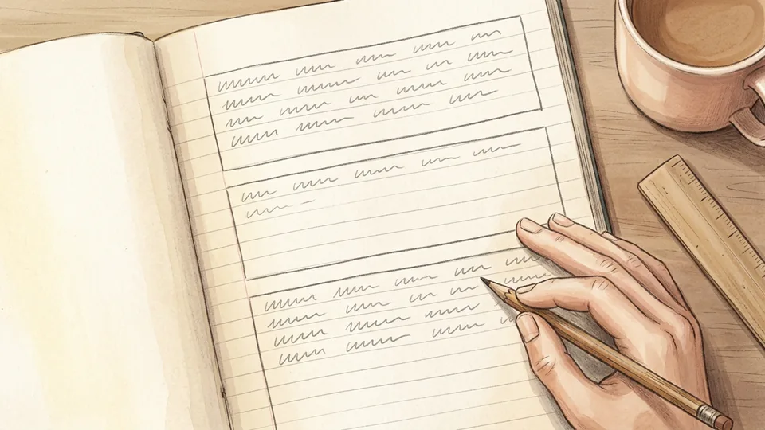

Driscoll's model, built on Borton's three questions, is the easiest structure to remember and hard to beat: what happened, what does it mean, what will I do. Three short paragraphs. It fits any subject, from a tutorial that went badly to a conversation you handled well, and it stops an entry from turning into a complaint.

**Tip:** Write the three headings before you write anything else. The empty middle section is what forces the thinking.

### Step 7 — Get the facts down before the feelings take over

The what section is description: the context, what you were trying to achieve, what you actually did, what others did, how it ended, and the feelings it produced. Keep the account close to what a camera would have recorded, then add how it felt. Mixing the two makes it impossible to tell later whether your reading of the event was fair.

**Tip:** Name the feeling plainly — irritated, relieved, humiliated. Vague words produce vague conclusions.

### Step 8 — Ask so what, and answer it honestly

This is the part people skip. What does the episode tell you about how you work? What were you basing your decision on at the time, and what did you not know? Is there a reading, a theory or a rule of thumb that explains it better than your first interpretation? Bring in an outside idea here; it is the difference between a diary and a reflection.

**Tip:** Write the sentence you would least like to be true, then decide whether it is. That is usually where the learning sits.

### Step 9 — Finish with a concrete now what

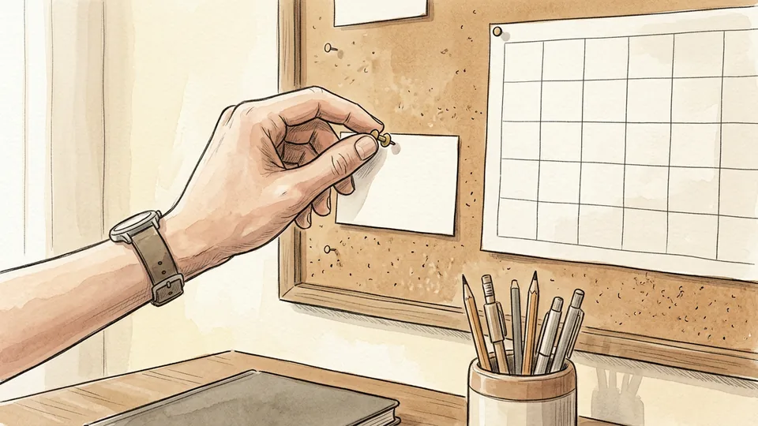

Edinburgh's toolkit warns against action plans that say only I will do better next time. Write what you will do, when, and how you will remind yourself: I will send the draft to Priya by Thursday and set a reminder on Tuesday. A reflection without a specific next action is a well-written shrug.

**Tip:** If the action needs another person, name them and say when you will ask. Plans that depend on an unnamed someone do not happen.

### Step 10 — Change the frame when entries get samey

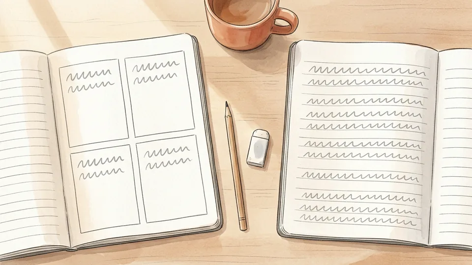

The Reflection Toolkit lists several alternatives: Gibbs' six-stage cycle, the four F's of active reviewing — facts, feelings, findings, future — and CARL, which runs context, action, results, learning. Switching models every few weeks forces different questions and stops your journal becoming a template you fill in without thinking.

**Tip:** Keep one framework for a whole month before judging it. Rotating every entry just produces confusion.

## Part 3 of 3 — Make It Worth Rereading

### Step 11 — Write to yourself, not to an audience

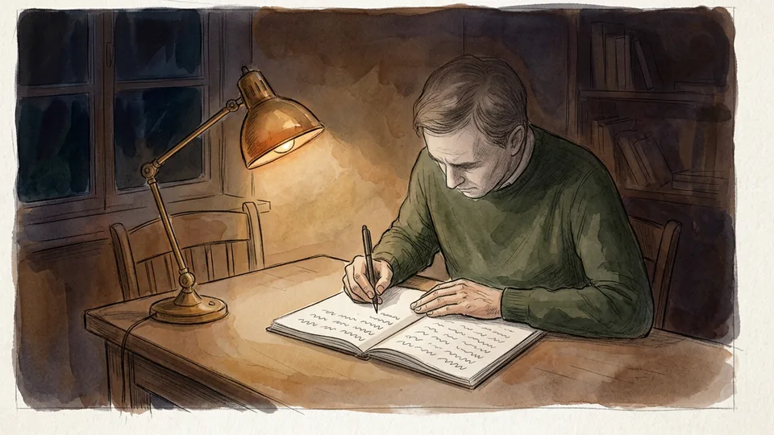

Marcus Aurelius wrote what later editors called the Meditations for nobody but himself; the Greek title means, roughly, to himself. Scholars read it as self-instruction — reminders of principles he wanted ready when circumstances demanded them. Writing for an imagined reader produces performance. Writing to yourself produces the sentence you need to hear.

**Tip:** If you catch yourself explaining background that you already know, you have started writing for an audience. Cut it.

### Step 12 — Keep a page of rules you are testing

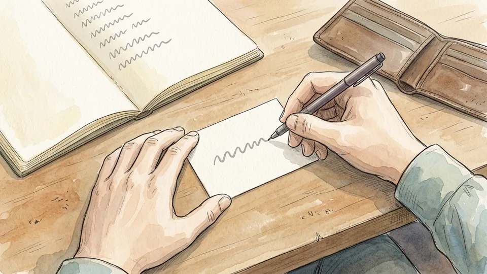

Epictetus told his students to write down the responses they wanted to have, so the words would be ready to hand when they were needed. Keep one page for the short rules you are currently testing — ask before assuming, do not answer an email angry — and revisit them. A principle you cannot state in a line is not yet usable.

**Tip:** Date each rule. Some will look wise in March and ridiculous by June, which is itself worth knowing.

### Step 13 — Date everything and leave hooks for later

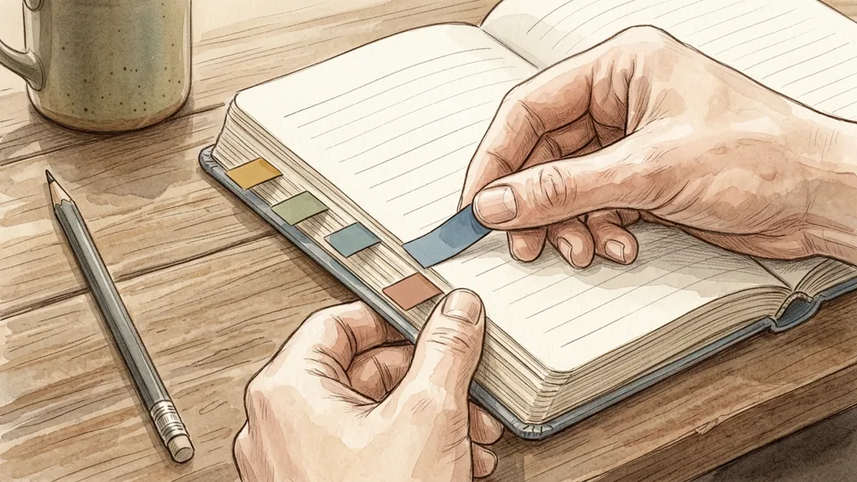

Put the date at the top of every entry and a two-word label in the margin — teaching, money, sleep, Dad. Labels are what make a year of entries searchable by hand. They also reveal volume: if nine entries in a row carry the same label, that subject is asking for a decision rather than more writing.

**Tip:** Coloured tabs on the page edge do the same job in a paper notebook, with no need to index anything.

### Step 14 — Reread at the end of each month

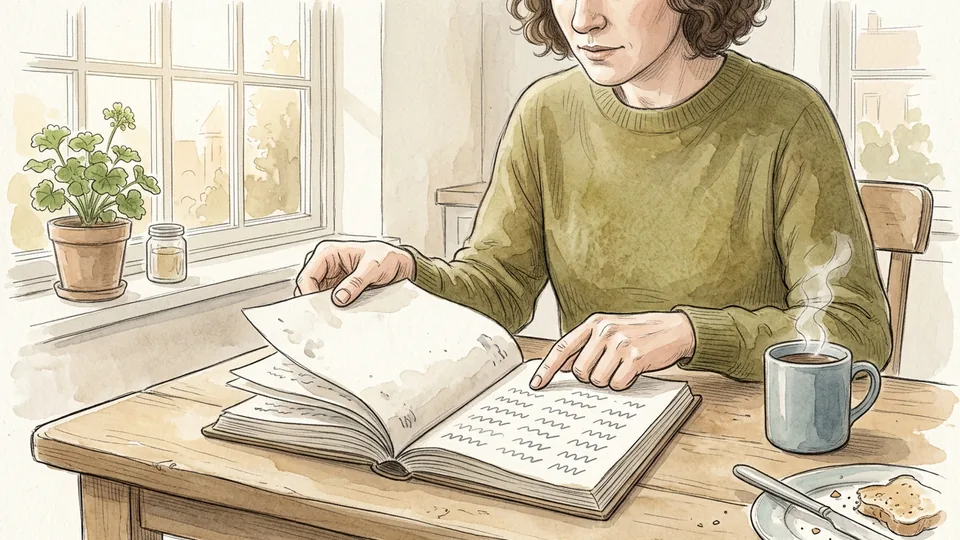

Set aside twenty minutes a month to read the last few entries in order, which is the only way the patterns show up. Look for repeated situations, promises you made and did not keep, and the ones you did. Scholars note that even the Meditations reads as scattered aphorisms until you look for the recurring concerns underneath; your own journal is no different.

**Tip:** Write a short entry about the rereading itself. The monthly summary is usually the most useful page in the book.

### Step 15 — Know the line between reflecting and ruminating

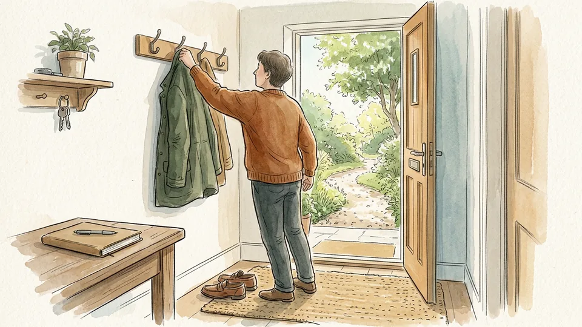

Reflection moves: it ends with an interpretation or an action. Rumination circles the same pain in the same words and leaves you lower than it found you. If an entry has no new sentence in it, close the book and go for a walk. If several weeks of entries do that, talk to someone rather than writing more.

**Tip:** A useful test: could you summarise the entry in one line that was not true before you wrote it? If not, stop for today.

## Tips

- Keep a second, scruffier notebook for first drafts of difficult entries. Knowing a page can be thrown away makes honesty cheaper.
- Write about things that went well, not only the wreckage. Success is harder to analyse and more useful to repeat.
- If a framework's questions do not fit your situation, answer the ones that do and ignore the rest. The model serves the thinking.
- Reflective entries written for a course, placement or portfolio follow the marker's rules first. Keep your private material in a separate book.

## Warnings

- Writing in detail about traumatic events can make distress worse for some people. If that is your material, work with a therapist rather than alone with a notebook, and stop if the writing leaves you worse for hours afterwards.
- A journal is not a secure document. Assume a shared laptop, a cloud backup or a curious family member could expose it, and keep notes about other people's private circumstances out of it.
- If entries persistently circle hopelessness, self-blame or thoughts of harming yourself, that is a reason to contact a general practitioner or a crisis line in your country, not a reason to write more.

## Community Q&A

**What is the difference between a reflective journal and a diary?**

A diary records what happened; a reflective journal interrogates it. The reflective version always carries a second and third movement beyond description — what the episode means, and what you will do differently — which is why structures like Driscoll's what, so what, now what exist. You can keep both in one book if you mark them differently, but do not expect narration alone to produce insight: the thinking happens in the sections most people skip.

**How often should I write in it?**

Often enough to catch patterns, rarely enough that you keep doing it. Twice a week is a realistic starting point for most people, with entries of ten minutes. Frequency matters less than two other things: writing close to the event, while the details are still accurate, and rereading periodically. A journal written daily and never reread does far less for you than one written weekly and reviewed monthly.

**What do I write when nothing much has happened?**

Pick a small, specific episode rather than waiting for a crisis: a decision you made quickly, a moment you felt uneasy, a piece of feedback, something that went better than expected. Reflection works on ordinary material. If the week really is featureless, use the slot to reread old entries and write a short summary of what you notice, which is often more valuable than a fresh entry.

**Does a reflective journal need to follow a model?**

No. The University of Edinburgh's toolkit explicitly offers free-form reflection alongside its structured models, and private reflection can take any form you want, provided you genuinely question yourself. Structures earn their place when you are stuck, when entries have gone shallow, or when the writing will be assessed — in which case follow whatever framework and language the assessor has asked for.

## Useful external resources

- [University of Edinburgh Reflection Toolkit: Reflecting on experience](https://reflection.ed.ac.uk/reflectors-toolkit/reflecting-on-experience) — Six reflective models side by side, including Gibbs' cycle, the four F's, CARL and the 5R framework.
- [University of Edinburgh Reflection Toolkit: What? So what? Now what?](https://reflection.ed.ac.uk/reflectors-toolkit/reflecting-on-experience/what-so-what-now-what) — Driscoll's three-stage model with prompt questions and worked examples for each stage.
- [Stanford Encyclopedia of Philosophy: Marcus Aurelius](https://plato.stanford.edu/entries/marcus-aurelius/) — On the Meditations as private self-instruction, and Epictetus's advice to write down the responses you want ready to hand.

## References

1. University of Edinburgh. Reflection Toolkit: Reflecting on experience, last published 15 October 2024. https://reflection.ed.ac.uk/reflectors-toolkit/reflecting-on-experience
2. University of Edinburgh. Reflection Toolkit: What? So what? Now what? (Driscoll 1994, after Borton 1970; see also Rolfe et al. 2001). https://reflection.ed.ac.uk/reflectors-toolkit/reflecting-on-experience/what-so-what-now-what
3. Stanford Encyclopedia of Philosophy. Marcus Aurelius, first published 29 November 2010, substantive revision 31 March 2025. https://plato.stanford.edu/entries/marcus-aurelius/
4. Stanford Encyclopedia of Philosophy. Stoicism, first published 20 January 2023. https://plato.stanford.edu/entries/stoicism/

## Internal links

- [How to Read a Philosophical Text](https://www.56juqingba.com/Read-a-Philosophical-Text)
- [How to Start a Nature Journal](https://www.56juqingba.com/Start-a-Nature-Journal)
- [How to Study for an Exam Without Cramming](https://www.56juqingba.com/Study-for-an-Exam-Without-Cramming)
- [How to Prepare for a Performance Review](https://www.56juqingba.com/Prepare-for-a-Performance-Review)
